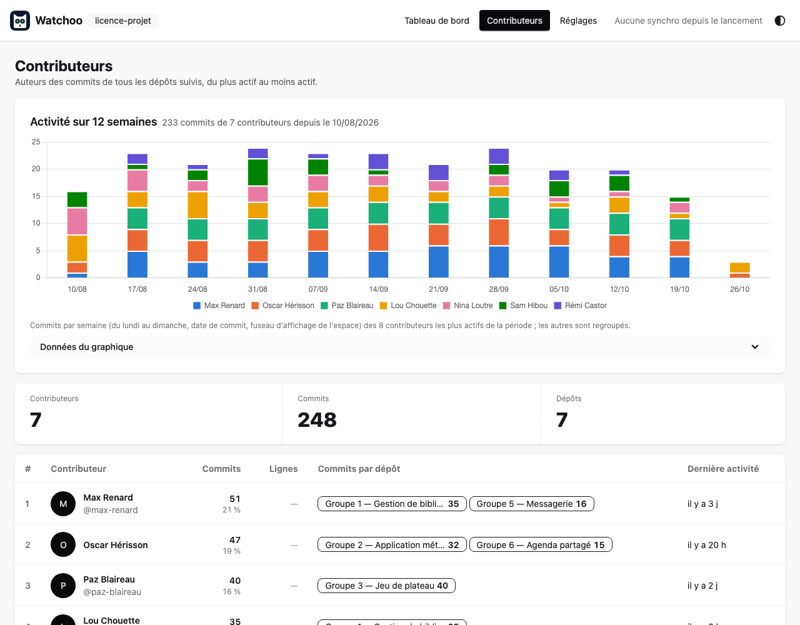

<p align="center">
  <picture>
    <source media="(prefers-color-scheme: dark)" srcset="assets/logo/watchoo-logo-final-nom-dark.svg">
    
  </picture>
</p>

## **Qui a travaillé, sur quoi, et quand ?**
Watchoo surveille une liste de dépôts GitHub et vous montre
d'un coup d'œil leur activité : les nouveaux commits, les contributeurs, et les dépôts qui ne bougent plus.

> **Statut : v0.6.2, MVP terminé et V2 publiée, plus la page par contributeur et la mise à jour en une commande (`watchoo update`).** Les phases 1 à 5 de la
> [roadmap](documentation/fr/07-roadmap.md) sont en place : ligne de commande, mode interactif
> (`watchoo tui`), interface web locale (`watchoo serve`), sortie `--json`, binaires et image Docker. La
> V2 (phase 6) ajoute les seuils par dépôt, l'activité par contributeur dans un dépôt, les pull requests,
> releases et tags, et le suivi par clones Git locaux sans `gh`. Watchoo est en `0.y.z` : l'interface peut encore changer d'une
> version à l'autre (voir le [journal des modifications](CHANGELOG.md)).

<p align="center">
  
  <br><sub>Tableau des activités ...</sub>
</p>

## Pour qui ?

- **Enseignants** qui suivent les projets de leurs étudiants : qui avance, qui décroche.
- **Développeurs et responsables techniques** qui suivent plusieurs dépôts à la fois.

Watchoo fonctionne avec les dépôts **privés**, et toutes les données restent sur votre machine.

## Ce que fait Watchoo

- 📥 Récupère les nouveaux commits de chaque dépôt, sur toutes ses branches, sans jamais re-télécharger
  ce qu'il a déjà.
- 👥 Montre qui contribue, et combien, avec des graphiques d'activité, pour tout l'espace ou dans un
  dépôt.
- 🚦 Donne un état à chaque dépôt : **Actif**, **Flemme** (plus de 5 jours sans commit), **Dead** (plus
  de 15 jours) ; seuils réglables pour l'espace ou pour chaque dépôt.
- 🔀 Suit les pull requests (ouvertes, mergées), les releases et les tags.
- 🌿 Fonctionne avec `gh` (API GitHub) ou, sans `gh`, avec des clones Git locaux qui ne consomment aucun
  quota.
- 🔄 Se met à jour automatiquement, ou à la demande.
- 🔒 Lecture seule : Watchoo ne modifie jamais rien sur GitHub.

Trois façons de l'utiliser, avec un seul programme :

| Mode | Commande | Pour |
| --- | --- | --- |
| Ligne de commande | `watchoo log`, `watchoo repo list`… (`--json` pour les scripts) | Des réponses rapides, des scripts |
| Interactif dans le terminal | `watchoo tui` | Naviguer au clavier |
| Interface web locale | `watchoo serve` | Un tableau de bord dans le navigateur |

## Prérequis

Au choix (la source est choisie à chaque synchro, sans réglage) :

- **Recommandé** : la [CLI GitHub `gh`](https://cli.github.com/), installée et connectée (`gh auth login`),
  avec un compte qui a accès aux dépôts à suivre. Watchoo passe par l'API GitHub ; il demande le token à
  `gh` (`gh auth token`) et ne le stocke jamais. **[Git](https://git-scm.com/) est aussi recommandé avec
  `gh`** : chaque dépôt suivi est cloné dans `repos/` (voir ci-dessous) pour compter les lignes
  ajoutées et supprimées de tous les commits, sans quota. Le clone utilise vos identifiants Git (clé
  SSH par défaut ; en HTTPS, `git.protocol: https`, et `gh auth setup-git` pour que `git` réutilise le
  compte de `gh`), jamais le token. Sans clone possible, la synchro continue par l'API seule et les
  lignes ne sont connues que pour 100 nouveaux commits par dépôt et par synchro (avertissement dans le
  bilan).
- **Sans `gh`** (pas encore publié) : [Git](https://git-scm.com/), avec une clé SSH (ou des identifiants
  Git en HTTPS, `git.protocol: https`) qui a accès aux dépôts. Watchoo les suit par clones locaux dans
  `repos/<name>`, à la racine de l'espace (homonymes : `repos/<owner>-<name>`), sans quota, mais sans
  pull requests, releases ni étoiles. Avec ou sans `gh`, `repos/` occupe à peu près la taille des
  dépôts suivis, et la première synchro d'un dépôt le clone en entier. `github.com` doit être connu de SSH (`ssh -T git@github.com` une
  fois) : Watchoo ne laisse `git` rien demander. Ces clones ont une copie de travail, pour lire le code
  des étudiants, mais **ils appartiennent à Watchoo** : à chaque synchro, la copie de travail est remise
  sur la branche par défaut et toute modification locale d'un fichier suivi est **écrasée** (les
  fichiers non suivis sont gardés). Travaillez dans votre propre clone. Si l'espace est dans un dépôt
  Git, ajoutez `repos/` à son `.gitignore`.

## Installation

### En une commande (Linux, macOS)

```bash
curl -fsSL https://raw.githubusercontent.com/studoo-app/watchoo/main/install.sh | sh
```

Le [script](install.sh) télécharge la dernière release pour votre système, vérifie sa somme SHA-256,
puis installe `watchoo` dans `~/.local/bin`, sans sudo. Il ne touche ni à votre PATH ni à `gh`, et vous
prévient si l'un des deux manque. Deux réglages, à placer devant `sh` : `WATCHOO_VERSION=v0.6.2`
pour une version précise, `WATCHOO_INSTALL_DIR=…` pour un autre répertoire. Vous pouvez lire le
script avant de le lancer : `curl -fsSL …/install.sh -o install.sh`.

### Binaires de release

Sous Windows, ou pour tout faire à la main : les [releases GitHub](https://github.com/studoo-app/watchoo/releases) proposent Watchoo pour Linux, macOS
et Windows, en amd64 et arm64 : `watchoo_<version>_<os>_<arch>.tar.gz` (`.zip` pour Windows), avec le
fichier de sommes SHA-256 `watchoo_<version>_checksums.txt`.

```bash
# exemple : Linux amd64
curl -fsSLO https://github.com/studoo-app/watchoo/releases/download/v0.6.2/watchoo_0.6.2_linux_amd64.tar.gz
curl -fsSLO https://github.com/studoo-app/watchoo/releases/download/v0.6.2/watchoo_0.6.2_checksums.txt
sha256sum --check --ignore-missing watchoo_0.6.2_checksums.txt
tar -xzf watchoo_0.6.2_linux_amd64.tar.gz watchoo
sudo install -m 0755 watchoo /usr/local/bin/watchoo
watchoo version
```

Sur macOS, `shasum -a 256 --check --ignore-missing` remplace `sha256sum`. Les binaires ne sont pas
encore signés.

### Docker

L'image `ghcr.io/studoo-app/watchoo` (linux/amd64 et linux/arm64) contient Watchoo et `gh` (et `git`
pour le suivi sans `gh`, à partir de la prochaine version), tourne en
utilisateur non root et lance l'interface web sur le port 8080. L'espace de supervision est le volume
`/data`. Le token GitHub n'est **jamais dans l'image** : il est donné à l'exécution par `GH_TOKEN`. Comme
l'interface écoute hors de la boucle locale du conteneur, un mot de passe est **obligatoire**.

```bash
export GH_TOKEN=…               # token GitHub, de préférence fine-grained en lecture seule
export WATCHOO_WEB_PASSWORD=…   # mot de passe de l'interface web
docker volume create watchoo-data
docker run --rm -e GH_TOKEN -v watchoo-data:/data ghcr.io/studoo-app/watchoo:0.6.2 init
docker run --rm -e GH_TOKEN -v watchoo-data:/data ghcr.io/studoo-app/watchoo:0.6.2 repo add owner/repo
docker run -d --name watchoo --restart unless-stopped \
  -e GH_TOKEN -e WATCHOO_WEB_PASSWORD -e WATCHOO_WEB_AUTH_USERNAME=prof \
  -e WATCHOO_TIMEZONE=Europe/Paris \
  -v watchoo-data:/data -p 127.0.0.1:8080:8080 \
  --read-only --tmpfs /tmp --tmpfs /home/nonroot:uid=65532,gid=65532,mode=0700 \
  --cap-drop ALL --security-opt no-new-privileges:true \
  ghcr.io/studoo-app/watchoo:0.6.2
```

Puis ouvrez <http://127.0.0.1:8080/> (utilisateur `prof`). Le fichier
[`docker-compose.yml`](docker-compose.yml) en donne l'équivalent pour `docker compose`. Le volume contient
des données personnelles (noms, e-mails et messages de commit de dépôts privés) : **ne le partagez pas**.
Détails : [Distribution](documentation/fr/03-architecture.md#distribution).

### Depuis les sources

Avec Go (version indiquée dans `go.mod`) :

```bash
go install github.com/studoo-app/watchoo/cmd/watchoo@v0.6.2
```

Ou dans un clone du dépôt :

```bash
make build    # produit bin/watchoo, à copier dans un répertoire du PATH
make check    # gofmt, go vet, tests, code sqlc et CSS à jour, compilation
make docker   # image Docker locale watchoo:dev
```

### Mise à jour

Mettre à jour Watchoo, c'est remplacer le binaire : vos espaces de supervision restent tels quels, et la
base est mise à niveau toute seule (migrations) à la première commande lancée avec la nouvelle version.
Lisez d'abord le [journal des modifications](CHANGELOG.md) : en `0.y.z`, une version mineure peut changer
l'interface.

- **`watchoo update`** (le plus simple pour une installation par le script ou par un binaire de
  release) : la commande affiche la version installée et la dernière, demande confirmation, télécharge
  l'archive de la release, vérifie sa somme SHA-256 et remplace le binaire d'un bloc ;
  `watchoo update --check` vérifie seulement. Si le répertoire du binaire n'est pas accessible en écriture
  (installation dans `/usr/local/bin`, par exemple), relancez avec les droits nécessaires ou utilisez le
  script d'installation ci-dessous. Chaque commande signale d'ailleurs, sur la sortie d'erreur, qu'une
  nouvelle version est disponible ; posez `WATCHOO_NO_UPDATE_CHECK=1` pour couper cette vérification.
- **Script d'installation** : relancez la même commande (avec le même `WATCHOO_INSTALL_DIR` si vous en
  aviez choisi un). Le binaire est remplacé d'un bloc ; un `watchoo serve` déjà lancé garde l'ancienne
  version jusqu'à son redémarrage.
- **Binaires de release** : téléchargez et vérifiez la nouvelle archive comme ci-dessus, puis remplacez
  le binaire.
- **Docker** (`watchoo update` y est refusé, et la vérification des nouvelles versions coupée) : changez le tag de l'image (`ghcr.io/studoo-app/watchoo:<version>`), puis recréez le
  conteneur (`docker rm -f watchoo` puis le même `docker run -d …`) ; avec compose, changez le tag dans
  `docker-compose.yml` puis `docker compose pull && docker compose up -d`. Le volume est conservé.
- **Depuis les sources** : `go install github.com/studoo-app/watchoo/cmd/watchoo@latest`, ou
  `git pull && make build` dans le clone (`watchoo update` refuse de remplacer une version de
  développement).

Vérifiez ensuite avec `watchoo version`. Les migrations ne vont que dans un sens : une base mise à
niveau peut ne plus s'ouvrir avec une version plus ancienne. Pour pouvoir revenir en arrière, copiez
`.watchoo/watchoo.db` (ou le volume Docker) avant la mise à jour.

## Démarrage rapide : suivre une promotion d'étudiants

```bash
mkdir licence-projet && cd licence-projet
watchoo init                              # crée l'espace de supervision (.watchoo/) ; sans gh : clones Git
watchoo repo add alice/projet-licence --label "Alice Martin"
watchoo repo import promo-licence.csv     # ou tous les dépôts d'un coup
watchoo sync                              # récupère les commits
watchoo repo list                         # qui est Actif, en Flemme ou Dead
watchoo log --since 7d                    # les commits de la semaine
watchoo contributors                      # qui contribue, et combien
watchoo prs --state open                  # les pull requests ouvertes
watchoo releases                          # releases et tags
watchoo tui                               # naviguer au clavier
watchoo serve                             # tableau de bord sur http://127.0.0.1:8080/
```

Le fichier d'import est un CSV (seule la colonne `repo` est obligatoire) ou une simple liste, un dépôt
par ligne :

```csv
repo,label,branches
alice/projet-licence,Alice Martin,
bob/projet-licence,Bob Durand,"main,dev"
mon-org/projet-groupe-3,Groupe 3,
```

```
DÉPÔT                 DERNIER COMMIT     AUTEUR      ÉTAT
Alice Martin          il y a 2 h         alice       -
Bob Durand            il y a 9 j         bob         ~ 9 j
Groupe 3              il y a 42 j        dan         ⚠ 42 j
```

Chaque répertoire initialisé avec `watchoo init` est un groupe indépendant : une promotion, un module, vos
projets perso… Les données ne se mélangent jamais. Toutes les commandes qui produisent des données
acceptent `--json` ([schéma](documentation/fr/05-cli.md#sortie-json)).

Vous supervisez à plusieurs ? `watchoo config export -o licence.json` écrit les dépôts suivis et les
réglages communs dans un fichier JSON (sans commit, e-mail ni token) ; chez la collègue, `watchoo config
import licence.json` montre un aperçu puis fusionne, sans rien retirer. Même chose sur la page Réglages
de `watchoo serve` ([détail](documentation/fr/05-cli.md#partage-de-la-configuration--watchoo-config)).

## Configuration

Chaque espace a son fichier `.watchoo/config.yaml`, commenté (modèle :
[`config.example.yaml`](config.example.yaml)). Ordre de priorité, du plus faible au plus fort : valeurs
par défaut, réglages de l'utilisateur (`~/.config/watchoo/config.yaml`), fichier de l'espace, variables
d'environnement `WATCHOO_<SECTION>_<CLÉ>` (ex. `WATCHOO_SYNC_INTERVAL=1h`), puis options de la ligne de
commande.

| Réglage | Par défaut | Rôle |
| --- | --- | --- |
| `sync.interval` | `30m` | Synchro automatique de `serve` et `tui` (15 min minimum, `0` : manuelle) |
| `activity.flemme_after_days` / `dead_after_days` | `5` / `15` | Seuils d'activité de l'espace (par dépôt : `repo add --flemme / --dead`, colonnes de l'import, page du dépôt) |
| `branches.exclude` | `[]` | Branches ignorées (ex. `dependabot/*`) |
| `timezone` | fuseau du système | Fuseau d'affichage et de regroupement par jour ou semaine |
| `web.addr` | `127.0.0.1:8080` | Adresse de l'interface web |
| `web.auth.username` | vide | Authentification basique (mot de passe dans `WATCHOO_WEB_PASSWORD`) |
| `github.user` | compte actif de `gh` | Compte `gh` à utiliser (vide avec `GH_TOKEN`) |
| `github.gh_path` | `gh` | Nom cherché dans le `PATH` ou chemin absolu de `gh` (pas de chemin relatif) |
| `git.protocol` | `ssh` | Sans `gh` : clones en SSH (`git@github.com:…`) ou en `https` (gestionnaire d'identifiants de Git) |

`watchoo -C <répertoire>` ou la variable `WATCHOO_DIR` choisissent l'espace sans s'y placer
([Espaces de supervision](documentation/fr/10-espaces-de-supervision.md)). Sous Linux et macOS, Watchoo
refuse un `.watchoo/` qui n'est pas à vous ou qui dépasse les droits `0700` (`config.yaml` : `0600`) :
un `.watchoo/` commité dans le dépôt d'un étudiant que vous avez cloné n'est jamais utilisé.

## Sécurité et vie privée

- **Token** : obtenu uniquement par `gh auth token` (ou `GH_TOKEN` lu par `gh`), jamais stocké, jamais
  affiché dans les journaux, les erreurs ni les sorties. Sans `gh`, Watchoo ne lit ni ne stocke aucun
  identifiant : `git` utilise votre clé SSH ou votre gestionnaire d'identifiants, sans invite.
- **Lecture seule** : Watchoo refuse tout appel GitHub qui modifierait quelque chose, avant même de
  l'envoyer ; côté `git`, il ne lance que `git fetch`, des lectures et la remise à jour de ses propres
  clones, jamais `push`.
- **Données locales** : tout reste dans `.watchoo/` (droits `0700`, fichiers `0600`), une base par espace.
  Elles viennent souvent de dépôts privés et contiennent des données personnelles d'étudiants : ne
  commitez pas `.watchoo/` (un `.gitignore` est créé), ne partagez pas la base ni le volume Docker. Ni
  message de commit ni e-mail dans les journaux.
- **Interface web** : écoute sur `127.0.0.1` par défaut ; sur toute autre adresse, `serve` refuse de
  démarrer sans authentification (basique ou reverse proxy de confiance). Protection CSRF, contrôle de
  l'en-tête `Host`, CSP stricte.

Détails : [Architecture](documentation/fr/03-architecture.md) et
[Interface web](documentation/fr/06-interface-web.md#sécurité).

## En savoir plus

- [Documentation complète](documentation/fr/README.md) : vision, fonctionnalités, architecture, roadmap.
- [Journal des modifications](CHANGELOG.md).
- [AGENTS.md](AGENTS.md) : consignes pour les agents de code qui travaillent sur le projet.

Watchoo est écrit en Go : un seul binaire, sans dépendance à installer (hormis `gh`, ou `git`).

## Licence

Watchoo est distribué sous la [licence Apache 2.0](LICENSE). Le nom « Watchoo » et le logo du hibou n'en
font pas partie : une version modifiée et redistribuée doit porter un autre nom (voir [NOTICE](NOTICE)).
