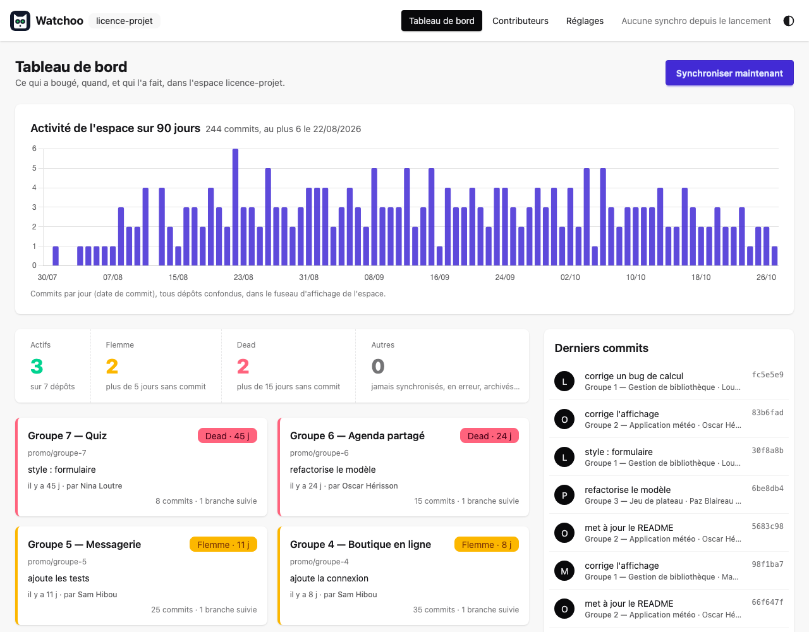

<p align="center">
  
</p>

## **Qui a travaillé, sur quoi, et quand ?**
Watchoo surveille une liste de dépôts GitHub et vous montre
d'un coup d'œil leur activité : les nouveaux commits, les contributeurs, et les dépôts qui ne bougent plus.

> **Statut : MVP v0.1.0.** Les phases 1 à 5 de la [roadmap](documentation/07-roadmap.md) sont en place :
> ligne de commande, mode interactif (`watchoo tui`), interface web locale (`watchoo serve`), sortie
> `--json`, binaires et image Docker. Watchoo est en `0.y.z` : l'interface peut encore changer d'une
> version à l'autre (voir le [journal des modifications](CHANGELOG.md)).

<p align="center">
  
  <br><sub>Tableau de bord, avec des données factices.</sub>
</p>

## Pour qui ?

- **Enseignants** qui suivent les projets de leurs étudiants : qui avance, qui décroche.
- **Développeurs et responsables techniques** qui suivent plusieurs dépôts à la fois.

Watchoo fonctionne avec les dépôts **privés**, et toutes les données restent sur votre machine.

## Ce que fait Watchoo

- 📥 Récupère les nouveaux commits de chaque dépôt, sur toutes ses branches, sans jamais re-télécharger
  ce qu'il a déjà.
- 👥 Montre qui contribue, et combien, avec des graphiques d'activité.
- 🚦 Donne un état à chaque dépôt : **Actif**, **Flemme** (plus de 5 jours sans commit), **Dead** (plus
  de 15 jours) ; seuils réglables.
- 🔄 Se met à jour automatiquement, ou à la demande.
- 🔒 Lecture seule : Watchoo ne modifie jamais rien sur GitHub.

Trois façons de l'utiliser, avec un seul programme :

| Mode | Commande | Pour |
| --- | --- | --- |
| Ligne de commande | `watchoo log`, `watchoo repo list`… (`--json` pour les scripts) | Des réponses rapides, des scripts |
| Interactif dans le terminal | `watchoo tui` | Naviguer au clavier |
| Interface web locale | `watchoo serve` | Un tableau de bord dans le navigateur |

## Prérequis

- La [CLI GitHub `gh`](https://cli.github.com/), installée et connectée (`gh auth login`), avec un compte
  qui a accès aux dépôts à suivre. Watchoo lui demande le token (`gh auth token`) et ne le stocke jamais.

## Installation

### Binaires de release

Les [releases GitHub](https://github.com/studoo-app/watchoo/releases) proposent Watchoo pour Linux, macOS
et Windows, en amd64 et arm64 : `watchoo_<version>_<os>_<arch>.tar.gz` (`.zip` pour Windows), avec le
fichier de sommes SHA-256 `watchoo_<version>_checksums.txt`.

```bash
# exemple : Linux amd64
curl -fsSLO https://github.com/studoo-app/watchoo/releases/download/v0.1.0/watchoo_0.1.0_linux_amd64.tar.gz
curl -fsSLO https://github.com/studoo-app/watchoo/releases/download/v0.1.0/watchoo_0.1.0_checksums.txt
sha256sum --check --ignore-missing watchoo_0.1.0_checksums.txt
tar -xzf watchoo_0.1.0_linux_amd64.tar.gz watchoo
sudo install -m 0755 watchoo /usr/local/bin/watchoo
watchoo version
```

Sur macOS, `shasum -a 256 --check --ignore-missing` remplace `sha256sum`. Les binaires ne sont pas
encore signés.

### Docker

L'image `ghcr.io/studoo-app/watchoo` (linux/amd64 et linux/arm64) contient Watchoo et `gh`, tourne en
utilisateur non root et lance l'interface web sur le port 8080. L'espace de supervision est le volume
`/data`. Le token GitHub n'est **jamais dans l'image** : il est donné à l'exécution par `GH_TOKEN`. Comme
l'interface écoute hors de la boucle locale du conteneur, un mot de passe est **obligatoire**.

```bash
export GH_TOKEN=…               # token GitHub, de préférence fine-grained en lecture seule
export WATCHOO_WEB_PASSWORD=…   # mot de passe de l'interface web
docker volume create watchoo-data
docker run --rm -e GH_TOKEN -v watchoo-data:/data ghcr.io/studoo-app/watchoo:0.1.0 init
docker run --rm -e GH_TOKEN -v watchoo-data:/data ghcr.io/studoo-app/watchoo:0.1.0 repo add owner/repo
docker run -d --name watchoo --restart unless-stopped \
  -e GH_TOKEN -e WATCHOO_WEB_PASSWORD -e WATCHOO_WEB_AUTH_USERNAME=prof \
  -e WATCHOO_TIMEZONE=Europe/Paris \
  -v watchoo-data:/data -p 127.0.0.1:8080:8080 \
  --read-only --tmpfs /tmp --tmpfs /home/nonroot:uid=65532,gid=65532,mode=0700 \
  --cap-drop ALL --security-opt no-new-privileges:true \
  ghcr.io/studoo-app/watchoo:0.1.0
```

Puis ouvrez <http://127.0.0.1:8080/> (utilisateur `prof`). Le fichier
[`docker-compose.yml`](docker-compose.yml) en donne l'équivalent pour `docker compose`. Le volume contient
des données personnelles (noms, e-mails et messages de commit de dépôts privés) : **ne le partagez pas**.
Détails : [Distribution](documentation/03-architecture.md#distribution).

### Depuis les sources

Avec Go (version indiquée dans `go.mod`) :

```bash
go install github.com/studoo-app/watchoo/cmd/watchoo@v0.1.0
```

Ou dans un clone du dépôt :

```bash
make build    # produit bin/watchoo, à copier dans un répertoire du PATH
make check    # gofmt, go vet, tests, code sqlc et CSS à jour, compilation
make docker   # image Docker locale watchoo:dev
```

## Démarrage rapide : suivre une promotion d'étudiants

```bash
mkdir licence-projet && cd licence-projet
watchoo init                              # crée l'espace de supervision (.watchoo/)
watchoo repo add alice/projet-licence --label "Alice Martin"
watchoo repo import promo-licence.csv     # ou tous les dépôts d'un coup
watchoo sync                              # récupère les commits
watchoo repo list                         # qui est Actif, en Flemme ou Dead
watchoo log --since 7d                    # les commits de la semaine
watchoo contributors                      # qui contribue, et combien
watchoo tui                               # naviguer au clavier
watchoo serve                             # tableau de bord sur http://127.0.0.1:8080/
```

Le fichier d'import est un CSV (seule la colonne `repo` est obligatoire) ou une simple liste, un dépôt
par ligne :

```csv
repo,label,branches
alice/projet-licence,Alice Martin,
bob/projet-licence,Bob Durand,"main,dev"
mon-org/projet-groupe-3,Groupe 3,
```

```
DÉPÔT                 DERNIER COMMIT     AUTEUR      ÉTAT
Alice Martin          il y a 2 h         alice       -
Bob Durand            il y a 9 j         bob         ~ 9 j
Groupe 3              il y a 42 j        dan         ⚠ 42 j
```

Chaque répertoire initialisé avec `watchoo init` est un groupe indépendant : une promotion, un module, vos
projets perso… Les données ne se mélangent jamais. Toutes les commandes qui produisent des données
acceptent `--json` ([schéma](documentation/05-cli.md#sortie-json)).

## Configuration

Chaque espace a son fichier `.watchoo/config.yaml`, commenté (modèle :
[`config.example.yaml`](config.example.yaml)). Ordre de priorité, du plus faible au plus fort : valeurs
par défaut, réglages de l'utilisateur (`~/.config/watchoo/config.yaml`), fichier de l'espace, variables
d'environnement `WATCHOO_<SECTION>_<CLÉ>` (ex. `WATCHOO_SYNC_INTERVAL=1h`), puis options de la ligne de
commande.

| Réglage | Par défaut | Rôle |
| --- | --- | --- |
| `sync.interval` | `30m` | Synchro automatique de `serve` et `tui` (15 min minimum, `0` : manuelle) |
| `activity.flemme_after_days` / `dead_after_days` | `5` / `15` | Seuils d'activité de l'espace (par dépôt : prévu en V2) |
| `branches.exclude` | `[]` | Branches ignorées (ex. `dependabot/*`) |
| `timezone` | fuseau du système | Fuseau d'affichage et de regroupement par jour ou semaine |
| `web.addr` | `127.0.0.1:8080` | Adresse de l'interface web |
| `web.auth.username` | vide | Authentification basique (mot de passe dans `WATCHOO_WEB_PASSWORD`) |
| `github.user` | compte actif de `gh` | Compte `gh` à utiliser (vide avec `GH_TOKEN`) |
| `github.gh_path` | `gh` | Nom cherché dans le `PATH` ou chemin absolu de `gh` (pas de chemin relatif) |

`watchoo -C <répertoire>` ou la variable `WATCHOO_DIR` choisissent l'espace sans s'y placer
([Espaces de supervision](documentation/10-espaces-de-supervision.md)). Sous Linux et macOS, Watchoo
refuse un `.watchoo/` qui n'est pas à vous ou qui dépasse les droits `0700` (`config.yaml` : `0600`) :
un `.watchoo/` commité dans le dépôt d'un étudiant que vous avez cloné n'est jamais utilisé.

## Sécurité et vie privée

- **Token** : obtenu uniquement par `gh auth token` (ou `GH_TOKEN` lu par `gh`), jamais stocké, jamais
  affiché dans les journaux, les erreurs ni les sorties.
- **Lecture seule** : Watchoo refuse tout appel GitHub qui modifierait quelque chose, avant même de
  l'envoyer.
- **Données locales** : tout reste dans `.watchoo/` (droits `0700`, fichiers `0600`), une base par espace.
  Elles viennent souvent de dépôts privés et contiennent des données personnelles d'étudiants : ne
  commitez pas `.watchoo/` (un `.gitignore` est créé), ne partagez pas la base ni le volume Docker. Ni
  message de commit ni e-mail dans les journaux.
- **Interface web** : écoute sur `127.0.0.1` par défaut ; sur toute autre adresse, `serve` refuse de
  démarrer sans authentification (basique ou reverse proxy de confiance). Protection CSRF, contrôle de
  l'en-tête `Host`, CSP stricte.

Détails : [Architecture](documentation/03-architecture.md) et
[Interface web](documentation/06-interface-web.md#sécurité).

## En savoir plus

- [Documentation complète](documentation/README.md) : vision, fonctionnalités, architecture, roadmap.
- [Journal des modifications](CHANGELOG.md).
- [AGENTS.md](AGENTS.md) : consignes pour les agents de code qui travaillent sur le projet.

Watchoo est écrit en Go : un seul binaire, sans dépendance à installer (hormis `gh`).

## Licence

Watchoo est distribué sous la [licence Apache 2.0](LICENSE). Le nom « Watchoo » et le logo du hibou n'en
font pas partie : une version modifiée et redistribuée doit porter un autre nom (voir [NOTICE](NOTICE)).
