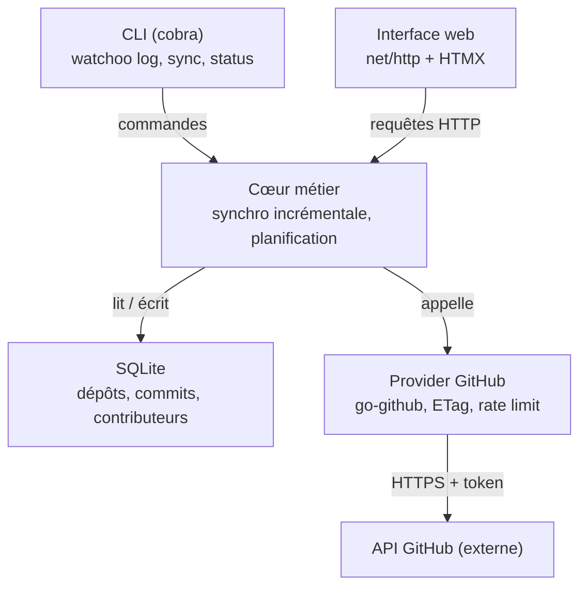

# 3. Architecture technique

[← Sommaire](README.md)

Un seul binaire, une seule base SQLite : la CLI et l'interface web partagent le même cœur métier, ce qui
évite toute duplication de logique.

## Vue d'ensemble



### Responsabilités des couches

| Couche | Rôle | Ne doit pas |
| --- | --- | --- |
| CLI | Parser les commandes, formater la sortie (tableau ou JSON) | Contenir de logique métier |
| TUI | Mode interactif au clavier (Bubble Tea) | Contenir de logique métier |
| Web | Servir pages et fragments HTMX | Contenir de logique métier |
| Cœur métier (`sync`) | Orchestrer la synchro, planifier, appliquer les règles | Connaître les détails HTTP de GitHub |
| Provider | Parler à une forge (GitHub, plus tard GitLab…) | Accéder directement à la base |
| Store | Persister et requêter SQLite, migrations | Appeler une forge |

## Stack retenue

| Brique | Choix proposé | Pourquoi |
| --- | --- | --- |
| Langage | Go, dernière version stable (fixée dans `go.mod`) | Binaire statique, cross-compilation simple, concurrence native |
| CLI | `spf13/cobra` + `spf13/viper` | Standard de fait, sous-commandes, config YAML / variables d'env |
| API GitHub | `google/go-github` (dernière version majeure), sans `golang.org/x/oauth2` | Client complet et typé ; le token est posé dans l'en-tête `Authorization` par le transport HTTP interne du provider, qui assure aussi la lecture seule, le cache ETag et le suivi du quota |
| Stockage | SQLite via `modernc.org/sqlite` (sans CGO) | Fichier unique, zéro installation, cross-compile facile |
| Accès BDD | `sqlc` (code généré sur `database/sql`) + migrations `pressly/goose` | Requêtes vérifiées contre le schéma, code Go typé généré, schéma versionné |
| Serveur web | `net/http` + routeur `go-chi/chi` | Léger, 100 % compatible `net/http`, groupes de routes et middlewares prêts à l'emploi |
| Front | `html/template` + HTMX + [DaisyUI](https://daisyui.com/) (sur Tailwind CSS) | Composants prêts à l'emploi (cartes, badges, tableaux, thèmes clair / sombre), pas de framework JS, assets embarqués avec `embed` |
| Graphiques | Chart.js, embarqué | Courbes d'activité simples, fonctionne hors ligne |
| Affichage terminal | `charmbracelet/bubbletea` + `bubbles` (TUI) + `lipgloss` | Mode interactif navigable au clavier ; sortie texte statique (`lipgloss/table`) pour les pipes et les scripts |
| Planification | `time.Ticker` + `errgroup` | Synchro périodique, parallélisme borné |
| Authentification | CLI GitHub `gh` (prérequis) | Token obtenu avec `gh auth token`, jamais stocké par Watchoo ; un seul token pour tous les propriétaires |
| Logs | `log/slog` | Logs structurés de la bibliothèque standard, sur la sortie d'erreur ; niveau `warn` par défaut, réglable par `WATCHOO_LOG_LEVEL` (`debug`, `info`, `warn`, `error`) ou `--verbose` (`debug`). Seulement des identifiants de dépôt, des SHA courts et des compteurs : jamais de token, de message de commit, de nom ni d'e-mail |

### Décisions techniques

Tous les choix de stack sont tranchés ; leur détail figure dans les « Points d'attention » ci-dessous.
L'interface `Provider` est fixée depuis la phase 2 (voir [Interface `Provider`](#interface-provider)).

## Organisation du code (cible)

```
watchoo/
  cmd/watchoo/         main.go — point d'entrée
  internal/cli/        commandes cobra
  internal/tui/        mode interactif Bubble Tea
  internal/web/        handlers chi, middlewares de sécurité, rendu ; templates/ et static/ (embed) ;
                       tailwind/ (source CSS, DaisyUI vendored, VERSIONS)
  internal/workspace/  espaces de supervision : init, recherche de .watchoo/, réglages
  internal/auth/       accès à gh (token, état de connexion) + faux gh pour les tests
  internal/provider/   interface Provider, types et erreurs ; providertest/ (faux Provider en mémoire)
    github/            implémentation GitHub, seul import de go-github ; githubtest/ (faux serveur)
  internal/sync/       moteur de synchronisation (Engine : SyncAll, SyncRepo, AddRepositories) et
                       coordinateur des synchros d'un processus long (Coordinator, « watchoo serve »)
  internal/activity/   règles d'activité (Actif / Flemme / Dead, états gris), formats courts
  internal/repoimport/ analyse des références de dépôts, de --branch et des fichiers d'import
  internal/textclean/  nettoyage des textes affichés (séquences d'échappement, contrôles), CLI et TUI
  internal/store/      SQLite, accès aux données
    migrations/        migrations goose (servent aussi de schéma à sqlc)
    queries/           requêtes SQL annotées pour sqlc
    db/                code Go généré par sqlc (ne pas éditer)
  sqlc.yaml            configuration de sqlc
  internal/model/      structs métier
  internal/tui/        mode interactif (Bubble Tea v2, bubbles, lipgloss)
  internal/logo/       hibou en versions texte et carte d'en-tête (CLI, config.yaml)
  config.example.yaml
```

## Interface `Provider`

Abstraction qui isole toute forge, définie dans `internal/provider`, sans dépendance à GitHub ni à
go-github. L'implémentation GitHub (`internal/provider/github`) est la seule du MVP et le seul endroit où
go-github est importé. Signature fixée en phase 2 (détail dans `internal/provider/provider.go`) :

| Méthode | Rôle |
| --- | --- |
| `Name()` | Identifiant de la forge (`github`) |
| `Repository(ctx, owner, name)` | Métadonnées d'un dépôt : identifiant numérique, owner et nom actuels, branche par défaut, URL, étoiles, issues ouvertes, archivé, privé, dernier push. Suit un renommage ou un transfert |
| `RepositoryByID(ctx, id)` | Les mêmes métadonnées, par l'identifiant numérique, qui ne change jamais |
| `Branches(ctx, owner, name)` | Toutes les branches (nom, SHA de tête), toutes les pages |
| `ListCommits(ctx, owner, name, opts)` | Commits d'une branche (ou d'un SHA), du plus récent au plus ancien (ordre chronologique, pas celui du graphe). Options : `Branch`, `Since`, `Stop` (arrêt au premier SHA pour lequel elle renvoie vrai, exclu, sans page suivante ; pas pour s'arrêter au premier SHA connu, voir [Synchronisation incrémentale](#synchronisation-incrémentale)), `Limit` |
| `CompareCommits(ctx, owner, name, base, head)` | Commits atteignables depuis `head` mais pas depuis `base` (comme `git log base..head`), merges compris, du plus récent au plus ancien |
| `CommitStats(ctx, owner, name, sha)` | Lignes ajoutées et supprimées par un commit (une requête par commit, une seule page de fichiers, jamais mise en cache) |
| `RateLimit(ctx)` | État du quota (`GET /rate_limit`, gratuit) |
| `LastRateLimit()` | Dernier état du quota observé sur les réponses, sans requête |

Règles communes :

- les arguments (owner, nom de dépôt, branche, SHA complet, identifiant) sont validés avant toute
  requête : une valeur invalide donne `ErrInvalidRef`, sans appel réseau ;
- dates en UTC, listes vides non nil ; plafonds internes (10 000 commits, 1 000 branches) contre une
  pagination sans fin ;
- erreurs de type `*APIError` (opération, méthode, chemin de l'API, code HTTP), à tester avec
  `errors.Is` / `errors.As` : `ErrNotFound` (`404` : dépôt introuvable ou compte sans accès),
  `ErrUnauthorized` (`401` : conseiller `gh auth login`), `ErrForbidden` et `*SSORequiredError` (`403`,
  SSO imposé par l'organisation), `*RateLimitError` (quota épuisé ou limite secondaire, avec le moment où
  réessayer), `ErrEmptyRepository` (dépôt vide), `ErrUnknownBase` (base d'une comparaison disparue),
  `ErrUnavailable` (réseau, délai, `5xx`), `ErrUnexpected`, `ErrWriteForbidden`. Leurs messages sont en
  français et ne citent jamais le token, un corps de réponse, un message de commit, un nom ni un e-mail ;
- sûr pour un usage concurrent : 4 dépôts synchronisés en parallèle avec la même instance.

Construction : `github.New(token, Options)` est légère (aucune requête). Le moteur de synchro en construit
un à chaque synchro, avec le token redemandé à `gh`, et lui passe le même cache ETag (`Cache`) et le même
état du quota (`Quota`), qui durent d'une synchro à l'autre. Autres options : `BaseURL` (tests),
`UserAgent` (`watchoo/<version>`), `Transport`, `Timeout` (30 s par requête par défaut), `Logger`.

Faux pour les tests : `providertest` (Provider en mémoire) et `githubtest` (serveur GitHub simulé), voir
[Tests](09-tests.md#api-github-simulée).

## Configuration

- Watchoo fonctionne par **espaces de supervision** : un répertoire initialisé par `watchoo init`, qui
  contient `.watchoo/config.yaml` et `.watchoo/watchoo.db`. Chaque groupe supervisé (ex. une promotion
  d'étudiants) a le sien. Détail complet : [Espaces de supervision](10-espaces-de-supervision.md).
- L'espace est trouvé comme Git : répertoire courant, puis parents. `-C <répertoire>` ou `WATCHOO_DIR`
  désignent un autre espace.
- Trois niveaux de réglages, chargés par viper : `$XDG_CONFIG_HOME/watchoo/config.yaml`, sinon
  `~/.config/watchoo/config.yaml` (facultatif, valeurs communes), puis `.watchoo/config.yaml` (l'espace),
  puis options et variables `WATCHOO_*`.
- Modèle de fichier : `config.example.yaml`, à créer en phase 1.
- Paramètres attendus : nom de l'espace, intervalle de synchro, adresse d'écoute web, seuils d'activité,
  branches exclues, parallélisme de synchro, fuseau horaire d'affichage (par défaut celui du système),
  compte `gh` (`github.user`), chemin de `gh` (`github.gh_path`).

## Points d'attention

### Quota de l'API GitHub
- 5 000 requêtes / heure avec token.
- Utiliser les **ETag** (`If-None-Match`) : une réponse `304 Not Modified` ne consomme pas de quota.
- **Cache ETag en mémoire**, par processus, jamais sur disque. La clé est l'URL complète de la requête
  (pages comprises ; `per_page=100` toujours, pour des clés stables) ; une réponse `304` est servie comme
  la réponse `200` en cache. Le cache est lié à une empreinte du token (SHA-256, en mémoire seulement) :
  un autre compte `gh` le vide, aucune réponse d'un compte n'est servie à un autre. Il est borné
  (1 024 réponses de 1 Mio au plus). `serve` et `tui`, qui tournent longtemps, en profitent d'une synchro
  à l'autre ; une commande ponctuelle (`watchoo sync`) repart d'un cache vide.
- Les statistiques d'un commit (`GET /repos/{owner}/{repo}/commits/{sha}`) ne demandent qu'une page de
  fichiers (`per_page=1`) : seuls les totaux servent, et ils couvrent tout le commit quelle que soit la
  page. Sans ce paramètre, GitHub renverrait jusqu'à 300 fichiers avec leur patch, c'est-à-dire le code du
  dépôt privé. Ces réponses ne sont pas mises en cache : chaque commit n'est demandé qu'une fois.
- L'état du quota est lu sur les en-têtes `X-RateLimit-*` de chaque réponse (`304` comprises) et
  partagé d'une synchro à l'autre.
- Quota épuisé (`403` ou `429` avec `X-RateLimit-Remaining: 0`) ou limite secondaire (`403` ou `429` avec
  `Retry-After` ou un message « secondary rate limit ») : le provider renvoie une `RateLimitError` qui
  donne le moment où réessayer (`X-RateLimit-Reset` ; pour une limite secondaire, `Retry-After`, sinon
  une minute, comme le recommande GitHub). Un quota épuisé l'emporte sur un `Retry-After` reçu dans la
  même réponse. D'ici là, il refuse les requêtes suivantes sans les envoyer (`GET /rate_limit` reste
  permis), avec la même erreur ; si un quota épuisé et une limite secondaire sont tous deux en cours,
  c'est la plus lointaine des deux échéances qui est donnée. Il n'attend jamais lui-même : c'est le
  moteur de synchro qui attend le reset plutôt qu'échouer en boucle.

### Fréquence de synchronisation
- **Décision** : intervalle de **30 min par défaut**, **15 min minimum**. Une valeur plus courte (config ou
  `--interval`) est refusée avec un message clair.
- **Qui synchronise** : `watchoo serve` et `watchoo tui` synchronisent automatiquement à cet intervalle tant
  qu'ils tournent. `tui` propose aussi une touche pour lancer une synchro tout de suite. Les autres commandes
  ne synchronisent que sur demande (`watchoo sync`).
- **Synchro manuelle**, possible à tout moment, de tous les dépôts ou d'un seul :
  - CLI : `watchoo sync` (tous les dépôts) ou `watchoo sync owner/repo` (un seul) ;
  - web : bouton « Synchroniser maintenant » dans les réglages (tous les dépôts) et sur la page de détail
    d'un dépôt (ce dépôt seul) ;
  - TUI : une touche pour tous les dépôts, une autre pour le dépôt sélectionné.

  Une synchro manuelle n'est pas soumise au minimum de 15 min. Elle respecte le verrou et le garde-fou
  sur le quota, et ne décale pas la prochaine synchro automatique.
- **Mode manuel seul** : la synchro automatique se désactive dans la config (`sync.auto: false`) ou avec
  `--interval 0`. `serve` et `tui` ne synchronisent alors que sur demande.
- **Garde-fou sur le quota** : si le quota restant passe sous **10 %**, Watchoo espace les synchros
  jusqu'à la remise à zéro du quota et le signale dans `status`, le web et le TUI.
- **Garde-fou, détail** : avant chaque dépôt, le moteur lit le dernier état du quota observé ; sous 10 %
  de la limite, ce dépôt et les suivants sont **reportés** (« reporté : quota bas jusqu'à HH:MM »). Un
  quota épuisé (`RateLimitError`) arrête la synchro des dépôts restants, reportés jusqu'à l'heure de
  reprise. Une erreur sur un dépôt n'arrête pas les autres : elle est enregistrée dans `sync_runs`. Le
  message enregistré donne l'heure en UTC ; la CLI et le TUI affichent l'heure de reprise en heure
  locale. Un état de quota dont l'heure de remise à zéro est passée est ignoré (nouvelle fenêtre).
- **Annulation** (Ctrl+C, sortie du TUI) : les dépôts en cours sont clos en erreur (« synchro
  annulée »), ceux qui n'ont pas commencé ne sont pas touchés.
- **Pas de double synchro** : si `serve` et `tui` tournent en même temps sur la même base, un verrou dans
  SQLite empêche deux synchros simultanées du même dépôt. Avant chaque dépôt, une transaction vérifie
  qu'aucun `sync_run` `running` de ce dépôt n'a commencé il y a moins de **30 min**, puis insère le sien ;
  un `running` plus ancien (processus arrêté en pleine synchro) est clos en erreur (« synchro
  interrompue »). Un dépôt verrouillé est ignoré et signalé (« déjà en cours de synchronisation »).
- Ordre de grandeur, dans le pire cas où tout a changé à chaque passage : 100 dépôts × 2 branches toutes
  les 30 min ≈ 800 requêtes / heure, loin des 5 000 du quota. Les réponses `304` ne coûtent rien.

### Branches suivies
- **Décision** : sans `--branch`, Watchoo suit **toutes les branches** du dépôt, y compris celles créées
  après l'ajout. La liste des branches est relue à chaque synchro.
- `--branch` restreint le suivi à une liste et à des motifs (`main,dev,release/*`). Une nouvelle branche qui
  correspond à un motif est suivie automatiquement.
- **Exclusions** : une liste de motifs à ignorer, réglable dans la config (`branches.exclude`), vide par
  défaut. Utile par exemple pour `dependabot/*` ou `renovate/*`, dont les branches automatiques fausseraient
  l'activité.
- **Branche supprimée sur GitHub** : elle cesse d'être suivie (`tracked = false`), mais son historique reste
  en base.
- **Coût** : la liste des branches coûte une requête par dépôt et par synchro, gratuite si rien n'a
  changé (`304`). Une branche dont la tête n'a pas bougé ne coûte rien de plus ; une branche qui a bougé
  coûte une comparaison (voir [Synchronisation incrémentale](#synchronisation-incrémentale)). Les commits
  partagés entre branches ne sont enregistrés qu'une fois (table `commit_branches`). `watchoo status`
  indique le nombre de branches suivies et le quota restant ; la mesure de la consommation de quota par
  synchro n'est pas prévue en phase 3.

### Synchronisation incrémentale
- **Règle** : la liste des commits (`ListCommits`) suit l'ordre **chronologique**, pas celui du graphe.
  Après un merge, des commits apportés par la branche fusionnée peuvent venir **après** un commit déjà en
  base : arrêter la liste au premier SHA connu (option `Stop`) les perdrait, sans aucune erreur, et la
  perte serait définitive (la synchro suivante compare depuis la nouvelle tête). Dès que le dépôt a des
  commits en base, le moteur s'appuie donc sur la comparaison (`CompareCommits`), seule méthode exacte,
  et jamais sur l'arrêt au premier SHA connu.
- **Premier import d'un dépôt** (aucun commit en base) : liste des commits de la branche de référence
  (`ListCommits`, sans `Stop` : rien n'est encore connu), du plus récent au plus ancien. `Since` ou
  `Limit` peuvent borner l'historique. La branche de référence est la branche par défaut si elle est
  suivie, sinon la première branche suivie ; elle est synchronisée en premier à chaque synchro.
- **Nouvelle branche d'un dépôt déjà synchronisé** (y compris les autres branches lors du premier
  import) : comparaison entre la tête de la branche de référence et la tête de la nouvelle branche.
  Elle donne exactement les commits propres à la branche, y compris ceux apportés par un merge. Cas
  courant chez les étudiants : `main` est en base (M0 puis M1) ; une branche partie de M0 reçoit F1, puis
  un merge de `main` (X). La liste des commits de la branche donne X, M1, F1, M0 : l'arrêt au premier
  SHA connu (M1) perdrait F1, alors que la comparaison M1...X donne X et F1.
- **Branche déjà synchronisée** : comparaison entre l'ancienne tête (`branches.head_sha`) et la nouvelle,
  merges compris (même s'ils apportent des commits plus anciens que l'ancienne tête). Tête inchangée :
  aucune requête.
- **Historique réécrit** (force-push) ou sans ancêtre commun : la comparaison renvoie `ErrUnknownBase`. Le
  moteur la retente depuis la tête de la branche de référence (si la branche n'est pas elle-même la
  branche de référence). À défaut, il relit la liste des commits **sans `Stop`**, bornée comme au premier
  import (`Since` ou `Limit`), et ignore les SHA déjà en base (ni réenregistrés, ni statistiques
  redemandées). Ce repli relit des pages déjà connues : il reste réservé à ce cas rare.
- **Nouvelle branche de référence d'un dépôt déjà importé** (branche par défaut renommée ou changée sur
  GitHub, ancienne référence supprimée, motifs `--branch` ou `branches.exclude` modifiés) : relecture de
  sa liste de commits **sans `Stop`**, bornée comme au premier import. Une comparaison depuis l'ancienne
  référence ne donnerait que les commits absents de celle-ci : les commits partagés resteraient rattachés
  à l'ancienne seule et, si elle n'est plus suivie, le dépôt paraîtrait vide (`last_commit_at` ne compte
  que les branches suivies). Les commits déjà en base ne sont ni réenregistrés ni leurs statistiques
  redemandées : seul `commit_branches` est complété. Coût : au plus `MaxCommits / 100` requêtes, une
  seule fois, au changement de référence. La référence précédente est déduite des branches suivies en
  base, avec la même règle (branche par défaut connue si suivie, sinon la première).
- **Appartenance aux branches** (`commit_branches`) : un commit est rattaché aux branches sur lesquelles
  le moteur l'a vu (liste ou comparaison). Une branche partie de la branche de référence n'est donc
  rattachée qu'à ses commits propres : `watchoo log --branch dev` montre ce qui est propre à `dev`, pas
  l'historique partagé avec `main`.
- **Statistiques des commits** (lignes ajoutées et supprimées, une requête par commit) : seulement pour
  les commits découverts après le premier import du dépôt, au plus 100 par dépôt et par synchro, les plus
  récents d'abord, et jamais quand le quota restant est sous 10 % (contrôlé avant chaque requête) ; sinon
  0. Un quota épuisé pendant les statistiques n'échoue pas le dépôt (ses commits sont enregistrés) mais
  reporte les dépôts suivants ; une autre erreur arrête les statistiques de ce dépôt seulement (un `404`
  ne saute que le commit concerné).
- **Commit sans date** : un commit sans date d'écriture ni de commit est ignoré (compté dans un log) ; une
  seule date manquante est complétée par l'autre.
- **Écriture** : tout ce qu'une synchro de dépôt écrit (métadonnées, branches, commits, contributeurs,
  `commit_branches`, `last_commit_at`, fin du `sync_run`) l'est dans **une transaction**.
- **Dépôt vide** (dépôt d'étudiant tout juste créé, auquel GitHub répond `409`) : branches et commits
  vides, sans erreur.
- **Dépôt renommé ou transféré** : GitHub répond `301` vers `/repositories/{id}` ; le provider suit la
  redirection et renvoie les owner et nom actuels. `RepositoryByID` permet de suivre un dépôt par son
  identifiant numérique, qui ne change jamais.
- **Lecture seule** : le transport HTTP du provider refuse toute méthode autre que `GET` et `HEAD` avant
  l'envoi (`ErrWriteForbidden`).
- Parallélisme borné avec `errgroup` : **4 dépôts synchronisés en parallèle maximum**. Le provider, son
  cache ETag et l'état du quota sont sûrs pour cet usage concurrent.

### Authentification : `gh` imposé
- **Décision** : la CLI GitHub **`gh` est un prérequis obligatoire**. C'est la **seule** source du token :
  Watchoo l'obtient avec `gh auth token` et ne lit ni `GITHUB_TOKEN`, ni de trousseau en propre, ni de
  token saisi à la main.
- Watchoo **ne stocke jamais le token** : ni dans la config, ni dans la base, ni dans un trousseau.
  `gh` le garde déjà dans le trousseau du système.
- Le token est redemandé à `gh` **au début de chaque synchro** et gardé en mémoire seulement le temps de
  la synchro. Si l'utilisateur se reconnecte ou change de compte dans `gh`, Watchoo suit sans redémarrer.
- `watchoo init` vérifie que `gh` est installé et connecté (`gh auth status`). Sinon il s'arrête et
  indique quoi faire (`gh auth login`). Il ne demande aucun token. Si `gh` n'a pas pu joindre GitHub pour
  vérifier le token (réseau coupé, proxy, panne de GitHub), `init` le dit sans conseiller `gh auth login`,
  qui n'y changerait rien.
- Plusieurs comptes dans `gh` : par défaut, le compte actif de `gh` pour `github.com`. Une option de
  config (`github.user`) permet d'en choisir un autre (`gh auth token --user …`). `gh` distingue les
  majuscules et `--user` ne lit que les comptes enregistrés (trousseau ou fichier de `gh`) : `github.user`
  doit donc reprendre le login exact d'un compte enregistré. Sinon `init` le refuse, en donnant le login
  connu de `gh` ou en demandant de vider le réglage, au lieu d'accepter un compte dont la synchro ne
  pourrait pas lire le token.
- `watchoo status` indique le compte `gh` utilisé et les droits (scopes) du token, sans jamais afficher le
  token.
- **Jamais** de token en clair dans les logs, l'interface web ou le TUI ; la sortie de `gh auth token` n'est
  jamais journalisée.
- Le token n'est posé dans l'en-tête `Authorization` que par le transport du provider, et seulement vers
  l'hôte de l'API : une redirection vers un autre hôte est refusée.
- Docker et CI : `gh` est inclus dans l'image Docker. Sans session interactive, `gh` lit son token dans
  la variable `GH_TOKEN`. Vérifié en phase 1 (gh 2.103) : sans `--user`, `gh auth token` renvoie bien le
  token de `GH_TOKEN`, et `gh auth status` présente ce compte comme le compte actif ; avec `--user`, `gh`
  ignore `GH_TOKEN` (« no oauth token found for github.com account … »). Il faut donc **laisser
  `github.user` vide** quand le token vient de `GH_TOKEN` ; `init` refuse un `github.user` que `gh` ne
  connaît que par cette variable.

### Dépôts privés

Les dépôts suivis sont principalement **privés**. Conséquences :

- **Accès** : le compte connecté dans `gh` doit avoir accès en lecture à chaque dépôt privé suivi. Sans
  accès, GitHub répond `404` (et non `403`) : Watchoo l'affiche comme « en erreur : dépôt introuvable ou
  compte sans accès », sans conclure que le dépôt a été supprimé.
- **Ce que le token de `gh` implique** :
  - il couvre **tous les propriétaires** auxquels le compte a accès (compte perso et organisations) : un
    seul token suffit, la question des tokens multiples ne se pose plus ;
  - il porte par défaut le droit `repo`, qui permet **lecture et écriture**. Watchoo reste en lecture seule :
    le code n'appelle **aucune** route GitHub en écriture (POST, PATCH, PUT, DELETE), le transport du
    provider les refuse avant l'envoi, et un test le vérifie ;
  - une organisation peut restreindre l'accès des applications OAuth tierces, ou imposer le SSO : il faut
    alors autoriser l'application GitHub CLI pour cette organisation. `init` et `status` le signalent quand
    un dépôt de l'organisation répond `404` ou `403`. Le provider distingue le SSO : une réponse `403` avec
    l'en-tête `X-GitHub-SSO` donne une `SSORequiredError` (organisation et lien d'autorisation).
- **Données locales confidentielles** : la base SQLite contient des messages de commit, des noms et des
  e-mails issus de dépôts privés.
  - Fichier de base et fichier de config créés avec les droits **`0600`** (lisibles par l'utilisateur seul).
  - Les logs ne contiennent **ni messages de commit ni e-mails** : seulement des identifiants (dépôt, SHA
    court) et des compteurs.
  - Image Docker : la base est sur un volume ; la documentation rappelle de ne pas le partager.
- **Interface web** : écoute sur `127.0.0.1` par défaut. L'exposer sur le réseau sans authentification
  exposerait le contenu des dépôts privés : dans ce cas l'authentification devient **obligatoire** (voir
  [Interface web](06-interface-web.md#sécurité)).
- **Quota** : identique pour les dépôts privés et publics (5 000 requêtes / heure par token).

### Fusion des identités
- Un même contributeur peut committer avec plusieurs e-mails.
- Rattacher les e-mails au login GitHub quand il est connu (table `contributor_emails`).

### Version de Go
- **Décision** : on part de la **dernière version stable** de Go. Le numéro exact est fixé dans `go.mod`
  (directive `go`) au démarrage de la phase 1.
- Règle : le projet reste toujours sur l'une des **deux versions maintenues** par l'équipe Go. On monte de
  version tous les six mois environ, et la CI utilise la même version que `go.mod`.
- Ce choix ne concerne que les développeurs : les utilisateurs reçoivent un binaire déjà compilé.

### Terminal : mode interactif (TUI)
- **Décision** : Watchoo propose un **mode interactif en TUI**, construit avec Bubble Tea (`bubbletea`),
  ses composants (`bubbles` : table, liste, viewport, saisie de filtre) et `lipgloss` pour le style.
- **Point d'entrée** : une commande dédiée, `watchoo tui`. Les autres commandes (`log`, `repo list`…)
  ne lancent jamais le TUI : elles affichent un tableau ou du JSON, puis rendent la main.
- **Calendrier** : le TUI fait partie du MVP et se construit en **phase 3**, avec les commandes CLI.
- Ce qui est attendu : parcourir les dépôts, les commits et les contributeurs au clavier (flèches,
  défilement, sélection, filtre), ouvrir le détail d'un dépôt, et lancer une synchro.
- **Sortie statique** : toutes les commandes autres que `tui` affichent un tableau texte (`lipgloss/table`)
  ou du JSON (`--json`), puis rendent la main. Watchoo reste ainsi scriptable. Si on lance `watchoo tui`
  hors d'un terminal, la commande s'arrête avec un message clair.
- Couleurs désactivées hors terminal et quand la variable `NO_COLOR` est définie.
- Le TUI est une couche d'affichage de plus, au même niveau que la CLI et le web : il appelle le
  cœur métier et ne contient pas de logique.
- **Réalisation (phase 3)** : Bubble Tea v2, bubbles v2 et lipgloss v2 (modules `charm.land/…/v2`). La
  synchro tourne dans une goroutine du moteur ; sa progression et son rapport reviennent au modèle par un
  canal, sans bloquer l'interface. Une seule synchro à la fois ; une synchro automatique qui tombe pendant
  une synchro est sautée, la suivante reste planifiée. Les textes venus de la base (messages, noms) sont
  nettoyés des séquences d'échappement avant affichage ; aucun e-mail n'est affiché. Pendant le TUI, les
  logs du moteur sont coupés (ils casseraient l'écran).
- Code dans `internal/tui/`.

### Accès aux données : sqlc
- Les requêtes sont écrites dans `internal/store/queries/*.sql`, chacune nommée
  (`-- name: ListRecentCommits :many`).
- `sqlc generate` vérifie chaque requête contre le schéma, qu'il lit dans les migrations goose, puis
  génère du Go typé dans `internal/store/db/`. Le code généré est commité et n'est jamais modifié à la main.
- Pas de dépendance ajoutée à l'exécution : le code généré utilise `database/sql` avec le driver
  `modernc.org/sqlite`.
- Filtres optionnels (`log --repo --author --since`, filtres de la page de détail) : paramètres pouvant
  être vides, avec `sqlc.narg`, sous la forme `(sqlc.narg(repo) IS NULL OR repo_id = sqlc.narg(repo))`.
- Une requête qui ne rentre pas dans ce cadre (SQL vraiment dynamique) peut être écrite à la main avec
  `database/sql` dans `internal/store/`, en restant l'exception.
- Le package `store` expose ses propres fonctions au cœur métier ; les types générés par sqlc ne sortent pas
  de `store`, ils sont convertis vers `internal/model`.

### Routeur : go-chi/chi
- Retenu pour une implémentation propre : les routes sont regroupées par zone (pages, fragments HTMX,
  réglages, assets statiques), chacune avec ses middlewares.
- **Réalisation (phase 4)** : `go-chi/chi/v5`. Middlewares, dans l'ordre : récupération de panique
  (page 500 en français, sans détail), journal d'accès `slog` (motif de route, code, durée), en-têtes de
  sécurité (CSP…), contrôle de l'en-tête `Host` (DNS rebinding), authentification basique (toutes les
  routes), taille des corps bornée, CSRF, puis `middleware.Timeout` de chi. `RequestID` n'est pas
  utilisé (rien à corréler) ; `RealIP` non plus : il ferait confiance à `X-Forwarded-For`, falsifiable,
  et le journal ne contient de toute façon aucune adresse IP. Récupération et journal sont écrits pour
  Watchoo (messages en français, aucune donnée personnelle).
- Les handlers restent des `http.Handler` standard : aucune dépendance de chi dans la logique métier.
- Le package `internal/web` n'a aucune logique métier : il lit `internal/store`, calcule les états avec
  `internal/activity` et pilote les synchros par `wsync.Coordinator` (une seule à la fois, synchro
  périodique, arrêt propre : voir [Interface web](06-interface-web.md#synchronisation-en-arrière-plan)).

### CSS : DaisyUI
- Pico.css est écarté car il n'est plus maintenu ; on prend **DaisyUI**, un plugin de Tailwind CSS.
- **Décision** : le CSS est généré par la **CLI autonome de Tailwind** (binaire unique, sans Node ni npm),
  pour garder « pas de Node, pas de build JS ».
- La cible `make css` lit les templates et produit `internal/web/static/app.css`, qui ne contient que les
  classes utilisées. Ce fichier est embarqué avec `embed` : le binaire final fonctionne hors ligne et ne
  dépend d'aucun CDN.
- Le CSS généré est **commité**, comme le code généré par sqlc : `go build` suffit après un clone, sans
  installer Tailwind. Il faut relancer `make css` quand on modifie des templates, et la CI vérifie que le
  fichier commité est à jour.
- La version CDN de DaisyUI reste tolérée pour prototyper au début de la phase 4, jamais dans une version
  distribuée.
- **Réalisation (phase 4)** : DaisyUI 5 pour Tailwind CSS v4, sous forme du bundle autonome
  `daisyui.mjs` de la release GitHub officielle, vendored dans `internal/web/tailwind/` (empreinte
  SHA-256 dans `tailwind/VERSIONS`, vérifiée par un test) ; il n'est lu que par la CLI autonome de
  Tailwind, jamais exécuté autrement. Source : `tailwind/input.css` (`@import "tailwindcss"
  source(none)`, `@source` vers les templates, les fichiers Go et le JavaScript de `internal/web`,
  `@plugin "./daisyui.mjs"` avec les thèmes `light` par défaut et `dark` si le système le préfère).
  `make css` lance `tailwindcss -i internal/web/tailwind/input.css -o internal/web/static/app.css
  --minify` ; `make css-check` régénère dans un fichier temporaire et compare. La CI installe la CLI de
  la version fixée (release GitHub officielle `tailwindlabs/tailwindcss`, empreinte vérifiée) et lance
  `css-check` ; en local, `make check` saute `css-check` (avec un message) si la CLI est absente.
  `app.css` est partagé par toutes les pages : chacun relance `make css` après avoir modifié un template.

### JavaScript : HTMX et Chart.js embarqués
- **Décision** : HTMX et Chart.js sont **embarqués** dans le binaire. On n'utilise aucun CDN.
- Une version précise de chaque bibliothèque est téléchargée une fois, puis placée dans
  `internal/web/static/vendor/` et commitée. Le numéro de version figure dans le nom du fichier (ex.
  `chart-4.x.y.min.js`).
- Ces fichiers sont servis avec `embed`, comme le CSS. L'interface fonctionne hors ligne et n'envoie
  aucune requête à un tiers (seule exception : les avatars GitHub de la page des contributeurs, voir
  [Interface web](06-interface-web.md#3-contributeurs)).
- Les mises à jour sont faites à la main, de façon volontaire, et notées dans le changelog.
- **Réalisation (phase 4)** : HTMX 2.0.11 (`htmx-2.0.11.min.js`) et Chart.js 4.6.1
  (`chart-4.6.1.umd.min.js`), chacun avec sa licence à côté. Téléchargés une fois depuis le registre
  npm officiel (tarball vérifié contre l'intégrité `sha512` publiée par npm, puis fichier min extrait) ;
  version, origine et empreinte SHA-256 de chaque fichier dans `internal/web/tailwind/VERSIONS`.
  Fichiers versionnés servis avec un cache d'un an (`immutable`), les autres revalidés (`ETag`).
  Chart.js n'est chargé que par les pages qui ont un graphique : détail d'un dépôt, tableau de bord (au
  moins un dépôt suivi) et contributeurs (au moins un auteur connu) ; voir
  [Graphiques d'activité](06-interface-web.md#graphiques-dactivité).

### Distribution
- Binaires multi-plateformes via GoReleaser, image Docker (phase 5, livrés en v0.1.0).
- **Réalisation (phase 5)** : trois façons d'obtenir Watchoo, compilé partout avec les mêmes options
  (`CGO_ENABLED=0`, `-trimpath`, `-ldflags "-s -w -X …/internal/cli.Version=… -X …/internal/cli.Commit=…
  -X …/internal/cli.Date=…"`) : version avec son `v` (`v0.1.0`), SHA complet du commit, date du commit
  en ISO 8601 UTC. Ces options sont écrites trois fois, à garder identiques : variable `LDFLAGS` du
  `Makefile`, `builds.ldflags` de `.goreleaser.yaml` et étape `build` du `Dockerfile`.
  - **Binaires de release** (`.goreleaser.yaml`, GoReleaser v2) : linux, darwin et windows en amd64 et
    arm64 ; archives `watchoo_<version>_<os>_<arch>.tar.gz` (`.zip` pour Windows) avec `LICENSE`,
    `NOTICE`, `README.md` et `config.example.yaml` ; fichier `watchoo_<version>_checksums.txt` (SHA-256) ;
    date des fichiers = date du commit (binaires reproductibles). Le journal de GoReleaser est désactivé :
    les notes viennent de `CHANGELOG.md` (skill `semver-changelog`), recopiées à la main dans la release.
    La release GitHub est créée **en brouillon** (`draft: true`), relue puis publiée à la main ; une
    version avec suffixe (`-rc.1`…) est marquée pré-version. En local : `make release-check`
    (`goreleaser check`) et `make release-snapshot` (`goreleaser release --snapshot --clean`, tout dans
    `dist/`, ignoré par Git, rien de publié).
  - **Image Docker** (`Dockerfile` à la racine, `make docker` pour une image locale `watchoo:dev`) :
    multi-étapes. Une étape télécharge le binaire officiel de `gh` (release GitHub `cli/cli`, version
    fixée, 2.103.3 en 0.1.0) et vérifie son SHA-256 deux fois : contre l'empreinte écrite dans le
    `Dockerfile` et contre le fichier `gh_<version>_checksums.txt` de la release. Une autre compile
    Watchoo. Image finale `gcr.io/distroless/static-debian13:nonroot` (sans shell ni gestionnaire de
    paquets, avec les certificats racine et la base des fuseaux horaires), épinglée par empreinte comme
    l'image `golang:1.27.3-alpine3.24` de construction. Utilisateur `nonroot` (uid / gid 65532), jamais
    root ; `WATCHOO_DIR=/data`, `WORKDIR /data` et `VOLUME /data` (créé en `0700`) ; `EXPOSE 8080` ;
    `ENTRYPOINT watchoo`, commande par défaut `serve --addr 0.0.0.0:8080`. Multi-architecture
    (linux/amd64 et linux/arm64) **sans émulation** : compilation et téléchargement tournent sur la
    plateforme de construction pour la plateforme cible, l'étape finale ne lance aucune commande.
    `.dockerignore` exclut `.watchoo/`, les bases, `bin/`, `dist/`, `.git/`, `.github/`, `.claude/`,
    `.agents/`, `.vibe/`.
  - **Depuis les sources** : `go install github.com/studoo-app/watchoo/cmd/watchoo@v0.1.0` (version
    alors lue dans les informations de module, sans `-ldflags`) ou `make build` dans un clone.
- **Docker à l'exécution** :
  - Le token n'est **jamais dans l'image** : `GH_TOKEN` est donné à l'exécution, lu par `gh` (laisser
    `github.user` vide, voir [Authentification](#authentification--gh-imposé)). Watchoo reste en lecture
    seule, mais un token classique `repo` permet aussi d'écrire : un token *fine-grained* limité aux
    dépôts suivis, en lecture seule (`Metadata`, `Contents`), réduit le risque en cas de fuite (non
    vérifié de bout en bout en 0.1.0 ; une organisation peut exiger d'approuver ce type de token).
  - Comme l'écoute n'est pas sur la boucle locale, `serve` **refuse de démarrer** sans authentification
    (message clair) : `WATCHOO_WEB_AUTH_USERNAME` (réglage `web.auth.username`) et
    `WATCHOO_WEB_PASSWORD`, ou `web.trusted_proxy: true` avec `web.allowed_hosts` derrière un reverse
    proxy authentifiant.
  - Exemple complet (volume nommé, port publié sur la boucle locale de l'hôte) :

    ```bash
    export GH_TOKEN=…  WATCHOO_WEB_PASSWORD=…
    docker volume create watchoo-data
    docker run --rm -e GH_TOKEN -v watchoo-data:/data ghcr.io/studoo-app/watchoo:0.1.0 init
    docker run --rm -e GH_TOKEN -v watchoo-data:/data ghcr.io/studoo-app/watchoo:0.1.0 repo add owner/repo
    docker run -d --name watchoo --restart unless-stopped \
      -e GH_TOKEN -e WATCHOO_WEB_PASSWORD -e WATCHOO_WEB_AUTH_USERNAME=prof \
      -e WATCHOO_TIMEZONE=Europe/Paris \
      -v watchoo-data:/data -p 127.0.0.1:8080:8080 \
      --read-only --tmpfs /tmp --tmpfs /home/nonroot:uid=65532,gid=65532,mode=0700 \
      --cap-drop ALL --security-opt no-new-privileges:true \
      ghcr.io/studoo-app/watchoo:0.1.0
    ```

    `docker-compose.yml` (racine) en donne l'équivalent pour `docker compose`. Avec un répertoire de
    l'hôte au lieu d'un volume nommé, il doit appartenir à l'uid 65532 (ou lancer avec `--user`).
  - Le volume contient la base de l'espace (messages de commit, noms et e-mails de dépôts privés) : **ne
    pas le partager**, ne le monter dans aucun autre conteneur.
  - Pas de `HEALTHCHECK` : l'image n'a ni shell ni client HTTP, toutes les routes exigent
    l'authentification et Watchoo n'a pas de route de santé. Suite possible : une sous-commande ou une
    route de santé sans données.
- **Workflow de release** (`.github/workflows/release.yml`) : déclenché seulement par un tag `v*.*.*`
  (vérifié SemVer), sans droits par défaut (`permissions: {}`), chaque job avec les siens. Job `check`
  (`contents: read`, aucun token) : `make check` complet, avec sqlc et la CLI Tailwind comme la CI ;
  puis, s'il réussit, job `release` (`contents: write`) : GoReleaser crée la release en brouillon ; et
  job `docker` (`contents: read`, `packages: write`) : `docker/build-push-action` construit le même
  `Dockerfile` pour linux/amd64 et linux/arm64 et pousse `ghcr.io/studoo-app/watchoo` avec les
  étiquettes `0.1.0`, `0.1` et `latest` (pas `latest` pour une pré-version), attestation de provenance
  et SBOM. Toutes les actions, ici comme dans la CI (`ci.yml`), sont épinglées par SHA de commit (version en
  commentaire).
  - **Choix** : l'image est construite par `docker/build-push-action` plutôt que par GoReleaser
    (`dockers_v2`) : un seul `Dockerfile`, qui compile lui-même, sert à `make docker`, à la CI et à la
    release ; il ne dépend pas de la disposition de `dist/` ni d'une émulation QEMU.
- **Suites possibles** (hors 0.1.0) : formule Homebrew (tap), signature des archives et de l'image
  (cosign, attestations GitHub), route de santé pour un `HEALTHCHECK`.
