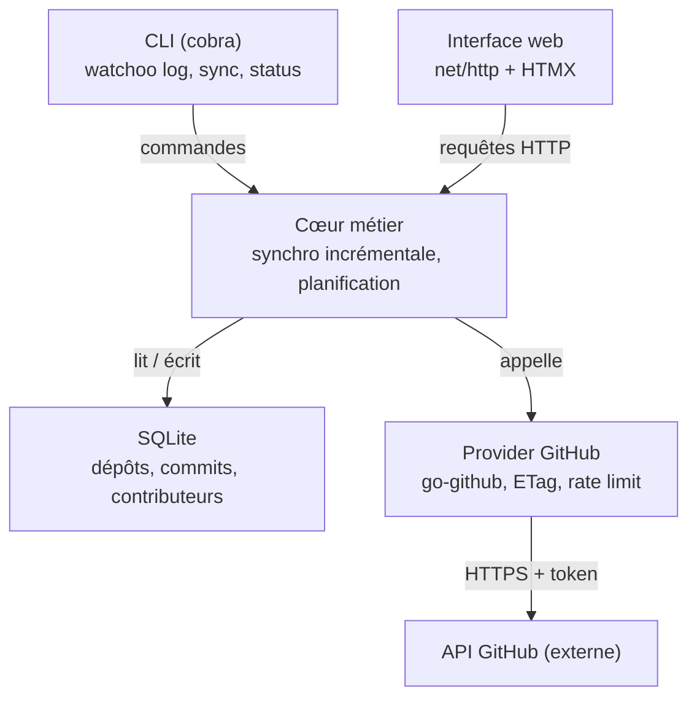

# 3. Architecture technique

[← Sommaire](README.md)

Un seul binaire, une seule base SQLite : la CLI et l'interface web partagent le même cœur métier, ce qui
évite toute duplication de logique.

## Vue d'ensemble



### Responsabilités des couches

| Couche | Rôle | Ne doit pas |
| --- | --- | --- |
| CLI | Parser les commandes, formater la sortie (tableau ou JSON) | Contenir de logique métier |
| TUI | Mode interactif au clavier (Bubble Tea) | Contenir de logique métier |
| Web | Servir pages et fragments HTMX | Contenir de logique métier |
| Cœur métier (`sync`) | Orchestrer la synchro, planifier, appliquer les règles | Connaître les détails HTTP de GitHub |
| Provider | Parler à une forge (GitHub, plus tard GitLab…) | Accéder directement à la base |
| Store | Persister et requêter SQLite, migrations | Appeler une forge |

## Stack retenue

| Brique | Choix proposé | Pourquoi |
| --- | --- | --- |
| Langage | Go, dernière version stable (fixée dans `go.mod`) | Binaire statique, cross-compilation simple, concurrence native |
| CLI | `spf13/cobra` + `spf13/viper` | Standard de fait, sous-commandes, config YAML / variables d'env |
| API GitHub | `google/go-github` + `golang.org/x/oauth2` | Client complet, gestion du token |
| Stockage | SQLite via `modernc.org/sqlite` (sans CGO) | Fichier unique, zéro installation, cross-compile facile |
| Accès BDD | `sqlc` (code généré sur `database/sql`) + migrations `pressly/goose` | Requêtes vérifiées contre le schéma, code Go typé généré, schéma versionné |
| Serveur web | `net/http` + routeur `go-chi/chi` | Léger, 100 % compatible `net/http`, groupes de routes et middlewares prêts à l'emploi |
| Front | `html/template` + HTMX + [DaisyUI](https://daisyui.com/) (sur Tailwind CSS) | Composants prêts à l'emploi (cartes, badges, tableaux, thèmes clair / sombre), pas de framework JS, assets embarqués avec `embed` |
| Graphiques | Chart.js, embarqué | Courbes d'activité simples, fonctionne hors ligne |
| Affichage terminal | `charmbracelet/bubbletea` + `bubbles` (TUI) + `lipgloss` | Mode interactif navigable au clavier ; sortie texte statique (`lipgloss/table`) pour les pipes et les scripts |
| Planification | `time.Ticker` + `errgroup` | Synchro périodique, parallélisme borné |
| Authentification | CLI GitHub `gh` (prérequis) | Token obtenu avec `gh auth token`, jamais stocké par Watchoo ; un seul token pour tous les propriétaires |
| Logs | `log/slog` | Logs structurés de la bibliothèque standard |

### Décisions techniques

Tous les choix de stack sont tranchés ; leur détail figure dans les « Points d'attention » ci-dessous.
La signature exacte de l'interface `Provider` sera fixée en phase 2.

## Organisation du code (cible)

```
watchoo/
  cmd/watchoo/         main.go — point d'entrée
  internal/cli/        commandes cobra
  internal/tui/        mode interactif Bubble Tea
  internal/web/        handlers, templates, static (embed)
  internal/workspace/  espaces de supervision : init, recherche de .watchoo/, réglages
  internal/auth/       accès à gh (token, état de connexion) + faux gh pour les tests
  internal/provider/   interface Provider + github/
  internal/sync/       moteur de synchronisation
  internal/store/      SQLite, accès aux données
    migrations/        migrations goose (servent aussi de schéma à sqlc)
    queries/           requêtes SQL annotées pour sqlc
    db/                code Go généré par sqlc (ne pas éditer)
  sqlc.yaml            configuration de sqlc
  internal/model/      structs métier
  config.example.yaml
```

## Interface `Provider`

Abstraction qui isole toute forge. Elle doit au minimum permettre de :

- obtenir les métadonnées d'un dépôt (branche par défaut, étoiles, issues ouvertes, URL) ;
- lister les branches d'un dépôt ;
- lister les commits d'une branche depuis une date / jusqu'à un SHA connu, avec pagination ;
- exposer l'état du quota API (restant, date de reset).

L'implémentation GitHub est la seule du MVP. La signature exacte sera fixée en phase 2.

## Configuration

- Watchoo fonctionne par **espaces de supervision** : un répertoire initialisé par `watchoo init`, qui
  contient `.watchoo/config.yaml` et `.watchoo/watchoo.db`. Chaque groupe supervisé (ex. une promotion
  d'étudiants) a le sien. Détail complet : [Espaces de supervision](10-espaces-de-supervision.md).
- L'espace est trouvé comme Git : répertoire courant, puis parents. `-C <répertoire>` ou `WATCHOO_DIR`
  désignent un autre espace.
- Trois niveaux de réglages, chargés par viper : `$XDG_CONFIG_HOME/watchoo/config.yaml`, sinon
  `~/.config/watchoo/config.yaml` (facultatif, valeurs communes), puis `.watchoo/config.yaml` (l'espace),
  puis options et variables `WATCHOO_*`.
- Modèle de fichier : `config.example.yaml`, à créer en phase 1.
- Paramètres attendus : nom de l'espace, intervalle de synchro, adresse d'écoute web, seuils d'activité,
  branches exclues, parallélisme de synchro, fuseau horaire d'affichage (par défaut celui du système),
  compte `gh` (`github.user`), chemin de `gh` (`github.gh_path`).

## Points d'attention

### Quota de l'API GitHub
- 5 000 requêtes / heure avec token.
- Utiliser les **ETag** (`If-None-Match`) : une réponse `304 Not Modified` ne consomme pas de quota.
- Si le quota est épuisé : attendre le reset plutôt qu'échouer en boucle.

### Fréquence de synchronisation
- **Décision** : intervalle de **30 min par défaut**, **15 min minimum**. Une valeur plus courte (config ou
  `--interval`) est refusée avec un message clair.
- **Qui synchronise** : `watchoo serve` et `watchoo tui` synchronisent automatiquement à cet intervalle tant
  qu'ils tournent. `tui` propose aussi une touche pour lancer une synchro tout de suite. Les autres commandes
  ne synchronisent que sur demande (`watchoo sync`).
- **Synchro manuelle**, possible à tout moment, de tous les dépôts ou d'un seul :
  - CLI : `watchoo sync` (tous les dépôts) ou `watchoo sync owner/repo` (un seul) ;
  - web : bouton « Synchroniser maintenant » dans les réglages (tous les dépôts) et sur la page de détail
    d'un dépôt (ce dépôt seul) ;
  - TUI : une touche pour tous les dépôts, une autre pour le dépôt sélectionné.

  Une synchro manuelle n'est pas soumise au minimum de 15 min. Elle respecte le verrou et le garde-fou
  sur le quota, et ne décale pas la prochaine synchro automatique.
- **Mode manuel seul** : la synchro automatique se désactive dans la config (`sync.auto: false`) ou avec
  `--interval 0`. `serve` et `tui` ne synchronisent alors que sur demande.
- **Garde-fou sur le quota** : si le quota restant passe sous **10 %**, Watchoo espace les synchros
  jusqu'à la remise à zéro du quota et le signale dans `status`, le web et le TUI.
- **Pas de double synchro** : si `serve` et `tui` tournent en même temps sur la même base, un verrou dans
  SQLite empêche deux synchros simultanées du même dépôt.
- Ordre de grandeur, dans le pire cas où tout a changé à chaque passage : 100 dépôts × 2 branches toutes
  les 30 min ≈ 800 requêtes / heure, loin des 5 000 du quota. Les réponses `304` ne coûtent rien.

### Branches suivies
- **Décision** : sans `--branch`, Watchoo suit **toutes les branches** du dépôt, y compris celles créées
  après l'ajout. La liste des branches est relue à chaque synchro.
- `--branch` restreint le suivi à une liste et à des motifs (`main,dev,release/*`). Une nouvelle branche qui
  correspond à un motif est suivie automatiquement.
- **Exclusions** : une liste de motifs à ignorer, réglable dans la config (`branches.exclude`), vide par
  défaut. Utile par exemple pour `dependabot/*` ou `renovate/*`, dont les branches automatiques fausseraient
  l'activité.
- **Branche supprimée sur GitHub** : elle cesse d'être suivie (`tracked = false`), mais son historique reste
  en base.
- **Coût** : chaque branche suivie coûte une requête par synchro, gratuite si rien n'a changé (`304`). Une
  branche déjà synchronisée s'arrête au premier SHA connu, et les commits partagés entre branches ne sont
  enregistrés qu'une fois (table `commit_branches`). `watchoo status` indique le nombre de branches suivies
  et la consommation de quota par synchro.

### Synchronisation incrémentale
- Paramètre `since` sur la liste des commits.
- Arrêt de la pagination dès qu'un SHA déjà connu est rencontré.
- Parallélisme borné avec `errgroup` : **4 dépôts synchronisés en parallèle maximum**.

### Authentification : `gh` imposé
- **Décision** : la CLI GitHub **`gh` est un prérequis obligatoire**. C'est la **seule** source du token :
  Watchoo l'obtient avec `gh auth token` et ne lit ni `GITHUB_TOKEN`, ni de trousseau en propre, ni de
  token saisi à la main.
- Watchoo **ne stocke jamais le token** : ni dans la config, ni dans la base, ni dans un trousseau.
  `gh` le garde déjà dans le trousseau du système.
- Le token est redemandé à `gh` **au début de chaque synchro** et gardé en mémoire seulement le temps de
  la synchro. Si l'utilisateur se reconnecte ou change de compte dans `gh`, Watchoo suit sans redémarrer.
- `watchoo init` vérifie que `gh` est installé et connecté (`gh auth status`). Sinon il s'arrête et
  indique quoi faire (`gh auth login`). Il ne demande aucun token. Si `gh` n'a pas pu joindre GitHub pour
  vérifier le token (réseau coupé, proxy, panne de GitHub), `init` le dit sans conseiller `gh auth login`,
  qui n'y changerait rien.
- Plusieurs comptes dans `gh` : par défaut, le compte actif de `gh` pour `github.com`. Une option de
  config (`github.user`) permet d'en choisir un autre (`gh auth token --user …`). `gh` distingue les
  majuscules et `--user` ne lit que les comptes enregistrés (trousseau ou fichier de `gh`) : `github.user`
  doit donc reprendre le login exact d'un compte enregistré. Sinon `init` le refuse, en donnant le login
  connu de `gh` ou en demandant de vider le réglage, au lieu d'accepter un compte dont la synchro ne
  pourrait pas lire le token.
- `watchoo status` indique le compte `gh` utilisé et les droits (scopes) du token, sans jamais afficher le
  token.
- **Jamais** de token en clair dans les logs, l'interface web ou le TUI ; la sortie de `gh auth token` n'est
  jamais journalisée.
- Docker et CI : `gh` est inclus dans l'image Docker. Sans session interactive, `gh` lit son token dans
  la variable `GH_TOKEN`. Vérifié en phase 1 (gh 2.103) : sans `--user`, `gh auth token` renvoie bien le
  token de `GH_TOKEN`, et `gh auth status` présente ce compte comme le compte actif ; avec `--user`, `gh`
  ignore `GH_TOKEN` (« no oauth token found for github.com account … »). Il faut donc **laisser
  `github.user` vide** quand le token vient de `GH_TOKEN` ; `init` refuse un `github.user` que `gh` ne
  connaît que par cette variable.

### Dépôts privés

Les dépôts suivis sont principalement **privés**. Conséquences :

- **Accès** : le compte connecté dans `gh` doit avoir accès en lecture à chaque dépôt privé suivi. Sans
  accès, GitHub répond `404` (et non `403`) : Watchoo l'affiche comme « en erreur : dépôt introuvable ou
  compte sans accès », sans conclure que le dépôt a été supprimé.
- **Ce que le token de `gh` implique** :
  - il couvre **tous les propriétaires** auxquels le compte a accès (compte perso et organisations) : un
    seul token suffit, la question des tokens multiples ne se pose plus ;
  - il porte par défaut le droit `repo`, qui permet **lecture et écriture**. Watchoo reste en lecture seule :
    le code n'appelle **aucune** route GitHub en écriture (POST, PATCH, PUT, DELETE), et un test le vérifie ;
  - une organisation peut restreindre l'accès des applications OAuth tierces, ou imposer le SSO : il faut
    alors autoriser l'application GitHub CLI pour cette organisation. `init` et `status` le signalent quand
    un dépôt de l'organisation répond `404` ou `403`.
- **Données locales confidentielles** : la base SQLite contient des messages de commit, des noms et des
  e-mails issus de dépôts privés.
  - Fichier de base et fichier de config créés avec les droits **`0600`** (lisibles par l'utilisateur seul).
  - Les logs ne contiennent **ni messages de commit ni e-mails** : seulement des identifiants (dépôt, SHA
    court) et des compteurs.
  - Image Docker : la base est sur un volume ; la documentation rappelle de ne pas le partager.
- **Interface web** : écoute sur `127.0.0.1` par défaut. L'exposer sur le réseau sans authentification
  exposerait le contenu des dépôts privés : dans ce cas l'authentification devient **obligatoire** (voir
  [Interface web](06-interface-web.md#sécurité)).
- **Quota** : identique pour les dépôts privés et publics (5 000 requêtes / heure par token).

### Fusion des identités
- Un même contributeur peut committer avec plusieurs e-mails.
- Rattacher les e-mails au login GitHub quand il est connu (table `contributor_emails`).

### Version de Go
- **Décision** : on part de la **dernière version stable** de Go. Le numéro exact est fixé dans `go.mod`
  (directive `go`) au démarrage de la phase 1.
- Règle : le projet reste toujours sur l'une des **deux versions maintenues** par l'équipe Go. On monte de
  version tous les six mois environ, et la CI utilise la même version que `go.mod`.
- Ce choix ne concerne que les développeurs : les utilisateurs reçoivent un binaire déjà compilé.

### Terminal : mode interactif (TUI)
- **Décision** : Watchoo propose un **mode interactif en TUI**, construit avec Bubble Tea (`bubbletea`),
  ses composants (`bubbles` : table, liste, viewport, saisie de filtre) et `lipgloss` pour le style.
- **Point d'entrée** : une commande dédiée, `watchoo tui`. Les autres commandes (`log`, `repo list`…)
  ne lancent jamais le TUI : elles affichent un tableau ou du JSON, puis rendent la main.
- **Calendrier** : le TUI fait partie du MVP et se construit en **phase 3**, avec les commandes CLI.
- Ce qui est attendu : parcourir les dépôts, les commits et les contributeurs au clavier (flèches,
  défilement, sélection, filtre), ouvrir le détail d'un dépôt, et lancer une synchro.
- **Sortie statique** : toutes les commandes autres que `tui` affichent un tableau texte (`lipgloss/table`)
  ou du JSON (`--json`), puis rendent la main. Watchoo reste ainsi scriptable. Si on lance `watchoo tui`
  hors d'un terminal, la commande s'arrête avec un message clair.
- Couleurs désactivées hors terminal et quand la variable `NO_COLOR` est définie.
- Le TUI est une couche d'affichage de plus, au même niveau que la CLI et le web : il appelle le
  cœur métier et ne contient pas de logique.
- Code dans `internal/tui/`.

### Accès aux données : sqlc
- Les requêtes sont écrites dans `internal/store/queries/*.sql`, chacune nommée
  (`-- name: ListRecentCommits :many`).
- `sqlc generate` vérifie chaque requête contre le schéma, qu'il lit dans les migrations goose, puis
  génère du Go typé dans `internal/store/db/`. Le code généré est commité et n'est jamais modifié à la main.
- Pas de dépendance ajoutée à l'exécution : le code généré utilise `database/sql` avec le driver
  `modernc.org/sqlite`.
- Filtres optionnels (`log --repo --author --since`, filtres de la page de détail) : paramètres pouvant
  être vides, avec `sqlc.narg`, sous la forme `(sqlc.narg(repo) IS NULL OR repo_id = sqlc.narg(repo))`.
- Une requête qui ne rentre pas dans ce cadre (SQL vraiment dynamique) peut être écrite à la main avec
  `database/sql` dans `internal/store/`, en restant l'exception.
- Le package `store` expose ses propres fonctions au cœur métier ; les types générés par sqlc ne sortent pas
  de `store`, ils sont convertis vers `internal/model`.

### Routeur : go-chi/chi
- Retenu pour une implémentation propre : les routes sont regroupées par zone (pages, fragments HTMX,
  réglages, assets statiques), chacune avec ses middlewares.
- Middlewares chi utilisés : `RequestID`, `RealIP`, `Recoverer`, `Timeout`, plus un logger branché sur
  `log/slog`. L'authentification basique (en cas d'exposition réseau) se branche sur le groupe concerné.
- Les handlers restent des `http.Handler` standard : aucune dépendance de chi dans la logique métier.

### CSS : DaisyUI
- Pico.css est écarté car il n'est plus maintenu ; on prend **DaisyUI**, un plugin de Tailwind CSS.
- **Décision** : le CSS est généré par la **CLI autonome de Tailwind** (binaire unique, sans Node ni npm),
  pour garder « pas de Node, pas de build JS ».
- La cible `make css` lit les templates et produit `internal/web/static/app.css`, qui ne contient que les
  classes utilisées. Ce fichier est embarqué avec `embed` : le binaire final fonctionne hors ligne et ne
  dépend d'aucun CDN.
- Le CSS généré est **commité**, comme le code généré par sqlc : `go build` suffit après un clone, sans
  installer Tailwind. Il faut relancer `make css` quand on modifie des templates, et la CI vérifie que le
  fichier commité est à jour.
- La version CDN de DaisyUI reste tolérée pour prototyper au début de la phase 4, jamais dans une version
  distribuée.

### JavaScript : HTMX et Chart.js embarqués
- **Décision** : HTMX et Chart.js sont **embarqués** dans le binaire. On n'utilise aucun CDN.
- Une version précise de chaque bibliothèque est téléchargée une fois, puis placée dans
  `internal/web/static/vendor/` et commitée. Le numéro de version figure dans le nom du fichier (ex.
  `chart-4.x.y.min.js`).
- Ces fichiers sont servis avec `embed`, comme le CSS. L'interface fonctionne hors ligne et n'envoie
  aucune requête à un tiers.
- Les mises à jour sont faites à la main, de façon volontaire, et notées dans le changelog.

### Distribution
- Binaires multi-plateformes via GoReleaser, image Docker (phase 5).
