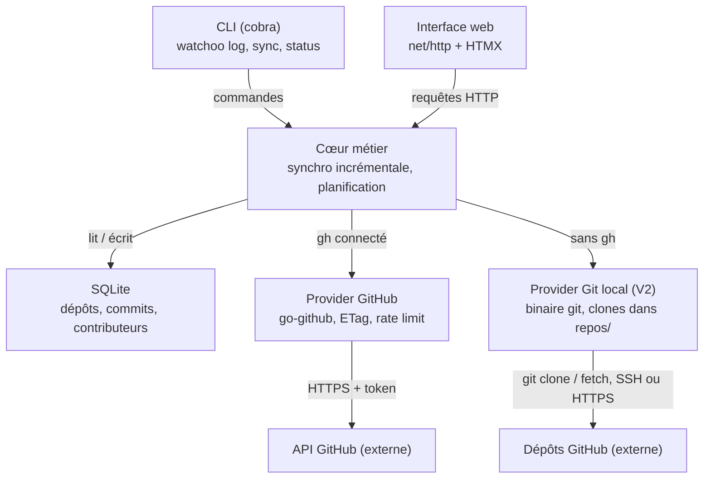

# 3. Architecture technique

[← Sommaire](README.md)

Un seul binaire, une seule base SQLite : la CLI et l'interface web partagent le même cœur métier, ce qui
évite toute duplication de logique.

## Vue d'ensemble



### Responsabilités des couches

| Couche | Rôle | Ne doit pas |
| --- | --- | --- |
| CLI | Parser les commandes, formater la sortie (tableau ou JSON) | Contenir de logique métier |
| TUI | Mode interactif au clavier (Bubble Tea) | Contenir de logique métier |
| Web | Servir pages et fragments HTMX | Contenir de logique métier |
| Cœur métier (`sync`) | Orchestrer la synchro, planifier, appliquer les règles | Connaître les détails HTTP de GitHub |
| Provider | Parler à une forge (GitHub, plus tard GitLab…) | Accéder directement à la base |
| Store | Persister et requêter SQLite, migrations | Appeler une forge |

## Stack retenue

| Brique | Choix proposé | Pourquoi |
| --- | --- | --- |
| Langage | Go, dernière version stable (fixée dans `go.mod`) | Binaire statique, cross-compilation simple, concurrence native |
| CLI | `spf13/cobra` + `spf13/viper` | Standard de fait, sous-commandes, config YAML / variables d'env |
| API GitHub | `google/go-github` (dernière version majeure), sans `golang.org/x/oauth2` | Client complet et typé ; le token est posé dans l'en-tête `Authorization` par le transport HTTP interne du provider, qui assure aussi la lecture seule, le cache ETag et le suivi du quota |
| Stockage | SQLite via `modernc.org/sqlite` (sans CGO) | Fichier unique, zéro installation, cross-compile facile |
| Accès BDD | `sqlc` (code généré sur `database/sql`) + migrations `pressly/goose` | Requêtes vérifiées contre le schéma, code Go typé généré, schéma versionné |
| Serveur web | `net/http` + routeur `go-chi/chi` | Léger, 100 % compatible `net/http`, groupes de routes et middlewares prêts à l'emploi |
| Front | `html/template` + HTMX + [DaisyUI](https://daisyui.com/) (sur Tailwind CSS) | Composants prêts à l'emploi (cartes, badges, tableaux, thèmes clair / sombre), pas de framework JS, assets embarqués avec `embed` |
| Graphiques | Chart.js, embarqué | Courbes d'activité simples, fonctionne hors ligne |
| Affichage terminal | `charmbracelet/bubbletea` + `bubbles` (TUI) + `lipgloss` | Mode interactif navigable au clavier ; sortie texte statique (`lipgloss/table`) pour les pipes et les scripts |
| Planification | `time.Ticker` + `errgroup` | Synchro périodique, parallélisme borné |
| Authentification | CLI GitHub `gh` (facultative depuis la V2) | Token obtenu avec `gh auth token`, jamais stocké par Watchoo ; un seul token pour tous les propriétaires. Sans `gh` : clones Git locaux, avec les identifiants Git de la machine |
| Dépôts Git locaux (V2) | Binaire `git` (os/exec), sans dépendance Go | Clones nus mis à jour par `git fetch` : suivi sans `gh` ni quota |
| Logs | `log/slog` | Logs structurés de la bibliothèque standard, sur la sortie d'erreur ; niveau `warn` par défaut, réglable par `WATCHOO_LOG_LEVEL` (`debug`, `info`, `warn`, `error`) ou `--verbose` (`debug`). Seulement des identifiants de dépôt, des SHA courts et des compteurs : jamais de token, de message de commit, de nom ni d'e-mail |

### Décisions techniques

Tous les choix de stack sont tranchés ; leur détail figure dans les « Points d'attention » ci-dessous.
L'interface `Provider` est fixée depuis la phase 2 (voir [Interface `Provider`](#interface-provider)).

## Organisation du code (cible)

```
watchoo/
  cmd/watchoo/         main.go — point d'entrée
  internal/cli/        commandes cobra
  internal/tui/        mode interactif Bubble Tea
  internal/web/        handlers chi, middlewares de sécurité, rendu ; templates/ et static/ (embed) ;
                       tailwind/ (source CSS, DaisyUI vendored, VERSIONS)
  internal/workspace/  espaces de supervision : init, recherche de .watchoo/, réglages
  internal/auth/       accès à gh (token, état de connexion) + faux gh pour les tests
  internal/provider/   interface Provider, types et erreurs ; providertest/ (faux Provider en mémoire)
    github/            implémentation GitHub, seul import de go-github ; githubtest/ (faux serveur)
    git/               dépôts Git locaux (V2) : binaire git, clones dans repos/ ; gittest/ (dépôts file://)
  internal/sync/       moteur de synchronisation (Engine : SyncAll, SyncRepo, AddRepositories) et
                       coordinateur des synchros d'un processus long (Coordinator, « watchoo serve »)
  internal/activity/   règles d'activité (Actif / Flemme / Dead, états gris), formats courts
  internal/repoimport/ analyse des références de dépôts, de --branch et des fichiers d'import
  internal/configshare/ partage de la configuration d'un espace (export JSON, validation, aperçu et
                       application d'un import ; « watchoo config », page Réglages)
  internal/textclean/  nettoyage des textes affichés (séquences d'échappement, contrôles), CLI et TUI
  internal/selfupdate/ mise à jour de Watchoo lui-même (0.6.0) : dernière version publiée, comparaison
                       SemVer, téléchargement vérifié et remplacement du binaire, vérification
                       périodique de « watchoo serve »
  internal/store/      SQLite, accès aux données
    migrations/        migrations goose (servent aussi de schéma à sqlc)
    queries/           requêtes SQL annotées pour sqlc
    db/                code Go généré par sqlc (ne pas éditer)
  sqlc.yaml            configuration de sqlc
  internal/model/      structs métier
  internal/tui/        mode interactif (Bubble Tea v2, bubbles, lipgloss)
  internal/logo/       hibou en versions texte et carte d'en-tête (CLI, config.yaml)
  config.example.yaml
```

## Interface `Provider`

Abstraction qui isole toute forge, définie dans `internal/provider`, sans dépendance à GitHub ni à
go-github. Deux implémentations : l'API GitHub (`internal/provider/github`, seul endroit où go-github est
importé) et, depuis la V2, les clones Git locaux (`internal/provider/git`, voir
[Dépôts Git locaux](#dépôts-git-locaux-v2)). Seule exception : `internal/selfupdate` lit les pages
publiques des releases de Watchoo lui-même, sans token ni API (voir
[Mise à jour de Watchoo](#mise-à-jour-de-watchoo-060)). Signature fixée en phase 2 (détail dans
`internal/provider/provider.go`) :

| Méthode | Rôle |
| --- | --- |
| `Name()` | Identifiant de la **forge** (`github`), pas du moyen d'y accéder : le provider Git local renvoie aussi `github` (les dépôts restent des dépôts GitHub, `repositories.provider` ne change pas) |
| `Repository(ctx, owner, name)` | Métadonnées d'un dépôt : identifiant numérique, owner et nom actuels, branche par défaut, URL, étoiles, issues ouvertes, archivé, privé, dernier push. Suit un renommage ou un transfert. `Partial` (V2) : la source ne connaît que owner, nom, branche par défaut et URL (identifiant 0) ; le moteur garde alors le reste en base |
| `RepositoryByID(ctx, id)` | Les mêmes métadonnées, par l'identifiant numérique, qui ne change jamais (`ErrUnsupported` pour les clones Git locaux : le moteur passe alors par `Repository`) |
| `Branches(ctx, owner, name)` | Toutes les branches (nom, SHA de tête), toutes les pages |
| `ListCommits(ctx, owner, name, opts)` | Commits d'une branche (ou d'un SHA), du plus récent au plus ancien (ordre chronologique, pas celui du graphe). Options : `Branch`, `Since`, `Stop` (arrêt au premier SHA pour lequel elle renvoie vrai, exclu, sans page suivante ; pas pour s'arrêter au premier SHA connu, voir [Synchronisation incrémentale](#synchronisation-incrémentale)), `Limit` |
| `CompareCommits(ctx, owner, name, base, head)` | Commits atteignables depuis `head` mais pas depuis `base` (comme `git log base..head`), merges compris, du plus récent au plus ancien |
| `CommitStats(ctx, owner, name, sha)` | Lignes ajoutées et supprimées par un commit (une requête par commit, une seule page de fichiers, jamais mise en cache) |
| `PullRequests(ctx, owner, name, opts)` (V2) | Pull requests du dépôt, tous états confondus (ouvertes, fermées, mergées), de la plus récemment modifiée à la plus ancienne. Options : `UpdatedSince` (arrêt à la première PR modifiée **avant** cette date, sans page suivante : synchro incrémentale), `Limit`. Numéro, titre, état, mergée, brouillon, auteur (login, identifiant), URL, branches de base et de tête, dates de création, de modification, de fermeture et de merge |
| `Releases(ctx, owner, name)` (V2) | Releases du dépôt, de la plus récente à la plus ancienne : identifiant, tag, nom, brouillon, pré-release, auteur, URL, dates de création et de publication. Sur GitHub, les brouillons ne sont visibles que d'un compte qui a le droit d'écriture sur le dépôt |
| `Tags(ctx, owner, name)` (V2) | Tags du dépôt (nom, SHA du commit visé), dans l'ordre de la forge |
| `RateLimit(ctx)` | État du quota (`GET /rate_limit`, gratuit) |
| `LastRateLimit()` | Dernier état du quota observé sur les réponses, sans requête |
| `ProfileURL(login)` (0.6.1) | Page web du profil d'un compte à partir de son login, sans requête (`https://github.com/<login>`, comme `html_url` du compte) ; chaîne vide pour un login vide ou qui n'a pas la forme d'un login de compte (`provider.ValidLogin` : caractère interdit, compte d'application `nom[bot]`). Sert à compléter la page de profil des contributeurs connus avant la 0.5.0 (voir [Synchronisation incrémentale](#synchronisation-incrémentale)) |

Règles communes :

- les arguments (owner, nom de dépôt, branche, SHA complet, identifiant) sont validés avant toute
  requête : une valeur invalide donne `ErrInvalidRef`, sans appel réseau ;
- dates en UTC, listes vides non nil ; plafonds internes (10 000 commits, 1 000 branches, 1 000 pull
  requests, 1 000 releases, 1 000 tags) contre une pagination sans fin ;
- une source qui ne connaît pas une notion (le provider des [dépôts Git locaux](#dépôts-git-locaux-v2)
  n'a ni pull requests, ni releases, ni identifiant numérique, ni quota) renvoie une erreur qui
  enveloppe `ErrUnsupported`, sans rien demander : le moteur de synchro la traite comme « non disponible
  pour cette source », pas comme un échec ;
- erreurs de type `*APIError` (opération, méthode, chemin de l'API, code HTTP), à tester avec
  `errors.Is` / `errors.As` : `ErrNotFound` (`404` : dépôt introuvable ou compte sans accès),
  `ErrUnauthorized` (`401` : conseiller `gh auth login`), `ErrForbidden` et `*SSORequiredError` (`403`,
  SSO imposé par l'organisation), `*RateLimitError` (quota épuisé ou limite secondaire, avec le moment où
  réessayer), `ErrEmptyRepository` (dépôt vide), `ErrUnknownBase` (base d'une comparaison disparue),
  `ErrUnavailable` (réseau, délai, `5xx`), `ErrUnexpected`, `ErrWriteForbidden`, `ErrUnsupported`,
  `ErrAccessDenied` (V2 : `git` n'a pas pu lire le dépôt distant, « accès refusé »). Leurs messages sont en
  français et ne citent jamais le token, un corps de réponse, un message de commit, un nom ni un e-mail ;
- sûr pour un usage concurrent : 4 dépôts synchronisés en parallèle avec la même instance.

Construction : `github.New(token, Options)` est légère (aucune requête). Le moteur de synchro en construit
un à chaque synchro, avec le token redemandé à `gh`, et lui passe le même cache ETag (`Cache`) et le même
état du quota (`Quota`), qui durent d'une synchro à l'autre. Autres options : `BaseURL` (tests),
`UserAgent` (`watchoo/<version>`), `Transport`, `Timeout` (30 s par requête par défaut), `Logger`.

`git.New(git.Options)` (V2) est légère aussi : `Dir` (`repos/` à la racine de l'espace), `Repos` (dépôts
de l'espace dans l'ordre de leur ajout : emplacement des clones), `Protocol` (`ssh` ou `https`,
réglage `git.protocol`), `BaseURL` (tests : dépôts `file://`), `GitPath`, délais (10 min par commande
réseau, 2 min par lecture du clone), `Logger`. Le moteur en construit un à chaque synchro faite sans `gh`.

Faux pour les tests : `providertest` (Provider en mémoire), `githubtest` (serveur GitHub simulé) et
`gittest` (vrais dépôts Git dans un répertoire temporaire, servis par `file://`), voir
[Tests](09-tests.md#api-github-simulée).

## Configuration

- Watchoo fonctionne par **espaces de supervision** : un répertoire initialisé par `watchoo init`, qui
  contient `.watchoo/config.yaml` et `.watchoo/watchoo.db`. Chaque groupe supervisé (ex. une promotion
  d'étudiants) a le sien. Détail complet : [Espaces de supervision](10-espaces-de-supervision.md).
- L'espace est trouvé comme Git : répertoire courant, puis parents. `-C <répertoire>` ou `WATCHOO_DIR`
  désignent un autre espace.
- Trois niveaux de réglages, chargés par viper : `$XDG_CONFIG_HOME/watchoo/config.yaml`, sinon
  `~/.config/watchoo/config.yaml` (facultatif, valeurs communes), puis `.watchoo/config.yaml` (l'espace),
  puis options et variables `WATCHOO_*`.
- Modèle de fichier : `config.example.yaml`, à créer en phase 1.
- Paramètres attendus : nom de l'espace, intervalle de synchro, adresse d'écoute web, seuils d'activité,
  branches exclues, parallélisme de synchro, fuseau horaire d'affichage (par défaut celui du système),
  compte `gh` (`github.user`), chemin de `gh` (`github.gh_path`), protocole des clones Git locaux
  (`git.protocol` : `ssh` par défaut, ou `https` ; V2).
- Partage entre superviseurs : `watchoo config export` / `import` (et la page Réglages) échangent un
  fichier JSON versionné (`format: watchoo-config`, `version: 1`) avec les dépôts suivis et les réglages
  communs, jamais `github.*`, `git.*` ni `web.*`. Le cœur est `internal/configshare` ; la réécriture de
  `config.yaml` est faite par `internal/workspace` (`WriteSharedSettings`). Voir
  [Partage de la configuration](05-cli.md#partage-de-la-configuration--watchoo-config).

## Points d'attention

### Quota de l'API GitHub
- 5 000 requêtes / heure avec token. Les clones Git locaux (V2, sans `gh`) n'en consomment pas.
- Utiliser les **ETag** (`If-None-Match`) : une réponse `304 Not Modified` ne consomme pas de quota.
- **Cache ETag en mémoire**, par processus, jamais sur disque. La clé est l'URL complète de la requête
  (pages comprises ; `per_page=100` toujours, pour des clés stables) ; une réponse `304` est servie comme
  la réponse `200` en cache. Le cache est lié à une empreinte du token (SHA-256, en mémoire seulement) :
  un autre compte `gh` le vide, aucune réponse d'un compte n'est servie à un autre. Il est borné
  (1 024 réponses de 1 Mio au plus). `serve` et `tui`, qui tournent longtemps, en profitent d'une synchro
  à l'autre ; une commande ponctuelle (`watchoo sync`) repart d'un cache vide.
- Les statistiques d'un commit (`GET /repos/{owner}/{repo}/commits/{sha}`) ne demandent qu'une page de
  fichiers (`per_page=1`) : seuls les totaux servent, et ils couvrent tout le commit quelle que soit la
  page. Sans ce paramètre, GitHub renverrait jusqu'à 300 fichiers avec leur patch, c'est-à-dire le code du
  dépôt privé. Ces réponses ne sont pas mises en cache : chaque commit n'est demandé qu'une fois.
- L'état du quota est lu sur les en-têtes `X-RateLimit-*` de chaque réponse (`304` comprises) et
  partagé d'une synchro à l'autre.
- Quota épuisé (`403` ou `429` avec `X-RateLimit-Remaining: 0`) ou limite secondaire (`403` ou `429` avec
  `Retry-After` ou un message « secondary rate limit ») : le provider renvoie une `RateLimitError` qui
  donne le moment où réessayer (`X-RateLimit-Reset` ; pour une limite secondaire, `Retry-After`, sinon
  une minute, comme le recommande GitHub). Un quota épuisé l'emporte sur un `Retry-After` reçu dans la
  même réponse. D'ici là, il refuse les requêtes suivantes sans les envoyer (`GET /rate_limit` reste
  permis), avec la même erreur ; si un quota épuisé et une limite secondaire sont tous deux en cours,
  c'est la plus lointaine des deux échéances qui est donnée. Il n'attend jamais lui-même : c'est le
  moteur de synchro qui attend le reset plutôt qu'échouer en boucle.

### Fréquence de synchronisation
- **Décision** : intervalle de **30 min par défaut**, **15 min minimum**. Une valeur plus courte (config ou
  `--interval`) est refusée avec un message clair.
- **Qui synchronise** : `watchoo serve` et `watchoo tui` synchronisent automatiquement à cet intervalle tant
  qu'ils tournent. `tui` propose aussi une touche pour lancer une synchro tout de suite. Les autres commandes
  ne synchronisent que sur demande (`watchoo sync`).
- **Synchro manuelle**, possible à tout moment, de tous les dépôts ou d'un seul :
  - CLI : `watchoo sync` (tous les dépôts) ou `watchoo sync owner/repo` (un seul) ;
  - web : bouton « Synchroniser maintenant » dans les réglages (tous les dépôts) et sur la page de détail
    d'un dépôt (ce dépôt seul) ;
  - TUI : une touche pour tous les dépôts, une autre pour le dépôt sélectionné.

  Une synchro manuelle n'est pas soumise au minimum de 15 min. Elle respecte le verrou et le garde-fou
  sur le quota, et ne décale pas la prochaine synchro automatique.
- **Mode manuel seul** : la synchro automatique se désactive dans la config (`sync.auto: false`) ou avec
  `--interval 0`. `serve` et `tui` ne synchronisent alors que sur demande.
- **Garde-fou sur le quota** : si le quota restant passe sous **10 %**, Watchoo espace les synchros
  jusqu'à la remise à zéro du quota et le signale dans `status`, le web et le TUI.
- **Garde-fou, détail** : avant chaque dépôt, le moteur lit le dernier état du quota observé ; sous 10 %
  de la limite, ce dépôt et les suivants sont **reportés** (« reporté : quota bas jusqu'à HH:MM »). Un
  quota épuisé (`RateLimitError`) arrête la synchro des dépôts restants, reportés jusqu'à l'heure de
  reprise. Une erreur sur un dépôt n'arrête pas les autres : elle est enregistrée dans `sync_runs`. Le
  message enregistré donne l'heure en UTC ; la CLI et le TUI affichent l'heure de reprise en heure
  locale. Un état de quota dont l'heure de remise à zéro est passée est ignoré (nouvelle fenêtre).
- **Annulation** (Ctrl+C, sortie du TUI) : les dépôts en cours sont clos en erreur (« synchro
  annulée »), ceux qui n'ont pas commencé ne sont pas touchés.
- **Pas de double synchro** : si `serve` et `tui` tournent en même temps sur la même base, un verrou dans
  SQLite empêche deux synchros simultanées du même dépôt. Avant chaque dépôt, une transaction vérifie
  qu'aucun `sync_run` `running` de ce dépôt n'a commencé il y a moins de **30 min**, puis insère le sien ;
  un `running` plus ancien (processus arrêté en pleine synchro) est clos en erreur (« synchro
  interrompue »). Un dépôt verrouillé est ignoré et signalé (« déjà en cours de synchronisation »).
- Ordre de grandeur, dans le pire cas où tout a changé à chaque passage : 100 dépôts × 2 branches toutes
  les 30 min ≈ 800 requêtes / heure, loin des 5 000 du quota. Les réponses `304` ne coûtent rien.
- **Pull requests, releases et tags** (V2) : trois listes de plus par dépôt et par synchro (première
  page seulement dans le cas courant). Toutes passent par le cache ETag : quand rien n'a changé, elles
  répondent `304` et ne coûtent rien. Dans le pire cas où tout change à chaque passage, 100 dépôts
  ajoutent 3 × 2 × 100 = 600 requêtes / heure, soit environ 1 400 au total, toujours loin des 5 000.

### Branches suivies
- **Décision** : sans `--branch`, Watchoo suit **toutes les branches** du dépôt, y compris celles créées
  après l'ajout. La liste des branches est relue à chaque synchro.
- `--branch` restreint le suivi à une liste et à des motifs (`main,dev,release/*`). Une nouvelle branche qui
  correspond à un motif est suivie automatiquement.
- **Exclusions** : une liste de motifs à ignorer, réglable dans la config (`branches.exclude`), vide par
  défaut. Utile par exemple pour `dependabot/*` ou `renovate/*`, dont les branches automatiques fausseraient
  l'activité.
- **Branche supprimée sur GitHub** : elle cesse d'être suivie (`tracked = false`), mais son historique reste
  en base.
- **Coût** : la liste des branches coûte une requête par dépôt et par synchro, gratuite si rien n'a
  changé (`304`). Une branche dont la tête n'a pas bougé ne coûte rien de plus ; une branche qui a bougé
  coûte une comparaison (voir [Synchronisation incrémentale](#synchronisation-incrémentale)). Les commits
  partagés entre branches ne sont enregistrés qu'une fois (table `commit_branches`). `watchoo status`
  indique le nombre de branches suivies et le quota restant ; la mesure de la consommation de quota par
  synchro n'est pas prévue en phase 3.

### Synchronisation incrémentale
- **Règle** : la liste des commits (`ListCommits`) suit l'ordre **chronologique**, pas celui du graphe.
  Après un merge, des commits apportés par la branche fusionnée peuvent venir **après** un commit déjà en
  base : arrêter la liste au premier SHA connu (option `Stop`) les perdrait, sans aucune erreur, et la
  perte serait définitive (la synchro suivante compare depuis la nouvelle tête). Dès que le dépôt a des
  commits en base, le moteur s'appuie donc sur la comparaison (`CompareCommits`), seule méthode exacte,
  et jamais sur l'arrêt au premier SHA connu.
- **Premier import d'un dépôt** (aucun commit en base) : liste des commits de la branche de référence
  (`ListCommits`, sans `Stop` : rien n'est encore connu), du plus récent au plus ancien. `Since` ou
  `Limit` peuvent borner l'historique. La branche de référence est la branche par défaut si elle est
  suivie, sinon la première branche suivie ; elle est synchronisée en premier à chaque synchro.
- **Nouvelle branche d'un dépôt déjà synchronisé** (y compris les autres branches lors du premier
  import) : comparaison entre la tête de la branche de référence et la tête de la nouvelle branche.
  Elle donne exactement les commits propres à la branche, y compris ceux apportés par un merge. Cas
  courant chez les étudiants : `main` est en base (M0 puis M1) ; une branche partie de M0 reçoit F1, puis
  un merge de `main` (X). La liste des commits de la branche donne X, M1, F1, M0 : l'arrêt au premier
  SHA connu (M1) perdrait F1, alors que la comparaison M1...X donne X et F1.
- **Branche déjà synchronisée** : comparaison entre l'ancienne tête (`branches.head_sha`) et la nouvelle,
  merges compris (même s'ils apportent des commits plus anciens que l'ancienne tête). Tête inchangée :
  aucune requête.
- **Historique réécrit** (force-push) ou sans ancêtre commun : la comparaison renvoie `ErrUnknownBase`. Le
  moteur la retente depuis la tête de la branche de référence (si la branche n'est pas elle-même la
  branche de référence). À défaut, il relit la liste des commits **sans `Stop`**, bornée comme au premier
  import (`Since` ou `Limit`), et ignore les SHA déjà en base (ni réenregistrés, ni statistiques
  redemandées). Ce repli relit des pages déjà connues : il reste réservé à ce cas rare.
- **Nouvelle branche de référence d'un dépôt déjà importé** (branche par défaut renommée ou changée sur
  GitHub, ancienne référence supprimée, motifs `--branch` ou `branches.exclude` modifiés) : relecture de
  sa liste de commits **sans `Stop`**, bornée comme au premier import. Une comparaison depuis l'ancienne
  référence ne donnerait que les commits absents de celle-ci : les commits partagés resteraient rattachés
  à l'ancienne seule et, si elle n'est plus suivie, le dépôt paraîtrait vide (`last_commit_at` ne compte
  que les branches suivies). Les commits déjà en base ne sont ni réenregistrés ni leurs statistiques
  redemandées : seul `commit_branches` est complété. Coût : au plus `MaxCommits / 100` requêtes, une
  seule fois, au changement de référence. La référence précédente est déduite des branches suivies en
  base, avec la même règle (branche par défaut connue si suivie, sinon la première).
- **Appartenance aux branches** (`commit_branches`) : un commit est rattaché aux branches sur lesquelles
  le moteur l'a vu (liste ou comparaison). Une branche partie de la branche de référence n'est donc
  rattachée qu'à ses commits propres : `watchoo log --branch dev` montre ce qui est propre à `dev`, pas
  l'historique partagé avec `main`.
- **Statistiques des commits** (lignes ajoutées et supprimées) : **lues dans le clone Git local** du
  dépôt (`repos/`, voir [Dépôts Git locaux](#dépôts-git-locaux-v2)), qui existe **avec ou sans `gh`**.
  À chaque synchro, le moteur calcule celles de **tous** les commits du dépôt dont les statistiques sont
  encore inconnues (`commits.stats_known = 0`) : nouveaux commits, **premier import compris**, et
  commits plus anciens jamais calculés (base d'avant la 0.5.0, synchro faite sans clone). Ni plafond ni
  quota : `git diff-tree --numstat` ne coûte aucune requête. Les SHA sont traités par paquets de 500
  (une poignée de processus `git` par paquet, jamais un par commit), en mémoire bornée, et le calcul
  s'arrête dès que la synchro est annulée. Un merge compte ce qu'il apporte à sa branche (comparaison
  au premier parent), un commit racine tout son contenu, un fichier binaire rien. Un commit calculé
  est marqué connu, même à `+0 −0` (merge sans changement, commit vide) : il n'est jamais recalculé. Un
  commit absent du clone (historique réécrit entre la lecture de l'API et le `fetch`) reste inconnu et
  sera repris à la synchro suivante. Les statistiques sont écrites dans la même transaction que le
  reste de la synchro du dépôt.
- **Repli sur l'API** (avec `gh` seulement) : si le clone d'un dépôt est **indisponible** (pas de clé
  SSH ni d'identifiants Git pour ce dépôt, `git` absent, emplacement du clone occupé, réseau…), la
  synchro du dépôt **n'échoue pas** : ses statistiques sont demandées à l'API comme avant la 0.5.0, une
  requête par commit, seulement pour les commits découverts après le premier import du dépôt, au plus
  100 par dépôt et par synchro, les plus récents d'abord, et jamais quand le quota restant est sous
  10 % (contrôlé avant chaque requête) ; les autres restent inconnues. Un quota épuisé pendant ces
  statistiques n'échoue pas le dépôt (ses commits sont enregistrés) mais reporte les dépôts suivants ;
  une autre erreur arrête les statistiques de ce dépôt seulement (un `404` ne saute que le commit
  concerné). Le rapport de synchro porte alors un **avertissement** pour ce dépôt (« clone Git local
  indisponible, statistiques de lignes lues par l'API (limitées) : … »), affiché par `watchoo sync`,
  le bilan du TUI et l'indicateur de synchro du web. Les commits restés inconnus sont calculés par le
  clone dès qu'il redevient disponible. Sans `gh`, le clone est la source elle-même : son
  indisponibilité fait échouer le dépôt, comme avant.
- **Pull requests, releases et tags** (V2) : lus après les commits, à chaque synchro d'un dépôt (archivé
  compris, comme les commits).
  - **Pull requests** : liste triée par date de modification décroissante, tous états confondus. Au
    premier passage (aucune PR en base), toute la liste (au plus 1 000) ; ensuite, seulement les PR
    modifiées depuis la plus récente date de modification en base (`UpdatedSince` : arrêt à la première
    PR modifiée **strictement avant** cette date ; celles de la même seconde sont relues, l'écriture
    étant idempotente). Une PR est enregistrée une fois par dépôt et par numéro, mise à jour à chaque
    changement (titre, état, merge…) ; jamais supprimée.
  - **Releases et tags** : listes complètes (au plus 1 000 chacune), qui **remplacent** celles en base :
    une release ou un tag supprimé sur la forge disparaît de Watchoo. Sans changement, la réponse `304`
    ne coûte rien.
  - **Garde-fou** : sous 10 % de quota restant (contrôlé avant ces listes), elles ne sont pas demandées.
  - **Échec isolé** : une erreur sur l'une de ces listes (`404`, `5xx`, quota épuisé…) ne fait pas
    échouer le dépôt : ses commits sont enregistrés, ce qui était en base pour cette liste est gardé, et
    l'erreur devient un **avertissement** du rapport de synchro (`watchoo sync`, bilan du TUI, logs). La
    synchro suivante réessaie (le point de reprise des PR n'avance pas). Un quota épuisé reporte en plus
    les dépôts suivants, comme pour les statistiques. Seule l'annulation (Ctrl+C) fait échouer le dépôt.
  - **Source sans cette notion** (`ErrUnsupported`, pull requests et releases des
    [clones Git locaux](#dépôts-git-locaux-v2)) : la liste est ignorée sans avertissement et rien n'est
    effacé.
  - **Auteurs** : le login et l'identifiant de compte de l'auteur d'une PR ou d'une release sont gardés
    tels quels, sans créer de contributeur (un contributeur est l'auteur d'au moins un commit).
- **Pages de profil** (0.6.1) : l'adresse du profil d'un contributeur vient d'ordinaire du compte lié à un
  **nouveau** commit (`provider.Person.ProfileURL`). Les commits déjà en base n'étant pas relus, un
  contributeur enregistré avant la 0.5.0 (migration `00005`) garderait sinon `profile_url` vide. Une fois
  par synchro, après les dépôts et quelle que soit la source (API ou clones Git locaux), le moteur
  complète donc, sans requête à la forge, l'adresse des contributeurs de la forge dont le login est connu
  et l'adresse vide : `Provider.ProfileURL(login)`, écrit par `store.BackfillProfileURLs` en une
  transaction. Seules ces lignes sont lues (coût négligeable après le premier passage) ; une adresse
  connue n'est jamais remplacée. Un échec est journalisé (sans login) et n'échoue jamais la synchro.
- **Commit sans date** : un commit sans date d'écriture ni de commit est ignoré (compté dans un log) ; une
  seule date manquante est complétée par l'autre.
- **Écriture** : tout ce qu'une synchro de dépôt écrit (métadonnées, branches, commits, statistiques des
  commits, contributeurs, `commit_branches`, `last_commit_at`, pull requests, releases, tags, fin du
  `sync_run`) l'est dans
  **une transaction**.
- **Dépôt vide** (dépôt d'étudiant tout juste créé, auquel GitHub répond `409`) : branches et commits
  vides, sans erreur.
- **Dépôt renommé ou transféré** : GitHub répond `301` vers `/repositories/{id}` ; le provider suit la
  redirection et renvoie les owner et nom actuels. `RepositoryByID` permet de suivre un dépôt par son
  identifiant numérique, qui ne change jamais.
- **Lecture seule** : le transport HTTP du provider refuse toute méthode autre que `GET` et `HEAD` avant
  l'envoi (`ErrWriteForbidden`).
- Parallélisme borné avec `errgroup` : **4 dépôts synchronisés en parallèle maximum**. Le provider, son
  cache ETag et l'état du quota sont sûrs pour cet usage concurrent.

### Authentification : `gh` facultatif
- **Décision** : la CLI GitHub **`gh`** donne accès à l'API GitHub ; elle est **facultative** depuis la
  V2. C'est la **seule** source du token : Watchoo l'obtient avec `gh auth token` et ne lit ni
  `GITHUB_TOKEN`, ni de trousseau en propre, ni de token saisi à la main.
- **Choix de la source**, refait au début de chaque synchro (et de chaque ajout de dépôts), selon `gh`
  seulement (`auth.Absent`, `wsync.Engine.Source`) :
  - `gh auth token` renvoie un token : **API GitHub**, comme au MVP ;
  - `gh` introuvable (`ErrGHNotFound`) ou connecté à aucun compte utilisable (`ErrNotLoggedIn`,
    `github.user` inutilisable compris) : **clones Git locaux**, sans token (voir
    [Dépôts Git locaux](#dépôts-git-locaux-v2)) ;
  - toute autre panne de `gh` (délai, réponse illisible) reste une **erreur** : elle ne fait pas basculer
    vers `git`. `gh auth token` ne contacte pas GitHub : un `gh` connecté mais sans réseau donne un token,
    donc l'API, et l'échec réseau reste une erreur de l'API comme avant ; un token révoqué aussi
    (`401`, « reconnectez-vous avec gh auth login »).

  Installer ou connecter `gh` fait repasser par l'API à la synchro suivante, sans autre manipulation.
  Aucun réglage par dépôt ni par espace ne choisit la source. Dans les deux cas, chaque dépôt suivi a
  aussi son **clone Git local** (`repos/`), qui donne les statistiques de lignes des commits (voir
  [Dépôts Git locaux](#dépôts-git-locaux-v2)).
- **Clones et identifiants avec `gh`** : le clone est fait par `git`, jamais avec le token de `gh`.
  Watchoo ne passe le token ni à `git`, ni dans une URL, ni dans l'environnement : `git` utilise les
  identifiants de l'utilisateur selon `git.protocol`, comme sans `gh` (clé SSH par défaut ; en
  `https`, son gestionnaire d'identifiants). Un utilisateur en `https` qui veut que `git` réutilise
  le compte de `gh` lance lui-même `gh auth setup-git` (qui configure `gh` comme gestionnaire
  d'identifiants de `git`) ; Watchoo ne le fait jamais. Sans identifiants Git, le clone est
  indisponible : les statistiques de lignes reviennent à l'API, limitées (voir
  [Synchronisation incrémentale](#synchronisation-incrémentale)), avec un avertissement.
- Watchoo **ne stocke jamais le token** : ni dans la config, ni dans la base, ni dans un trousseau.
  `gh` le garde déjà dans le trousseau du système.
- Le token est redemandé à `gh` **au début de chaque synchro** et gardé en mémoire seulement le temps de
  la synchro. Si l'utilisateur se reconnecte ou change de compte dans `gh`, Watchoo suit sans redémarrer.
- `watchoo init` vérifie `gh` (`gh auth status`) et ne demande aucun token. Connecté : le compte et ses
  droits sont dans le compte rendu. **Absent ou connecté à aucun compte** : `init` continue si `git` est
  installé, prévient que les dépôts seront suivis par clones Git locaux et rappelle `gh auth login` (ou
  l'installation de `gh`) pour passer par l'API ; sans `git` non plus, il s'arrête. Il s'arrête aussi,
  sans rien créer, pour un token refusé par GitHub (le compte est connu de `gh` : `gh auth login`), un
  `github.user` inutilisable ou inconnu de `gh`, et quand `gh` n'a pas pu joindre GitHub pour vérifier le
  token (réseau coupé, proxy, panne de GitHub) : il le dit alors sans conseiller `gh auth login`, qui n'y
  changerait rien. Détail : [Espaces de supervision](10-espaces-de-supervision.md#comportement-de-watchoo-init).
- Plusieurs comptes dans `gh` : par défaut, le compte actif de `gh` pour `github.com`. Une option de
  config (`github.user`) permet d'en choisir un autre (`gh auth token --user …`). `gh` distingue les
  majuscules et `--user` ne lit que les comptes enregistrés (trousseau ou fichier de `gh`) : `github.user`
  doit donc reprendre le login exact d'un compte enregistré. Sinon `init` le refuse, en donnant le login
  connu de `gh` ou en demandant de vider le réglage, au lieu d'accepter un compte dont la synchro ne
  pourrait pas lire le token. (Un `github.user` devenu inutilisable après `init` fait passer les
  synchros par les clones Git locaux, comme un `gh` non connecté ; `watchoo status` l'affiche.)
- `watchoo status` indique le compte `gh` utilisé et les droits (scopes) du token, sans jamais afficher le
  token, et la **source** des synchros (« API GitHub » ou « clones Git locaux », avec la raison) ; le web
  (Réglages, quota « sans objet ») et le bilan de `watchoo sync` la signalent aussi.
- **Jamais** de token en clair dans les logs, l'interface web ou le TUI ; la sortie de `gh auth token` n'est
  jamais journalisée.
- Le token n'est posé dans l'en-tête `Authorization` que par le transport du provider, et seulement vers
  l'hôte de l'API : une redirection vers un autre hôte est refusée.
- Docker et CI : `gh` est inclus dans l'image Docker. Sans session interactive, `gh` lit son token dans
  la variable `GH_TOKEN`. Vérifié en phase 1 (gh 2.103) : sans `--user`, `gh auth token` renvoie bien le
  token de `GH_TOKEN`, et `gh auth status` présente ce compte comme le compte actif ; avec `--user`, `gh`
  ignore `GH_TOKEN` (« no oauth token found for github.com account … »). Il faut donc **laisser
  `github.user` vide** quand le token vient de `GH_TOKEN` ; `init` refuse un `github.user` que `gh` ne
  connaît que par cette variable. Sans `GH_TOKEN`, l'image suit les dépôts par clones Git locaux (elle
  contient `git` et `ssh`, voir [Distribution](#distribution)).

### Dépôts privés

Les dépôts suivis sont principalement **privés**. Conséquences :

- **Accès** : le compte connecté dans `gh` doit avoir accès en lecture à chaque dépôt privé suivi. Sans
  accès, GitHub répond `404` (et non `403`) : Watchoo l'affiche comme « en erreur : dépôt introuvable ou
  compte sans accès », sans conclure que le dépôt a été supprimé.
- **Ce que le token de `gh` implique** :
  - il couvre **tous les propriétaires** auxquels le compte a accès (compte perso et organisations) : un
    seul token suffit, la question des tokens multiples ne se pose plus ;
  - il porte par défaut le droit `repo`, qui permet **lecture et écriture**. Watchoo reste en lecture seule :
    le code n'appelle **aucune** route GitHub en écriture (POST, PATCH, PUT, DELETE), le transport du
    provider les refuse avant l'envoi, et un test le vérifie ;
  - une organisation peut restreindre l'accès des applications OAuth tierces, ou imposer le SSO : il faut
    alors autoriser l'application GitHub CLI pour cette organisation. `repo add`, `repo import` (et l'ajout
    depuis le web) le signalent quand un dépôt de l'organisation répond `404` ou `403` ; la synchro le
    consigne et `status` le reprend. Le provider distingue le SSO : une réponse `403` avec
    l'en-tête `X-GitHub-SSO` donne une `SSORequiredError` (organisation et lien d'autorisation).
- **Données locales confidentielles** : la base SQLite contient des messages de commit, des noms et des
  e-mails issus de dépôts privés.
  - Fichier de base et fichier de config créés avec les droits **`0600`** (lisibles par l'utilisateur seul).
  - Les logs ne contiennent **ni messages de commit ni e-mails** : seulement des identifiants (dépôt, SHA
    court) et des compteurs.
  - Image Docker : la base est sur un volume ; la documentation rappelle de ne pas le partager.
- **Interface web** : écoute sur `127.0.0.1` par défaut. L'exposer sur le réseau sans authentification
  exposerait le contenu des dépôts privés : dans ce cas l'authentification devient **obligatoire** (voir
  [Interface web](06-interface-web.md#sécurité)).
- **Quota** : identique pour les dépôts privés et publics (5 000 requêtes / heure par token).

### Dépôts Git locaux (V2)

En place depuis la phase 6 ([Roadmap](07-roadmap.md#phase-6--v2)).

- **But** : suivre un dépôt depuis un clone local, mis à jour par `git fetch` à chaque synchro, pour
  pouvoir suivre des dépôts privés sans `gh` et sans consommer de quota de l'API GitHub, et lire les
  statistiques de lignes de **tous** les commits sans coût. Le clone a une **copie de travail** :
  l'enseignant peut y lire le code des étudiants.
- **Décision « toujours cloner »** (0.5.0) : avec ou sans `gh`, **chaque dépôt suivi a son clone** dans
  `repos/`, créé à sa première synchro puis mis à jour à chacune.
- **Choix de la source** des commits et des métadonnées : **uniquement** selon la présence de `gh`, sans
  réglage par dépôt ni par espace, refait à chaque synchro (voir
  [Authentification](#authentification--gh-facultatif)). `gh` installé et connecté : API GitHub ; sinon :
  clones Git locaux. Le choix est fait dans le cœur métier (`wsync.Engine`, à partir de
  `auth.Client.Token`) : la CLI, le web et le TUI ne font que l'afficher.
  - **Avec `gh`** : l'API reste la source de tout le reste (métadonnées, branches, commits, logins et
    profils GitHub, pull requests, releases, tags), exactement comme avant ; le moteur ouvre **en plus**
    le provider Git (`Options.NewGitProvider`, mêmes clones et même règle des homonymes) et, pour chaque
    dépôt, crée ou met à jour son clone puis y lit les **statistiques de lignes** (voir
    [Synchronisation incrémentale](#synchronisation-incrémentale)). La branche extraite dans la copie
    de travail est la branche par défaut donnée par l'API (aucun `ls-remote` de plus). Le clone se fait
    avec les identifiants Git de l'utilisateur, jamais avec le token (voir
    [Authentification](#authentification--gh-facultatif)) ; un clone indisponible ne fait jamais
    échouer le dépôt : repli sur les statistiques de l'API, limitées, et avertissement.
  - **Sans `gh`** : le clone est la source de tout, comme avant ; seules les statistiques changent :
    elles couvrent désormais tous les commits.
  - Le clone et le `fetch` ne consomment aucun quota de l'API ; ils se font dans la goroutine du dépôt
    (au plus 4 dépôts en parallèle, comme le reste de la synchro).
- **Disque et premier passage** : comme le clone est obligatoire, `repos/` occupe à peu près la taille
  des dépôts suivis (historique complet et copie de travail ; les fichiers LFS ne sont pas téléchargés).
  La **première synchro** d'un dépôt est plus lente qu'avant la 0.5.0 : clone complet, puis
  statistiques de tout l'historique (quelques secondes pour un dépôt d'étudiant, davantage pour un
  gros dépôt) ; les suivantes ne font qu'un `fetch` et ne calculent que les nouveaux commits.
- **Un second `Provider`** dans `internal/provider/git/`, qui lance le binaire `git` par `os/exec`
  (tableaux d'arguments, jamais de shell ; `--` avant les URL et les chemins, `--end-of-options` avant
  les références), sans nouvelle dépendance Go. Le moteur de synchro ne change pas de logique : il reçoit
  un autre `Provider` (`Options.NewGitProvider`, par défaut `git.New` sur `repos/`, avec les dépôts de
  l'espace par identifiant croissant, `wsync.CloneRefs`). Les règles
  communes s'appliquent : validation avant toute commande (`ErrInvalidRef`, aucun `git` lancé), erreurs
  typées, dates en UTC, listes vides non nil, plafonds (`MaxCommits`, `MaxBranches`, `MaxTags`),
  usage concurrent (4 dépôts en parallèle).
- **Nom de la forge** : `Name()` renvoie `github`. Les lignes de `repositories` gardent
  `provider = 'github'` : c'est le même dépôt GitHub, lu par un autre moyen. Passer de l'API aux clones
  et inversement ne crée donc ni doublon ni nouvel historique.
- **Adresse des dépôts** : `owner/name` donne le dépôt distant GitHub, selon `git.protocol` (réglage
  propre à la machine, jamais partagé) : `ssh` par défaut, `git@github.com:owner/name.git` (dépôts privés
  avec la clé SSH de l'utilisateur) ; `https`, `https://github.com/owner/name.git` (gestionnaire
  d'identifiants de Git). L'URL est passée à chaque `fetch` (aucun remote enregistré n'est utilisé) : un
  changement de protocole s'applique à la synchro suivante. Aucun token ni identifiant dans une URL. Les
  pages web (`https://github.com/owner/name`, `…/commit/<sha>`, profil `https://github.com/<login>` par
  `ProfileURL`) sont construites par le provider Git :
  ce qui est propre à GitHub reste dans `internal/provider`. `Options.BaseURL` remplace l'adresse pour
  les tests (`file://…/owner/name.git`).
- **Clones** : clones **avec copie de travail** dans **`repos/<name>`, à la racine de l'espace** (le
  répertoire qui contient `.watchoo/`) : `~/supervision/licence-projet/repos/projet-groupe-3/`. Nom du
  dépôt seul, sans propriétaire ni suffixe `.git`, **en minuscules** (GitHub, comme les systèmes de
  fichiers de macOS et Windows, ne tient pas compte de la casse). `repos/` est créé en `0700` au premier
  clone ; le contenu des clones garde les droits posés par Git.
- **Homonymes** (règle `git.Layout`, sans état en base) : les dépôts de l'espace, **suivis ou arrêtés**,
  sont pris par identifiant croissant (ordre d'ajout) et chacun reçoit le premier nom libre parmi
  `<name>`, `<owner>-<name>`, `<owner>-<name>-2`, `<owner>-<name>-3`… (en minuscules ; « libre » : pas
  déjà donné à un dépôt plus ancien, sans tenir compte de la casse ; `.git` n'est jamais donné). Ainsi
  `alice/projet` puis `bob/projet` donnent `repos/projet` et `repos/bob-projet` ; un `carol/bob-projet`
  ajouté ensuite reçoit `repos/carol-bob-projet`. **Ajouter** un dépôt ne déplace jamais un clone ;
  `repo remove --keep-history` non plus (le dépôt reste en base). **Supprimer** un dépôt (`repo remove`,
  page Réglages) peut libérer un nom : `wsync.DeleteRepository` supprime le clone, puis **déplace**
  (renommage en deux temps, sans reclonage) ceux dont l'emplacement change (`bob/projet` passe de
  `repos/bob-projet` à `repos/projet`). Un dépôt renommé sur GitHub pendant le suivi par l'API change
  d'emplacement : nouveau clone au nouveau nom, l'ancien répertoire reste.
- **Signature** : chaque clone porte dans `.git/watchoo-repository` le dépôt pour lequel Watchoo l'a créé
  (`owner/name` en minuscules). Watchoo ne met à jour, ne déplace ni ne supprime **que** ses clones
  signés pour ce dépôt : un emplacement occupé par autre chose (répertoire de l'utilisateur, clone fait à
  la main, clone signé pour un autre dépôt, lien symbolique) n'est jamais touché et la synchro du dépôt
  échoue (« emplacement du clone occupé ») ; un répertoire vide est remplacé.
- **Création** : premier besoin d'un dépôt dans une synchro : `git init` dans un répertoire temporaire de
  `repos/` (`.clone+…`, un nom qu'aucun dépôt ne peut porter), signature, mise à jour (ci-dessous), puis
  renommage (un clone interrompu ne laisse rien de cassé). Pas de `git clone` : une seule façon de lire
  le distant, et aucun remote enregistré.
- **Mise à jour** (une par dépôt et par synchro, sérialisée par dépôt : verrou du provider ; entre
  processus, le verrou de synchro en base) :
  1. `git fetch --prune --no-tags --no-recurse-submodules -- <url>` avec
     `+refs/heads/*:refs/remotes/origin/*` et `+refs/tags/*:refs/tags/*` : les branches du distant
     arrivent dans `origin/…`, un force-push, une branche ou un tag supprimé sont suivis ;
  2. la branche par défaut est celle de `git ls-remote --symref` (déjà lue par `Repository` dans la même
     synchro) ou, avec `gh`, celle donnée par l'API (`Prepare`) ; `origin/HEAD` la désigne
     (`git symbolic-ref`) ;
  3. `git checkout --force -B <défaut> origin/<défaut>` puis `git reset --hard origin/<défaut>` : la copie
     de travail est sur la branche par défaut, telle que sur GitHub. **Le clone appartient à Watchoo** :
     une modification locale d'un fichier suivi, une autre branche extraite, un merge en cours sont
     **écrasés** à chaque synchro ; les fichiers **non suivis** sont gardés (pas de `git clean`). Dépôt
     vide (ou branche par défaut absente) : rien à extraire, le clone ne contient que `.git/`.

  Les lectures (`Branches`, `ListCommits`…) se font dans `refs/remotes/origin/` et `refs/tags/`, jamais
  dans les branches locales : une branche créée à la main dans le clone n'est pas une branche du dépôt.
- **Dépôts d'étudiants, rien ne s'exécute** : les hooks d'un dépôt distant ne sont jamais copiés, et
  `-c core.hooksPath=<périphérique nul>` empêche aussi ceux de la configuration de l'utilisateur de
  s'exécuter dans un clone ; ni sous-module (`submodule.recurse=false`, `fetch.recurseSubmodules=false`,
  `--no-recurse-submodules`), ni `core.fsmonitor` ; `GIT_LFS_SKIP_SMUDGE=1` : aucun fichier LFS
  téléchargé (les pointeurs restent dans la copie de travail). `core.symlinks` garde sa valeur : Git
  refuse déjà tout chemin qui sortirait de la copie de travail. Les variables qui désigneraient un autre
  dépôt (`GIT_DIR`, `GIT_WORK_TREE`, `GIT_INDEX_FILE`…) sont retirées de l'environnement de `git`.
- **Retrait** : `repo remove` supprime le clone (et déplace un homonyme, voir plus haut), avec ou sans
  `gh` ; `repo remove --keep-history` le **garde**, comme l'historique en base. Passer de l'API aux
  clones Git locaux ou inversement réutilise les mêmes clones, toujours tenus à jour.
- **Lecture seule** : Watchoo ne lance que `git ls-remote`, `git fetch`, des commandes de lecture du clone
  (`for-each-ref`, `rev-parse`, `rev-list`, `log`, `diff-tree`) et, dans ses seuls clones, `git init`,
  `symbolic-ref`, `checkout` et `reset` ; jamais `push`. Il désigne toujours le clone par `--git-dir`
  (et `--work-tree`), lancé depuis un répertoire neutre : `git` ne cherche jamais le dépôt depuis le
  répertoire courant, et ne peut donc pas travailler dans un dépôt de l'utilisateur (la racine de
  l'espace, par exemple). La configuration
  de l'utilisateur ne peut pas changer les sorties lues (`-c log.showSignature=false`,
  `color.ui=false`, `core.quotePath=false`) ; l'entretien automatique d'un clone se fait au premier plan
  (`gc.autoDetach=false`, `maintenance.autoDetach=false`).
- **Recherche de l'espace** : un `.watchoo/` commité dans le dépôt d'un étudiant se retrouve dans
  `repos/<name>/` ; il n'est jamais pris pour un espace (voir
  [Espaces de supervision](10-espaces-de-supervision.md#comment-watchoo-trouve-lespace)).
- **`.gitignore`** : `repos/` est hors de `.watchoo/`, donc hors de son `.gitignore`. Si la racine de
  l'espace est elle-même un dépôt Git, `repos/` y apparaît : à l'utilisateur de l'ajouter à son propre
  `.gitignore` (Watchoo n'écrit rien hors de `.watchoo/` et `repos/`).
- **Identifiants** : Watchoo ne lit, ne demande ni ne stocke aucun identifiant. `git` s'appuie sur ce que
  l'utilisateur a configuré (clé SSH et agent, gestionnaire d'identifiants). Il est lancé sans entrée
  standard et **sans invite** : `GIT_TERMINAL_PROMPT=0` (pas de saisie d'identifiant HTTPS),
  `GCM_INTERACTIVE=never` (Git Credential Manager sans fenêtre) et, pour SSH,
  `GIT_SSH_COMMAND="ssh -o BatchMode=yes"` (ni phrase de passe, ni confirmation d'un hôte inconnu :
  `github.com` doit déjà être dans `known_hosts`, par exemple après un `ssh -T git@github.com`).
  **Décision** : si l'utilisateur a déjà choisi sa commande SSH (`GIT_SSH_COMMAND`, `GIT_SSH` ou
  `core.sshCommand` dans sa configuration Git), elle est gardée telle quelle et Watchoo n'ajoute rien :
  la remplacer casserait une configuration voulue (clé dédiée, proxy) ; elle doit alors elle-même ne
  rien demander. `git` est lancé avec `LC_ALL=C` pour classer ses échecs. Un échec d'accès (clé
  refusée, hôte inconnu, identifiants absents, dépôt introuvable ou privé sans accès) donne
  `ErrAccessDenied` : « en erreur : accès refusé : vérifiez la clé SSH ou les identifiants Git de cette
  machine » ; un échec réseau donne `ErrUnavailable`. La sortie de `git` n'est jamais recopiée dans une
  erreur ni dans les logs (niveau Debug : commande, durée et code de retour seulement).
- **Ajout d'un dépôt** (`repo add`, `repo import`, web) : l'accès est vérifié par
  `git ls-remote --symref <url> HEAD`, sans rien cloner (`--dry-run` compris) ; il donne aussi la
  branche par défaut. Inaccessible : `OutcomeInaccessible` avec « accès refusé ». Le dépôt est enregistré
  avec `provider_id` inconnu (`NULL`, voir [Modèle de données](04-modele-donnees.md)), l'URL
  `https://github.com/owner/name` et des étoiles et issues à 0 ; il est retrouvé ensuite par owner/name.
- **Synchro** : la même stratégie incrémentale qu'avec l'API (voir
  [Synchronisation incrémentale](#synchronisation-incrémentale)) :
  - `Repository` (`ls-remote`) d'abord, même pour un dépôt dont l'identifiant est connu
    (`RepositoryByID` renvoie `ErrUnsupported`) ;
  - `Branches` (`for-each-ref refs/remotes/origin/`, sans `origin/HEAD`, triées par nom) crée ou met à
    jour le clone ;
  - `ListCommits` et `CompareCommits` lisent `git log` (`base..head` pour une comparaison, merges
    compris, du plus récent au plus ancien) avec des champs séparés par NUL ; une base ou une tête
    absente du clone donne `ErrUnknownBase`, et le moteur se replie comme avec l'API. Deux historiques
    sans ancêtre commun donnent exactement les commits de la tête (GitHub répond `404`) ; un dépôt vide
    donne des listes vides ; une branche inconnue `ErrNotFound` ;
  - `CommitStats` lit `git diff-tree --numstat` (premier parent, ou arbre vide pour un commit racine ;
    fichiers binaires non comptés). Le moteur ne l'appelle pas commit par commit : il utilise
    `CommitStatsBatch` (propre au provider Git, avec ou sans `gh`), qui traite un paquet de SHA en deux
    processus (`git rev-list --no-walk --parents --ignore-missing --stdin` pour les parents, puis
    `git diff-tree --stdin --always --numstat` sur « commit premier-parent »), avec les mêmes règles ;
    un SHA absent du clone est simplement omis du résultat ;
  - `Tags` lit `refs/tags/` (SHA du commit visé, tag annoté déréférencé) ;
  - pas de quota : `RateLimit` renvoie `ErrUnsupported` et `LastRateLimit` rien. Le garde-fou ne reporte
    jamais de dépôt, la lecture initiale du quota est sautée, `status` et la page Réglages affichent
    « sans objet ».
- **Métadonnées** : `Repository` renvoie `Partial`. Le moteur écrit alors seulement la branche par
  défaut (si elle est connue) et la date de synchro ; owner, nom, URL, étoiles, issues, état archivé et
  `provider_id` gardent leur valeur en base, **jamais remplacée par des zéros**. Quand `gh` revient, la
  synchro suivante passe par l'API : pour un dépôt sans `provider_id`, elle le résout par owner/name
  (`Repository`) et l'enregistre, avec toutes les métadonnées.
- **Ce que le mode local ne fournit pas** : pas de login GitHub (seulement nom et e-mail Git : les
  contributeurs ne sont fusionnés que par e-mail, voir [Fusion des identités](#fusion-des-identités)),
  pas d'étoiles, d'issues, d'état archivé, de pull requests ni de releases ; les tags, eux, sont
  disponibles. Le provider Git renvoie `ErrUnsupported` pour `PullRequests` et `Releases` : le moteur
  garde ce qui est en base, sans avertissement. Les écrans masquent ce qui manque pour un dépôt jamais lu
  par l'API (`provider_id` inconnu, `model.Repository.ForgeDetails`) : page d'un dépôt (étoiles, issues,
  cartes pull requests et releases) et détail du TUI ; un dépôt déjà lu par l'API garde ses dernières
  valeurs connues.
- **Distribution** : l'image Docker contient `git` et le client `ssh` (voir [Distribution](#distribution)).
- **Tests** : dépôts Git créés dans un répertoire temporaire et servis par le système de fichiers
  (`file://`, paquet `gittest`), sans service extérieur ; voir [Tests](09-tests.md).

### Fusion des identités
- Un même contributeur peut committer avec plusieurs e-mails.
- Rattacher les e-mails au login GitHub quand il est connu (table `contributor_emails`).
- Avec les clones Git locaux (V2, sans `gh`), le login n'est jamais connu : les commits ne sont
  rattachés que par e-mail (deux e-mails d'une même personne font deux contributeurs tant qu'une synchro
  par l'API ne les a pas reliés à un même compte).

### Mise à jour de Watchoo (0.6.0)

Watchoo signale ses nouvelles versions et sait remplacer son propre binaire (`watchoo update`, voir
[CLI](05-cli.md#mise-à-jour--watchoo-update)). Tout est dans `internal/selfupdate` ; `cli` et `web` ne
font qu'afficher.

- **Exception documentée** à la règle « rien de spécifique à GitHub hors de `internal/provider/github` et
  `internal/provider/git` » : `internal/selfupdate` lit les **pages publiques des releases de Watchoo
  lui-même** (`https://github.com/studoo-app/watchoo/releases`), sans rapport avec les dépôts suivis.
  Il n'utilise **ni token** (ni celui de `gh`, ni aucun autre), **ni l'API GitHub** (donc aucun quota),
  ni go-github : seulement `net/http` et la bibliothèque standard (`archive/tar`, `compress/gzip`,
  `archive/zip`, `crypto/sha256`). Aucune requête n'écrit quoi que ce soit (GET seulement).
- **Dernière version** : comme `install.sh`, Watchoo demande `…/releases/latest` et lit le tag dans la
  redirection vers `…/releases/tag/vX.Y.Z` (la page elle-même n'est pas téléchargée). GitHub n'y
  redirige que vers la dernière release publiée qui n'est pas une pré-version : une pré-version n'est
  jamais proposée (un tag avec suffixe est ignoré par sécurité).
- **Comparaison** : SemVer 2.0.0 (préfixe `v`, pré-versions moins prioritaires que la version finale).
  Avis seulement si la dernière version est strictement plus récente ; une version installée plus récente
  que la dernière publiée ne donne aucun avis. Une version `dev`, une pseudo-version de Go
  (`v0.0.0-2026…-abcdef`) ou toute version avec suffixe n'est pas une version de release : ni avis ni
  mise à jour automatique.
- **Transport** : HTTPS seulement, redirections comprises (HTTP accepté uniquement vers la boucle locale,
  pour le faux serveur des tests, comme `WATCHOO_RELEASES_URL` d'`install.sh`) ; `User-Agent`
  `watchoo/<version>` ; tailles plafonnées (archive 100 Mo, fichier de sommes 1 Mo, binaire extrait
  200 Mo). La racine des releases est injectable (tests : faux serveur `httptest`, jamais le réseau).
- **Avis à chaque commande** : décision du mainteneur, la vérification a lieu à **chaque lancement**,
  sans cache. Elle part dans une goroutine dès le début de la commande (`PersistentPreRun` de la
  commande racine), avec un délai total de 1,5 s ; après la commande, l'avis est écrit sur la sortie
  d'erreur si la réponse est déjà là ou arrive avant la fin de ce délai, compté depuis le début : une
  commande n'est jamais retardée de plus de 1,5 s, et une commande longue (`sync`) pas du tout. Une
  réponse déjà arrivée est toujours préférée au délai écoulé (une commande plus longue que 1,5 s garde
  son avis). Échec ou absence de réseau : rien n'est affiché (log de niveau debug, visible avec
  `--verbose`). `watchoo` seul (carte et aide générale) a son avis, après l'aide. Pas de vérification
  avec `--json`, quand la sortie d'erreur n'est pas un terminal, pour une version qui n'est pas une
  version de release, pour `update` (qui vérifie de toute façon), `serve` et `tui` (qui ont leur propre
  vérification), l'aide et la complétion, ni quand `WATCHOO_NO_UPDATE_CHECK` vaut autre chose que vide,
  `0` ou `false`. La décision « vérifier ou non » (variable, version de release) est partagée par les
  commandes, `serve` et `tui`.
- **`watchoo tui`** : une vérification à l'ouverture, dans une commande Bubble Tea (goroutine), avec son
  propre délai de 10 s ; la CLI passe au TUI une fonction de vérification qui renvoie la nouvelle version
  (versions installée et publiée, image Docker ou non ; vide si Watchoo est à jour), et le TUI écrit
  l'avis sur la ligne sous son en-tête. Échec : rien.
- **`watchoo serve`** : vérification au démarrage puis toutes les 30 min (`selfupdate.Monitor`, tant que le
  serveur tourne) ; une nouvelle version est annoncée une fois sur la sortie d'erreur et gardée en
  mémoire, d'où l'interface web tire son bandeau.
- **Remplacement du binaire** : archive `watchoo_<version>_<os>_<arch>.tar.gz` (`.zip` sous Windows) et
  `watchoo_<version>_checksums.txt` de la release ; somme SHA-256 de l'archive comparée à celle du
  fichier de sommes (refus sinon) ; binaire `watchoo` (`watchoo.exe`) extrait en mémoire. Le chemin du
  binaire en cours est `os.Executable` suivi de `filepath.EvalSymlinks` ; le nouveau binaire est écrit
  dans un fichier temporaire **du même répertoire**, passé en `0755`, puis renommé par-dessus l'ancien
  (renommage atomique : un binaire n'est jamais à moitié écrit ; un processus déjà lancé garde
  l'ancien). Sous Windows, où un exécutable lancé ne peut pas être remplacé, l'ancien est d'abord
  renommé en `watchoo.exe.old`.
- **Refus** (code de retour non nul, message qui dit quoi faire) : dans l'image Docker (variable
  `WATCHOO_DOCKER`, posée par le `Dockerfile`, ou fichier `/.dockerenv`) : changer le tag de l'image ;
  version de développement : `go install …@latest` ou `git pull && make build` ; répertoire du binaire
  non accessible en écriture : droits, `sudo`, ou réinstallation par `install.sh` avec
  `WATCHOO_INSTALL_DIR`.
- **Après la mise à jour** : un `watchoo serve` déjà lancé garde l'ancienne version jusqu'à son
  redémarrage ; la base de chaque espace est mise à niveau (migrations) à la prochaine commande.
- **Image Docker** : `WATCHOO_NO_UPDATE_CHECK=1` et `WATCHOO_DOCKER=1` dans le `Dockerfile` (une image
  se met à jour en changeant de tag, pas par `watchoo update`).

### Version de Go
- **Décision** : on part de la **dernière version stable** de Go. Le numéro exact est fixé dans `go.mod`
  (directive `go`) au démarrage de la phase 1.
- Règle : le projet reste toujours sur l'une des **deux versions maintenues** par l'équipe Go. On monte de
  version tous les six mois environ, et la CI utilise la même version que `go.mod`.
- Ce choix ne concerne que les développeurs : les utilisateurs reçoivent un binaire déjà compilé.

### Terminal : mode interactif (TUI)
- **Décision** : Watchoo propose un **mode interactif en TUI**, construit avec Bubble Tea (`bubbletea`),
  ses composants (`bubbles` : table, liste, viewport, saisie de filtre) et `lipgloss` pour le style.
- **Point d'entrée** : une commande dédiée, `watchoo tui`. Les autres commandes (`log`, `repo list`…)
  ne lancent jamais le TUI : elles affichent un tableau ou du JSON, puis rendent la main.
- **Calendrier** : le TUI fait partie du MVP et se construit en **phase 3**, avec les commandes CLI.
- Ce qui est attendu : parcourir les dépôts, les commits et les contributeurs au clavier (flèches,
  défilement, sélection, filtre), ouvrir le détail d'un dépôt, lancer une synchro et ajouter un dépôt à
  suivre (même cœur que `watchoo repo add` : `Engine.AddRepositories`, dans une commande Bubble Tea).
- **Sortie statique** : toutes les commandes autres que `tui` affichent un tableau texte (`lipgloss/table`)
  ou du JSON (`--json`), puis rendent la main. Watchoo reste ainsi scriptable. Si on lance `watchoo tui`
  hors d'un terminal, la commande s'arrête avec un message clair.
- Couleurs désactivées hors terminal et quand la variable `NO_COLOR` est définie.
- Le TUI est une couche d'affichage de plus, au même niveau que la CLI et le web : il appelle le
  cœur métier et ne contient pas de logique.
- **Réalisation (phase 3)** : Bubble Tea v2, bubbles v2 et lipgloss v2 (modules `charm.land/…/v2`). La
  synchro tourne dans une goroutine du moteur ; sa progression et son rapport reviennent au modèle par un
  canal, sans bloquer l'interface. Une seule synchro à la fois ; une synchro automatique qui tombe pendant
  une synchro est sautée, la suivante reste planifiée. Les textes venus de la base (messages, noms) sont
  nettoyés des séquences d'échappement avant affichage ; aucun e-mail n'est affiché. Pendant le TUI, les
  logs du moteur sont coupés (ils casseraient l'écran).
- Code dans `internal/tui/`.

### Accès aux données : sqlc
- Les requêtes sont écrites dans `internal/store/queries/*.sql`, chacune nommée
  (`-- name: ListRecentCommits :many`).
- `sqlc generate` vérifie chaque requête contre le schéma, qu'il lit dans les migrations goose, puis
  génère du Go typé dans `internal/store/db/`. Le code généré est commité et n'est jamais modifié à la main.
- Pas de dépendance ajoutée à l'exécution : le code généré utilise `database/sql` avec le driver
  `modernc.org/sqlite`.
- Filtres optionnels (`log --repo --author --since`, filtres de la page de détail) : paramètres pouvant
  être vides, avec `sqlc.narg`, sous la forme `(sqlc.narg(repo) IS NULL OR repo_id = sqlc.narg(repo))`.
- Une requête qui ne rentre pas dans ce cadre (SQL vraiment dynamique) peut être écrite à la main avec
  `database/sql` dans `internal/store/`, en restant l'exception.
- Le package `store` expose ses propres fonctions au cœur métier ; les types générés par sqlc ne sortent pas
  de `store`, ils sont convertis vers `internal/model`.

### Routeur : go-chi/chi
- Retenu pour une implémentation propre : les routes sont regroupées par zone (pages, fragments HTMX,
  réglages, assets statiques), chacune avec ses middlewares.
- **Réalisation (phase 4)** : `go-chi/chi/v5`. Middlewares, dans l'ordre : récupération de panique
  (page 500 en français, sans détail), journal d'accès `slog` (motif de route, code, durée), en-têtes de
  sécurité (CSP…), contrôle de l'en-tête `Host` (DNS rebinding), authentification basique (toutes les
  routes), taille des corps bornée, CSRF, puis `middleware.Timeout` de chi. `RequestID` n'est pas
  utilisé (rien à corréler) ; `RealIP` non plus : il ferait confiance à `X-Forwarded-For`, falsifiable,
  et le journal ne contient de toute façon aucune adresse IP. Récupération et journal sont écrits pour
  Watchoo (messages en français, aucune donnée personnelle).
- Les handlers restent des `http.Handler` standard : aucune dépendance de chi dans la logique métier.
- Le package `internal/web` n'a aucune logique métier : il lit `internal/store`, calcule les états avec
  `internal/activity` et pilote les synchros par `wsync.Coordinator` (une seule à la fois, synchro
  périodique, arrêt propre : voir [Interface web](06-interface-web.md#synchronisation-en-arrière-plan)).

### CSS : DaisyUI
- Pico.css est écarté car il n'est plus maintenu ; on prend **DaisyUI**, un plugin de Tailwind CSS.
- **Décision** : le CSS est généré par la **CLI autonome de Tailwind** (binaire unique, sans Node ni npm),
  pour garder « pas de Node, pas de build JS ».
- La cible `make css` lit les templates et produit `internal/web/static/app.css`, qui ne contient que les
  classes utilisées. Ce fichier est embarqué avec `embed` : le binaire final fonctionne hors ligne et ne
  dépend d'aucun CDN.
- Le CSS généré est **commité**, comme le code généré par sqlc : `go build` suffit après un clone, sans
  installer Tailwind. Il faut relancer `make css` quand on modifie des templates, et la CI vérifie que le
  fichier commité est à jour.
- La version CDN de DaisyUI reste tolérée pour prototyper au début de la phase 4, jamais dans une version
  distribuée.
- **Réalisation (phase 4)** : DaisyUI 5 pour Tailwind CSS v4, sous forme du bundle autonome
  `daisyui.mjs` de la release GitHub officielle, vendored dans `internal/web/tailwind/` (empreinte
  SHA-256 dans `tailwind/VERSIONS`, vérifiée par un test) ; il n'est lu que par la CLI autonome de
  Tailwind, jamais exécuté autrement. Source : `tailwind/input.css` (`@import "tailwindcss"
  source(none)`, `@source` vers les templates, les fichiers Go et le JavaScript de `internal/web`,
  `@plugin "./daisyui.mjs"` avec les thèmes `light` par défaut et `dark` si le système le préfère).
  `make css` lance `tailwindcss -i internal/web/tailwind/input.css -o internal/web/static/app.css
  --minify` ; `make css-check` régénère dans un fichier temporaire et compare. La CI installe la CLI de
  la version fixée (release GitHub officielle `tailwindlabs/tailwindcss`, empreinte vérifiée) et lance
  `css-check` ; en local, `make check` saute `css-check` (avec un message) si la CLI est absente.
  `app.css` est partagé par toutes les pages : chacun relance `make css` après avoir modifié un template.

### JavaScript : HTMX et Chart.js embarqués
- **Décision** : HTMX et Chart.js sont **embarqués** dans le binaire. On n'utilise aucun CDN.
- Une version précise de chaque bibliothèque est téléchargée une fois, puis placée dans
  `internal/web/static/vendor/` et commitée. Le numéro de version figure dans le nom du fichier (ex.
  `chart-4.x.y.min.js`).
- Ces fichiers sont servis avec `embed`, comme le CSS. L'interface fonctionne hors ligne et n'envoie
  aucune requête à un tiers (seule exception : les avatars GitHub de la page des contributeurs, voir
  [Interface web](06-interface-web.md#3-contributeurs)).
- Les mises à jour sont faites à la main, de façon volontaire, et notées dans le changelog.
- **Réalisation (phase 4)** : HTMX 2.0.11 (`htmx-2.0.11.min.js`) et Chart.js 4.6.1
  (`chart-4.6.1.umd.min.js`), chacun avec sa licence à côté. Téléchargés une fois depuis le registre
  npm officiel (tarball vérifié contre l'intégrité `sha512` publiée par npm, puis fichier min extrait) ;
  version, origine et empreinte SHA-256 de chaque fichier dans `internal/web/tailwind/VERSIONS`.
  Fichiers versionnés servis avec un cache d'un an (`immutable`), les autres revalidés (`ETag`).
  Chart.js n'est chargé que par les pages qui ont un graphique : détail d'un dépôt, tableau de bord (au
  moins un dépôt suivi) et contributeurs (au moins un auteur connu) ; voir
  [Graphiques d'activité](06-interface-web.md#graphiques-dactivité).

### Distribution
- Binaires multi-plateformes via GoReleaser, image Docker (phase 5, livrés en v0.1.0).
- **Réalisation (phase 5)** : trois façons d'obtenir Watchoo, compilé partout avec les mêmes options
  (`CGO_ENABLED=0`, `-trimpath`, `-ldflags "-s -w -X …/internal/cli.Version=… -X …/internal/cli.Commit=…
  -X …/internal/cli.Date=…"`) : version avec son `v` (`v0.1.0`), SHA complet du commit, date du commit
  en ISO 8601 UTC. Ces options sont écrites trois fois, à garder identiques : variable `LDFLAGS` du
  `Makefile`, `builds.ldflags` de `.goreleaser.yaml` et étape `build` du `Dockerfile`.
  - **Binaires de release** (`.goreleaser.yaml`, GoReleaser v2) : linux, darwin et windows en amd64 et
    arm64 ; archives `watchoo_<version>_<os>_<arch>.tar.gz` (`.zip` pour Windows) avec `LICENSE`,
    `NOTICE`, `README.md` et `config.example.yaml` ; fichier `watchoo_<version>_checksums.txt` (SHA-256) ;
    date des fichiers = date du commit (binaires reproductibles). Le journal de GoReleaser est désactivé :
    les notes viennent de `CHANGELOG.md` (skill `semver-changelog`), recopiées à la main dans la release.
    La release GitHub est créée **en brouillon** (`draft: true`), relue puis publiée à la main ; une
    version avec suffixe (`-rc.1`…) est marquée pré-version. En local : `make release-check`
    (`goreleaser check`) et `make release-snapshot` (`goreleaser release --snapshot --clean`, tout dans
    `dist/`, ignoré par Git, rien de publié).
  - **Script d'installation** (`install.sh` à la racine, servi par
    `https://raw.githubusercontent.com/studoo-app/watchoo/main/install.sh`) : `sh` POSIX, Linux et
    macOS en amd64 et arm64. Il lit la dernière version dans la redirection de `…/releases/latest` (sans
    l'API GitHub ni son quota), ou prend `WATCHOO_VERSION` ; télécharge l'archive et le fichier de
    sommes avec curl (HTTPS seulement, redirections comprises) ou wget ; refuse une archive dont la somme
    SHA-256 ne correspond pas ; installe dans `WATCHOO_INSTALL_DIR`, par défaut `~/.local/bin`, sans
    sudo, par copie puis renommage. Il ne modifie ni le PATH ni la configuration et n'installe pas `gh`,
    mais signale son absence. Tout le script est dans des fonctions appelées à la dernière ligne, pour
    qu'un téléchargement interrompu n'exécute rien. Windows : archive `.zip` à la main.
  - **Image Docker** (`Dockerfile` à la racine, `make docker` pour une image locale `watchoo:dev`) :
    multi-étapes. Une étape télécharge le binaire officiel de `gh` (release GitHub `cli/cli`, version
    fixée, 2.103.3 en 0.1.0) et vérifie son SHA-256 deux fois : contre l'empreinte écrite dans le
    `Dockerfile` et contre le fichier `gh_<version>_checksums.txt` de la release. Une autre compile
    Watchoo. Image finale `FROM scratch` (V2), qui reçoit un système Alpine minimal installé par une
    troisième étape : `apk add --root /rootfs --arch <cible> --initdb --no-scripts` des paquets
    `alpine-baselayout-data`, `musl`, `busybox`, `busybox-binsh`, `ca-certificates-bundle`, `tzdata`,
    `git` et `openssh-client-default`, signatures vérifiées avec les clés d'Alpine de l'image
    `alpine:3.24` (épinglée par empreinte, comme `golang:1.27.3-alpine3.24`), puis base `apk` retirée
    (pas de gestionnaire de paquets dans l'image). **Décision (V2)** : l'image distroless
    `static-debian13` des versions 0.1 et 0.2 ne pouvait pas recevoir `git` (programme lié à la libc, à
    libcurl, et qui lance `ssh` par `/bin/sh` pour `GIT_SSH_COMMAND`) ; l'installation croisée garde le
    multi-architecture sans émulation. Conséquence : l'image a un `/bin/sh` (busybox, sans les autres
    commandes : les scripts d'installation ne sont pas lancés) ; versions des paquets données par le
    dépôt Alpine 3.24 au moment de la construction (non épinglées une à une). Utilisateur `nonroot`
    (uid / gid 65532, ajouté à `/etc/passwd`, ce qu'exige `ssh`), jamais root, `HOME=/home/nonroot`
    (`0700`) ; `WATCHOO_DIR=/data`, `WORKDIR /data` et `VOLUME /data` (créé en `0700`) ; `EXPOSE 8080` ;
    `ENTRYPOINT watchoo`, commande par défaut `serve --addr 0.0.0.0:8080`. Multi-architecture
    (linux/amd64 et linux/arm64) **sans émulation** : compilation, téléchargement et installation des
    paquets tournent sur la plateforme de construction pour la plateforme cible, l'étape finale ne lance
    aucune commande.
    `.dockerignore` exclut `.watchoo/`, les bases, `bin/`, `dist/`, `.git/`, `.github/`, `.claude/`,
    `.agents/`, `.vibe/`.
  - **Depuis les sources** : `go install github.com/studoo-app/watchoo/cmd/watchoo@v0.1.0` (version
    alors lue dans les informations de module, sans `-ldflags`) ou `make build` dans un clone.
- **Docker à l'exécution** :
  - Le token n'est **jamais dans l'image** : `GH_TOKEN` est donné à l'exécution, lu par `gh` (laisser
    `github.user` vide, voir [Authentification](#authentification--gh-facultatif)). Watchoo reste en lecture
    seule, mais un token classique `repo` permet aussi d'écrire : un token *fine-grained* limité aux
    dépôts suivis, en lecture seule (`Metadata`, `Contents`), réduit le risque en cas de fuite (non
    vérifié de bout en bout en 0.1.0 ; une organisation peut exiger d'approuver ce type de token).
  - Comme l'écoute n'est pas sur la boucle locale, `serve` **refuse de démarrer** sans authentification
    (message clair) : `WATCHOO_WEB_AUTH_USERNAME` (réglage `web.auth.username`) et
    `WATCHOO_WEB_PASSWORD`, ou `web.trusted_proxy: true` avec `web.allowed_hosts` derrière un reverse
    proxy authentifiant.
  - Exemple complet (volume nommé, port publié sur la boucle locale de l'hôte) :

    ```bash
    export GH_TOKEN=…  WATCHOO_WEB_PASSWORD=…
    docker volume create watchoo-data
    docker run --rm -e GH_TOKEN -v watchoo-data:/data ghcr.io/studoo-app/watchoo:0.1.0 init
    docker run --rm -e GH_TOKEN -v watchoo-data:/data ghcr.io/studoo-app/watchoo:0.1.0 repo add owner/repo
    docker run -d --name watchoo --restart unless-stopped \
      -e GH_TOKEN -e WATCHOO_WEB_PASSWORD -e WATCHOO_WEB_AUTH_USERNAME=prof \
      -e WATCHOO_TIMEZONE=Europe/Paris \
      -v watchoo-data:/data -p 127.0.0.1:8080:8080 \
      --read-only --tmpfs /tmp --tmpfs /home/nonroot:uid=65532,gid=65532,mode=0700 \
      --cap-drop ALL --security-opt no-new-privileges:true \
      ghcr.io/studoo-app/watchoo:0.1.0
    ```

    `docker-compose.yml` (racine) en donne l'équivalent pour `docker compose`. Avec un répertoire de
    l'hôte au lieu d'un volume nommé, il doit appartenir à l'uid 65532 (ou lancer avec `--user`).
  - Le volume contient la base de l'espace (messages de commit, noms et e-mails de dépôts privés) : **ne
    pas le partager**, ne le monter dans aucun autre conteneur.
  - **Sans `GH_TOKEN`** (V2) : les dépôts sont suivis par clones Git locaux dans le volume
    (`/data/repos`). Pour des dépôts privés en SSH, monter une clé et un `known_hosts` qui
    contient `github.com`, en lecture seule : `-v ~/.ssh-watchoo:/home/nonroot/.ssh:ro` (fichiers lisibles
    par l'uid 65532, clé sans phrase de passe ou agent SSH monté, car `ssh` ne demande rien). Non vérifié
    de bout en bout en V2 ; un token `GH_TOKEN` reste le plus simple.
  - Pas de `HEALTHCHECK` : l'image n'a pas de client HTTP, toutes les routes exigent
    l'authentification et Watchoo n'a pas de route de santé. Suite possible : une sous-commande ou une
    route de santé sans données.
- **Workflow de release** (`.github/workflows/release.yml`) : déclenché seulement par un tag `v*.*.*`
  (vérifié SemVer), sans droits par défaut (`permissions: {}`), chaque job avec les siens. Job `check`
  (`contents: read`, aucun token) : `make check` complet, avec sqlc et la CLI Tailwind comme la CI ;
  puis, s'il réussit, job `release` (`contents: write`) : GoReleaser crée la release en brouillon ; et
  job `docker` (`contents: read`, `packages: write`) : `docker/build-push-action` construit le même
  `Dockerfile` pour linux/amd64 et linux/arm64 et pousse `ghcr.io/studoo-app/watchoo` avec les
  étiquettes `0.1.0`, `0.1` et `latest` (pas `latest` pour une pré-version), attestation de provenance
  et SBOM. Toutes les actions, ici comme dans la CI (`ci.yml`), sont épinglées par SHA de commit (version en
  commentaire).
  - **Choix** : l'image est construite par `docker/build-push-action` plutôt que par GoReleaser
    (`dockers_v2`) : un seul `Dockerfile`, qui compile lui-même, sert à `make docker`, à la CI et à la
    release ; il ne dépend pas de la disposition de `dist/` ni d'une émulation QEMU.
- **Suites possibles** (hors 0.1.0) : formule Homebrew (tap), signature des archives et de l'image
  (cosign, attestations GitHub), route de santé pour un `HEALTHCHECK`.
