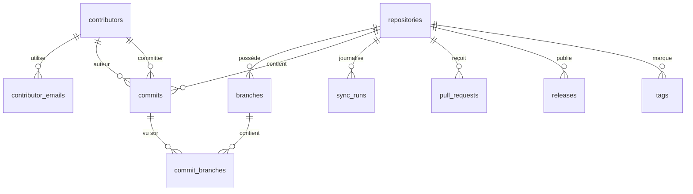

# 4. Modèle de données

[← Sommaire](README.md)

Sept tables suffisent pour le MVP ; `commits` est la table centrale, reliée aux dépôts, aux branches (via
`commit_branches`) et aux contributeurs. La V2 en ajoute trois (migration `00003`) : `pull_requests`,
`releases` et `tags`, soit **dix tables**. Le stockage est un fichier SQLite versionné par des migrations
`goose`, avec **une base par espace de supervision** (`.watchoo/watchoo.db`, voir
[Espaces de supervision](10-espaces-de-supervision.md)). Les tables ne connaissent donc pas la notion
d'espace : deux espaces ne partagent jamais de données.

## Schéma relationnel

## Tables

### `repositories` — dépôts suivis

Unicité : **`(provider, provider_id)`** et **`(provider, owner, name)`**.

| Colonne | Description |
| --- | --- |
| id | Identifiant interne |
| provider | Forge d'origine (`github` au MVP) |
| provider_id | Identifiant du dépôt sur la forge (identifiant numérique GitHub), qui ne change jamais |
| owner | Propriétaire (utilisateur ou organisation) |
| name | Nom du dépôt |
| label | Nom affiché (ex. « Alice Martin », « Groupe 3 »), facultatif ; vide = `owner/repo` |
| default_branch | Branche par défaut |
| url | URL du dépôt |
| stars | Nombre d'étoiles |
| open_issues | Nombre d'issues ouvertes |
| last_synced_at | Date de la dernière synchronisation |
| last_commit_at | Date du dernier commit connu, toutes branches suivies confondues |
| archived | Dépôt archivé sur GitHub |
| flemme_after_days | Seuil « Flemme » propre au dépôt, au moins 1 (vide = valeur globale, 5 j par défaut) ; réglé par `repo add --flemme`, la colonne `flemme` de l'import, le partage de la configuration ou la page du dépôt dans le web |
| dead_after_days | Seuil « Dead » propre au dépôt, au moins 1 (vide = valeur globale, 15 j par défaut) ; réglé de même (`--dead`, colonne `dead`) |
| enabled | Suivi actif, ou arrêté (`repo remove --keep-history` : historique gardé, plus de synchro ; `repo add` le réactive) |
| branch_patterns | Branches à suivre (`--branch`, colonne `branches` de l'import) : noms et motifs `path.Match` séparés par des virgules (`main,dev,release/*`) ; vide = toutes les branches. Ajoutée par la migration `00002` |

### `branches` — branches surveillées

Unicité : **`(repo_id, name)`**.

| Colonne | Description |
| --- | --- |
| id | Identifiant interne |
| repo_id | Dépôt parent |
| name | Nom de la branche |
| head_sha | SHA du dernier commit connu sur la branche |
| tracked | Branche suivie ou non |

### `contributors` — personnes identifiées

Unicité : **`(provider, provider_user_id)`**. Ces colonnes sont vides pour une personne connue seulement
par son e-mail Git ; SQLite accepte plusieurs valeurs vides dans une colonne unique.

| Colonne | Description |
| --- | --- |
| id | Identifiant interne |
| provider | Forge du compte (`github` au MVP), vide si aucun compte n'est connu |
| provider_user_id | Identifiant du compte sur la forge (identifiant numérique GitHub), qui ne change jamais |
| provider_login | Login GitHub (si connu), mis à jour si la personne en change |
| name | Nom affiché |
| avatar_url | URL de l'avatar |

### `contributor_emails` — rattachement des e-mails Git

Clé primaire : **`email`**. Une adresse désigne une seule personne ; une personne peut avoir plusieurs
adresses. Les adresses sont enregistrées **en minuscules** (`Bob@Mail.com` et `bob@mail.com` sont la même
adresse).

| Colonne | Description |
| --- | --- |
| email | Adresse e-mail Git, en minuscules |
| contributor_id | Contributeur |

### `commits` — historique (table centrale)

Clé primaire : **`(repo_id, sha)`**. Chaque commit est enregistré une seule fois par dépôt, quel que
soit le nombre de branches qui le contiennent.

| Colonne | Description |
| --- | --- |
| repo_id | Dépôt |
| sha | Identifiant du commit |
| author_id | Auteur (contributeur) |
| committer_id | Committer (contributeur) |
| message | Message de commit |
| authored_at | Date d'écriture |
| committed_at | Date de commit |
| additions | Lignes ajoutées (0 si inconnu, voir ci-dessous) |
| deletions | Lignes supprimées (0 si inconnu) |
| url | Lien vers le commit sur la forge |

- **Statistiques** (`additions`, `deletions`) : une requête par commit. Elles ne sont demandées que pour
  les commits découverts **après le premier import** du dépôt, au plus **100 par dépôt et par synchro**,
  et jamais quand le quota restant est sous 10 % ; sinon elles valent 0 (le premier import d'un dépôt
  d'étudiant de plusieurs centaines de commits ne coûte donc pas des centaines de requêtes).
- **Auteur et committer** : un commit dont l'e-mail Git est vide et qui n'est lié à aucun compte GitHub
  n'a pas de contributeur (`author_id` / `committer_id` vides) ; son nom Git est ignoré, faute
  d'identité fiable pour regrouper ces commits.

### `commit_branches` — appartenance des commits aux branches

Un même commit appartient souvent à plusieurs branches (par exemple après un merge de `dev` dans `main`).
Cette table de liaison indique sur quelles branches suivies chaque commit a été vu.

Clé primaire : **`(repo_id, sha, branch_id)`**. Clé étrangère `(repo_id, sha)` vers `commits`.

| Colonne | Description |
| --- | --- |
| repo_id | Dépôt |
| sha | Commit |
| branch_id | Branche sur laquelle le commit a été vu |

- Comptages et statistiques (contributeurs, graphiques) : sur `commits` seule, donc sans doublon.
- Filtre par branche : jointure avec `commit_branches`.

### `sync_runs` — journal des synchronisations

| Colonne | Description |
| --- | --- |
| id | Identifiant interne |
| repo_id | Dépôt synchronisé |
| started_at | Début |
| finished_at | Fin |
| new_commits | Nombre de nouveaux commits récupérés |
| status | `running`, `success` ou `error` |
| error | Message d'erreur éventuel, en français, sans donnée personnelle |

Le dernier `sync_run` d'un dépôt donne l'état « en erreur ». Un `sync_run` `running` sert aussi de
**verrou** : voir [Architecture](03-architecture.md#fréquence-de-synchronisation).

### `pull_requests` — pull requests (V2)

Clé primaire : **`(repo_id, number)`**. Une PR est enregistrée une fois par dépôt, puis mise à jour à
chaque synchro qui la voit modifiée (voir
[Synchronisation incrémentale](03-architecture.md#synchronisation-incrémentale)) ; elle n'est jamais
supprimée, sauf avec son dépôt.

| Colonne | Description |
| --- | --- |
| repo_id | Dépôt |
| number | Numéro de la PR dans le dépôt (au moins 1) |
| title | Titre (texte venu du dépôt : nettoyé à l'affichage, jamais dans les logs) |
| state | `open` ou `closed`, comme sur la forge |
| merged | Mergée (une PR mergée est aussi `closed`, avec `merged_at`) |
| draft | Brouillon |
| author_login | Login de l'auteur sur la forge ; vide si inconnu |
| author_provider_id | Identifiant numérique du compte de l'auteur ; 0 si inconnu |
| url | Lien vers la PR sur la forge |
| base_branch | Branche visée |
| head_branch | Branche proposée |
| created_at | Date d'ouverture |
| updated_at | Dernière modification (sert de point de reprise de la synchro suivante) |
| closed_at | Date de fermeture ; vide si ouverte |
| merged_at | Date de merge ; vide si non mergée. Une PR mergée a `state = closed` et `merged_at` renseigné |

- **Auteur** : gardé tel quel (login et identifiant de compte), **sans lien** vers `contributors` : un
  contributeur est l'auteur d'au moins un commit, et un auteur de PR sans commit ne doit pas apparaître
  dans le classement. Le rapprochement reste possible par `author_provider_id` =
  `contributors.provider_user_id`.
- **État affiché** : « ouverte » (ou « brouillon »), « mergée » (`merged`) ou « fermée » (fermée sans
  merge).

### `releases` — releases (V2)

Clé primaire : **`(repo_id, provider_id)`**. La liste d'un dépôt est **remplacée** à chaque synchro
réussie de cette liste : une release supprimée sur la forge disparaît.

| Colonne | Description |
| --- | --- |
| repo_id | Dépôt |
| provider_id | Identifiant de la release sur la forge |
| tag_name | Tag de la release |
| name | Titre (peut être vide) |
| draft | Brouillon (visible seulement d'un compte avec droit d'écriture sur le dépôt) |
| prerelease | Pré-release |
| author_login | Login de l'auteur ; vide si inconnu |
| url | Lien vers la release sur la forge |
| created_at | Date de création |
| published_at | Date de publication ; vide pour un brouillon |

### `tags` — tags (V2)

Clé primaire : **`(repo_id, name)`**. Comme `releases`, la liste d'un dépôt est remplacée à chaque
synchro réussie de cette liste.

| Colonne | Description |
| --- | --- |
| repo_id | Dépôt |
| name | Nom du tag |
| sha | SHA du commit visé |

La forge ne donne pas de date pour un tag : l'affichage reprend la date du commit visé quand il est en
base (jointure sur `commits (repo_id, sha)`, sans clé étrangère : le commit peut être sur une branche
non suivie).

## Index

| Index | Usage |
| --- | --- |
| `commits(repo_id, committed_at DESC)` | Vue « derniers commits » d'un dépôt |
| `commits(author_id, committed_at DESC)` | Vue « activité d'un contributeur » |
| `commit_branches(branch_id)` | Filtre « commits d'une branche » |
| `pull_requests(repo_id, updated_at DESC)` | Point de reprise de la synchro des PR, liste des PR d'un dépôt |

## Fusion des identités

À chaque commit synchronisé, l'auteur et le committer sont rattachés à un contributeur :

- **commit lié à un compte GitHub** : contributeur trouvé (ou créé) par `(provider, provider_user_id)`,
  login, nom et avatar mis à jour ; l'e-mail Git (en minuscules) lui est rattaché. Si cet e-mail
  appartenait à un contributeur **sans compte**, celui-ci est fusionné dans le contributeur avec compte
  (ses commits et ses autres e-mails lui sont réattribués, puis il est supprimé) ;
- **commit sans compte** : contributeur trouvé par e-mail, sinon créé sans compte (nom = nom Git) ;
- **ni compte ni e-mail** : pas de contributeur.

Précisions :

- seuls les commits **nouveaux** passent par ces règles : un commit déjà en base ne met pas à jour son
  contributeur ;
- le nom Git d'un commit sans compte met à jour le nom d'un contributeur **sans compte** trouvé par
  e-mail (le plus récent l'emporte), jamais celui d'un contributeur avec compte ; un login ou un avatar
  vide n'efface pas la valeur connue ; lors d'une fusion, le contributeur avec compte reprend le nom du
  contributeur absorbé s'il n'en a pas.

## Renommages et changements de login

Sur GitHub, un dépôt peut être renommé ou transféré, et un utilisateur peut changer de login. Les
identifiants numériques (`provider_id`, `provider_user_id`) ne changent jamais : c'est sur eux que repose
l'unicité. À chaque synchro, Watchoo met à jour `owner`, `name` et `provider_login` si besoin, sans créer de
doublon et sans séparer l'historique.

## Dates

- Stockées en **texte ISO 8601, en UTC**, avec un format strictement fixe à la seconde près :
  `2006-01-02T15:04:05Z` (ex. `2026-10-26T14:03:00Z`). Un format fixe se trie correctement comme du texte,
  donc les index sur `committed_at` fonctionnent.
- C'est le format renvoyé par l'API GitHub. Les colonnes de date sont déclarées `TEXT` (sqlc génère donc
  des `string` ou `sql.NullString`) : la conversion `string` ↔ `time.Time` est faite explicitement dans
  `internal/store` (`FormatTime` / `ParseTime`), car le driver `modernc` n'écrit pas ce format tout seul.
  Le format est aussi vérifié en base par une contrainte `CHECK`.
- **Conversion en heure locale à l'affichage seulement** (CLI, TUI, web) : dates relatives (« il y a 2 h »)
  ou date et heure locales.
- **Regroupements « par jour / semaine »** (graphiques, statistiques) : selon le **fuseau de
  l'utilisateur**, celui du système par défaut ou celui réglé dans la config. Sinon, un commit fait à
  23 h à Paris tomberait le lendemain.
- Le fuseau horaire de l'auteur n'est pas conservé, car l'API GitHub renvoie les dates déjà converties en
  UTC.
