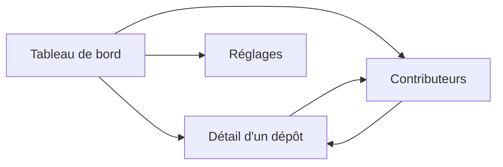

# 6. Interface web

[← Sommaire](README.md)

Quatre pages servies par `watchoo serve`, rafraîchies par HTMX sans rechargement complet. Les templates
(`html/template`) et les assets statiques sont embarqués dans le binaire (`embed`) : aucun build JavaScript.
Le style repose sur [DaisyUI](https://daisyui.com/) : composants `card`, `badge`, `table`, `stat`,
thèmes clair / sombre (voir [Architecture](03-architecture.md#css--daisyui)).

`watchoo serve` affiche **un seul espace de supervision** : celui du répertoire où on le lance (ou celui
donné par `-C`). Le nom de l'espace (ex. « licence-projet ») est affiché dans le titre de chaque page. Pour
plusieurs espaces en même temps, on lance un `serve` par espace, chacun sur son port (`web.addr`).

## Pages

| Page | Adresse | Fragments HTMX |
| --- | --- | --- |
| Tableau de bord | `/` | `/fragments/dashboard/repos`, `/fragments/dashboard/feed` |
| Détail d'un dépôt | `/repos/{id}` (`?page=`, `?branch=`, `?author=`) | `/repos/{id}/commits` |
| Contributeurs | `/contributors` | `/fragments/contributors` |
| Réglages | `/settings` | `/fragments/quota` |

Toutes les pages ont la même barre de navigation (DaisyUI `navbar`) : logo, nom de l'espace, liens,
état des synchros et sélecteur de thème clair / sombre (choix gardé dans `localStorage`, clé
`watchoo-theme` ; par défaut, celui du système, `prefers-color-scheme`). Sous 1024 px de large, les
liens puis l'état des synchros passent chacun sur leur propre ligne. Les dates sont relatives
(« il y a 2 h »), avec l'heure locale (fuseau d'affichage) en infobulle. Page introuvable (404) et
erreurs (500…) : pages en français, sans détail interne (le détail est dans le journal de `serve`).

### 1. Tableau de bord
- Une **carte par dépôt** : nom affiché (`label`, ex. « Alice Martin ») ou `owner/repo` (rappelé sous le
  label), première ligne du dernier commit, auteur, ancienneté, nombre de commits et de branches suivies.
- **Pastille d'état** (voir [règles](02-fonctionnalites.md#règles-fonctionnelles)) : Actif en vert
  (`badge-success`), Flemme en orange (`badge-warning`), Dead en rouge (`badge-error`) ; jamais
  synchronisé, en erreur, archivé, arrêté ou vide en gris (`badge-neutral`). Libellés identiques à la
  CLI (« Flemme · 9 j », « Dead · 40 j »). La bordure gauche de la carte reprend la couleur.
- **Tri** : Dead, puis Flemme, puis Actif, le dernier commit le plus ancien d'abord dans chaque groupe ;
  ensuite les dépôts en erreur (pour qu'ils se voient), puis les autres états gris ; égalités départagées
  par nom affiché.
- **Compteurs** par état (DaisyUI `stat`), avec les seuils de l'espace rappelés sous Flemme et Dead.
- **Fil des 20 derniers commits**, tous dépôts confondus (initiale de l'auteur, message, dépôt, date ;
  SHA court lié au commit sur GitHub).
- **Graphique d'activité de l'espace sur 90 jours** : commits par jour, tous dépôts confondus (voir
  [Graphiques d'activité](#graphiques-dactivité)), avec son résumé (total, jour le plus chargé). Absent
  tant qu'aucun dépôt n'est suivi.
- Bouton **« Synchroniser maintenant »**. Sans aucun dépôt : un état vide renvoie vers les réglages.

### 2. Détail d'un dépôt
- En-tête : état, seuils, dernier commit, dernière synchro et son résultat, nombre de commits, branche par
  défaut, branches suivies et motifs, étoiles et issues.
- Historique des commits **paginé** (50 par page, liens précédent / suivant, HTMX). Le numéro de page
  hors bornes est ramené à la première ou à la dernière page.
- Filtres par **branche** (branches suivies d'abord) et par **auteur** (login GitHub, sinon nom Git ;
  jamais un e-mail), appliqués par HTMX au changement et gardés d'une page à l'autre ; l'adresse de la
  page (`?branch=`, `?author=`, `?page=`) est mise dans la barre d'adresse et se recharge telle quelle.
  **Choix** : un filtre auteur qui contient « @ » (un e-mail) est ignoré, avec un message, pour qu'aucune
  adresse ne finisse dans une URL ou l'historique du navigateur.
- **Graphique d'activité sur 90 jours** (Chart.js) : commits par jour calendaire du fuseau d'affichage,
  calculés en Go (`activity.DailyCounts`), transmis en JSON dans un
  `<script type="application/json" id="activity-data">` et dessinés par `static/app.js` (aucune donnée
  dans du code JavaScript ; couleurs du thème, redessiné au changement de thème, sans animation si le
  système demande moins de mouvement). HTMX supprime tout `<script>` d'un fragment
  (`allowScriptTags: false`) : le graphique est donc hors des fragments ; à la fin d'une synchro,
  `app.js` relit la page (même origine), extrait les données avec `DOMParser` (qui n'exécute rien) et
  redessine.
- Liste des contributeurs du dépôt (avatar ou initiale, login, dernier commit).
- Bouton **« Synchroniser ce dépôt »** (absent si le suivi est arrêté).
- Fragments : `/repos/{id}/commits` (historique) ; `/repos/{id}` avec l'en-tête `HX-Target`
  `repo-overview` ou `repo-contributors` renvoie l'en-tête ou les contributeurs seuls. Tous se
  rechargent à la fin d'une synchro.

### 3. Contributeurs
- Classement global (commits, part du total, lignes ajoutées / retirées ; « — » si les statistiques n'ont
  pas encore été lues), avec trois compteurs (contributeurs, commits, dépôts).
- Nombre de commits par dépôt (liens vers le détail).
- Dernière activité.
- **Graphique d'activité par contributeur sur 12 semaines** : barres empilées des commits par semaine
  (du lundi au dimanche), une série par contributeur parmi les **8 plus actifs de la période** (égalités
  départagées par le classement global), les autres regroupés dans « Autres contributeurs » (gris) ;
  légende, infobulle par semaine (détail et total) et table « Données du graphique » repliable (vue
  sans graphique). Absent tant qu'aucun auteur n'est connu. Voir
  [Graphiques d'activité](#graphiques-dactivité).
- Avatar GitHub. **Choix** : l'image est chargée depuis `avatars.githubusercontent.com`, seul hôte
  externe permis (CSP `img-src`) : c'est une requête vers un tiers, faite par le navigateur, qui révèle à
  GitHub qu'un avatar est affiché, mais sans en-tête `Referer` (`referrerpolicy="no-referrer"`), en
  chargement différé (`loading="lazy"`) et sans aucun cookie de Watchoo. Une URL d'avatar d'un autre
  hôte n'est jamais affichée ; sans avatar, on montre l'initiale du nom. Aucun e-mail n'est affiché.

### 4. Réglages
- Liste des dépôts suivis (état, branches, commits, dernière synchro).
- Ajouter un dépôt (`owner/repo` ou URL, label, branches : mêmes vérifications que `watchoo repo add`,
  accès vérifié auprès de GitHub, aucune synchro lancée). Un champ branches vide veut dire « non
  précisé » : un nouveau dépôt suit toutes les branches, un dépôt déjà suivi garde ses motifs. Réponses :
  redirection vers `/settings?msg=<code>&repo=<id>` (le message est construit par le serveur à partir
  d'une liste fixe de codes : rien de la requête n'est renvoyé tel quel), `400` avec le formulaire
  rempli en cas de saisie invalide, `422` si le dépôt est inaccessible, `502` avec un message générique
  si GitHub répond mal. Une saisie refusée qui contient « @ » (une URL avec identifiants) n'est pas
  réaffichée.
- Modifier le nom affiché et les branches (champ vide : toutes les branches).
- Retirer un dépôt : page de confirmation (`GET`, ne modifie rien), puis arrêt du suivi avec historique
  gardé (comme `repo remove --keep-history`), ou suppression avec l'historique. **Choix** : la
  suppression est refusée (`409`) pendant une synchro, pour que le moteur n'écrive pas dans un dépôt en
  cours de suppression ; l'arrêt du suivi reste possible. Un dépôt arrêté peut reprendre son suivi.
- Import groupé depuis un fichier CSV (même format et même bilan que `watchoo repo import`) : V2.
- Intervalle de synchronisation : valeur en vigueur, prochaine synchro et valeur de `config.yaml`. Il
  peut être changé **pour la durée du processus seulement** (durée Go comme `45m` ou `1h30m`, nombre
  entier de minutes, ou 0 ; 0 ou au moins 15 min) : `config.yaml` n'est jamais réécrit par
  l'interface ; pour un changement durable, modifier `sync.interval` dans le fichier.
- Bouton **« Synchroniser maintenant »**.
- État du **quota API** GitHub (restant, limite, remise à zéro en heure locale, « quota bas » sous
  10 %), lu par une requête gratuite (`GET /rate_limit`) dans un fragment chargé après la page et
  rechargé à la fin d'une synchro ; « quota inconnu » si `gh` ne donne pas de token.
- Les formulaires des réglages sont des `POST` classiques (redirection `303`, ou page réaffichée avec
  l'erreur), car HTMX ne remplace pas le contenu sur une réponse 4xx. La liste des dépôts n'est pas
  rechargée à la fin d'une synchro (seul le quota l'est).

## Graphiques d'activité

Trois graphiques (Chart.js 4, embarqué, chargé seulement sur les pages qui en ont un) : détail d'un
dépôt et tableau de bord (commits par jour sur 90 jours, `activity.DailyCounts`), contributeurs
(commits par semaine sur 12 semaines, `activity.WeeklyCounts`, séries construites par
`buildContributorChart` dans `internal/web/charts.go`).

- **Calcul en Go**, par des fonctions pures testées : jours et semaines (du lundi au dimanche) dans le
  **fuseau d'affichage** de l'espace ([Dates](04-modele-donnees.md#dates)) ; dates lues par
  `store.CommitTimes` (tous dépôts ou un seul) et `store.AuthorCommitTimes` (auteur et date) ; aucun
  e-mail. Les noms de la légende sont nettoyés (`textclean`) et tronqués à 40 caractères.
- **Transmission** : JSON dans un `<script type="application/json">` (échappé par `html/template`),
  lu par `static/app.js` avec `JSON.parse` et validé ; aucune donnée dans du code JavaScript (CSP
  stricte). Chaque `<canvas>` déclare sa forme (`data-chart` : `daily` ou `weekly-stacked`), ses
  données (`data-source`), son résumé (`data-summary`), sa table éventuelle (`data-table`) et la page
  à relire (`data-refresh-url`).
- **Rafraîchissement** : les graphiques sont hors des fragments (HTMX retire leurs `<script>`) ; à la fin
  d'une synchro (`sync-finished`), `app.js` relit la page (même origine), en extrait les données, le
  résumé et la table avec `DOMParser` (qui n'exécute rien ; la table est recopiée par `importNode`,
  jamais par `innerHTML`) et redessine.
  Une carte de graphique n'est rendue que si l'espace a des données au chargement de la page (au
  moins un dépôt suivi pour le tableau de bord, un auteur connu pour les contributeurs) : sur un espace
  encore vide, elle n'apparaît qu'au rechargement de la page qui suit la première synchro (limite connue
  de 0.1.0).
- **Couleurs** : barres simples de la couleur primaire du thème ; séries des contributeurs dans une
  palette catégorielle de 8 teintes en ordre fixe, avec une variante claire et une variante sombre
  (vérifiées pour les daltonismes courants et le contraste sur le fond de chaque thème ; en thème clair,
  trois teintes sont sous 3:1, d'où la légende et la table des données) ; « Autres contributeurs » en
  gris ; jamais de couleur générée. Axes et grille reprennent le texte du thème. Redessiné au changement
  de thème ; sans animation si le système demande moins de mouvement.
- **Accessibilité** : chaque `<canvas>` a `role="img"` et un `aria-label` qui résume la série ; un résumé
  textuel est affiché à côté du titre.

## Navigation



## Logo et icônes

Le logo est un hibou (« watch-hoo ») géométrique : une tête pleine aux oreilles pointues, dont les yeux et le
bec sont découpés dans la forme, sur un carré arrondi. Il reste lisible jusqu'à 16 px. Les fichiers sont
dans [`assets/logo/`](../assets/logo/) :

| Fichier | Usage |
| --- | --- |
| `watchoo.svg` | Logo de référence, fond sombre (README, en-tête des pages) ; tous les autres fichiers en sont tirés |
| `watchoo-light.svg` | Variante pour fond clair |
| `watchoo-nom.svg` | Nom « watchoo » à gauche du logo, pour fond clair (en-tête des pages, documents) |
| `watchoo-nom-light.svg` | Même chose, pour fond sombre |
| `favicon.ico` | Favicon : 16, 32 et 48 px |
| `apple-touch-icon.png` | Raccourci sur l'écran d'accueil iOS (180 px) |
| `icon-192.png`, `icon-512.png` | Manifeste web |

Couleurs : fond `#0f172a` (variante claire : `#e2e8f0`), tête `#f8fafc` (variante claire : `#0f172a`),
pupilles `#22c55e`, le vert de l'état Actif. Dans les versions avec le nom, les lettres sont des tracés
géométriques (aucune police requise) et les deux « o » portent un point vert, comme les yeux. Ces
fichiers sont copiés dans `internal/web/static/` (`make logo`) et embarqués avec `embed` ; un test
vérifie que les copies sont identiques. Un manifeste web minimal (`/manifest.webmanifest`) cite les
icônes.

### Versions texte (CLI et TUI)

Le même hibou existe en plusieurs versions texte, choisies selon la situation et le terminal :

| Fichier | Taille | Usage |
| --- | --- | --- |
| `ascii-mini.txt` | 8 × 3, blocs Unicode | [Carte d'en-tête](05-cli.md#carte-den-tête) de la CLI, en-tête des fichiers de configuration (`config.yaml`), en-tête du TUI |
| `ascii-mini-pur.txt` | 8 × 3, ASCII pur | Carte d'en-tête de la CLI si le terminal ne gère pas l'Unicode |
| `ascii-mini-nom.txt` | 44 × 4, blocs Unicode | En-tête du TUI, avec le nom |
| `ascii-blocs.txt` | 16 × 8, blocs Unicode | Écran d'accueil du TUI |
| `ascii-blocs-nom.txt` | 53 × 8, blocs Unicode | Idem, avec le nom |
| `ascii.txt` | 16 × 8, ASCII pur | Écran d'accueil du TUI si le terminal ne gère pas l'Unicode |
| `ascii-nom.txt` | 53 × 8, ASCII pur | Idem, avec le nom |

La version mini, en ASCII pur :

```
|\    /|
| o##o |
\##\/##/
```

Les versions avec le nom tiennent dans 80 colonnes ; si le terminal est plus étroit que la version avec le
nom, on affiche la version sans nom.

Le hibou prend la couleur du texte du terminal et ses yeux celle du fond : il s'adapte seul aux terminaux
clairs et sombres. Dans la carte d'en-tête de la CLI, les pupilles sont colorées en vert (séquences ANSI) ;
dans le TUI, avec lipgloss ; sans couleur (`NO_COLOR`, sortie redirigée), le dessin reste lisible en
monochrome.

Ces fichiers sont embarqués dans le binaire par le package `internal/logo`. `go:embed` ne pouvant pas
remonter hors du package, `internal/logo/art/` en garde une copie : après une modification de
`assets/logo/*.txt`, `make logo` refait la copie, et un test vérifie qu'elle est identique, octet pour
octet.

## Synchronisation en arrière-plan

`watchoo serve` lance aussi la synchro périodique (`--interval`, **30 min** par défaut, **15 min** minimum,
désactivable avec `--interval 0`). La synchro manuelle reste possible à tout moment (réglages pour tous
les dépôts, page de détail pour un seul). Pendant une synchro, HTMX affiche sa progression. Les pages
reflètent l'état de la base ; HTMX rafraîchit les fragments concernés.

Fonctionnement (`wsync.Coordinator`, un seul par processus, qui réutilise le moteur) :

- **une seule synchro à la fois** dans le processus : une demande manuelle pendant une synchro est
  refusée avec le message « Synchro déjà en cours » ; une synchro automatique qui tombe pendant une
  synchro est sautée. Une synchro manuelle ne décale pas la prochaine synchro automatique. Le verrou en
  base (`sync_runs`) et le garde-fou de quota restent ceux du moteur : un `tui` ou un `watchoo sync`
  lancé en même temps ne synchronise pas deux fois le même dépôt ;
- **au démarrage**, une synchro n'est lancée tout de suite que si la dernière synchro terminée
  (`sync_runs`) date de plus d'un intervalle ; sinon, la première a lieu un intervalle après elle ;
- **progression** : l'état des synchros (navbar) est un fragment qui se rafraîchit toutes les 2 s
  pendant une synchro (dépôts terminés / total, dépôt en cours), et toutes les 30 s sinon, pour voir
  démarrer une synchro automatique (ou lancée depuis un autre onglet). **Choix** : ce sondage à 30 s
  continue une fois la synchro finie ; il ne coûte qu'une lecture en mémoire de l'état du coordinateur
  (aucun appel GitHub, aucune requête en base) et un fragment de quelques centaines d'octets. Quand il
  constate la fin d'une synchro, sa réponse porte l'en-tête `HX-Trigger: sync-finished`, et les
  fragments des pages (cartes, fil, historique…) ainsi que les graphiques se rechargent.
  Une synchro lancée depuis l'interface et déjà terminée quand la réponse est rendue (échec immédiat
  du moteur, dépôt vite synchronisé) porte cet en-tête dès la réponse au `POST`. Les boutons de synchro
  (« Synchroniser maintenant », « Synchroniser ce dépôt ») et celui de la suppression d'un dépôt ne
  sont jamais désactivés au rendu : la plupart sont hors des fragments rechargés et resteraient
  inutilisables après la fin de la synchro ; c'est le `POST` qui refuse (« Synchro déjà en cours »,
  suppression refusée pendant une synchro) ;
- le token est redemandé à `gh` à chaque synchro par le moteur ; il n'est jamais envoyé au navigateur ;
- **arrêt** (Ctrl+C, SIGTERM) : le serveur cesse d'accepter des requêtes et termine celles en cours
  (10 s au plus), la synchro en cours est annulée (ses `sync_runs` sont clos « synchro annulée ») et
  attendue (10 s au plus), puis la base est fermée.

## Sécurité

- Écoute sur **`127.0.0.1:8080` par défaut** (`web.addr`, option `--addr`).
- Les dépôts suivis sont principalement **privés** : l'interface affiche leur contenu (messages de commit,
  auteurs) ; elle n'affiche **aucun e-mail**.
- Si on écoute ailleurs que sur la boucle locale (`127.0.0.0/8`, `::1`, `localhost` ; un hôte vide ou
  `0.0.0.0` écoute sur toutes les interfaces), l'**authentification est obligatoire** : Watchoo refuse
  de démarrer sans authentification basique configurée, sauf si on indique explicitement qu'un reverse
  proxy authentifiant est en place.
  - **Authentification basique** : identifiant `web.auth.username` dans la config, mot de passe
    **uniquement** dans la variable d'environnement `WATCHOO_WEB_PASSWORD` (12 caractères au moins ;
    jamais dans un fichier de réglages, jamais journalisé). Comparaison en temps constant (empreintes
    SHA-256, `crypto/subtle`). Elle s'applique à toutes les adresses, fichiers statiques compris, et
    peut aussi être activée en écoute locale. Sans HTTPS, le mot de passe circule en clair sur le réseau :
    préférer un reverse proxy HTTPS.
  - **Reverse proxy** : `web.trusted_proxy: true` permet de démarrer sans authentification basique,
    avec un avertissement au démarrage. Le contrôle de l'en-tête `Host` **reste actif** : un proxy ne
    protège pas d'une page rebindée qui joint Watchoo directement (même avec Watchoo sur `127.0.0.1`
    et le proxy sur la même machine). `web.allowed_hosts` liste les noms publics que le proxy transmet
    dans `Host` (ex. `["watchoo.example.org"]`, sans port) ; hors boucle locale, il est **obligatoire**
    avec `web.trusted_proxy` sans authentification basique (refus de démarrer sinon). En boucle
    locale, sans ce réglage, seuls les noms locaux passent (cas d'un proxy qui transmet
    `Host: 127.0.0.1:8080`, comme nginx par défaut ; Caddy transmet le nom public, à lister).
- **DNS rebinding** : une requête dont l'en-tête `Host` n'est ni `localhost`, `127.0.0.1`, `[::1]` (ou
  l'hôte écouté) suivi du port écouté, ni un nom de `web.allowed_hosts` (avec n'importe quel port) est
  refusée (`421`), avec une page qui ne montre rien de l'espace. Le contrôle s'applique en écoute
  locale, derrière un reverse proxy déclaré sans authentification basique, et dès que
  `web.allowed_hosts` est réglé. Il n'est levé qu'hors boucle locale avec l'authentification basique
  et sans `web.allowed_hosts` : le navigateur n'envoie pas les identifiants au nom d'un autre site.
- **CSRF** : aucune action en `GET` ; toute requête qui modifie quelque chose est un `POST`, vérifié deux
  fois : origine (`http.CrossOriginProtection` : `Sec-Fetch-Site`, sinon `Origin` comparé à `Host`) et
  jeton aléatoire (cookie `HttpOnly`, `SameSite=Strict`, nommé avec le port, renvoyé dans le champ
  `csrf_token` ou l'en-tête `X-CSRF-Token` que HTMX ajoute grâce à `hx-headers`). Échec : `403`, rien
  n'est modifié. Le cookie n'est posé qu'avec une page ou un fragment HTML, jamais avec un fichier
  statique (`/static/…`, icônes, manifeste).
- **Méthodes** : `HEAD` est accepté partout où `GET` l'est (même réponse, sans corps) ; une autre méthode
  sur une route connue donne `405`.
- **En-têtes** : `Content-Security-Policy` stricte (`default-src 'self'` ; `img-src 'self'
  https://avatars.githubusercontent.com data:` ; `script-src 'self'` et `style-src 'self'`, sans
  `unsafe-inline` ni `unsafe-eval` ; `frame-ancestors 'none'`…), `X-Content-Type-Options: nosniff`,
  `Referrer-Policy: no-referrer`, `X-Frame-Options: DENY` ; pages et fragments en `Cache-Control:
  no-store`. Vérifié : HTMX 2 et Chart.js 4 fonctionnent sous cette politique, HTMX étant réglé par la
  balise `<meta name="htmx-config">` (pas de `<style>` injecté, pas d'`eval` donc pas de `hx-on` ni de
  filtres d'événements, pas de `<script>` exécuté dans un fragment, pas d'historique gardé dans
  `localStorage`). Aucun script ni style en ligne dans les templates.
- **Échappement** : `html/template` partout ; aucun `template.HTML` construit à partir de données ; les
  textes venus de la base passent en plus par `textclean` (caractères de contrôle).
- **Journal d'accès** (`slog`, niveau info) : méthode, motif de route (`/repos/{id}`), code, durée ;
  jamais la query string, une adresse IP, un en-tête ni une donnée personnelle.
- **Journal** : une lecture du quota interrompue (page quittée, arrêt de `serve` : contexte annulé) est
  journalisée en `debug` ; les autres échecs de lecture du quota, en avertissement.
- **Limites** : délais du serveur (`ReadHeaderTimeout` 5 s…), corps de requête borné à 64 Kio,
  identifiants de dépôt validés par la route (1 à 18 chiffres).
- Le token GitHub n'est jamais affiché ni renvoyé au navigateur.
