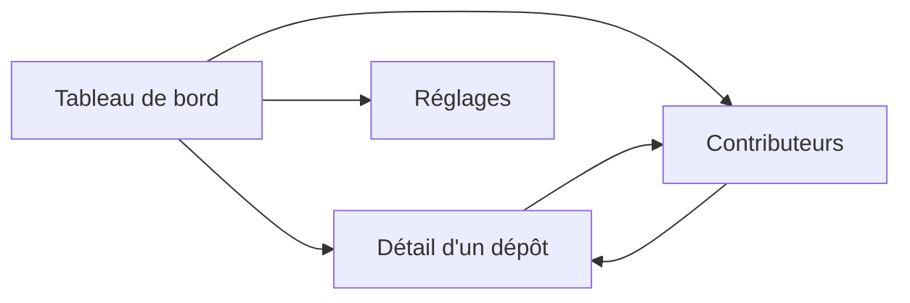

# 6. Interface web

[← Sommaire](README.md)

Quatre pages servies par `watchoo serve`, rafraîchies par HTMX sans rechargement complet. Les templates
(`html/template`) et les assets statiques sont embarqués dans le binaire (`embed`) : aucun build JavaScript.
Le style repose sur [DaisyUI](https://daisyui.com/) : composants `card`, `badge`, `table`, `stat`,
thèmes clair / sombre (voir [Architecture](03-architecture.md#css--daisyui)).

`watchoo serve` affiche **un seul espace de supervision** : celui du répertoire où on le lance (ou celui
donné par `-C`). Le nom de l'espace (ex. « licence-projet ») est affiché dans le titre de chaque page. Pour
plusieurs espaces en même temps, on lance un `serve` par espace, chacun sur son port (`web.addr`).

## Pages

### 1. Tableau de bord
- Une **carte par dépôt** : nom affiché (`label`, ex. « Alice Martin ») ou `owner/repo`, dernier commit, auteur, ancienneté.
- **Pastille d'état** (voir [règles](02-fonctionnalites.md#règles-fonctionnelles)) : Actif en vert
  (`badge-success`), Flemme en orange (`badge-warning`), Dead en rouge (`badge-error`) ; jamais
  synchronisé, en erreur ou archivé en gris (`badge-neutral`).
- **Fil des 20 derniers commits**, tous dépôts confondus.

### 2. Détail d'un dépôt
- Historique des commits **paginé**.
- Filtres par **branche** et par **auteur**.
- **Graphique d'activité sur 90 jours** (Chart.js).
- Liste des contributeurs du dépôt.
- Bouton **« Synchroniser ce dépôt »**.

### 3. Contributeurs
- Classement global.
- Nombre de commits par dépôt.
- Dernière activité.
- Avatar GitHub.

### 4. Réglages
- Ajouter / retirer un dépôt, modifier son nom affiché.
- Import groupé depuis un fichier CSV (même format et même bilan que `watchoo repo import`) : V2.
- Intervalle de synchronisation.
- Bouton **« Synchroniser maintenant »**.
- État du **quota API** GitHub.

## Navigation



## Logo et icônes

Le logo est un hibou (« watch-hoo ») géométrique : une tête pleine aux oreilles pointues, dont les yeux et le
bec sont découpés dans la forme, sur un carré arrondi. Il reste lisible jusqu'à 16 px. Les fichiers sont
dans [`assets/logo/`](../assets/logo/) :

| Fichier | Usage |
| --- | --- |
| `watchoo.svg` | Logo de référence, fond sombre (README, en-tête des pages) ; tous les autres fichiers en sont tirés |
| `watchoo-light.svg` | Variante pour fond clair |
| `watchoo-nom.svg` | Nom « watchoo » à gauche du logo, pour fond clair (en-tête des pages, documents) |
| `watchoo-nom-light.svg` | Même chose, pour fond sombre |
| `favicon.ico` | Favicon : 16, 32 et 48 px |
| `apple-touch-icon.png` | Raccourci sur l'écran d'accueil iOS (180 px) |
| `icon-192.png`, `icon-512.png` | Manifeste web |

Couleurs : fond `#0f172a` (variante claire : `#e2e8f0`), tête `#f8fafc` (variante claire : `#0f172a`),
pupilles `#22c55e`, le vert de l'état Actif. Dans les versions avec le nom, les lettres sont des tracés
géométriques (aucune police requise) et les deux « o » portent un point vert, comme les yeux. Ces fichiers seront copiés dans `internal/web/static/` et
embarqués avec `embed` lorsque l'interface web sera écrite.

### Versions texte (CLI et TUI)

Le même hibou existe en plusieurs versions texte, choisies selon la situation et le terminal :

| Fichier | Taille | Usage |
| --- | --- | --- |
| `ascii-mini.txt` | 8 × 3, blocs Unicode | [Carte d'en-tête](05-cli.md#carte-den-tête) de la CLI, en-tête des fichiers de configuration (`config.yaml`), en-tête du TUI |
| `ascii-mini-pur.txt` | 8 × 3, ASCII pur | Carte d'en-tête de la CLI si le terminal ne gère pas l'Unicode |
| `ascii-mini-nom.txt` | 44 × 4, blocs Unicode | En-tête du TUI, avec le nom |
| `ascii-blocs.txt` | 16 × 8, blocs Unicode | Écran d'accueil du TUI |
| `ascii-blocs-nom.txt` | 53 × 8, blocs Unicode | Idem, avec le nom |
| `ascii.txt` | 16 × 8, ASCII pur | Écran d'accueil du TUI si le terminal ne gère pas l'Unicode |
| `ascii-nom.txt` | 53 × 8, ASCII pur | Idem, avec le nom |

La version mini, en ASCII pur :

```
|\    /|
| o##o |
\##\/##/
```

Les versions avec le nom tiennent dans 80 colonnes ; si le terminal est plus étroit que la version avec le
nom, on affiche la version sans nom.

Le hibou prend la couleur du texte du terminal et ses yeux celle du fond : il s'adapte seul aux terminaux
clairs et sombres. Dans la carte d'en-tête de la CLI, les pupilles sont colorées en vert (séquences ANSI) ;
dans le TUI, avec lipgloss ; sans couleur (`NO_COLOR`, sortie redirigée), le dessin reste lisible en
monochrome.

Ces fichiers sont embarqués dans le binaire par le package `internal/logo`. `go:embed` ne pouvant pas
remonter hors du package, `internal/logo/art/` en garde une copie : après une modification de
`assets/logo/*.txt`, `make logo` refait la copie, et un test vérifie qu'elle est identique, octet pour
octet.

## Synchronisation en arrière-plan

`watchoo serve` lance aussi la synchro périodique (`--interval`, **30 min** par défaut, **15 min** minimum,
désactivable avec `--interval 0`). La synchro manuelle reste possible à tout moment (réglages pour tous
les dépôts, page de détail pour un seul). Pendant une synchro, HTMX affiche sa progression. Les pages
reflètent l'état de la base ; HTMX rafraîchit les fragments concernés.

## Sécurité

- Écoute sur **`127.0.0.1` par défaut**.
- Les dépôts suivis sont principalement **privés** : l'interface affiche leur contenu (messages de commit,
  auteurs, e-mails).
- Si on écoute sur une autre adresse que `127.0.0.1` / `localhost`, l'**authentification est
  obligatoire** : Watchoo refuse de démarrer sans authentification basique configurée, sauf si on indique
  explicitement qu'un reverse proxy authentifiant est en place.
- Le token GitHub n'est jamais affiché ni renvoyé au navigateur.
