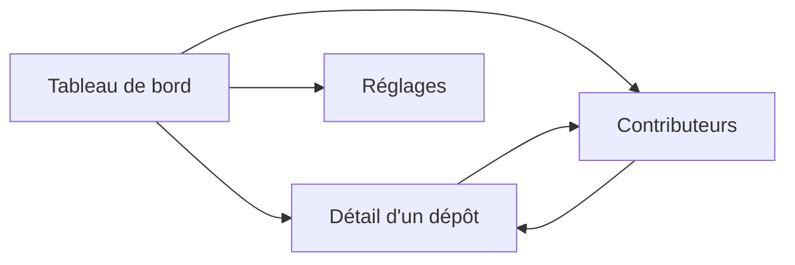

# 6. Interface web

[← Sommaire](README.md)

Quatre pages servies par `watchoo serve`, rafraîchies par HTMX sans rechargement complet. Les templates
(`html/template`) et les assets statiques sont embarqués dans le binaire (`embed`) : aucun build JavaScript.
Le style repose sur [DaisyUI](https://daisyui.com/) : composants `card`, `badge`, `table`, `stat`,
thèmes clair / sombre (voir [Architecture](03-architecture.md#css--daisyui)).

`watchoo serve` affiche **un seul espace de supervision** : celui du répertoire où on le lance (ou celui
donné par `-C`). Le nom de l'espace (ex. « licence-projet ») est affiché dans le titre de chaque page. Pour
plusieurs espaces en même temps, on lance un `serve` par espace, chacun sur son port (`web.addr`).

## Pages

### 1. Tableau de bord
- Une **carte par dépôt** : nom affiché (`label`, ex. « Alice Martin ») ou `owner/repo`, dernier commit, auteur, ancienneté.
- **Pastille d'état** (voir [règles](02-fonctionnalites.md#règles-fonctionnelles)) : Actif en vert
  (`badge-success`), Flemme en orange (`badge-warning`), Dead en rouge (`badge-error`) ; jamais
  synchronisé, en erreur ou archivé en gris (`badge-neutral`).
- **Fil des 20 derniers commits**, tous dépôts confondus.

### 2. Détail d'un dépôt
- Historique des commits **paginé**.
- Filtres par **branche** et par **auteur**.
- **Graphique d'activité sur 90 jours** (Chart.js).
- Liste des contributeurs du dépôt.
- Bouton **« Synchroniser ce dépôt »**.

### 3. Contributeurs
- Classement global.
- Nombre de commits par dépôt.
- Dernière activité.
- Avatar GitHub.

### 4. Réglages
- Ajouter / retirer un dépôt, modifier son nom affiché.
- Import groupé depuis un fichier CSV (même format et même bilan que `watchoo repo import`) : V2.
- Intervalle de synchronisation.
- Bouton **« Synchroniser maintenant »**.
- État du **quota API** GitHub.

## Navigation

## Synchronisation en arrière-plan

`watchoo serve` lance aussi la synchro périodique (`--interval`, **30 min** par défaut, **15 min** minimum,
désactivable avec `--interval 0`). La synchro manuelle reste possible à tout moment (réglages pour tous
les dépôts, page de détail pour un seul). Pendant une synchro, HTMX affiche sa progression. Les pages
reflètent l'état de la base ; HTMX rafraîchit les fragments concernés.

## Sécurité

- Écoute sur **`127.0.0.1` par défaut**.
- Les dépôts suivis sont principalement **privés** : l'interface affiche leur contenu (messages de commit,
  auteurs, e-mails).
- Si on écoute sur une autre adresse que `127.0.0.1` / `localhost`, l'**authentification est
  obligatoire** : Watchoo refuse de démarrer sans authentification basique configurée, sauf si on indique
  explicitement qu'un reverse proxy authentifiant est en place.
- Le token GitHub n'est jamais affiché ni renvoyé au navigateur.
