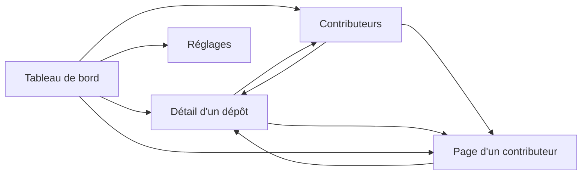

# 6. Interface web

[← Sommaire](README.md)

Cinq pages servies par `watchoo serve`, rafraîchies par HTMX sans rechargement complet. Les templates
(`html/template`) et les assets statiques sont embarqués dans le binaire (`embed`) : aucun build JavaScript.
Le style repose sur [DaisyUI](https://daisyui.com/) : composants `card`, `badge`, `table`, `stat`,
thèmes clair / sombre (voir [Architecture](03-architecture.md#css--daisyui)).

`watchoo serve` affiche **un seul espace de supervision** : celui du répertoire où on le lance (ou celui
donné par `-C`). Le nom de l'espace (ex. « licence-projet ») est affiché dans le titre de chaque page. Pour
plusieurs espaces en même temps, on lance un `serve` par espace, chacun sur son port (`web.addr`).

## Pages

| Page | Adresse | Fragments HTMX |
| --- | --- | --- |
| Tableau de bord | `/` | `/fragments/dashboard/repos`, `/fragments/dashboard/feed` |
| Détail d'un dépôt | `/repos/{id}` (`?page=`, `?branch=`, `?author=`) | `/repos/{id}/commits` |
| Contributeurs | `/contributors` | `/fragments/contributors` |
| Page d'un contributeur (0.5.0) | `/contributors/{id}` (`?page=`) | `/contributors/{id}/commits` |
| Réglages | `/settings` | `/fragments/quota` |

Toutes les pages ont la même barre de navigation (DaisyUI `navbar`) : logo, nom de l'espace, liens,
état des synchros et sélecteur de thème clair / sombre (choix gardé dans `localStorage`, clé
`watchoo-theme` ; par défaut, celui du système, `prefers-color-scheme`). Sous 1024 px de large, les
liens puis l'état des synchros passent chacun sur leur propre ligne. Les dates sont relatives
(« il y a 2 h »), avec l'heure locale (fuseau d'affichage) en infobulle. Page introuvable (404) et
erreurs (500…) : pages en français, sans détail interne (le détail est dans le journal de `serve`).

### Lignes ajoutées et supprimées (0.5.0)

Partout où un commit est listé (fil du tableau de bord, historique d'un dépôt, commits d'un
contributeur), il montre **ses** lignes : « +12 −3 », « +0 −0 » pour un commit réellement sans ligne
(merge sans changement, commit vide), « — » si elles sont encore inconnues (`commits.stats_known = 0` :
clone Git local indisponible). Template partagé `commit-lines`.

Les **totaux** sont donnés par contributeur (classement, page d'un contributeur, ses dépôts), par
dépôt (carte du tableau de bord, en-tête et contributeurs de la page d'un dépôt) et pour l'espace
(compteur « Lignes » du tableau de bord), calculés par le store (`model.LineTotals`, requêtes
agrégées) : ils additionnent les commits connus et ajoutent « (dont N commits non comptés) » quand une
partie des commits n'en a pas encore ; « — » si aucun n'en a. Template partagé `line-totals`.

### 1. Tableau de bord
- Une **carte par dépôt** : nom affiché (`label`, ex. « Alice Martin ») ou `owner/repo` (rappelé sous le
  label), première ligne du dernier commit, auteur, ancienneté, nombre de commits et leurs lignes
  ajoutées / supprimées (0.5.0, voir [Lignes ajoutées et supprimées](#lignes-ajoutées-et-supprimées-050)),
  nombre de branches suivies, et nombre de pull requests ouvertes s'il y en a (V2).
- **Pastille d'état** (voir [règles](02-fonctionnalites.md#règles-fonctionnelles)) : Actif en vert
  (`badge-success`), Flemme en orange (`badge-warning`), Dead en rouge (`badge-error`) ; jamais
  synchronisé, en erreur, archivé, arrêté ou vide en gris (`badge-neutral`). Libellés identiques à la
  CLI (« Flemme · 9 j », « Dead · 40 j »). La bordure gauche de la carte reprend la couleur.
- **Tri** : Dead, puis Flemme, puis Actif, le dernier commit le plus ancien d'abord dans chaque groupe ;
  ensuite les dépôts en erreur (pour qu'ils se voient), puis les autres états gris ; égalités départagées
  par nom affiché.
- **Compteurs** par état (DaisyUI `stat`), avec les seuils de l'espace rappelés sous Flemme et Dead,
  et un compteur **Lignes** (0.5.0) : lignes ajoutées / supprimées de tous les commits de l'espace.
- **Fil des 20 derniers commits**, tous dépôts confondus (initiale de l'auteur, message, dépôt, date,
  lignes `+/-` du commit ; SHA court lié au commit sur GitHub).
- **Graphique d'activité de l'espace sur 90 jours** : commits par jour, tous dépôts confondus (voir
  [Graphiques d'activité](#graphiques-dactivité)), avec son résumé (total, jour le plus chargé). Absent
  tant qu'aucun dépôt n'est suivi.
- Bouton **« Synchroniser maintenant »**. Sans aucun dépôt : un état vide renvoie vers les réglages.

### 2. Détail d'un dépôt
- En-tête : état, seuils appliqués (chacun marqué « propre à ce dépôt » ou « de l'espace », lien
  « Modifier » vers le formulaire des seuils), dernier commit, dernière synchro et son résultat, nombre
  de commits et leurs lignes ajoutées / supprimées (0.5.0), branche par défaut, branches suivies et
  motifs, étoiles et issues.
- **Seuils d'activité de ce dépôt** (bloc repliable sous l'en-tête, hors des fragments HTMX : une saisie
  en cours n'est pas effacée par le rafraîchissement d'après synchro) : deux champs, « Flemme après » et
  « Dead après », en jours sans commit, préremplis avec les seuils propres du dépôt ; vide (ou `0`) =
  seuil de l'espace, rappelé dans le texte et en indication des champs. `POST /repos/{id}/thresholds`
  (CSRF) : mêmes règles que `repo add --flemme / --dead` (1 à 3 650 jours, Dead strictement supérieur
  à Flemme quand les deux sont donnés), enregistrement par le moteur (`Engine.SetThresholds`), puis
  redirection `303` vers `/repos/{id}?msg=thresholds#repo-thresholds` (bloc ouvert, message de
  confirmation, état recalculé). Saisie refusée : `400`, page réaffichée avec le message et la saisie ;
  dépôt inconnu : `404`.
- Historique des commits **paginé** (50 par page, liens précédent / suivant, HTMX), chaque commit avec
  ses lignes `+/-`. Le numéro de page
  hors bornes est ramené à la première ou à la dernière page.
- Filtres par **branche** (branches suivies d'abord) et par **auteur** (login GitHub, sinon nom Git ;
  jamais un e-mail), appliqués par HTMX au changement et gardés d'une page à l'autre ; l'adresse de la
  page (`?branch=`, `?author=`, `?page=`) est mise dans la barre d'adresse et se recharge telle quelle.
  **Choix** : un filtre auteur qui contient « @ » (un e-mail) est ignoré, avec un message, pour qu'aucune
  adresse ne finisse dans une URL ou l'historique du navigateur.
- **Graphique d'activité sur 90 jours** (Chart.js) : commits par jour calendaire du fuseau d'affichage,
  calculés en Go (`activity.DailyCounts`), transmis en JSON dans un
  `<script type="application/json" id="activity-data">` et dessinés par `static/app.js` (aucune donnée
  dans du code JavaScript ; couleurs du thème, redessiné au changement de thème, sans animation si le
  système demande moins de mouvement). HTMX supprime tout `<script>` d'un fragment
  (`allowScriptTags: false`) : le graphique est donc hors des fragments ; à la fin d'une synchro,
  `app.js` relit la page (même origine), extrait les données avec `DOMParser` (qui n'exécute rien) et
  redessine.
- Liste des contributeurs du dépôt (avatar ou initiale, nom lié à la page du contributeur, lien
  secondaire vers son profil GitHub, dernier commit, ses lignes ajoutées / supprimées dans ce dépôt).
- **Activité par contributeur sur 12 semaines** (V2) : le graphique de la page des contributeurs
  (barres empilées des commits par semaine, 8 contributeurs les plus actifs de la période, les autres
  regroupés, table « Données du graphique » repliable), restreint aux commits du dépôt : toutes les
  branches suivies, un commit présent sur plusieurs branches compté une fois (`store.AuthorCommitTimes`
  avec le dépôt). Toujours affiché : sans commit d'auteur connu sur la période, le résumé le dit
  (« Aucun commit d'auteur connu depuis le … ») et la table aussi ; le graphique se remplit à la fin
  d'une synchro, sans recharger la page. Voir [Graphiques d'activité](#graphiques-dactivité).
- **Pull requests, releases et tags** (V2, fragment `repo-pulls`) : deux cartes côte à côte (l'une sous
  l'autre sur un écran étroit).
  - **Pull requests** : toutes les PR ouvertes (brouillons marqués), puis les 10 dernières mergées ;
    pour chacune, numéro et titre (première ligne, liés à la PR sur GitHub), auteur (login), branches
    (`tête → base`) et date relative (ouverture pour une PR ouverte, merge sinon). Compteurs en tête
    (ouvertes, mergées, fermées sans merge).
  - **Releases et tags** : les 10 dernières releases (tag, titre, pastille `pré-release` ou
    `brouillon`, date de publication, liées à la release sur GitHub), puis les 15 derniers tags (nom,
    SHA court lié au commit sur GitHub s'il est en base, date de ce commit).
  - Sans donnée : « Aucune pull request en base » / « Aucune release ni aucun tag en base » (dépôt qui
    n'en a pas, ou pas encore synchronisé).
  - **Dépôt jamais lu par l'API** (V2 : suivi par [clones Git locaux](03-architecture.md#dépôts-git-locaux-v2),
    sans `gh`, `provider_id` inconnu) : la carte « Pull requests » dit qu'elles ne sont pas disponibles
    et rappelle `gh auth login`, sans compteurs ; la carte « Releases et tags » montre les tags (lus par
    `git`) et précise que les releases ne le sont pas ; dans l'en-tête, « Sur GitHub » remplace les
    étoiles et les issues par « non disponibles ». Un dépôt déjà lu par l'API garde ses dernières
    valeurs.
- Bouton **« Synchroniser ce dépôt »** (absent si le suivi est arrêté).
- Fragments : `/repos/{id}/commits` (historique) ; `/repos/{id}` avec l'en-tête `HX-Target`
  `repo-overview`, `repo-contributors` ou `repo-pulls` renvoie l'en-tête, les contributeurs ou les pull
  requests et releases seuls. Tous se rechargent à la fin d'une synchro.

### 3. Contributeurs
- Classement global (commits, part du total, lignes ajoutées / retirées ; « — » si aucun de ses commits
  n'a encore de statistiques connues, voir `commits.stats_known`), avec trois compteurs (contributeurs, commits, dépôts). Le nom de chaque
  contributeur mène à sa page (0.5.0).
- Nombre de commits par dépôt (liens vers le détail).
- Dernière activité.
- **Graphique d'activité par contributeur sur 12 semaines** : barres empilées des commits par semaine
  (du lundi au dimanche), une série par contributeur parmi les **8 plus actifs de la période** (égalités
  départagées par le classement global), les autres regroupés dans « Autres contributeurs » (gris) ;
  légende, infobulle par semaine (détail et total) et table « Données du graphique » repliable (vue
  sans graphique). Absent tant qu'aucun auteur n'est connu. Voir
  [Graphiques d'activité](#graphiques-dactivité).
- Avatar GitHub. **Choix** : l'image est chargée depuis `avatars.githubusercontent.com`, seul hôte
  externe permis (CSP `img-src`) : c'est une requête vers un tiers, faite par le navigateur, qui révèle à
  GitHub qu'un avatar est affiché, mais sans en-tête `Referer` (`referrerpolicy="no-referrer"`), en
  chargement différé (`loading="lazy"`) et sans aucun cookie de Watchoo. Une URL d'avatar d'un autre
  hôte n'est jamais affichée ; sans avatar, on montre l'initiale du nom. Aucun e-mail n'est affiché.

### 4. Page d'un contributeur (0.5.0)

`GET /contributors/{id}` (identifiant interne du contributeur, 1 à 18 chiffres ; inconnu : `404`).
Fil d'Ariane « Contributeurs › nom ». Rien n'est propre à GitHub dans le handler ni les templates : le
lien de profil est l'adresse enregistrée en base (voir [Liens vers les profils](#liens-vers-les-profils-050)).

- **En-tête** (fragment `contributor-overview`) : avatar (même règle que la page des contributeurs),
  nom affiché, login avec le lien « GitHub » vers son profil s'il est connu, nombre d'identités Git
  rattachées (« 2 identités Git connues » : le **nombre** d'adresses e-mail, **jamais les adresses**).
  Totaux : commits, lignes ajoutées / retirées (« — » si inconnues, comme le classement ; les lignes
  sont lues dans le clone Git local de chaque dépôt, pour tous les commits, ce que rappelle une note :
  « — » ne reste que si le clone est indisponible), dépôts, premier et dernier commit (dates relatives). **Choix** : aucun état Actif / Flemme /
  Dead pour une personne : ces états sont des règles de dépôt (seuils par dépôt) ; la page donne
  l'ancienneté du dernier commit, et l'état de chacun de ses dépôts dans la liste ci-dessous.
- **Activité sur 90 jours** : commits par jour du contributeur, tous dépôts confondus (graphique
  `daily`, comme le tableau de bord et la page d'un dépôt).
- **Activité par dépôt sur 12 semaines** : le graphique empilé `contributors-chart` (même template, même
  palette), une série par dépôt parmi les 8 où il a le plus de commits sur la période, les autres
  regroupés dans « Autres dépôts », avec la table « Données du graphique » repliable (nom du dépôt lié
  à sa page).
- **Ses dépôts** (fragment `contributor-repos`) : pour chaque dépôt où il est auteur d'au moins un
  commit, nom lié à la page du dépôt, pastille d'état du dépôt (règles et seuils du dépôt), ses commits,
  ses lignes `+/-` (« — » si inconnues), son dernier commit dans ce dépôt ; tri par commits
  décroissants, puis dernier commit le plus récent.
- **Ses commits** (fragment `contributor-commits`) : historique paginé (50 par page, comme celui d'un
  dépôt ; liens précédent / suivant HTMX, `?page=` poussé dans l'adresse), chaque commit avec la
  première ligne du message (nettoyée), le dépôt (lien), la date, les lignes `+/-` (« — » si elles
  sont inconnues) et le SHA
  court lié au commit sur la forge. Même liste que l'historique d'un dépôt (template partagé
  `commit-item`).
- **Ses pull requests** (fragment `contributor-pulls`, V2) : les 20 plus récemment modifiées, tous
  dépôts confondus (numéro, titre lié à la PR, dépôt, état : ouverte, brouillon, mergée, fermée).
  Rapprochement par le **compte de forge** : `pull_requests.author_provider_id` =
  `contributors.provider_user_id` (l'auteur d'une PR n'est pas un contributeur en base). Un
  contributeur sans compte connu (clones Git locaux, e-mail non rattaché) n'a pas cette carte : la page
  le dit en une ligne. Les **releases** ne sont pas rapprochées : seul le login de leur auteur est
  gardé, et un login peut changer de titulaire.
- Contributeur sans aucun commit d'auteur (il n'est que committer) : la page s'affiche, totaux à zéro,
  graphiques vides et messages « Aucun commit… ».
- Fragments rechargés à la fin d'une synchro (`sync-finished`) : `contributor-overview`,
  `contributor-repos` et `contributor-pulls` (`GET /contributors/{id}` avec l'en-tête `HX-Target`),
  `contributor-commits` (`GET /contributors/{id}/commits`, qui sert la page complète hors HTMX) ; les
  deux graphiques relisent la page, comme ailleurs.
- **Liens vers cette page** : nom de chaque ligne du classement des contributeurs et de la table de
  données des graphiques par contributeur (page des contributeurs, page d'un dépôt), contributeurs de la
  page d'un dépôt, auteur de chaque commit des historiques (dépôt, contributeur) et du fil du tableau de
  bord, auteur du dernier commit des cartes du tableau de bord. Un commit sans auteur connu n'a pas de
  lien.
- Données personnelles : nom, login, avatar et messages de commit, comme le reste de l'interface ;
  **aucune adresse e-mail** n'est lue pour cette page (seul leur nombre) ; le journal d'accès n'écrit que
  le motif de route (`/contributors/{id}`), jamais l'identifiant, un nom ni un message.

### 5. Réglages
- Liste des dépôts suivis (état, branches, commits, dernière synchro).
- Ajouter un dépôt (`owner/repo` ou URL, label, branches : mêmes vérifications que `watchoo repo add`,
  accès vérifié auprès de GitHub, ou par `git ls-remote` sans `gh` (V2), aucune synchro lancée). Un champ branches vide veut dire « non
  précisé » : un nouveau dépôt suit toutes les branches, un dépôt déjà suivi garde ses motifs. Réponses :
  redirection vers `/settings?msg=<code>&repo=<id>` (le message est construit par le serveur à partir
  d'une liste fixe de codes : rien de la requête n'est renvoyé tel quel), `400` avec le formulaire
  rempli en cas de saisie invalide, `422` si le dépôt est inaccessible, `502` avec un message générique
  si GitHub répond mal. Une saisie refusée qui contient « @ » (une URL avec identifiants) n'est pas
  réaffichée.
- Modifier le nom affiché et les branches (champ vide : toutes les branches).
- Retirer un dépôt : page de confirmation (`GET`, ne modifie rien), puis arrêt du suivi avec historique
  gardé (comme `repo remove --keep-history`, clone Git local gardé aussi), ou suppression avec
  l'historique et le clone Git local (V2) s'il existe. **Choix** : la
  suppression est refusée (`409`) pendant une synchro, pour que le moteur n'écrive pas dans un dépôt en
  cours de suppression ; l'arrêt du suivi reste possible. Un dépôt arrêté peut reprendre son suivi.
- Import groupé depuis un fichier CSV (même format et même bilan que `watchoo repo import`) : V2.
- Intervalle de synchronisation : valeur en vigueur, prochaine synchro et valeur de `config.yaml`,
  relue sur le disque à chaque affichage (si un import l'a changée depuis le lancement, la page dit
  qu'elle vaudra au prochain lancement). Il peut être changé **pour la durée du processus seulement** (durée Go comme `45m` ou `1h30m`, nombre
  entier de minutes, ou 0 ; 0 ou au moins 15 min) : ce réglage ne réécrit jamais `config.yaml` ;
  pour un changement durable, modifier `sync.interval` dans le fichier (ou importer une configuration
  partagée, ci-dessous).
- Bouton **« Synchroniser maintenant »**.
- **Partager la configuration** (même fichier JSON et mêmes règles que `watchoo config export` et
  `watchoo config import`, voir [Partage de la configuration](05-cli.md#partage-de-la-configuration--watchoo-config)) :
  - lien **« Exporter »** : `GET /settings/export`, sans effet de bord, renvoie le document en pièce
    jointe (`Content-Type: application/json`, `Content-Disposition: attachment`, nom de fichier sûr
    tiré du nom de l'espace : `watchoo-config-<nom>.json`, lettres ASCII, chiffres, `-` et `_`
    seulement ; `Cache-Control: no-store`) ;
  - formulaire **« Importer »** : `POST /settings/import` (`multipart/form-data`, champ `file`, CSRF,
    1 Mio au plus) **valide et affiche l'aperçu sans rien appliquer** : dépôts à ajouter, à mettre à
    jour (avant → après : nom affiché, branches, seuils propres), à reprendre, inchangés ; réglages modifiés ; avertissements (variable
    `WATCHOO_*` qui masque un réglage, commentaires de `config.yaml` perdus). L'aperçu ne vérifie pas
    l'accès aux dépôts. Fichier invalide : `400` avec le message de validation ; trop gros : `413` ;
  - bouton **« Appliquer »** : `POST /settings/import/apply` (CSRF) renvoie le contenu du fichier dans un
    champ caché (`document`, formulaire `multipart/form-data`) ; le serveur le **revalide entièrement**
    (l'aperçu n'est jamais pris pour acquis : un document modifié entre-temps est traité comme un
    nouveau), l'applique comme la CLI (réglages, puis dépôts avec vérification d'accès), puis redirige
    vers `/settings?msg=imported` avec un bilan construit par le serveur (nombres de dépôts ajoutés, mis
    à jour, inaccessibles ; réglages écrits). Un document devenu invalide : `400`, rien n'est modifié ;
  - **choix** : les réglages réécrits ne sont pris en compte par le `watchoo serve` en cours qu'**à son
    prochain lancement** (le bilan le dit) : la configuration du processus n'est jamais changée à
    chaud, l'intervalle compris (il reste modifiable pour la durée du processus, ci-dessus). Les
    dépôts ajoutés sont, eux, visibles et synchronisés tout de suite. L'import reste possible pendant
    une synchro, comme l'ajout d'un dépôt ;
  - export, aperçu et application relisent `config.yaml` sur le disque à chaque requête (sans toucher
    à la configuration du processus) : un export fait après un import reflète le nouveau fichier, et
    réimporter le même fichier affiche « Rien à appliquer » ;
  - **une seule application à la fois** par processus : une seconde, simultanée, reçoit `409` et ne
    change rien ;
  - le bilan donne le nombre de dépôts inaccessibles ou en erreur (bandeau rouge) ; leurs noms sont
    écrits dans le journal du `serve` (`WARN`, `owner/repo` et l'erreur, jamais d'e-mail), et
    `watchoo config import fichier --dry-run` les liste. Un fichier de plusieurs centaines de dépôts
    peut dépasser le délai d'une requête (30 s) : les dépôts non traités sont comptés en erreur et
    l'import se relance sans risque (ou se fait par la CLI).
- État du **quota API** GitHub (restant, limite, remise à zéro en heure locale, « quota bas » sous
  10 %), lu par une requête gratuite (`GET /rate_limit`) dans un fragment chargé après la page et
  rechargé à la fin d'une synchro ; « quota inconnu » si `gh` est en panne ou que la lecture échoue.
  Sans `gh` installé et connecté (V2), « sans objet » : les dépôts sont suivis par clones Git locaux,
  sans quota, et le fragment le dit (avec ce qui n'est alors pas lu et le rappel de `gh auth login`).
- Les formulaires des réglages sont des `POST` classiques (redirection `303`, ou page réaffichée avec
  l'erreur), car HTMX ne remplace pas le contenu sur une réponse 4xx. La liste des dépôts n'est pas
  rechargée à la fin d'une synchro (seul le quota l'est).

## Liens vers les profils (0.5.0)

Partout où l'interface montre un contributeur (classement et table des données du graphique de la page
des contributeurs, contributeurs et table du graphique de la page d'un dépôt, auteur des commits des
historiques, du fil et des cartes du tableau de bord, page d'un contributeur), son nom mène à **sa page**
(lien principal) ; si son compte de forge est connu, un **lien secondaire** « GitHub » ouvre son profil
dans un nouvel onglet (`target="_blank"`, `rel="noopener noreferrer"`, comme les liens vers les commits
et les dépôts), avec le libellé accessible « Profil GitHub de <login> ».

- L'adresse vient du provider (`html_url` du compte, enregistrée dans `contributors.profile_url`, voir
  [Modèle de données](04-modele-donnees.md#contributors--personnes-identifiées)) ; `internal/web` ne
  construit aucune adresse de forge. Seule une adresse `https://` est affichée (fonction de template
  `profileURL`), sinon pas de lien.
- Pas de lien pour un contributeur connu seulement par son nom et son e-mail Git (clones Git locaux).
  Un contributeur enregistré avant la 0.5.0 (login connu, adresse vide) a son lien dès la synchro
  suivante (celle que `watchoo serve` lance en arrière-plan suffit) : le provider construit l'adresse à
  partir du login (0.6.1, voir
  [Modèle de données](04-modele-donnees.md#contributors--personnes-identifiées)).

## Graphiques d'activité

Deux formes de graphique (Chart.js 4, embarqué, chargé seulement sur les pages qui en ont un) :
commits par jour sur 90 jours (`activity.DailyCounts`) pour le tableau de bord et le détail d'un
dépôt ; commits par semaine et par contributeur sur 12 semaines (`activity.CountContributorWeeks`,
séries construites par `buildContributorChart` dans `internal/web/charts.go`, template partagé
`contributors-chart` de `partials.html`) pour la page des contributeurs (tous les dépôts) et le détail
d'un dépôt (ses seuls commits). La page d'un contributeur (0.5.0) reprend les deux formes : par jour
pour ses commits (`store.ContributorCommitTimes`), et empilé par semaine avec **une série par dépôt**
(`buildRepoChart` ; mêmes comptages par `activity.CountRepoWeeks`).

- **Calcul en Go**, par des fonctions pures testées : jours et semaines (du lundi au dimanche) dans le
  **fuseau d'affichage** de l'espace ([Dates](04-modele-donnees.md#dates)) ; dates lues par
  `store.CommitTimes` (tous dépôts ou un seul) et `store.AuthorCommitTimes` (auteur et date) ; aucun
  e-mail. Les noms de la légende sont nettoyés (`textclean`) et tronqués à 40 caractères.
- **Transmission** : JSON dans un `<script type="application/json">` (échappé par `html/template`),
  lu par `static/app.js` avec `JSON.parse` et validé ; aucune donnée dans du code JavaScript (CSP
  stricte). Chaque `<canvas>` déclare sa forme (`data-chart` : `daily` ou `weekly-stacked`), ses
  données (`data-source`), son résumé (`data-summary`), sa table éventuelle (`data-table`) et la page
  à relire (`data-refresh-url`).
- **Rafraîchissement** : les graphiques sont hors des fragments (HTMX retire leurs `<script>`) ; à la fin
  d'une synchro (`sync-finished`), `app.js` relit la page (même origine), en extrait les données, le
  résumé et la table avec `DOMParser` (qui n'exécute rien ; la table est recopiée par `importNode`,
  jamais par `innerHTML`) et redessine.
  Une carte de graphique n'est rendue que si l'espace a des données au chargement de la page (au
  moins un dépôt suivi pour le tableau de bord, un auteur connu pour les contributeurs) : sur un espace
  encore vide, elle n'apparaît qu'au rechargement de la page qui suit la première synchro (limite connue
  de 0.1.0). Les deux graphiques du détail d'un dépôt sont toujours rendus (vides, avec leur résumé,
  jusqu'au premier commit) ; ils relisent la même page, une seule fois.
- **Couleurs** : barres simples de la couleur primaire du thème ; séries des contributeurs dans une
  palette catégorielle de 8 teintes en ordre fixe, avec une variante claire et une variante sombre
  (vérifiées pour les daltonismes courants et le contraste sur le fond de chaque thème ; en thème clair,
  trois teintes sont sous 3:1, d'où la légende et la table des données) ; « Autres contributeurs » en
  gris ; jamais de couleur générée. Axes et grille reprennent le texte du thème. Redessiné au changement
  de thème ; sans animation si le système demande moins de mouvement.
- **Accessibilité** : chaque `<canvas>` a `role="img"` et un `aria-label` qui résume la série ; un résumé
  textuel est affiché à côté du titre.

## Bandeau de nouvelle version (0.6.0)

`watchoo serve` vérifie au démarrage, puis toutes les 30 min, si une version plus récente de Watchoo est
publiée (voir [CLI](05-cli.md#mise-à-jour--watchoo-update)). Quand c'en est une, **toutes les pages**
(sauf les pages d'erreur publiques, montrées avant authentification) affichent sous la barre de
navigation un bandeau discret (alerte DaisyUI `alert-info alert-soft`, `role="status"`) :
« Nouvelle version de Watchoo disponible : v0.5.0 → v0.6.0 », un lien « Notes de version » vers la page
de la release (nouvel onglet) et la marche à suivre : `watchoo update` puis redémarrer `watchoo serve` ;
dans l'image Docker, changer le tag de l'image. Pas de bandeau quand la vérification est coupée
(`WATCHOO_NO_UPDATE_CHECK`, posée dans l'image Docker), échoue, ou que la version est à jour. Le bandeau
ne fait aucune requête : la version connue est gardée en mémoire par le processus (`selfupdate.Monitor`).

## Navigation



## Logo et icônes

Le logo est un hibou (« watch-hoo ») pixelisé, dessiné comme les versions texte : une tête pleine aux
oreilles pointues, deux yeux carrés magenta aux pupilles vertes et un bec découpé dans la forme. Le nom
« WATCHOO » est en lettres géométriques (aucune police requise), les deux « OO » en vert, comme les
pupilles. Les fichiers sont dans [`assets/logo/`](../assets/logo/) ; les trois `watchoo-logo-final*.svg`
sont la référence, tous les autres en sont tirés :

| Fichier | Usage |
| --- | --- |
| `watchoo-logo-final.svg` | Hibou seul, pour fond clair (référence) |
| `watchoo-logo-final-nom.svg` | Hibou et nom, pour fond clair (README, en-tête des pages en thème clair) (référence) |
| `watchoo-logo-final-light-nom.svg` | Nom seul, pour fond clair (référence) |
| `watchoo-logo-final-dark.svg` | Hibou seul, pour fond sombre |
| `watchoo-logo-final-nom-dark.svg` | Hibou et nom, pour fond sombre (README, en-tête des pages en thème sombre) |
| `watchoo-logo-final-light-nom-dark.svg` | Nom seul, pour fond sombre |
| `watchoo-icone.svg` | Hibou sur un carré blanc arrondi : favicon SVG, manifeste web, source des icônes PNG et ICO |
| `favicon.ico` | Favicon : 16, 32 et 48 px |
| `apple-touch-icon.png` | Raccourci sur l'écran d'accueil iOS (180 px, fond blanc opaque) |
| `icon-192.png`, `icon-512.png` | Manifeste web |

Couleurs : tête et lettres `#000000` (variantes pour fond sombre : `#f8fafc`), yeux `#d500f9`, pupilles et
« OO » `#00e676` (contour des pupilles `#19a53e`) ; fond des icônes `#ffffff`. L'en-tête des pages affiche
la version qui suit le thème DaisyUI effectif (variante Tailwind `dark:` définie dans `input.css`, sur
l'attribut `data-theme` ou `prefers-color-scheme`). Les fichiers utilisés par l'interface sont copiés
dans `internal/web/static/` (`make logo`) et embarqués avec `embed` ; un test vérifie que les copies sont
identiques. Un manifeste web minimal (`/manifest.webmanifest`) cite les icônes.

### Versions texte (CLI et TUI)

Le même hibou existe en plusieurs versions texte, choisies selon la situation et le terminal :

| Fichier | Taille | Usage |
| --- | --- | --- |
| `ascii-mini.txt` | 8 × 3, blocs Unicode | [Carte d'en-tête](05-cli.md#carte-den-tête) de la CLI, en-tête des fichiers de configuration (`config.yaml`), en-tête du TUI |
| `ascii-mini-pur.txt` | 8 × 3, ASCII pur | Carte d'en-tête de la CLI si le terminal ne gère pas l'Unicode |
| `ascii-mini-nom.txt` | 44 × 4, blocs Unicode | En-tête du TUI, avec le nom |
| `ascii-blocs.txt` | 16 × 8, blocs Unicode | Écran d'accueil du TUI |
| `ascii-blocs-nom.txt` | 53 × 8, blocs Unicode | Idem, avec le nom |
| `ascii.txt` | 16 × 8, ASCII pur | Écran d'accueil du TUI si le terminal ne gère pas l'Unicode |
| `ascii-nom.txt` | 53 × 8, ASCII pur | Idem, avec le nom |

La version mini, en ASCII pur :

```
|\    /|
| o##o |
\##\/##/
```

Les versions avec le nom tiennent dans 80 colonnes ; si le terminal est plus étroit que la version avec le
nom, on affiche la version sans nom.

Le hibou prend la couleur du texte du terminal et ses yeux celle du fond : il s'adapte seul aux terminaux
clairs et sombres. Dans la carte d'en-tête de la CLI, les pupilles sont colorées en vert (séquences ANSI) ;
dans le TUI, avec lipgloss ; sans couleur (`NO_COLOR`, sortie redirigée), le dessin reste lisible en
monochrome.

Ces fichiers sont embarqués dans le binaire par le package `internal/logo`. `go:embed` ne pouvant pas
remonter hors du package, `internal/logo/art/` en garde une copie : après une modification de
`assets/logo/*.txt`, `make logo` refait la copie, et un test vérifie qu'elle est identique, octet pour
octet.

## Synchronisation en arrière-plan

`watchoo serve` lance aussi la synchro périodique (`--interval`, **30 min** par défaut, **15 min** minimum,
désactivable avec `--interval 0`). La synchro manuelle reste possible à tout moment (réglages pour tous
les dépôts, page de détail pour un seul). Pendant une synchro, HTMX affiche sa progression. Les pages
reflètent l'état de la base ; HTMX rafraîchit les fragments concernés.

Fonctionnement (`wsync.Coordinator`, un seul par processus, qui réutilise le moteur) :

- **une seule synchro à la fois** dans le processus : une demande manuelle pendant une synchro est
  refusée avec le message « Synchro déjà en cours » ; une synchro automatique qui tombe pendant une
  synchro est sautée. Une synchro manuelle ne décale pas la prochaine synchro automatique. Le verrou en
  base (`sync_runs`) et le garde-fou de quota restent ceux du moteur : un `tui` ou un `watchoo sync`
  lancé en même temps ne synchronise pas deux fois le même dépôt ;
- **au démarrage**, une synchro n'est lancée tout de suite que si la dernière synchro terminée
  (`sync_runs`) date de plus d'un intervalle ; sinon, la première a lieu un intervalle après elle ;
- **progression** : l'état des synchros (navbar) est un fragment qui se rafraîchit toutes les 2 s
  pendant une synchro (dépôts terminés / total, dépôt en cours), et toutes les 30 s sinon, pour voir
  démarrer une synchro automatique (ou lancée depuis un autre onglet). **Choix** : ce sondage à 30 s
  continue une fois la synchro finie ; il ne coûte qu'une lecture en mémoire de l'état du coordinateur
  (aucun appel GitHub, aucune requête en base) et un fragment de quelques centaines d'octets. Quand il
  constate la fin d'une synchro, sa réponse porte l'en-tête `HX-Trigger: sync-finished`, et les
  fragments des pages (cartes, fil, historique…) ainsi que les graphiques se rechargent. Hors synchro,
  il donne le bilan de la dernière : dépôts en erreur, reportés, et nombre d'**avertissements** (pull
  requests, releases ou tags non lus, clone Git local indisponible ; le détail est dans l'infobulle) ;
  Une synchro lancée depuis l'interface et déjà terminée quand la réponse est rendue (échec immédiat
  du moteur, dépôt vite synchronisé) porte cet en-tête dès la réponse au `POST`. Les boutons de synchro
  (« Synchroniser maintenant », « Synchroniser ce dépôt ») et celui de la suppression d'un dépôt ne
  sont jamais désactivés au rendu : la plupart sont hors des fragments rechargés et resteraient
  inutilisables après la fin de la synchro ; c'est le `POST` qui refuse (« Synchro déjà en cours »,
  suppression refusée pendant une synchro) ;
- le token est redemandé à `gh` à chaque synchro par le moteur ; il n'est jamais envoyé au navigateur ;
- **arrêt** (Ctrl+C, SIGTERM) : le serveur cesse d'accepter des requêtes et termine celles en cours
  (10 s au plus), la synchro en cours est annulée (ses `sync_runs` sont clos « synchro annulée ») et
  attendue (10 s au plus), puis la base est fermée.

## Sécurité

- Écoute sur **`127.0.0.1:8080` par défaut** (`web.addr`, option `--addr`).
- Les dépôts suivis sont principalement **privés** : l'interface affiche leur contenu (messages de commit,
  auteurs) ; elle n'affiche **aucun e-mail**.
- Si on écoute ailleurs que sur la boucle locale (`127.0.0.0/8`, `::1`, `localhost` ; un hôte vide ou
  `0.0.0.0` écoute sur toutes les interfaces), l'**authentification est obligatoire** : Watchoo refuse
  de démarrer sans authentification basique configurée, sauf si on indique explicitement qu'un reverse
  proxy authentifiant est en place.
  - **Authentification basique** : identifiant `web.auth.username` dans la config, mot de passe
    **uniquement** dans la variable d'environnement `WATCHOO_WEB_PASSWORD` (12 caractères au moins ;
    jamais dans un fichier de réglages, jamais journalisé). Comparaison en temps constant (empreintes
    SHA-256, `crypto/subtle`). Elle s'applique à toutes les adresses, fichiers statiques compris, et
    peut aussi être activée en écoute locale. Sans HTTPS, le mot de passe circule en clair sur le réseau :
    préférer un reverse proxy HTTPS.
  - **Reverse proxy** : `web.trusted_proxy: true` permet de démarrer sans authentification basique,
    avec un avertissement au démarrage. Le contrôle de l'en-tête `Host` **reste actif** : un proxy ne
    protège pas d'une page rebindée qui joint Watchoo directement (même avec Watchoo sur `127.0.0.1`
    et le proxy sur la même machine). `web.allowed_hosts` liste les noms publics que le proxy transmet
    dans `Host` (ex. `["watchoo.example.org"]`, sans port) ; hors boucle locale, il est **obligatoire**
    avec `web.trusted_proxy` sans authentification basique (refus de démarrer sinon). En boucle
    locale, sans ce réglage, seuls les noms locaux passent (cas d'un proxy qui transmet
    `Host: 127.0.0.1:8080`, comme nginx par défaut ; Caddy transmet le nom public, à lister).
- **DNS rebinding** : une requête dont l'en-tête `Host` n'est ni `localhost`, `127.0.0.1`, `[::1]` (ou
  l'hôte écouté) suivi du port écouté, ni un nom de `web.allowed_hosts` (avec n'importe quel port) est
  refusée (`421`), avec une page qui ne montre rien de l'espace. Le contrôle s'applique en écoute
  locale, derrière un reverse proxy déclaré sans authentification basique, et dès que
  `web.allowed_hosts` est réglé. Il n'est levé qu'hors boucle locale avec l'authentification basique
  et sans `web.allowed_hosts` : le navigateur n'envoie pas les identifiants au nom d'un autre site.
- **CSRF** : aucune action en `GET` ; toute requête qui modifie quelque chose est un `POST`, vérifié deux
  fois : origine (`http.CrossOriginProtection` : `Sec-Fetch-Site`, sinon `Origin` comparé à `Host`) et
  jeton aléatoire (cookie `HttpOnly`, `SameSite=Strict`, nommé avec le port, renvoyé dans le champ
  `csrf_token` ou l'en-tête `X-CSRF-Token` que HTMX ajoute grâce à `hx-headers`). Échec : `403`, rien
  n'est modifié. Le cookie n'est posé qu'avec une page ou un fragment HTML, jamais avec un fichier
  statique (`/static/…`, icônes, manifeste).
- **Méthodes** : `HEAD` est accepté partout où `GET` l'est (même réponse, sans corps) ; une autre méthode
  sur une route connue donne `405`.
- **En-têtes** : `Content-Security-Policy` stricte (`default-src 'self'` ; `img-src 'self'
  https://avatars.githubusercontent.com data:` ; `script-src 'self'` et `style-src 'self'`, sans
  `unsafe-inline` ni `unsafe-eval` ; `frame-ancestors 'none'`…), `X-Content-Type-Options: nosniff`,
  `Referrer-Policy: no-referrer`, `X-Frame-Options: DENY` ; pages et fragments en `Cache-Control:
  no-store`. Vérifié : HTMX 2 et Chart.js 4 fonctionnent sous cette politique, HTMX étant réglé par la
  balise `<meta name="htmx-config">` (pas de `<style>` injecté, pas d'`eval` donc pas de `hx-on` ni de
  filtres d'événements, pas de `<script>` exécuté dans un fragment, pas d'historique gardé dans
  `localStorage`). Aucun script ni style en ligne dans les templates.
- **Échappement** : `html/template` partout ; aucun `template.HTML` construit à partir de données ; les
  textes venus de la base passent en plus par `textclean` (caractères de contrôle).
- **Journal d'accès** (`slog`, niveau info) : méthode, motif de route (`/repos/{id}`), code, durée ;
  jamais la query string, une adresse IP, un en-tête ni une donnée personnelle.
- **Journal** : une lecture du quota interrompue (page quittée, arrêt de `serve` : contexte annulé) est
  journalisée en `debug` ; les autres échecs de lecture du quota, en avertissement.
- **Limites** : délais du serveur (`ReadHeaderTimeout` 5 s…), corps de requête borné à 64 Kio (1 Mio
  plus 64 Kio pour `POST /settings/import` et `POST /settings/import/apply`, qui portent un fichier ;
  au-delà : `413`, rien n'est appliqué), identifiants de dépôt et de contributeur validés par la route
  (1 à 18 chiffres).
- Le token GitHub n'est jamais affiché ni renvoyé au navigateur.
