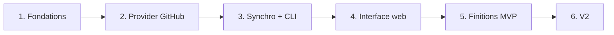

# 7. Roadmap

[← Sommaire](README.md)

Six phases courtes, chacune livrant quelque chose d'utilisable. **On ne passe à la suivante que lorsque
la précédente marche de bout en bout.**

**État** : phases 1 à 5 réalisées, MVP publié en **v0.1.0** (voir [CHANGELOG.md](../CHANGELOG.md)) ;
reste le critère de fin du MVP (usage réel d'une semaine), puis la phase 6.

## Phases

### Phase 1 — Fondations
- Squelette du projet, `cobra`, configuration (viper).
- SQLite + migrations (`goose`), configuration `sqlc` et premières requêtes générées.
- Espaces de supervision : `watchoo init` crée `.watchoo/` (config, base, `.gitignore`, droits `0700`/`0600`)
  après avoir vérifié `gh` ; recherche de l'espace dans le répertoire courant puis les parents ; `-C` et
  `WATCHOO_DIR` (voir [Espaces de supervision](10-espaces-de-supervision.md)).
- Token obtenu uniquement avec `gh auth token`, jamais stocké ; vérifier le cas `GH_TOKEN` (Docker, CI).
- Mock de `gh` (interface + faux binaire) et CI sans service extérieur (voir [Tests](09-tests.md)).

**Livrable** : `watchoo init` transforme un répertoire en espace de supervision, avec sa config et une base au
bon schéma ; les autres commandes retrouvent l'espace.

### Phase 2 — Provider GitHub
- Interface `Provider`.
- Client `go-github`.
- Récupération des commits avec pagination, ETag et gestion du rate limit.
- Tests avec un serveur HTTP simulé (`httptest`).

**Livrable** : provider testé, sans appel réseau réel dans les tests.

### Phase 3 — Moteur de synchro + CLI
- `repo add / list / remove`, `sync`, `log`, `contributors`, `status`.
- Import groupé `repo import` (CSV ou liste), vérification d'accès et bilan.
- Mode interactif `watchoo tui` (Bubble Tea) : dépôts, commits, contributeurs, filtre, synchro.

**Livrable** : l'outil est déjà utile en terminal, en mode commande comme en mode interactif.

### Phase 4 — Interface web
- `serve`, templates embarqués, CSS DaisyUI généré par la CLI autonome Tailwind (`make css`).
- Tableau de bord, détail dépôt (avec le graphique d'activité sur 90 jours), contributeurs, réglages.
- Synchro périodique en arrière-plan.

**Livrable** : interface web locale fonctionnelle.

### Phase 5 — Finitions MVP
- Graphiques d'activité (au-delà de celui du détail d'un dépôt, livré en phase 4).
- Sortie `--json`.
- Makefile, binaires multi-plateformes via GoReleaser, image Docker, README.
- Versions SemVer et `CHANGELOG.md` tenus avec les skills `semver` et `semver-changelog` (voir [Skills](11-skills.md)).

**Livrable** : MVP distribuable.

**Réalisé (v0.1.0)** :
- Graphiques : activité de l'espace sur 90 jours (tableau de bord) et commits par semaine sur 12
  semaines des 8 contributeurs les plus actifs (page contributeurs), calculés en Go dans le fuseau
  d'affichage ([Graphiques d'activité](06-interface-web.md#graphiques-dactivité)).
- `--json` sur toutes les commandes qui produisent des données, schéma documenté et vérifié par un test
  ([Sortie JSON](05-cli.md#sortie-json)) ; `watchoo version` donne aussi le commit et sa date.
- `make release-check`, `make release-snapshot`, `make docker` ; GoReleaser (linux, darwin, windows en
  amd64 et arm64, archives et sommes SHA-256, release en brouillon) ; image Docker distroless non root
  avec `gh` vérifié par SHA-256, publiée sur `ghcr.io/studoo-app/watchoo` ; workflow de release sur tag
  ([Distribution](03-architecture.md#distribution)).
- README complet, `CHANGELOG.md`, règles de version ([Skills](11-skills.md#versions-et-changelogmd)).
- Retouches web : `HEAD` accepté partout où `GET` l'est, cookie CSRF limité aux pages HTML, lecture du
  quota interrompue journalisée en debug.

### Phase 6 — V2
- Pull requests et releases : **en place** (pull requests lues de façon incrémentale, releases et tags,
  `watchoo prs` et `watchoo releases`, cartes de la page d'un dépôt, PR ouvertes sur le tableau de bord
  et dans le TUI ; échec isolé en avertissement, `ErrUnsupported` pour le provider Git local).
- **Dépôts Git locaux** : **en place** (provider `internal/provider/git` sur le binaire `git`, clones
  nus dans `.watchoo/repos/` mis à jour par `git fetch`, choix de la source à chaque synchro selon `gh`,
  `provider_id` facultatif (migration `00004`), `watchoo init` sans `gh`, source dans `status`, `sync`,
  la page Réglages, écrans qui masquent ce que le clone ne fournit pas, image Docker avec `git`). Un
  dépôt peut être suivi depuis un clone local qui fournit commits, branches et tags sans appel à l'API
  GitHub, donc sans consommer de quota. Alternative à l'API GitHub et à `gh` : si `gh` est installé et
  connecté, Watchoo l'utilise ; sinon il passe par le clone local (voir
  [Dépôts Git locaux](03-architecture.md#dépôts-git-locaux-v2)).
- Seuils d'activité par dépôt (option de `repo add`, colonne de l'import, réglage web) : **en place**
  (`--flemme` / `--dead`, colonnes `flemme` / `dead`, partage de la configuration, formulaire de la page
  d'un dépôt).
- Activité par contributeur à l'intérieur d'un dépôt : **en place** (graphique des commits par semaine
  des contributeurs sur la page d'un dépôt, total et courbe par semaine dans le détail du TUI,
  `watchoo contributors --weeks N`).

L'import d'une organisation entière et les alertes passent en V3 (voir
[Fonctionnalités](02-fonctionnalites.md#v3)).

## Définition de « terminé » pour chaque phase

- Code écrit et relu.
- Tests passants, sans service extérieur (`gh` mocké, API GitHub simulée avec `httptest`).
- `go vet` sans avertissement.
- Résumé de ce qui marche.

## Critère de fin du MVP

> Suivre **10 dépôts réels pendant une semaine** sans erreur de synchro ni dépassement de quota.
