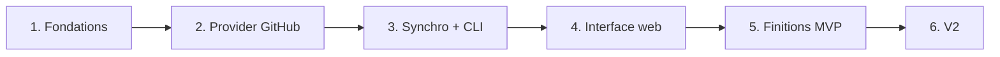

# 7. Roadmap

[← Sommaire](README.md)

Six phases courtes, chacune livrant quelque chose d'utilisable. **On ne passe à la suivante que lorsque
la précédente marche de bout en bout.**

## Phases

### Phase 1 — Fondations
- Squelette du projet, `cobra`, configuration (viper).
- SQLite + migrations (`goose`), configuration `sqlc` et premières requêtes générées.
- Espaces de supervision : `watchoo init` crée `.watchoo/` (config, base, `.gitignore`, droits `0700`/`0600`)
  après avoir vérifié `gh` ; recherche de l'espace dans le répertoire courant puis les parents ; `-C` et
  `WATCHOO_DIR` (voir [Espaces de supervision](10-espaces-de-supervision.md)).
- Token obtenu uniquement avec `gh auth token`, jamais stocké ; vérifier le cas `GH_TOKEN` (Docker, CI).
- Mock de `gh` (interface + faux binaire) et CI sans service extérieur (voir [Tests](09-tests.md)).

**Livrable** : `watchoo init` transforme un répertoire en espace de supervision, avec sa config et une base au
bon schéma ; les autres commandes retrouvent l'espace.

### Phase 2 — Provider GitHub
- Interface `Provider`.
- Client `go-github`.
- Récupération des commits avec pagination, ETag et gestion du rate limit.
- Tests avec un serveur HTTP simulé (`httptest`).

**Livrable** : provider testé, sans appel réseau réel dans les tests.

### Phase 3 — Moteur de synchro + CLI
- `repo add / list / remove`, `sync`, `log`, `contributors`, `status`.
- Import groupé `repo import` (CSV ou liste), vérification d'accès et bilan.
- Mode interactif `watchoo tui` (Bubble Tea) : dépôts, commits, contributeurs, filtre, synchro.

**Livrable** : l'outil est déjà utile en terminal, en mode commande comme en mode interactif.

### Phase 4 — Interface web
- `serve`, templates embarqués, CSS DaisyUI généré par la CLI autonome Tailwind (`make css`).
- Tableau de bord, détail dépôt, contributeurs.
- Synchro périodique en arrière-plan.

**Livrable** : interface web locale fonctionnelle.

### Phase 5 — Finitions MVP
- Graphiques d'activité.
- Sortie `--json`.
- Makefile, binaires multi-plateformes via GoReleaser, image Docker, README.
- Versions SemVer et `CHANGELOG.md` tenus avec les skills `semver` et `semver-changelog` (voir [Skills](11-skills.md)).

**Livrable** : MVP distribuable.

### Phase 6 — V2
- Pull requests, releases.
- Import d'organisation.
- Alertes Discord / Slack / e-mail.

## Définition de « terminé » pour chaque phase

- Code écrit et relu.
- Tests passants, sans service extérieur (`gh` mocké, API GitHub simulée avec `httptest`).
- `go vet` sans avertissement.
- Résumé de ce qui marche.

## Critère de fin du MVP

> Suivre **10 dépôts réels pendant une semaine** sans erreur de synchro ni dépassement de quota.
