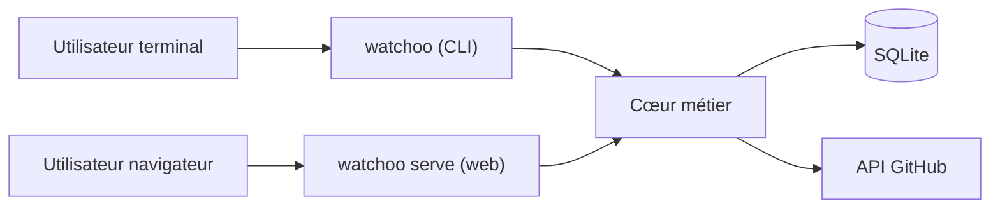

# Documentation Watchoo

> Document de définition du projet — version du 26 octobre 2026 · Benoit
>
> Statut : **en développement**. Les phases 1 (fondations) et 2 (provider GitHub) de la
> [roadmap](07-roadmap.md) sont réalisées ; ces pages décrivent l'outil complet, construit phase par phase.

Watchoo est un binaire Go unique qui surveille une liste de dépôts GitHub et répond à trois questions :
**qu'est-ce qui a bougé, quand, et qui l'a fait.** Il s'utilise en ligne de commande (CLI) ou via une
interface web locale servie par le même binaire.

## Sommaire

| # | Document | Contenu |
| --- | --- | --- |
| 1 | [Vision et objectifs](01-vision.md) | Pourquoi Watchoo, objectifs, périmètre, hors périmètre |
| 2 | [Fonctionnalités](02-fonctionnalites.md) | Périmètre MVP, V2, V3 |
| 3 | [Architecture technique](03-architecture.md) | Schéma d'ensemble, stack Go, organisation du code, points d'attention |
| 4 | [Modèle de données](04-modele-donnees.md) | Tables SQLite, relations, index |
| 5 | [CLI](05-cli.md) | Commandes, options globales, exemples de sortie |
| 6 | [Interface web](06-interface-web.md) | Pages, comportement HTMX, sécurité |
| 7 | [Roadmap](07-roadmap.md) | Phases de réalisation, critères de passage, critère de fin du MVP |
| 8 | [Prompt pour agent de code](08-prompt-agent.md) | Consigne prête à coller pour faire construire le projet phase par phase |
| 9 | [Stratégie de tests](09-tests.md) | Mock de `gh`, API GitHub simulée, tests par couche, CI sans service extérieur |
| 10 | [Espaces de supervision](10-espaces-de-supervision.md) | `watchoo init`, un répertoire par groupe supervisé, scénario « étudiants de licence » |
| 11 | [Skills des agents de code](11-skills.md) | Skills installés via skills.sh, organisation dans le dépôt, règles |
| — | [Glossaire](glossaire.md) | Vocabulaire du projet |

## En une image

## Principes directeurs

1. **Un seul binaire, une base par espace** : CLI, TUI et web partagent le même cœur métier ; chaque
   groupe supervisé a son propre répertoire (`watchoo init`), avec sa config et sa base SQLite.
2. **Zéro installation** : SQLite embarqué sans CGO, assets web embarqués (HTMX + DaisyUI), pas de framework ni de build JavaScript.
3. **Sobriété vis-à-vis de l'API GitHub** : synchronisation incrémentale, ETag, respect du rate limit.
4. **Extensible** : l'accès aux forges passe par une interface `Provider` (GitHub d'abord, GitLab/Gitea ensuite).
5. **Livrer par phases** : chaque phase produit quelque chose d'utilisable de bout en bout.
