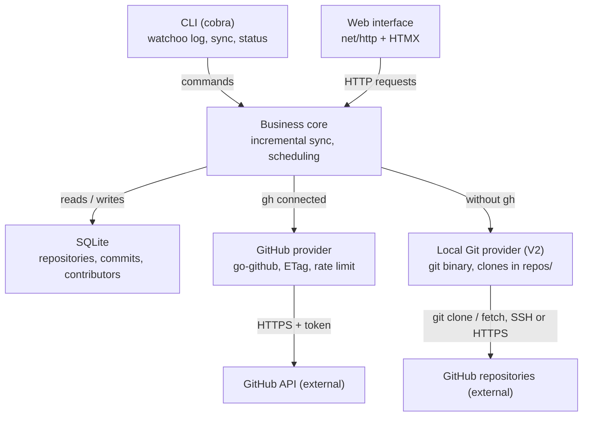

# 3. Technical architecture

[← Contents](README.md)

A single binary, a single SQLite database: the CLI and the web interface share the same business core,
which avoids any duplication of logic.

## Overview



### Layer responsibilities

| Layer | Role | Must not |
| --- | --- | --- |
| CLI | Parse commands, format the output (table or JSON) | Contain business logic |
| TUI | Keyboard-driven interactive mode (Bubble Tea) | Contain business logic |
| Web | Serve pages and HTMX fragments | Contain business logic |
| Business core (`sync`) | Orchestrate the sync, schedule, apply the rules | Know GitHub's HTTP details |
| Provider | Talk to a forge (GitHub, later GitLab…) | Access the database directly |
| Store | Persist and query SQLite, migrations | Call a forge |

## Chosen stack

| Building block | Proposed choice | Why |
| --- | --- | --- |
| Language | Go, latest stable version (pinned in `go.mod`) | Static binary, simple cross-compilation, native concurrency |
| CLI | `spf13/cobra` + `spf13/viper` | De facto standard, subcommands, YAML config / env variables |
| GitHub API | `google/go-github` (latest major version), without `golang.org/x/oauth2` | Complete and typed client; the token is set in the `Authorization` header by the provider's internal HTTP transport, which also enforces read-only access, the ETag cache and quota tracking |
| Storage | SQLite via `modernc.org/sqlite` (no CGO) | Single file, zero installation, easy cross-compilation |
| Database access | `sqlc` (generated code on `database/sql`) + `pressly/goose` migrations | Queries checked against the schema, typed generated Go code, versioned schema |
| Web server | `net/http` + `go-chi/chi` router | Lightweight, 100% compatible with `net/http`, route groups and ready-made middlewares |
| Front end | `html/template` + HTMX + [DaisyUI](https://daisyui.com/) (on Tailwind CSS) | Ready-made components (cards, badges, tables, light / dark themes), no JS framework, assets embedded with `embed` |
| Charts | Chart.js, embedded | Simple activity curves, works offline |
| Terminal display | `charmbracelet/bubbletea` + `bubbles` (TUI) + `lipgloss` | Keyboard-navigable interactive mode; static text output (`lipgloss/table`) for pipes and scripts |
| Scheduling | `time.Ticker` + `errgroup` | Periodic sync, bounded parallelism |
| Authentication | GitHub CLI `gh` (optional since the V2) | Token obtained with `gh auth token`, never stored by Watchoo; a single token for all owners. Without `gh`: local Git clones, with the machine's Git credentials |
| Local Git repositories (V2) | The `git` binary (os/exec), with no Go dependency | Bare clones updated by `git fetch`: tracking without `gh` or quota |
| Logs | `log/slog` | Structured logs from the standard library, on the error output; `warn` level by default, set via `WATCHOO_LOG_LEVEL` (`debug`, `info`, `warn`, `error`) or `--verbose` (`debug`). Only repository identifiers, short SHAs and counters: never a token, a commit message, a name or an email |

### Technical decisions

All the stack choices are settled; their details are covered in the "Key considerations" section below.
The `Provider` interface has been fixed since phase 2 (see [The `Provider` interface](#the-provider-interface)).

## Code layout (target)

```
watchoo/
  cmd/watchoo/         main.go — entry point
  internal/cli/        cobra commands
  internal/tui/        Bubble Tea interactive mode
  internal/web/        chi handlers, security middlewares, rendering; templates/ and static/ (embed);
                       tailwind/ (CSS source, vendored DaisyUI, VERSIONS)
  internal/workspace/  workspaces: init, .watchoo/ lookup, settings
  internal/auth/       access to gh (token, login state) + fake gh for tests
  internal/provider/   Provider interface, types and errors; providertest/ (in-memory fake Provider)
    github/            GitHub implementation, the only go-github import; githubtest/ (fake server)
    git/               local Git repositories (V2): git binary, clones in repos/ ; gittest/ (file:// repositories)
  internal/sync/       synchronization engine (Engine: SyncAll, SyncRepo, AddRepositories) and
                       coordinator of a long-lived process's syncs (Coordinator, "watchoo serve")
  internal/activity/   activity rules (Actif / Flemme / Dead, gray states), short formats
  internal/repoimport/ parsing of repository references, of --branch and of import files
  internal/configshare/ sharing of a workspace's configuration (JSON export, validation, preview and
                       application of an import; "watchoo config", Settings page)
  internal/textclean/  cleaning of displayed texts (escape sequences, control characters), CLI and TUI
  internal/selfupdate/ Watchoo's own self-update (0.6.0): latest published release, SemVer
                       comparison, verified download and replacement of the binary, periodic
                       check of "watchoo serve"
  internal/store/      SQLite, data access
    migrations/        goose migrations (also serve as the sqlc schema)
    queries/           SQL queries annotated for sqlc
    db/                Go code generated by sqlc (do not edit)
  sqlc.yaml            sqlc configuration
  internal/model/      business structs
  internal/tui/        interactive mode (Bubble Tea v2, bubbles, lipgloss)
  internal/logo/       owl in text versions and header card (CLI, config.yaml)
  config.example.yaml
```

## The `Provider` interface

An abstraction that isolates any forge, defined in `internal/provider`, with no dependency on GitHub or
go-github. Two implementations: the GitHub API (`internal/provider/github`, the only place where go-github is
imported) and, since the V2, the local Git clones (`internal/provider/git`, see
[Local Git repositories](#local-git-repositories-v2)). The only exception: `internal/selfupdate` reads the
public release pages of Watchoo itself, with no token nor API (see
[Watchoo self-update](#watchoo-self-update-060)). Signature fixed in phase 2 (details in
`internal/provider/provider.go`):

| Method | Role |
| --- | --- |
| `Name()` | Identifier of the **forge** (`github`), not of the way to access it: the local Git provider also returns `github` (the repositories remain GitHub repositories, `repositories.provider` does not change) |
| `Repository(ctx, owner, name)` | Metadata of a repository: numeric ID, current owner and name, default branch, URL, stars, open issues, archived, private, last push. Follows a rename or a transfer. `Partial` (V2): the source only knows owner, name, default branch and URL (ID 0); the engine then keeps the rest in the database |
| `RepositoryByID(ctx, id)` | The same metadata, by the numeric ID, which never changes (`ErrUnsupported` for the local Git clones: the engine then goes through `Repository`) |
| `Branches(ctx, owner, name)` | All branches (name, head SHA), all pages |
| `ListCommits(ctx, owner, name, opts)` | Commits of a branch (or of a SHA), from newest to oldest (chronological order, not graph order). Options: `Branch`, `Since`, `Stop` (stop at the first SHA for which it returns true, excluded, without a next page; not for stopping at the first known SHA, see [Incremental sync](#incremental-sync)), `Limit` |
| `CompareCommits(ctx, owner, name, base, head)` | Commits reachable from `head` but not from `base` (like `git log base..head`), merges included, from newest to oldest |
| `CommitStats(ctx, owner, name, sha)` | Lines added and deleted by a commit (one request per commit, a single page of files, never cached) |
| `PullRequests(ctx, owner, name, opts)` (V2) | Pull requests of the repository, all states included (open, closed, merged), from the most recently modified to the oldest. Options: `UpdatedSince` (stop at the first PR modified **before** this date, with no next page: incremental sync), `Limit`. Number, title, state, merged, draft, author (login, ID), URL, base and head branches, creation, modification, closure and merge dates |
| `Releases(ctx, owner, name)` (V2) | Releases of the repository, from the most recent to the oldest: ID, tag, name, draft, pre-release, author, URL, creation and publication dates. On GitHub, drafts are only visible to an account with write access to the repository |
| `Tags(ctx, owner, name)` (V2) | Tags of the repository (name, SHA of the commit they point to), in the order of the forge |
| `RateLimit(ctx)` | Quota status (`GET /rate_limit`, free) |
| `LastRateLimit()` | Last quota status observed on the responses, with no request |
| `ProfileURL(login)` (0.6.1) | Web page of the profile of an account from its login, with no request (`https://github.com/<login>`, like the `html_url` of the account); empty string for an empty login or one that has not the shape of an account login (`provider.ValidLogin`: forbidden character, application account `name[bot]`). Used to complete the profile page of the contributors known before 0.5.0 (see [Incremental sync](#incremental-sync)) |

Common rules:

- the arguments (owner, repository name, branch, full SHA, ID) are validated before any request: an
  invalid value gives `ErrInvalidRef`, with no network call;
- dates in UTC, non-nil empty lists; internal caps (10,000 commits, 1,000 branches, 1,000 pull
  requests, 1,000 releases, 1,000 tags) against endless pagination;
- a source that does not know a notion (the provider of the [local Git repositories](#local-git-repositories-v2)
  has neither pull requests, nor releases, nor a numeric ID, nor quota) returns an error that
  wraps `ErrUnsupported`, asking for nothing: the sync engine treats it as "not available
  for this source", not as a failure;
- errors of type `*APIError` (operation, method, API path, HTTP status), to be tested with
  `errors.Is` / `errors.As`: `ErrNotFound` (`404`: repository not found or account without access),
  `ErrUnauthorized` (`401`: suggest `gh auth login`), `ErrForbidden` and `*SSORequiredError` (`403`,
  SSO enforced by the organization), `*RateLimitError` (quota exhausted or secondary rate limit, with the
  time to retry), `ErrEmptyRepository` (empty repository), `ErrUnknownBase` (base of a comparison gone),
  `ErrUnavailable` (network, timeout, `5xx`), `ErrUnexpected`, `ErrWriteForbidden`, `ErrUnsupported`,
  `ErrAccessDenied` (V2: `git` could not read the remote repository, "accès refusé" ("access denied")).
  Their messages are in French and never mention the token, a response body, a commit message, a name or
  an email;
- safe for concurrent use: 4 repositories synced in parallel with the same instance.

Construction: `github.New(token, Options)` is lightweight (no request). The sync engine builds one at each
sync, with the token requested again from `gh`, and gives it the same ETag cache (`Cache`) and the same
quota state (`Quota`), which last from one sync to the next. Other options: `BaseURL` (tests),
`UserAgent` (`watchoo/<version>`), `Transport`, `Timeout` (30s per request by default), `Logger`.

`git.New(git.Options)` (V2) is lightweight too: `Dir` (`repos/` at the root of the workspace), `Repos` (the
repositories of the workspace in the order they were added: location of the clones), `Protocol` (`ssh` or
`https`, setting `git.protocol`), `BaseURL` (tests: `file://` repositories), `GitPath`, timeouts (10 min per
network command, 2 min per read of the clone), `Logger`. The engine builds one at each sync made without
`gh`.

Fakes for the tests: `providertest` (in-memory Provider), `githubtest` (simulated GitHub server) and
`gittest` (real Git repositories in a temporary directory, served over `file://`), see
[Testing](09-testing.md#simulated-github-api).

## Configuration

- Watchoo works with **workspaces**: a directory initialized by `watchoo init`, which contains
  `.watchoo/config.yaml` and `.watchoo/watchoo.db`. Each monitored group (e.g. a class of students) has
  its own. Full details: [Workspaces](10-workspaces.md).
- The workspace is found like Git: current directory, then parents. `-C <directory>` or `WATCHOO_DIR`
  designate another workspace.
- Three levels of settings, loaded by viper: `$XDG_CONFIG_HOME/watchoo/config.yaml`, else
  `~/.config/watchoo/config.yaml` (optional, common values), then `.watchoo/config.yaml` (the workspace),
  then options and `WATCHOO_*` variables.
- File template: `config.example.yaml`, to be created in phase 1.
- Expected settings: workspace name, sync interval, web listen address, activity thresholds, excluded
  branches, sync parallelism, display time zone (the system's by default), `gh` account (`github.user`),
  path to `gh` (`github.gh_path`), protocol of the local Git clones (`git.protocol`: `ssh` by default, or
  `https`; V2).
- Sharing between supervisors: `watchoo config export` / `import` (and the Settings page) exchange a
  versioned JSON file (`format: watchoo-config`, `version: 1`) with the tracked repositories and the common
  settings, never `github.*`, `git.*` nor `web.*`. The core is `internal/configshare`; the rewrite of
  `config.yaml` is done by `internal/workspace` (`WriteSharedSettings`). See
  [Configuration sharing](05-cli.md#configuration-sharing-watchoo-config).

## Key considerations

### GitHub API quota
- 5,000 requests / hour with a token. The local Git clones (V2, without `gh`) do not consume any.
- Use the **ETags** (`If-None-Match`): a `304 Not Modified` response does not consume any quota.
- **In-memory ETag cache**, per process, never on disk. The key is the full URL of the request (pages
  included; `per_page=100` always, for stable keys); a `304` response is served like the cached `200`
  response. The cache is tied to a checksum of the token (SHA-256, in memory only): another `gh` account
  empties it, no response from one account is served to another. It is bounded (1,024 responses of 1 MiB
  at most). `serve` and `tui`, which run for a long time, benefit from it from one sync to the next; a
  one-off command (`watchoo sync`) starts again from an empty cache.
- The statistics of a commit (`GET /repos/{owner}/{repo}/commits/{sha}`) request only one page of files
  (`per_page=1`): only the totals are used, and they cover the whole commit whatever the page. Without
  this parameter, GitHub would return up to 300 files with their patch, that is, the code of the private
  repository. These responses are not cached: each commit is requested only once.
- The quota state is read from the `X-RateLimit-*` headers of each response (`304` included) and shared
  from one sync to the next.
- Quota exhausted (`403` or `429` with `X-RateLimit-Remaining: 0`) or secondary rate limit (`403` or `429`
  with `Retry-After` or a "secondary rate limit" message): the provider returns a `RateLimitError` that
  gives the time to retry (`X-RateLimit-Reset`; for a secondary rate limit, `Retry-After`, otherwise one
  minute, as GitHub recommends). An exhausted quota takes precedence over a `Retry-After` received in the
  same response. Until then, it refuses the following requests without sending them (`GET /rate_limit`
  remains allowed), with the same error; if an exhausted quota and a secondary rate limit are both in
  effect, the later of the two deadlines is given. It never waits itself: the sync engine is the one that
  waits for the reset rather than failing in a loop.

### Sync frequency
- **Decision**: interval of **30 min by default**, **15 min minimum**. A shorter value (config or
  `--interval`) is rejected with a clear message.
- **Who syncs**: `watchoo serve` and `watchoo tui` sync automatically at this interval as long as they
  run. `tui` also offers a key to trigger a sync right away. The other commands sync only on demand
  (`watchoo sync`).
- **Manual sync**, possible at any time, for all repositories or a single one:
  - CLI: `watchoo sync` (all repositories) or `watchoo sync owner/repo` (a single one);
  - web: "Synchroniser maintenant" (Sync now) button in the settings (all repositories) and on the detail
    page of a repository (that repository only);
  - TUI: one key for all repositories, another for the selected repository.

  A manual sync is not subject to the 15 min minimum. It respects the lock and the quota guard, and does
  not shift the next automatic sync.
- **Manual-only mode**: the automatic sync is disabled in the config (`sync.auto: false`) or with
  `--interval 0`. `serve` and `tui` then sync only on demand.
- **Quota guard**: if the remaining quota drops below **10%**, Watchoo spaces out the syncs until the
  quota resets and reports it in `status`, the web UI and the TUI.
- **Quota guard, details**: before each repository, the engine reads the last observed quota state; below
  10% of the limit, that repository and the following ones are **postponed** ("reporté : quota bas
  jusqu'à HH:MM" — "postponed: low quota until HH:MM"). An exhausted quota (`RateLimitError`) stops the
  sync of the remaining repositories, postponed until the resume time. An error on one repository does not
  stop the others: it is recorded in `sync_runs`. The recorded message gives the time in UTC; the CLI and
  the TUI display the resume time in local time. A quota state whose reset time has passed is ignored
  (new window).
- **Cancellation** (Ctrl+C, leaving the TUI): the repositories in progress are closed as errored
  ("synchro annulée" — "sync canceled"), those that have not started are untouched.
- **No double sync**: if `serve` and `tui` run at the same time on the same database, a lock in SQLite
  prevents two simultaneous syncs of the same repository. Before each repository, a transaction checks
  that no `running` `sync_run` of that repository started less than **30 min** ago, then inserts its own;
  an older `running` one (process stopped in the middle of a sync) is closed as errored ("synchro
  interrompue" — "sync interrupted"). A locked repository is skipped and reported ("déjà en cours de
  synchronisation" — "already being synced").
- Order of magnitude, in the worst case where everything has changed at each pass: 100 repositories × 2
  branches every 30 min ≈ 800 requests / hour, far from the 5,000 of the quota. `304` responses cost
  nothing.
- **Pull requests, releases and tags** (V2): three more lists per repository and per sync (first page
  only in the common case). All of them go through the ETag cache: when nothing has changed, they answer
  `304` and cost nothing. In the worst case where everything changes at each pass, 100 repositories add
  3 × 2 × 100 = 600 requests / hour, that is about 1,400 in total, still far from the 5,000.

### Tracked branches
- **Decision**: without `--branch`, Watchoo tracks **all the branches** of the repository, including those
  created after it was added. The list of branches is read again at each sync.
- `--branch` restricts tracking to a list and to patterns (`main,dev,release/*`). A new branch that
  matches a pattern is tracked automatically.
- **Exclusions**: a list of patterns to ignore, configurable in the config (`branches.exclude`), empty by
  default. Useful for example for `dependabot/*` or `renovate/*`, whose automatic branches would skew the
  activity.
- **Branch deleted on GitHub**: it stops being tracked (`tracked = false`), but its history remains in the
  database.
- **Cost**: the list of branches costs one request per repository per sync, free if nothing changed
  (`304`). A branch whose head has not moved costs nothing more; a branch that has moved costs one
  comparison (see [Incremental sync](#incremental-sync)). The commits shared between branches are stored
  only once (`commit_branches` table). `watchoo status` reports the number of tracked branches and the
  remaining quota; measuring the quota consumption per sync is not planned in phase 3.

### Incremental sync
- **Rule**: the list of commits (`ListCommits`) follows the **chronological** order, not the graph order.
  After a merge, commits brought by the merged branch may come **after** a commit already in the database:
  stopping the list at the first known SHA (`Stop` option) would lose them, with no error at all, and the
  loss would be permanent (the next sync compares from the new head). As soon as the repository has commits
  in the database, the engine therefore relies on the comparison (`CompareCommits`), the only exact
  method, and never on stopping at the first known SHA.
- **First import of a repository** (no commit in the database): list of the commits of the reference branch
  (`ListCommits`, without `Stop`: nothing is known yet), from newest to oldest. `Since` or `Limit` can
  bound the history. The reference branch is the default branch if it is tracked, otherwise the first
  tracked branch; it is synced first at each sync.
- **New branch of an already-synced repository** (including the other branches during the first import):
  comparison between the head of the reference branch and the head of the new branch. It gives exactly the
  commits specific to the branch, including those brought by a merge. Common case with students: `main` is
  in the database (M0 then M1); a branch that started from M0 receives F1, then a merge from `main` (X).
  The list of commits of the branch gives X, M1, F1, M0: stopping at the first known SHA (M1) would lose
  F1, whereas the comparison M1...X gives X and F1.
- **Already-synced branch**: comparison between the old head (`branches.head_sha`) and the new one, merges
  included (even when they bring commits older than the old head). Unchanged head: no request.
- **Rewritten history** (force-push) or no common ancestor: the comparison returns `ErrUnknownBase`. The
  engine retries it from the head of the reference branch (if the branch is not itself the reference
  branch). Failing that, it reads the list of commits again **without `Stop`**, bounded as in the first
  import (`Since` or `Limit`), and ignores the SHAs already in the database (neither stored again, nor
  their stats requested again). This fallback reads already-known pages again: it remains reserved for
  this rare case.
- **New reference branch of an already-imported repository** (default branch renamed or changed on GitHub,
  old reference deleted, `--branch` patterns or `branches.exclude` modified): re-read of its list of
  commits **without `Stop`**, bounded as in the first import. A comparison from the old reference would
  give only the commits absent from it: the shared commits would remain attached to the old one alone and,
  if it is no longer tracked, the repository would look empty (`last_commit_at` only counts the tracked
  branches). The commits already in the database are neither stored again nor their stats requested again:
  only `commit_branches` is completed. Cost: at most `MaxCommits / 100` requests, once only, when the
  reference changes. The previous reference is deduced from the tracked branches in the database, with the
  same rule (known default branch if tracked, otherwise the first one).
- **Branch membership** (`commit_branches`): a commit is attached to the branches on which the engine saw
  it (list or comparison). A branch that started from the reference branch is therefore attached only to
  its own commits: `watchoo log --branch dev` shows what is specific to `dev`, not the history shared with
  `main`.
- **Commit stats** (lines added and deleted): **read from the local Git clone** of the repository
  (`repos/`, see [Local Git repositories](#local-git-repositories-v2)), which exists **with or without
  `gh`**. At each sync, the engine computes those of **all** the commits of the repository whose statistics
  are still unknown (`commits.stats_known = 0`): new commits, **first import included**, and older commits
  never computed (base from before 0.5.0, sync made without a clone). Neither cap nor quota: `git
  diff-tree --numstat` costs no request. The SHAs are processed in batches of 500 (a handful of `git`
  processes per batch, never one per commit), in bounded memory, and the computation stops as soon as the
  sync is canceled. A merge counts what it brings to its branch (comparison to the first parent), a root
  commit its whole content, a binary file nothing. A computed commit is marked known, even at `+0 −0`
  (merge with no change, empty commit): it is never computed again. A commit absent from the clone (history
  rewritten between the API read and the `fetch`) stays unknown and will be picked up at the next sync.
  The statistics are written in the same transaction as the rest of the sync of the repository.
- **Fallback to the API** (with `gh` only): if the clone of a repository is **unavailable** (no SSH key nor
  Git credentials for it, `git` missing, clone location occupied, network…), the sync of the repository
  **does not fail**: its statistics are asked from the API as before 0.5.0, one request per commit, only
  for the commits discovered after the first import of the repository, at most 100 per repository and per
  sync, the most recent first, and never when the remaining quota is below 10% (checked before each
  request); the others stay unknown. An exhausted quota during these statistics does not fail the
  repository (its commits are stored) but postpones the following repositories; another error stops the
  statistics of that repository only (a `404` skips only the commit concerned). The sync report then
  carries a **warning** for this repository ("clone Git local indisponible, statistiques de lignes lues
  par l'API (limitées) : …" — "local Git clone unavailable, line statistics read by the API (limited):
  …"), displayed by `watchoo sync`, the TUI summary and the sync indicator of the web. The commits left
  unknown are computed by the clone as soon as it becomes available again. Without `gh`, the clone is the
  source itself: its unavailability fails the repository, as before.
- **Pull requests, releases and tags** (V2): read after the commits, at each sync of a repository
  (archived included, like the commits).
  - **Pull requests**: list sorted by descending modification date, all states included. At the first
    pass (no PR in the database), the whole list (at most 1,000); then, only the PRs modified since the
    most recent modification date in the database (`UpdatedSince`: stop at the first PR modified
    **strictly before** this date; those of the same second are read again, the write being idempotent).
    A PR is stored once per repository and per number, updated at each change (title, state, merge…);
    never deleted.
  - **Releases and tags**: full lists (at most 1,000 each), which **replace** those in the database: a
    release or a tag deleted on the forge disappears from Watchoo. With no change, the `304` response
    costs nothing.
  - **Quota guard**: below 10% of remaining quota (checked before these lists), they are not requested.
  - **Isolated failure**: an error on one of these lists (`404`, `5xx`, exhausted quota…) does not make
    the repository fail: its commits are stored, what was in the database for this list is kept, and the
    error becomes a **warning** of the sync report (`watchoo sync`, TUI summary, logs). The next sync
    tries again (the resume point of the PRs does not advance). An exhausted quota also postpones the
    following repositories, as for the statistics. Only the cancellation (Ctrl+C) makes the repository
    fail.
  - **Source without this notion** (`ErrUnsupported`, pull requests and releases of the [local Git
    clones](#local-git-repositories-v2)): the list is ignored without a warning and nothing is deleted.
  - **Authors**: the login and the account ID of the author of a PR or a release are kept as is, without
    creating a contributor (a contributor is the author of at least one commit).
- **Profile pages** (0.6.1): the address of the profile of a contributor usually comes from the account
  linked to a **new** commit (`provider.Person.ProfileURL`). The commits already in the database not being
  read again, a contributor stored before 0.5.0 (migration `00005`) would otherwise keep an empty
  `profile_url`. Once per sync, after the repositories and whatever the source (API or local Git clones),
  the engine therefore completes, with no request to the forge, the address of the contributors of the
  forge whose login is known and address empty: `Provider.ProfileURL(login)`, written by
  `store.BackfillProfileURLs` in one transaction. Only these rows are read (negligible cost after the
  first pass); a known address is never replaced. A failure is logged (without login) and never fails the
  sync.
- **Commit without a date**: a commit with neither an author date nor a commit date is ignored (counted in
  a log); a single missing date is filled in with the other.
- **Writes**: everything a repository sync writes (metadata, branches, commits, statistics of the commits,
  contributors, `commit_branches`, `last_commit_at`, pull requests, releases, tags, end of the `sync_run`)
  is written in **one transaction**.
- **Empty repository** (a student's repository just created, to which GitHub answers `409`): empty
  branches and commits, with no error.
- **Repository renamed or transferred**: GitHub answers `301` to `/repositories/{id}`; the provider follows
  the redirection and returns the current owner and name. `RepositoryByID` makes it possible to follow a
  repository by its numeric ID, which never changes.
- **Read-only**: the provider's HTTP transport refuses any method other than `GET` and `HEAD` before
  sending (`ErrWriteForbidden`).
- Bounded parallelism with `errgroup`: **4 repositories synced in parallel at most**. The provider, its
  ETag cache and the quota state are safe for this concurrent use.

### Authentication: `gh` optional
- **Decision**: the GitHub CLI **`gh`** gives access to the GitHub API; it is **optional** since the V2.
  It is the **only** source of the token: Watchoo obtains it with `gh auth token` and reads neither
  `GITHUB_TOKEN`, nor a keychain of its own, nor a token entered by hand.
- **Choice of the source**, made again at the beginning of each sync (and of each addition of
  repositories), according to `gh` only (`auth.Absent`, `wsync.Engine.Source`):
  - `gh auth token` returns a token: **GitHub API**, as in the MVP;
  - `gh` not found (`ErrGHNotFound`) or logged in to no usable account (`ErrNotLoggedIn`, unusable
    `github.user` included): **local Git clones**, with no token (see
    [Local Git repositories](#local-git-repositories-v2));
  - any other failure of `gh` (timeout, unreadable response) remains an **error**: it does not switch to
    `git`. `gh auth token` does not contact GitHub: a `gh` logged in but without network gives a token,
    so the API, and the network failure remains an API error as before; a revoked token too (`401`,
    "reconnectez-vous avec gh auth login" ("reconnect with gh auth login")).

  Installing or connecting `gh` goes back through the API at the next sync, with no other manipulation.
  No per-repository nor per-workspace setting chooses the source. In both cases, each tracked repository
  also has its **local Git clone** (`repos/`), which provides the line statistics of the commits (see
  [Local Git repositories](#local-git-repositories-v2)).
- **Clones and credentials with `gh`**: the clone is made by `git`, never with the token of `gh`. Watchoo
  passes the token neither to `git`, nor in a URL, nor in the environment: `git` uses the credentials of
  the user according to `git.protocol`, as without `gh` (SSH key by default; with `https`, its credential
  manager). A user on `https` who wants `git` to reuse the account of `gh` runs `gh auth setup-git`
  themselves (which sets `gh` up as the credential manager of `git`); Watchoo never does it. Without Git
  credentials, the clone is unavailable: the line statistics fall back to the API, limited (see
  [Incremental sync](#incremental-sync)), with a warning.
- Watchoo **never stores the token**: not in the config, not in the database, not in a keychain.
  `gh` already keeps it in the system keychain.
- The token is requested again from `gh` **at the beginning of each sync** and kept in memory only for the
  duration of the sync. If the user logs in again or switches account in `gh`, Watchoo follows without
  restarting.
- `watchoo init` checks `gh` (`gh auth status`) and asks for no token. Logged in: the account and its
  rights are in the report. **Absent or logged in to no account**: `init` continues if `git` is installed,
  warns that the repositories will be tracked by local Git clones and recalls `gh auth login` (or the
  installation of `gh`) to go through the API; without `git` either, it stops. It also stops, creating
  nothing, for a token refused by GitHub (the account is known to `gh`: `gh auth login`), an unusable
  `github.user` or one unknown to `gh`, and when `gh` could not reach GitHub to verify the token (network
  down, proxy, GitHub outage): it then says so without suggesting `gh auth login`, which would change
  nothing. Details: [Workspaces](10-workspaces.md#behavior-of-watchoo-init).
- Several accounts in `gh`: by default, the active `gh` account for `github.com`. A config option
  (`github.user`) allows choosing another one (`gh auth token --user …`). `gh` distinguishes uppercase and
  `--user` only reads the registered accounts (keychain or `gh` file): `github.user` must therefore repeat
  the exact login of a registered account. Otherwise `init` rejects it, giving the login known to `gh` or
  asking to clear the setting, instead of accepting an account whose token the sync could not read. (A
  `github.user` that became unusable after `init` makes the syncs go through the local Git clones, like a
  `gh` not logged in; `watchoo status` displays it.)
- `watchoo status` shows the `gh` account in use and the rights (scopes) of the token, without ever
  displaying the token, and the **source** of the syncs ("API GitHub" ("GitHub API") or "clones Git
  locaux" ("local Git clones"), with the reason); the web (Settings, "sans objet" ("not applicable")
  quota) and the summary of `watchoo sync` report it too.
- **Never** a token in clear text in the logs, the web interface or the TUI; the output of `gh auth token`
  is never logged.
- The token is set in the `Authorization` header only by the transport of the provider, and only towards
  the API host: a redirection to another host is refused.
- Docker and CI: `gh` is included in the Docker image. Without an interactive session, `gh` reads its token
  from the `GH_TOKEN` variable. Verified in phase 1 (gh 2.103): without `--user`, `gh auth token` does
  return the token of `GH_TOKEN`, and `gh auth status` presents that account as the active one; with
  `--user`, `gh` ignores `GH_TOKEN` ("no oauth token found for github.com account …"). So **leave
  `github.user` empty** when the token comes from `GH_TOKEN`; `init` rejects a `github.user` that `gh`
  only knows through that variable. Without `GH_TOKEN`, the image tracks the repositories by local Git
  clones (it contains `git` and `ssh`, see [Distribution](#distribution)).

### Private repositories

The tracked repositories are mainly **private**. Consequences:

- **Access**: the account logged in `gh` must have read access to each tracked private repository. Without
  access, GitHub answers `404` (and not `403`): Watchoo displays it as "en erreur : dépôt introuvable ou
  compte sans accès" ("error: repository not found or account without access"), without concluding that
  the repository was deleted.
- **What the token of `gh` implies**:
  - it covers **all the owners** the account has access to (personal account and organizations): a single
    token is enough, the question of multiple tokens no longer arises;
  - it carries the `repo` right by default, which allows **read and write**. Watchoo remains read-only:
    the code calls **no** GitHub route in write (POST, PATCH, PUT, DELETE), the transport of the provider
    refuses them before sending, and a test checks it;
  - an organization can restrict the access of third-party OAuth applications, or enforce SSO: the GitHub
    CLI application must then be authorized for that organization. `repo add`, `repo import` (and adding
    from the web) point it out when a repository of the organization answers `404` or `403`; the sync
    records it and `status` reports it. The provider distinguishes SSO: a `403` response with the
    `X-GitHub-SSO` header gives a `SSORequiredError` (organization and authorization link).
- **Confidential local data**: the SQLite database contains commit messages, names and emails from private
  repositories.
  - Database file and config file created with the **`0600`** permissions (readable by the user only).
  - The logs contain **neither commit messages nor emails**: only identifiers (repository, short SHA) and
    counters.
  - Docker image: the database is on a volume; the documentation reminds you not to share it.
- **Web interface**: listens on `127.0.0.1` by default. Exposing it on the network without authentication
  would expose the content of the private repositories: in that case authentication becomes **mandatory**
  (see [Web interface](06-web-interface.md#security)).
- **Quota**: the same for private and public repositories (5,000 requests / hour per token).

### Local Git repositories (V2)

In place since phase 6 ([Roadmap](07-roadmap.md#phase-6--v2)).

- **Purpose**: track a repository from a local clone, updated by `git fetch` at each sync, to be able to
  track private repositories without `gh` and without consuming any GitHub API quota, and to read the line
  statistics of **all** the commits at no cost. The clone has a **working copy**: the instructor can read
  the code of the students in it.
- **"Always clone" decision** (0.5.0): with or without `gh`, **each tracked repository has its clone** in
  `repos/`, created at its first sync then updated at each one.
- **Choice of the source** of the commits and of the metadata: **only** according to the presence of `gh`,
  with no per-repository nor per-workspace setting, made again at each sync (see
  [Authentication](#authentication-gh-optional)). `gh` installed and logged in: GitHub API; otherwise:
  local Git clones. The choice is made in the business core (`wsync.Engine`, from `auth.Client.Token`):
  the CLI, the web and the TUI only display it.
  - **With `gh`**: the API remains the source of everything else (metadata, branches, commits, logins and
    GitHub profiles, pull requests, releases, tags), exactly as before; the engine opens **in addition**
    the Git provider (`Options.NewGitProvider`, same clones and same duplicate-name rule) and, for each
    repository, creates or updates its clone then reads the **line statistics** in it (see
    [Incremental sync](#incremental-sync)). The branch checked out in the working copy is the default
    branch given by the API (no extra `ls-remote`). The clone is made with the Git credentials of the
    user, never with the token (see [Authentication](#authentication-gh-optional)); an unavailable clone
    never makes the repository fail: fallback to the statistics of the API, limited, and a warning.
  - **Without `gh`**: the clone is the source of everything, as before; only the statistics change: they
    now cover all the commits.
  - The clone and the `fetch` consume no quota of the API; they happen in the goroutine of the repository
    (at most 4 repositories in parallel, like the rest of the sync).
- **Disk and first pass**: since the clone is mandatory, `repos/` takes up roughly the size of the tracked
  repositories (full history and working copy; the LFS files are not downloaded). The **first sync** of a
  repository is slower than before 0.5.0: full clone, then statistics of the whole history (a few seconds
  for a student's repository, more for a big repository); the following ones only do a `fetch` and only
  compute the new commits.
- **A second `Provider`** in `internal/provider/git/`, which runs the `git` binary through `os/exec`
  (argument arrays, never a shell; `--` before the URLs and the paths, `--end-of-options` before the
  refs), with no new Go dependency. The sync engine does not change its logic: it receives another
  `Provider` (`Options.NewGitProvider`, by default `git.New` on `repos/`, with the repositories of the
  workspace by increasing ID, `wsync.CloneRefs`). The common rules apply: validation before any command
  (`ErrInvalidRef`, no `git` launched), typed errors, dates in UTC, non-nil empty lists, caps
  (`MaxCommits`, `MaxBranches`, `MaxTags`), concurrent use (4 repositories in parallel).
- **Name of the forge**: `Name()` returns `github`. The rows of `repositories` keep
  `provider = 'github'`: it is the same GitHub repository, read by another means. Switching from the API
  to the clones and the other way round therefore creates neither a duplicate nor a new history.
- **Address of the repositories**: `owner/name` gives the remote GitHub repository, according to
  `git.protocol` (setting specific to the machine, never shared): `ssh` by default,
  `git@github.com:owner/name.git` (private repositories with the SSH key of the user); `https`,
  `https://github.com/owner/name.git` (credential manager of Git). The URL is passed to each `fetch` (no
  registered remote is used): a change of protocol applies at the next sync. No token nor credential in a
  URL. The web pages (`https://github.com/owner/name`, `…/commit/<sha>`, profile
  `https://github.com/<login>` through `ProfileURL`) are built by the Git provider: what is specific to
  GitHub stays in `internal/provider`. `Options.BaseURL` replaces the address for the tests
  (`file://…/owner/name.git`).
- **Clones**: clones **with a working copy** in **`repos/<name>`, at the root of the workspace** (the
  directory that contains `.watchoo/`): `~/supervision/licence-projet/repos/projet-groupe-3/`. Name of the
  repository alone, without owner nor `.git` suffix, **in lowercase** (GitHub, like the file systems of
  macOS and Windows, ignores case). `repos/` is created with `0700` at the first clone; the content of the
  clones keeps the permissions set by Git.
- **Duplicate names** (`git.Layout` rule, with no state in the database): the repositories of the
  workspace, **tracked or stopped**, are taken by increasing ID (order of addition) and each receives the
  first free name among `<name>`, `<owner>-<name>`, `<owner>-<name>-2`, `<owner>-<name>-3`… (in lowercase;
  "free": not already given to an older repository, regardless of case; `.git` is never given). Thus
  `alice/projet` then `bob/projet` give `repos/projet` and `repos/bob-projet`; a `carol/bob-projet` added
  afterwards receives `repos/carol-bob-projet`. **Adding** a repository never moves a clone;
  `repo remove --keep-history` neither (the repository stays in the database). **Removing** a repository
  (`repo remove`, Settings page) can free a name: `wsync.DeleteRepository` deletes the clone, then
  **moves** (renaming in two steps, without re-cloning) those whose location changes (`bob/projet` goes
  from `repos/bob-projet` to `repos/projet`). A repository renamed on GitHub while tracked by the API
  changes location: new clone with the new name, the old directory remains.
- **Signature**: each clone carries in `.git/watchoo-repository` the repository for which Watchoo created
  it (`owner/name` in lowercase). Watchoo updates, moves or deletes **only** its clones signed for that
  repository: a location occupied by something else (directory of the user, clone made by hand, clone
  signed for another repository, symbolic link) is never touched and the sync of the repository fails
  ("emplacement du clone occupé" ("clone location occupied")); an empty directory is replaced.
- **Creation**: first need of a repository in a sync: `git init` in a temporary directory of `repos/`
  (`.clone+…`, a name no repository can have), signature, update (below), then renaming (an interrupted
  clone leaves nothing broken). No `git clone`: a single way to read the remote, and no registered remote.
- **Update** (one per repository and per sync, serialized per repository: lock of the provider; between
  processes, the sync lock in the database):
  1. `git fetch --prune --no-tags --no-recurse-submodules -- <url>` with
     `+refs/heads/*:refs/remotes/origin/*` and `+refs/tags/*:refs/tags/*`: the branches of the remote
     arrive in `origin/…`, a force-push, a deleted branch or tag are followed;
  2. the default branch is the one of `git ls-remote --symref` (already read by `Repository` in the same
     sync) or, with `gh`, the one given by the API (`Prepare`); `origin/HEAD` designates it
     (`git symbolic-ref`);
  3. `git checkout --force -B <défaut> origin/<défaut>` then `git reset --hard origin/<défaut>`: the
     working copy is on the default branch, as on GitHub. **The clone belongs to Watchoo**: a local
     modification of a tracked file, another branch checked out, a merge in progress are **overwritten**
     at each sync; the **untracked** files are kept (no `git clean`). Empty repository (or default branch
     absent): nothing to check out, the clone contains only `.git/`.

  The reads (`Branches`, `ListCommits`…) happen in `refs/remotes/origin/` and `refs/tags/`, never in the
  local branches: a branch created by hand in the clone is not a branch of the repository.
- **Students' repositories, nothing runs**: the hooks of a remote repository are never copied, and
  `-c core.hooksPath=<périphérique nul>` also prevents those of the configuration of the user from running
  in a clone; neither submodule (`submodule.recurse=false`, `fetch.recurseSubmodules=false`,
  `--no-recurse-submodules`), nor `core.fsmonitor`; `GIT_LFS_SKIP_SMUDGE=1`: no LFS file downloaded (the
  pointers stay in the working copy). `core.symlinks` keeps its value: Git already refuses any path that
  would leave the working copy. The variables that would designate another repository (`GIT_DIR`,
  `GIT_WORK_TREE`, `GIT_INDEX_FILE`…) are removed from the environment of `git`.
- **Removal**: `repo remove` deletes the clone (and moves a duplicate name, see above), with or without
  `gh`; `repo remove --keep-history` **keeps** it, like the history in the database. Switching from the
  API to the local Git clones or the other way round reuses the same clones, always kept up to date.
- **Read-only**: Watchoo only runs `git ls-remote`, `git fetch`, read commands of the clone
  (`for-each-ref`, `rev-parse`, `rev-list`, `log`, `diff-tree`) and, in its only clones, `git init`,
  `symbolic-ref`, `checkout` and `reset`; never `push`. It always designates the clone by `--git-dir`
  (and `--work-tree`), run from a neutral directory: `git` never looks for the repository from the current
  directory, and therefore cannot work in a repository of the user (the root of the workspace, for
  example). The configuration of the user cannot change the outputs read (`-c log.showSignature=false`,
  `color.ui=false`, `core.quotePath=false`); the automatic maintenance of a clone happens in the foreground
  (`gc.autoDetach=false`, `maintenance.autoDetach=false`).
- **Lookup of the workspace**: a `.watchoo/` committed in the repository of a student ends up in
  `repos/<name>/`; it is never taken for a workspace (see
  [Workspaces](10-workspaces.md#how-watchoo-finds-the-workspace)).
- **`.gitignore`**: `repos/` is outside `.watchoo/`, therefore outside its `.gitignore`. If the root of
  the workspace is itself a Git repository, `repos/` appears in it: up to the user to add it to their own
  `.gitignore` (Watchoo writes nothing outside `.watchoo/` and `repos/`).
- **Credentials**: Watchoo neither reads, asks for nor stores any credential. `git` relies on what the
  user has configured (SSH key and agent, credential manager). It is run without standard input and
  **without prompt**: `GIT_TERMINAL_PROMPT=0` (no HTTPS credential entry), `GCM_INTERACTIVE=never` (Git
  Credential Manager without window) and, for SSH, `GIT_SSH_COMMAND="ssh -o BatchMode=yes"` (neither
  passphrase nor confirmation of an unknown host: `github.com` must already be in `known_hosts`, for
  example after an `ssh -T git@github.com`). **Decision**: if the user has already chosen their SSH
  command (`GIT_SSH_COMMAND`, `GIT_SSH` or `core.sshCommand` in their Git configuration), it is kept as is
  and Watchoo adds nothing: replacing it would break an intended configuration (dedicated key, proxy); it
  must then itself ask for nothing. `git` is run with `LC_ALL=C` to classify its failures. An access
  failure (key refused, unknown host, missing credentials, repository not found or private without access)
  gives `ErrAccessDenied`: "en erreur : accès refusé : vérifiez la clé SSH ou les identifiants Git de
  cette machine" ("error: access denied: check the SSH key or the Git credentials of this machine"); a
  network failure gives `ErrUnavailable`. The output of `git` is never copied into an error nor into the
  logs (Debug level: command, duration and return code only).
- **Adding a repository** (`repo add`, `repo import`, web): the access is checked by
  `git ls-remote --symref <url> HEAD`, without cloning anything (`--dry-run` included); it also gives the
  default branch. Inaccessible: `OutcomeInaccessible` with "accès refusé" ("access denied"). The
  repository is recorded with an unknown `provider_id` (`NULL`, see [Data model](04-data-model.md)), the
  URL `https://github.com/owner/name` and stars and issues at 0; it is found afterwards by owner/name.
- **Sync**: the same incremental strategy as with the API (see
  [Incremental sync](#incremental-sync)):
  - `Repository` (`ls-remote`) first, even for a repository whose ID is known (`RepositoryByID` returns
    `ErrUnsupported`);
  - `Branches` (`for-each-ref refs/remotes/origin/`, without `origin/HEAD`, sorted by name) creates or
    updates the clone;
  - `ListCommits` and `CompareCommits` read `git log` (`base..head` for a comparison, merges included,
    from newest to oldest) with fields separated by NUL; a base or a head missing from the clone gives
    `ErrUnknownBase`, and the engine falls back as with the API. Two histories with no common ancestor
    give exactly the commits of the head (GitHub answers `404`); an empty repository gives empty lists; an
    unknown branch `ErrNotFound`;
  - `CommitStats` reads `git diff-tree --numstat` (first parent, or empty tree for a root commit; binary
    files not counted). The engine does not call it commit by commit: it uses `CommitStatsBatch` (specific
    to the Git provider, with or without `gh`), which processes a batch of SHAs in two processes (`git
    rev-list --no-walk --parents --ignore-missing --stdin` for the parents, then `git diff-tree --stdin
    --always --numstat` on the "first-parent commit"), with the same rules; a SHA missing from the clone
    is simply left out of the result;
  - `Tags` reads `refs/tags/` (SHA of the commit pointed to, annotated tag dereferenced);
  - no quota: `RateLimit` returns `ErrUnsupported` and `LastRateLimit` nothing. The quota guard never
    postpones a repository, the initial read of the quota is skipped, `status` and the Settings page
    display "sans objet" ("not applicable").
- **Metadata**: `Repository` returns `Partial`. The engine then writes only the default branch (if it is
  known) and the sync date; owner, name, URL, stars, issues, archived state and `provider_id` keep their
  value in the database, **never replaced by zeros**. When `gh` comes back, the next sync goes through the
  API: for a repository without `provider_id`, it resolves it by owner/name (`Repository`) and records it,
  with all the metadata.
- **What the local mode does not provide**: no GitHub login (only Git name and email: the contributors
  are merged by email only, see [Identity merging](#identity-merging)), no stars, issues, archived state,
  pull requests nor releases; the tags, they, are available. The Git provider returns `ErrUnsupported` for
  `PullRequests` and `Releases`: the engine keeps what is in the database, without a warning. The screens
  hide what is missing for a repository never read by the API (unknown `provider_id`,
  `model.Repository.ForgeDetails`): page of a repository (stars, issues, pull requests and releases cards)
  and detail of the TUI; a repository already read by the API keeps its last known values.
- **Distribution**: the Docker image contains `git` and the `ssh` client (see
  [Distribution](#distribution)).
- **Tests**: Git repositories created in a temporary directory and served by the file system (`file://`,
  `gittest` package), with no external service; see [Testing](09-testing.md).

### Identity merging
- A single contributor can commit with several emails.
- Attach the emails to the GitHub login when it is known (`contributor_emails` table).
- With the local Git clones (V2, without `gh`), the login is never known: the commits are attached by
  email only (two emails of the same person make two contributors as long as a sync through the API has
  not linked them to a same account).

### Watchoo self-update (0.6.0)

Watchoo announces its new versions and knows how to replace its own binary (`watchoo update`, see
[CLI](05-cli.md#self-update-watchoo-update)). Everything is in `internal/selfupdate`; `cli` and `web` only
display.

- **Documented exception** to the rule "nothing specific to GitHub outside `internal/provider/github` and
  `internal/provider/git`": `internal/selfupdate` reads the **public release pages of Watchoo itself**
  (`https://github.com/studoo-app/watchoo/releases`), unrelated to the tracked repositories. It uses
  **neither token** (neither the one of `gh`, nor any other), **nor the GitHub API** (so no quota), nor
  go-github: only `net/http` and the standard library (`archive/tar`, `compress/gzip`, `archive/zip`,
  `crypto/sha256`). No request writes anything (GET only).
- **Latest version**: like `install.sh`, Watchoo requests `…/releases/latest` and reads the tag in the
  redirection to `…/releases/tag/vX.Y.Z` (the page itself is not downloaded). GitHub only redirects there
  to the latest published release that is not a pre-release: a pre-release is never offered (a tag with a
  suffix is ignored for safety).
- **Comparison**: SemVer 2.0.0 (`v` prefix, pre-releases with lower priority than the final version). A
  notice only if the latest version is strictly newer; an installed version more recent than the latest
  published one gives no notice. A `dev` version, a Go pseudo-version (`v0.0.0-2026…-abcdef`) or any
  version with a suffix is not a release version: neither notice nor automatic update.
- **Transport**: HTTPS only, redirections included (HTTP accepted only towards the loopback, for the fake
  server of the tests, like `WATCHOO_RELEASES_URL` of `install.sh`); `User-Agent` `watchoo/<version>`;
  capped sizes (100 MB archive, 1 MB checksum file, 200 MB extracted binary). The root of the releases is
  injectable (tests: fake `httptest` server, never the network).
- **Notice at every command**: a decision of the maintainer, the check happens at **every launch**, with
  no cache. It starts in a goroutine at the beginning of the command (`PersistentPreRun` of the root
  command), with a total timeout of 1.5s; after the command, the notice is written to the error output if
  the response is already there or arrives before the end of this timeout, counted from the start: a
  command is never delayed by more than 1.5s, and a long command (`sync`) not at all. A response that has
  already arrived is always preferred to the elapsed timeout (a command longer than 1.5s keeps its
  notice). Failure or no network: nothing is displayed (log of debug level, visible with `--verbose`).
  `watchoo` alone (card and general help) has its notice, after the help. No check with `--json`, when the
  error output is not a terminal, for a version that is not a release version, for `update` (which checks
  anyway), `serve` and `tui` (which have their own check), the help and the completion, nor when
  `WATCHOO_NO_UPDATE_CHECK` is worth anything other than empty, `0` or `false`. The decision "check or
  not" (variable, release version) is shared by the commands, `serve` and `tui`.
- **`watchoo tui`**: one check at opening, in a Bubble Tea command (goroutine), with its own timeout of
  10s; the CLI passes the TUI a check function that returns the new version (installed and published
  versions, Docker image or not; empty if Watchoo is up to date), and the TUI writes the notice on the
  line under its header. Failure: nothing.
- **`watchoo serve`**: check at startup then every 30 min (`selfupdate.Monitor`, as long as the server
  runs); a new version is announced once on the error output and kept in memory, from where the web
  interface takes its banner.
- **Binary replacement**: archive `watchoo_<version>_<os>_<arch>.tar.gz` (`.zip` under Windows) and
  `watchoo_<version>_checksums.txt` of the release; SHA-256 checksum of the archive compared to the one of
  the checksum file (refused otherwise); binary `watchoo` (`watchoo.exe`) extracted in memory. The path of
  the current binary is `os.Executable` followed by `filepath.EvalSymlinks`; the new binary is written to
  a temporary file **of the same directory**, set to `0755`, then renamed over the old one (atomic rename:
  a binary is never half-written; an already-launched process keeps the old one). Under Windows, where a
  running executable cannot be replaced, the old one is first renamed to `watchoo.exe.old`.
- **Refusal** (non-zero return code, message that says what to do): in the Docker image (variable
  `WATCHOO_DOCKER`, set by the `Dockerfile`, or file `/.dockerenv`): change the tag of the image;
  development version: `go install …@latest` or `git pull && make build`; directory of the binary not
  writable: permissions, `sudo`, or reinstallation by `install.sh` with `WATCHOO_INSTALL_DIR`.
- **After the update**: an already-running `watchoo serve` keeps the old version until its restart; the
  database of each workspace is upgraded (migrations) at the next command.
- **Docker image**: `WATCHOO_NO_UPDATE_CHECK=1` and `WATCHOO_DOCKER=1` in the `Dockerfile` (an image
  updates itself by changing tag, not by `watchoo update`).

### Go version
- **Decision**: we start from the **latest stable version** of Go. The exact number is pinned in `go.mod`
  (`go` directive) at the start of phase 1.
- Rule: the project always stays on one of the **two supported versions** maintained by the Go team. The
  version is upgraded about every six months, and CI uses the same version as `go.mod`.
- This choice only concerns developers: users receive an already-compiled binary.

### Terminal: interactive mode (TUI)
- **Decision**: Watchoo offers an **interactive TUI mode**, built with Bubble Tea (`bubbletea`), its
  components (`bubbles`: table, list, viewport, filter input) and `lipgloss` for the style.
- **Entry point**: a dedicated command, `watchoo tui`. The other commands (`log`, `repo list`…) never
  launch the TUI: they display a table or JSON, then return control.
- **Schedule**: the TUI is part of the MVP and is built in **phase 3**, along with the CLI commands.
- What is expected: browse the repositories, the commits and the contributors with the keyboard (arrows,
  scrolling, selection, filter), open the detail of a repository, start a sync and add a repository to
  track (same core as `watchoo repo add`: `Engine.AddRepositories`, in a Bubble Tea command).
- **Static output**: all the commands other than `tui` display a text table (`lipgloss/table`) or JSON
  (`--json`), then return control. Watchoo stays scriptable this way. If `watchoo tui` is run outside a
  terminal, the command stops with a clear message.
- Colors disabled outside a terminal and when the `NO_COLOR` variable is set.
- The TUI is one more display layer, at the same level as the CLI and the web: it calls the business core
  and contains no logic.
- **Implementation (phase 3)**: Bubble Tea v2, bubbles v2 and lipgloss v2 (modules `charm.land/…/v2`). The
  sync runs in a goroutine of the engine; its progress and its report come back to the model through a
  channel, without blocking the interface. One sync at a time; an automatic sync that falls during a sync
  is skipped, the next one stays scheduled. The texts coming from the database (messages, names) are
  cleaned of escape sequences before display; no email is displayed. During the TUI, the logs of the
  engine are muted (they would break the screen).
- Code in `internal/tui/`.

### Data access: sqlc
- The queries are written in `internal/store/queries/*.sql`, each named
  (`-- name: ListRecentCommits :many`).
- `sqlc generate` checks each query against the schema, which it reads in the goose migrations, then
  generates typed Go in `internal/store/db/`. The generated code is committed and never modified by hand.
- No dependency added at runtime: the generated code uses `database/sql` with the `modernc.org/sqlite`
  driver.
- Optional filters (`log --repo --author --since`, filters of the detail page): parameters that can be
  empty, with `sqlc.narg`, in the form `(sqlc.narg(repo) IS NULL OR repo_id = sqlc.narg(repo))`.
- A query that does not fit in this framework (truly dynamic SQL) can be written by hand with
  `database/sql` in `internal/store/`, remaining the exception.
- The `store` package exposes its own functions to the business core; the types generated by sqlc do not
  leave `store`, they are converted to `internal/model`.

### Router: go-chi/chi
- Chosen for a clean implementation: the routes are grouped by area (pages, HTMX fragments, settings,
  static assets), each with its middlewares.
- **Implementation (phase 4)**: `go-chi/chi/v5`. Middlewares, in order: panic recovery (500 page in
  French, without details), `slog` access log (route pattern, code, duration), security headers (CSP…),
  check of the `Host` header (DNS rebinding), basic authentication (all routes), bounded body size, CSRF,
  then chi's `middleware.Timeout`. `RequestID` is not used (nothing to correlate); `RealIP` neither: it
  would trust `X-Forwarded-For`, which can be forged, and the log contains no IP address anyway. Recovery
  and logging are written for Watchoo (messages in French, no personal data).
- The handlers remain standard `http.Handler`: no dependency of chi in the business logic.
- The `internal/web` package has no business logic: it reads `internal/store`, computes the states with
  `internal/activity` and drives the syncs through `wsync.Coordinator` (one at a time, periodic sync,
  clean shutdown: see [Web interface](06-web-interface.md#background-synchronization)).

### CSS: DaisyUI
- Pico.css is ruled out because it is no longer maintained; we take **DaisyUI**, a plugin of Tailwind CSS.
- **Decision**: the CSS is generated by the **standalone CLI of Tailwind** (single binary, no Node nor
  npm), to keep "no Node, no JS build".
- The `make css` target reads the templates and produces `internal/web/static/app.css`, which contains
  only the used classes. This file is embedded with `embed`: the final binary works offline and depends on
  no CDN.
- The generated CSS is **committed**, like the code generated by sqlc: `go build` is enough after a clone,
  without installing Tailwind. `make css` must be run again when templates are modified, and CI checks
  that the committed file is up to date.
- The CDN version of DaisyUI remains tolerated to prototype at the beginning of phase 4, never in a
  released version.
- **Implementation (phase 4)**: DaisyUI 5 for Tailwind CSS v4, as the standalone bundle `daisyui.mjs` of
  the official GitHub release, vendored in `internal/web/tailwind/` (SHA-256 checksum in
  `tailwind/VERSIONS`, checked by a test); it is only read by the standalone CLI of Tailwind, never
  executed otherwise. Source: `tailwind/input.css` (`@import "tailwindcss"
  source(none)`, `@source` towards the templates, the Go files and the JavaScript of `internal/web`,
  `@plugin "./daisyui.mjs"` with the `light` theme by default and `dark` if the system prefers it).
  `make css` runs `tailwindcss -i internal/web/tailwind/input.css -o internal/web/static/app.css
  --minify` ; `make css-check` regenerates into a temporary file and compares. CI installs the CLI of
  the pinned version (official GitHub release `tailwindlabs/tailwindcss`, checksum verified) and runs
  `css-check`; locally, `make check` skips `css-check` (with a message) if the CLI is absent.
  `app.css` is shared by all the pages: everyone runs `make css` again after modifying a template.

### JavaScript: embedded HTMX and Chart.js
- **Decision**: HTMX and Chart.js are **embedded** in the binary. No CDN is used.
- A precise version of each library is downloaded once, then placed in `internal/web/static/vendor/` and
  committed. The version number appears in the name of the file (e.g. `chart-4.x.y.min.js`).
- These files are served with `embed`, like the CSS. The interface works offline and sends no request to a
  third party (only exception: the GitHub avatars of the contributors page, see
  [Web interface](06-web-interface.md#3-contributors)).
- The updates are done by hand, deliberately, and noted in the changelog.
- **Implementation (phase 4)**: HTMX 2.0.11 (`htmx-2.0.11.min.js`) and Chart.js 4.6.1
  (`chart-4.6.1.umd.min.js`), each with its license next to it. Downloaded once from the official npm
  registry (tarball checked against the `sha512` integrity published by npm, then min file extracted);
  version, origin and SHA-256 checksum of each file in `internal/web/tailwind/VERSIONS`.
  Versioned files served with a one-year cache (`immutable`), the others revalidated (`ETag`).
  Chart.js is only loaded by the pages that have a chart: detail of a repository, dashboard (at least one
  tracked repository) and contributors (at least one known author); see
  [Activity charts](06-web-interface.md#activity-charts).

### Distribution
- Multi-platform binaries via GoReleaser, Docker image (phase 5, delivered in v0.1.0).
- **Implementation (phase 5)**: three ways to get Watchoo, compiled everywhere with the same options
  (`CGO_ENABLED=0`, `-trimpath`, `-ldflags "-s -w -X …/internal/cli.Version=… -X …/internal/cli.Commit=…
  -X …/internal/cli.Date=…"`): version with its `v` (`v0.1.0`), full SHA of the commit, date of the commit
  in ISO 8601 UTC. These options are written three times, to be kept identical: variable `LDFLAGS` of the
  `Makefile`, `builds.ldflags` of `.goreleaser.yaml` and `build` step of the `Dockerfile`.
  - **Release binaries** (`.goreleaser.yaml`, GoReleaser v2): linux, darwin and windows in amd64 and
    arm64; archives `watchoo_<version>_<os>_<arch>.tar.gz` (`.zip` for Windows) with `LICENSE`,
    `NOTICE`, `README.md` and `config.example.yaml`; file `watchoo_<version>_checksums.txt` (SHA-256);
    date of the files = date of the commit (reproducible binaries). The changelog of GoReleaser is
    disabled: the notes come from `CHANGELOG.md` (skill `semver-changelog`), copied by hand into the release.
    The GitHub release is created **as a draft** (`draft: true`), reviewed then published by hand; a
    version with a suffix (`-rc.1`…) is marked pre-release. Locally: `make release-check`
    (`goreleaser check`) and `make release-snapshot` (`goreleaser release --snapshot --clean`, everything in
    `dist/`, ignored by Git, nothing published).
  - **Install script** (`install.sh` at the root, served by
    `https://raw.githubusercontent.com/studoo-app/watchoo/main/install.sh`): POSIX `sh`, Linux and
    macOS in amd64 and arm64. It reads the latest version in the redirection of `…/releases/latest` (without
    the GitHub API nor its quota), or takes `WATCHOO_VERSION`; downloads the archive and the checksum file
    with curl (HTTPS only, redirects included) or wget; refuses an archive whose SHA-256 sum does not
    match; installs into `WATCHOO_INSTALL_DIR`, by default `~/.local/bin`, without sudo, by copy then
    renaming. It modifies neither the PATH nor the configuration and does not install `gh`, but reports
    its absence. The whole script is in functions called on the last line, so that an interrupted
    download executes nothing. Windows: `.zip` archive by hand.
  - **Docker image** (`Dockerfile` at the root, `make docker` for a local image `watchoo:dev`):
    multi-stage. One stage downloads the official binary of `gh` (GitHub release `cli/cli`, pinned
    version, 2.103.3 in 0.1.0) and checks its SHA-256 twice: against the checksum written in the
    `Dockerfile` and against the file `gh_<version>_checksums.txt` of the release. Another one compiles
    Watchoo. Final image `FROM scratch` (V2), which receives a minimal Alpine system installed by a third
    stage: `apk add --root /rootfs --arch <cible> --initdb --no-scripts` of the packages
    `alpine-baselayout-data`, `musl`, `busybox`, `busybox-binsh`, `ca-certificates-bundle`, `tzdata`,
    `git` and `openssh-client-default`, signatures verified with the Alpine keys of the image
    `alpine:3.24` (pinned by checksum, like `golang:1.27.3-alpine3.24`), then the `apk` base removed (no
    package manager in the image). **Decision (V2)**: the distroless image `static-debian13` of versions
    0.1 and 0.2 could not receive `git` (program linked to the libc, to libcurl, and which runs `ssh`
    through `/bin/sh` for `GIT_SSH_COMMAND`); the cross-installation keeps the multi-architecture without
    emulation. Consequence: the image has a `/bin/sh` (busybox, without the other commands: the
    installation scripts are not run); versions of the packages given by the Alpine 3.24 repository at
    build time (not pinned one by one). User `nonroot` (uid / gid 65532, added to `/etc/passwd`, which
    `ssh` requires), never root, `HOME=/home/nonroot` (`0700`); `WATCHOO_DIR=/data`, `WORKDIR /data` and
    `VOLUME /data` (created with `0700`); `EXPOSE 8080`; `ENTRYPOINT watchoo`, default command
    `serve --addr 0.0.0.0:8080`. Multi-architecture (linux/amd64 and linux/arm64) **without emulation**:
    compilation, download and installation of the packages run on the build platform for the target
    platform, the final stage runs no command.
    `.dockerignore` excludes `.watchoo/`, the databases, `bin/`, `dist/`, `.git/`, `.github/`, `.claude/`,
    `.agents/`, `.vibe/`.
  - **From the sources**: `go install github.com/studoo-app/watchoo/cmd/watchoo@v0.1.0` (version
    then read from the module information, without `-ldflags`) or `make build` in a clone.
- **Docker at runtime**:
  - The token is **never in the image**: `GH_TOKEN` is given at runtime, read by `gh` (leave
    `github.user` empty, see [Authentication](#authentication-gh-optional)). Watchoo remains read-only,
    but a classic `repo` token also allows writing: a *fine-grained* token limited to the tracked
    repositories, read-only (`Metadata`, `Contents`), reduces the risk in case of a leak (not
    verified end to end in 0.1.0; an organization may require approving this type of token).
  - Since listening is not on the loopback, `serve` **refuses to start** without authentication
    (clear message): `WATCHOO_WEB_AUTH_USERNAME` (setting `web.auth.username`) and
    `WATCHOO_WEB_PASSWORD`, or `web.trusted_proxy: true` with `web.allowed_hosts` behind a trusted
    reverse proxy.
  - Complete example (named volume, port published on the loopback of the host):

    ```bash
    export GH_TOKEN=…  WATCHOO_WEB_PASSWORD=…
    docker volume create watchoo-data
    docker run --rm -e GH_TOKEN -v watchoo-data:/data ghcr.io/studoo-app/watchoo:0.1.0 init
    docker run --rm -e GH_TOKEN -v watchoo-data:/data ghcr.io/studoo-app/watchoo:0.1.0 repo add owner/repo
    docker run -d --name watchoo --restart unless-stopped \
      -e GH_TOKEN -e WATCHOO_WEB_PASSWORD -e WATCHOO_WEB_AUTH_USERNAME=prof \
      -e WATCHOO_TIMEZONE=Europe/Paris \
      -v watchoo-data:/data -p 127.0.0.1:8080:8080 \
      --read-only --tmpfs /tmp --tmpfs /home/nonroot:uid=65532,gid=65532,mode=0700 \
      --cap-drop ALL --security-opt no-new-privileges:true \
      ghcr.io/studoo-app/watchoo:0.1.0
    ```

    `docker-compose.yml` (root) gives its equivalent for `docker compose`. With a directory of
    the host instead of a named volume, it must belong to the uid 65532 (or run with `--user`).
  - The volume contains the database of the workspace (commit messages, names and emails from private
    repositories): **do not share it**, do not mount it in any other container.
  - **Without `GH_TOKEN`** (V2): the repositories are tracked by local Git clones in the volume
    (`/data/repos`). For private repositories over SSH, mount a key and a `known_hosts` that contains
    `github.com`, read-only: `-v ~/.ssh-watchoo:/home/nonroot/.ssh:ro` (files readable by the uid 65532,
    key with no passphrase or mounted SSH agent, because `ssh` asks for nothing). Not verified end to end
    in V2; a `GH_TOKEN` token remains the simplest.
  - No `HEALTHCHECK`: the image has no HTTP client, all the routes require authentication and Watchoo has
    no health route. Possible follow-up: a subcommand or a health route without data.
- **Release workflow** (`.github/workflows/release.yml`): triggered only by a tag `v*.*.*`
  (checked SemVer), no rights by default (`permissions: {}`), each job with its own. Job `check`
  (`contents: read`, no token): full `make check`, with sqlc and the Tailwind CLI like the CI;
  then, if it succeeds, job `release` (`contents: write`): GoReleaser creates the release as a draft; and
  job `docker` (`contents: read`, `packages: write`): `docker/build-push-action` builds the same
  `Dockerfile` for linux/amd64 and linux/arm64 and pushes `ghcr.io/studoo-app/watchoo` with the
  tags `0.1.0`, `0.1` and `latest` (no `latest` for a pre-release), provenance attestation
  and SBOM. All the actions, here as in the CI (`ci.yml`), are pinned by commit SHA (version in
  a comment).
  - **Choice**: the image is built by `docker/build-push-action` rather than by GoReleaser
    (`dockers_v2`): a single `Dockerfile`, which compiles by itself, serves `make docker`, the CI and the
    release; it does not depend on the layout of `dist/` nor on a QEMU emulation.
- **Possible follow-ups** (outside 0.1.0): Homebrew formula (tap), signing of the archives and of the image
  (cosign, GitHub attestations), health route for a `HEALTHCHECK`.
