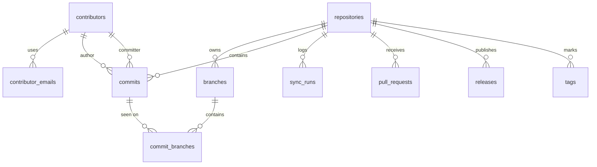

# 4. Data model

[← Contents](README.md)

Seven tables are enough for the MVP; `commits` is the central table, linked to the repositories, the
branches (via `commit_branches`) and the contributors. V2 adds three of them (migration `00003`):
`pull_requests`, `releases` and `tags`, i.e. **ten tables**; the migration `00004` makes
`repositories.provider_id` optional (repositories tracked through local Git repositories); the
migration `00005` (0.5.0) adds `contributors.profile_url` and the migration `00006` (0.5.0)
`commits.stats_known`. The storage is a SQLite file versioned by `goose` migrations, with **one
database per workspace** (`.watchoo/watchoo.db`, see [Workspaces](10-workspaces.md)). The tables
therefore do not know the notion of workspace: two workspaces never share data.

## Relational schema

## Tables

### `repositories` — tracked repositories

Uniqueness: **`(provider, provider_id)`** and **`(provider, owner, name)`**. `provider_id` can be
`NULL` (V2): SQLite accepts several `NULL` values in the `UNIQUE` constraint, and `owner` / `name` stay
unique.

| Column | Description |
| --- | --- |
| id | Internal ID |
| provider | Origin forge (`github` for the MVP) |
| provider_id | ID of the repository on the forge (GitHub numeric ID), which never changes. `NULL` = not yet known (V2): repository added and synced only through [local Git repositories](03-architecture.md#local-git-repositories-v2), which have none; the first sync through the API resolves it by owner/name and writes it. Strictly positive (`CHECK`); `0` in `model.Repository.ProviderID` |
| owner | Owner (user or organization) |
| name | Name of the repository |
| label | Display label (e.g. "Alice Martin", "Groupe 3"), optional; empty = `owner/repo` |
| default_branch | Default branch |
| url | URL of the repository |
| stars | Number of stars |
| open_issues | Number of open issues |
| last_synced_at | Date of the last sync |
| last_commit_at | Date of the last known commit, all tracked branches combined |
| archived | Repository archived on GitHub |
| flemme_after_days | Own "Flemme" (Slacking) threshold of the repository, at least 1 (empty = global value, 5 days by default); set by `repo add --flemme`, the `flemme` column of the import, the configuration sharing or the repository page in the web |
| dead_after_days | Own "Dead" threshold of the repository, at least 1 (empty = global value, 15 days by default); set the same way (`--dead`, `dead` column) |
| enabled | Actively tracked, or stopped (`repo remove --keep-history`: history kept, no more sync; `repo add` reactivates it) |
| branch_patterns | Branches to track (`--branch`, `branches` column of the import): names and `path.Match` patterns separated by commas (`main,dev,release/*`); empty = all the branches. Added by the migration `00002` |

### `branches` — monitored branches

Uniqueness: **`(repo_id, name)`**.

| Column | Description |
| --- | --- |
| id | Internal ID |
| repo_id | Parent repository |
| name | Name of the branch |
| head_sha | SHA of the last known commit on the branch |
| tracked | Whether the branch is tracked |

### `contributors` — identified people

Uniqueness: **`(provider, provider_user_id)`**. These columns are empty for a person known only
by their Git email; SQLite accepts several empty values in a unique column.

| Column | Description |
| --- | --- |
| id | Internal ID |
| provider | Forge of the account (`github` for the MVP), empty if no account is known |
| provider_user_id | ID of the account on the forge (GitHub numeric ID), which never changes |
| provider_login | GitHub login (if known), updated if the person changes it |
| name | Display label |
| avatar_url | URL of the avatar |
| profile_url | Profile page of the account on the forge (`html_url` of the GitHub account), given by the provider; empty if no login is known. Added by the migration `00005` (0.5.0); completed from the login for the contributors already in the database (0.6.1) |

`profile_url` comes from the provider, never from an address built outside `internal/provider/`:
the web interface adds nothing GitHub-specific to it. Usually, it is the `html_url` of the account
linked to a **new** commit (`provider.Person.ProfileURL`). A contributor already in the database
before the migration `00005` (the commits already in the database are not read again, and the
migration guesses no address) has their address completed by the **next sync**, through the API as
through the local Git repositories: for each contributor of the forge with an empty `provider_login`
and an empty `profile_url`, the engine writes
`Provider.ProfileURL(login)` (`https://github.com/<login>`, without a request; nothing for a login that
does not have the shape of an account login, like `dependabot[bot]`). Like the login and the avatar, an
empty address does not erase the known value, and a known address is never replaced by this complement. A
contributor without a login (known only through the local Git repositories) has no address.

### `contributor_emails` — attaching the Git emails

Primary key: **`email`**. One address designates a single person; a person can have several
addresses. The addresses are stored **in lowercase** (`Bob@Mail.com` and `bob@mail.com` are the same
address).

| Column | Description |
| --- | --- |
| email | Git email address, in lowercase |
| contributor_id | Contributor |

### `commits` — history (central table)

Primary key: **`(repo_id, sha)`**. Each commit is stored once per repository, whatever the
number of branches that contain it.

| Column | Description |
| --- | --- |
| repo_id | Repository |
| sha | Identifier of the commit |
| author_id | Author (contributor) |
| committer_id | Committer (contributor) |
| message | Commit message |
| authored_at | Author date |
| committed_at | Commit date |
| additions | Lines added (0 if unknown, see below) |
| deletions | Lines deleted (0 if unknown) |
| stats_known | `1` if `additions` and `deletions` have been computed (even at 0), `0` if they are still unknown. Added by the migration `00006` (0.5.0) |
| url | Link to the commit on the forge |

- **Stats** (`additions`, `deletions`): computed in the **local Git clone** of the repository
  (`git diff-tree --numstat`, without quota), with or without `gh`, for **all** the commits, the first
  import included; each sync takes the commits whose `stats_known` is still 0 again. If the clone is
  unavailable, the sync through the API falls back on one request per commit, only for the commits
  discovered after the first import of the repository, at most 100 per repository and per sync and never
  below 10% of remaining quota (see [Incremental sync](03-architecture.md#incremental-sync)).
- **Unknown or null**: `stats_known` distinguishes a commit never computed (`0`, displayed "—") from a
  commit really at `+0 −0` (`1`: merge without any change, empty commit), which is never computed
  again. A total (contributor, repository) is displayed "—" only if **none** of its commits has known
  stats; otherwise it sums the known commits. The migration `00006` marks known the commits already in
  the database whose `additions` or `deletions` is not zero (they were read through the API); the
  others (`0`/`0`, impossible to distinguish before the migration) are computed again by the clone at
  the next sync, which costs nothing. A partial index (`commits_stats_unknown`, on `(repo_id, sha)` of
  the unknown commits) serves to find them again. Rolling back (`Down`): index and column removed; the
  values of `additions` and `deletions` remain.
- **Author and committer**: a commit whose Git email is empty and which is not linked to any GitHub account
  has no contributor (`author_id` / `committer_id` empty); its Git name is ignored, for lack of a reliable
  identity to group these commits.

### `commit_branches` — membership of the commits in the branches

A single commit often belongs to several branches (for example after a merge of `dev` into `main`).
This junction table tells on which tracked branches each commit was seen.

Primary key: **`(repo_id, sha, branch_id)`**. Foreign key `(repo_id, sha)` to `commits`.

| Column | Description |
| --- | --- |
| repo_id | Repository |
| sha | Commit |
| branch_id | Branch on which the commit was seen |

- Counts and stats (contributors, charts): on `commits` only, therefore without duplicates.
- Filter by branch: join with `commit_branches`.

### `sync_runs` — sync log

| Column | Description |
| --- | --- |
| id | Internal ID |
| repo_id | Repository synced |
| started_at | Start |
| finished_at | End |
| new_commits | Number of new commits fetched |
| status | `running`, `success` or `error` |
| error | Optional error message, in French, with no personal data |

The last `sync_run` of a repository gives the Error state. A `running` `sync_run` also serves as a
**lock**: see [Architecture](03-architecture.md#sync-frequency).

### `pull_requests` — pull requests (V2)

Primary key: **`(repo_id, number)`**. A PR is recorded once per repository, then updated at
each sync that sees it updated (see
[Incremental sync](03-architecture.md#incremental-sync)); it is never
removed, except with its repository.

| Column | Description |
| --- | --- |
| repo_id | Repository |
| number | Number of the PR in the repository (at least 1) |
| title | Title (text coming from the repository: cleaned at display, never in the logs) |
| state | `open` or `closed`, as on the forge |
| merged | Merged (a merged PR is also `closed`, with `merged_at`) |
| draft | Draft |
| author_login | Login of the author on the forge; empty if unknown |
| author_provider_id | Numeric ID of the account of the author; 0 if unknown |
| url | Link to the PR on the forge |
| base_branch | Targeted branch |
| head_branch | Proposed branch |
| created_at | Date of opening |
| updated_at | Last update (serves as the resume point of the next sync) |
| closed_at | Date of closing; empty if open |
| merged_at | Date of merge; empty if not merged. A merged PR has `state = closed` and `merged_at` filled |

- **Author**: kept as is (login and account ID), **without a link** to `contributors`: a
  contributor is the author of at least one commit, and an author of PRs without a commit must not
  appear in the ranking. The matching stays possible through `author_provider_id` =
  `contributors.provider_user_id`.
- **Displayed state**: "ouverte" ("open") (or "brouillon" ("draft")), "mergée" ("merged") (`merged`) or
  "fermée" ("closed") (closed without merge).

### `releases` — releases (V2)

Primary key: **`(repo_id, provider_id)`**. The list of a repository is **replaced** at each successful
sync of that list: a release deleted on the forge disappears.

| Column | Description |
| --- | --- |
| repo_id | Repository |
| provider_id | ID of the release on the forge |
| tag_name | Tag of the release |
| name | Title (can be empty) |
| draft | Draft (only visible from an account with write access to the repository) |
| prerelease | Pre-release |
| author_login | Login of the author; empty if unknown |
| url | Link to the release on the forge |
| created_at | Date of creation |
| published_at | Date of publication; empty for a draft |

### `tags` — tags (V2)

Primary key: **`(repo_id, name)`**. Like `releases`, the list of a repository is replaced at each
successful sync of that list.

| Column | Description |
| --- | --- |
| repo_id | Repository |
| name | Name of the tag |
| sha | SHA of the targeted commit |

The forge gives no date for a tag: the display takes the date of the targeted commit when it is in the
database (join on `commits (repo_id, sha)`, without a foreign key: the commit can be on an untracked
branch).

## Index

| Index | Usage |
| --- | --- |
| `commits(repo_id, committed_at DESC)` | "Latest commits" view of a repository |
| `commits(author_id, committed_at DESC)` | "Activity of a contributor" view |
| `commit_branches(branch_id)` | "Commits of a branch" filter |
| `pull_requests(repo_id, updated_at DESC)` | Resume point of the PR sync, list of the PRs of a repository |

## Identity merging

For each synced commit, the author and the committer are attached to a contributor:

- **commit linked to a GitHub account**: contributor found (or created) by `(provider, provider_user_id)`,
  login, name and avatar updated; the Git email (in lowercase) is attached to it. If that email
  belonged to a contributor **without an account**, the latter is merged into the contributor with an
  account (its commits and its other emails are reassigned to it, then it is deleted);
- **commit without an account**: contributor found by email, otherwise created without an account (name = Git name);
- **neither account nor email**: no contributor.

Details:

- only the **new** commits go through these rules: a commit already in the database does not update its
  contributor;
- the Git name of a commit without an account updates the name of a contributor **without an account**
  found by email (the most recent wins), never that of a contributor with an account; an empty login,
  avatar or
  profile address does not erase the known value; during a merge, the contributor with an account takes the name of the
  absorbed contributor if it has none.

Without `gh` (local Git repositories, V2), no commit is linked to an account: only the rule "commit
without an account" applies (attaching by email). A contributor created this way is merged later, as
above, when a sync through the API attaches one of its emails to an account.

## Migration `00004`: `provider_id` optional

SQLite does not know how to remove a `NOT NULL` from a column: the migration rebuilds `repositories`
following the procedure documented by SQLite (new table, copy, `DROP`, renaming). Points of attention:

- **outside the goose transaction** (`-- +goose NO TRANSACTION`) to be able to cut the foreign keys
  (`PRAGMA foreign_keys = OFF`, without effect in a transaction): otherwise `DROP TABLE repositories`
  would delete in cascade the branches, commits, `commit_branches`, `sync_runs`, pull requests,
  releases and
  tags. goose runs a migration `NO TRANSACTION` on a single connection, so that the pragma
  does apply to the following statements; the rebuild itself is in an explicit transaction
  (`BEGIN` … `COMMIT`), then the foreign keys are re-enabled;
- the child tables keep their `REFERENCES repositories` clause, which designates the new table after the
  renaming; `id`, columns and constraints (`COLLATE NOCASE`, `CHECK`) are taken as is, and
  `provider_id` gains `CHECK (provider_id IS NULL OR provider_id > 0)`;
- a test (`internal/store/migration_provider_id_test.go`) fills a database with the `00003` schema (two repositories
  with branches, commits, `commit_branches`, syncs, PRs, releases, tags, contributors), applies
  `00004` and checks that no row is lost, that `foreign_key_check` and `integrity_check` are
  clean, that the foreign keys are re-enabled and that the cascade still works;
- rolling back (`Down`): same rebuild back to `NOT NULL`, an unknown `provider_id` receiving
  the opposite of the internal ID (negative, unique, replaced at the sync by the next API).

Written by the engine (`store.RepositoryMetadata`): `ProviderID` > 0 is written (resolution after the
answer of `gh`), 0 keeps the value in the database; `Partial` (sync through local Git repositories) only writes the
default branch (if it is known) and the sync date, never zeros instead of the URL, the
stars, the issues, the archived state or `provider_id`.

## Renames and login changes

On GitHub, a repository can be renamed or transferred, and a user can change their login. The numeric IDs
(`provider_id`, `provider_user_id`) never change: uniqueness rests on them. At each sync, Watchoo
updates `owner`, `name` and `provider_login` if needed, without creating a
duplicate and without splitting the history. Without `gh` (local Git repositories), a repository is designated by owner/name:
a renaming is only followed at the next sync through the API.

## Dates

- Stored as **ISO 8601 text, in UTC**, with a strictly fixed format, accurate to the second:
  `2006-01-02T15:04:05Z` (e.g. `2026-10-26T14:03:00Z`). A fixed format sorts correctly as text,
  so the indexes on `committed_at` work.
- It is the format returned by the GitHub API. The date columns are declared `TEXT` (sqlc therefore
  generates `string` or `sql.NullString`): the `string` ↔ `time.Time` conversion is done explicitly in
  `internal/store` (`FormatTime` / `ParseTime`), because the `modernc` driver does not write this format
  by itself. The format is also checked in the database by a `CHECK` constraint.
- **Conversion to local time at display only** (CLI, TUI, web): relative dates ("il y a 2 h" ("2 h ago"))
  or local date and time.
- **"Per day / week" groupings** (charts, stats): according to the **user's time zone**, the system's by
  default or the one set in the config. Otherwise, a commit made at 11 p.m. in Paris would fall on the
  next day.
- The time zone of the author is not kept, because the GitHub API returns the dates already converted to
  UTC.
