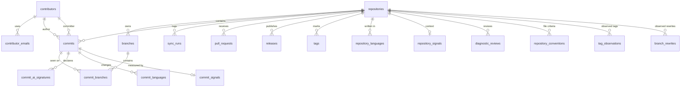

# 4. Data model

[← Contents](README.md)

Seven tables are enough for the MVP; `commits` is the central table, linked to the repositories, the
branches (via `commit_branches`) and the contributors. V2 adds three of them (migration `00003`):
`pull_requests`, `releases` and `tags`, i.e. **ten tables**; the migration `00004` makes
`repositories.provider_id` optional (repositories tracked through local Git repositories); the
migration `00005` (0.5.0) adds `contributors.profile_url` and the migration `00006` (0.5.0)
`commits.stats_known`; the migration `00007` (1.1.0) adds `repository_languages`; the migration `00008` (1.2.0)
adds `commits.ai_rules_version` and the `commit_ai_signatures` table; the migration `00009` (1.2.0) adds
`commits.languages_version` and the `commit_languages` table, i.e. **thirteen tables**; the migration `00010` (1.3.0)
adds `sync_runs.warnings`. The migration `00011` (phase 7.1) adds `commit_signals`, the migration `00012` (phase 7.2) `pull_requests.tool_ids` and `repository_signals`, the migration `00013` (phase 7.4) `diagnostic_reviews`, i.e. **sixteen tables**, the migration `00014` (phase 7.5) the form columns of `commit_signals`, and the migration `00015` (phase 7.7) its measures of the absolute signals and counter-indicators (see [Supervision and diagnosis](12-supervision-diagnostic.md)). The migration `00016` (phase 8.1) adds `commits.parent_count` and `repositories.conventions_since` (see [Project conventions](13-conventions.md) and [Migration `00016`](#migration-00016-project-conventions)), the migration `00017` (phase 8.3) the cache `repository_conventions` of the file criteria of the conventions (see [Migration `00017`](#migration-00017-cache-of-the-file-criteria)), then the migrations `00018` and `00019` (phase 8.4) the history of the tags `tag_observations` and the observed rewrites of the default branch `branch_rewrites`, i.e. **nineteen tables** (see [Migrations `00018` and `00019`](#migrations-00018-and-00019-history-of-the-tags-and-of-the-default-branch)); the migration `00020` (phase 8.5) only adds columns to `pull_requests` and `repositories` (see [Migration `00020`](#migration-00020-merges-and-pull-request-bodies)), and the migration `00021` (phase 8.6) only the review counters of `pull_requests` (see [Migration `00021`](#migration-00021-pull-request-reviews)); the migration `00022` (1.8.0) only adds `contributors.label`, the name given to a contributor by the supervisor (see [Migration `00022`](#migration-00022-labels-of-the-contributors)); the migration `00023` (1.9.0) only adds `contributors.primary_id`, `commits.person_id` and `commit_signals.person_id`, the groups of contributors (see [Contributor groups](#contributor-groups-190)). The storage is a SQLite file versioned by `goose` migrations, with **one
database per workspace** (`.watchoo/watchoo.db`, see [Workspaces](10-workspaces.md)). The tables
therefore do not know the notion of workspace: two workspaces never share data.

## Relational schema

## Tables

### `repositories` — tracked repositories

Uniqueness: **`(provider, provider_id)`** and **`(provider, owner, name)`**. `provider_id` can be
`NULL` (V2): SQLite accepts several `NULL` values in the `UNIQUE` constraint, and `owner` / `name` stay
unique.

| Column | Description |
| --- | --- |
| id | Internal ID |
| provider | Origin forge (`github` for the MVP) |
| provider_id | ID of the repository on the forge (GitHub numeric ID), which never changes. `NULL` = not yet known (V2): repository added and synced only through [local Git repositories](03-architecture.md#local-git-repositories-v2), which have none; the first sync through the API resolves it by owner/name and writes it. Strictly positive (`CHECK`); `0` in `model.Repository.ProviderID` |
| owner | Owner (user or organization) |
| name | Name of the repository |
| label | Display label (e.g. "Alice Martin", "Groupe 3"), optional; empty = `owner/repo` |
| default_branch | Default branch |
| url | URL of the repository |
| stars | Number of stars |
| open_issues | Number of open issues |
| last_synced_at | Date of the last sync |
| last_commit_at | Date of the last known commit, all tracked branches combined |
| archived | Repository archived on GitHub |
| flemme_after_days | Own Slacking threshold of the repository, at least 1 (empty = global value, 5 days by default); set by `repo add --flemme`, the `flemme` column of the import, the configuration sharing or the repository page in the web |
| dead_after_days | Own "Dead" threshold of the repository, at least 1 (empty = global value, 15 days by default); set the same way (`--dead`, `dead` column) |
| enabled | Actively tracked, or stopped (`repo remove --keep-history`: history kept, no more sync; `repo add` reactivates it) |
| branch_patterns | Branches to track (`--branch`, `branches` column of the import): names and `path.Match` patterns separated by commas (`main,dev,release/*`); empty = all the branches. Added by the migration `00002` |
| conventions_since | Start date of the conventions for this repository (`repo add --conventions-since YYYY-MM-DD`, configuration sharing), stored in the fixed format at **midnight UTC** of the calendar date (`2026-09-01T00:00:00Z`, `CHECK`); empty = date of the workspace (`conventions.since`). Read as the calendar date, at midnight in the time zone of the workspace. Added by the migration `00016` (phase 8.1) |
| allow_squash_merge, allow_merge_commit, allow_rebase_merge | Merge methods allowed on the forge (BR5, phase 8.5): `1` or `0`, read in the `GET /repos` the sync already makes; empty = unknown (GitHub only returns them to an account with the push right; always unknown in local clone mode). Rewritten at every sync through the API: empty again if the push right is lost. Added by the migration `00020` |
| conventions_prs_version | Version of the pull request rules (`conventions.PRRulesVersion`) for which the full list of the pull requests of the repository was read again once (filling of `merge_commit_sha`, `from_fork` and `body_sections` for the PRs already in the database); empty = never. Added by the migration `00020` (phase 8.5) |

### `branches` — monitored branches

Uniqueness: **`(repo_id, name)`**.

| Column | Description |
| --- | --- |
| id | Internal ID |
| repo_id | Parent repository |
| name | Name of the branch |
| head_sha | SHA of the last known commit on the branch |
| tracked | Whether the branch is tracked |

### `contributors` — identified people

Uniqueness: **`(provider, provider_user_id)`**. These columns are empty for a person known only
by their Git email; SQLite accepts several empty values in a unique column.

| Column | Description |
| --- | --- |
| id | Internal ID |
| provider | Forge of the account (`github` for the MVP), empty if no account is known |
| provider_user_id | ID of the account on the forge (GitHub numeric ID), which never changes |
| provider_login | GitHub login (if known), updated if the person changes it |
| name | Name known from the commits: name of the forge account, otherwise Git name; updated by the sync (see [Identity merging](#identity-merging)) |
| label | Name given by the supervisor in the web interface (1.8.0, migration `00022`); empty = none. Never written by the sync |
| primary_id | Contributor group (1.9.0, migration `00023`): the **principal** contributor this one is attached to; `NULL` = principal itself (alone or with attached accounts). See [Contributor groups](#contributor-groups-190) |
| avatar_url | URL of the avatar |
| profile_url | Profile page of the account on the forge (`html_url` of the GitHub account), given by the provider; empty if no login is known. Added by the migration `00005` (0.5.0); completed from the login for the contributors already in the database (0.6.1) |

`profile_url` comes from the provider, never from an address built outside `internal/provider/`:
the web interface adds nothing GitHub-specific to it. Usually, it is the `html_url` of the account
linked to a **new** commit (`provider.Person.ProfileURL`). A contributor already in the database
before the migration `00005` (the commits already in the database are not read again, and the
migration guesses no address) has their address completed by the **next sync**, through the API as
through the local Git repositories: for each contributor of the forge with an empty `provider_login`
and an empty `profile_url`, the engine writes
`Provider.ProfileURL(login)` (`https://github.com/<login>`, without a request; nothing for a login that
does not have the shape of an account login, like `dependabot[bot]`). Like the login and the avatar, an
empty address does not erase the known value, and a known address is never replaced by this complement. A
contributor without a login (known only through the local Git repositories) has no address.

**Label** (1.8.0): the commits give a pseudonym (login, Git name) that often says nothing about the
person; the supervisor can give a contributor a name of their choice from the web interface
(`/settings/contributors`, see [Web interface](06-web-interface.md#5-settings)). The **displayed
name** of a contributor is then, everywhere (web, CLI, TUI, `display_name` key of `--json`): `label`
if it is filled, otherwise `name`, otherwise `provider_login`, otherwise "unknown"; the login and the
Git name remain visible next to it. Rules:

- the sync **never** writes `label`: a new commit, a change of login or of Git name leaves it as is;
- the value is trimmed of its surrounding spaces, 1 to 100 characters, without control characters;
  an empty value removes the label (back to the name of the commits);
- it stays in the database of the workspace: it is **never exported** by the configuration sharing
  (it is personal data, often the real name of a learner), nor written to the logs;
- the filters `--author` (`watchoo log`, `watchoo diagnostic`) and `--contributor` (`watchoo conventions`)
  also accept it, exactly, like the login and the name.

### `contributor_emails` — attaching the Git emails

Primary key: **`email`**. One address designates a single person; a person can have several
addresses. The addresses are stored **in lowercase** (`Bob@Mail.com` and `bob@mail.com` are the same
address).

| Column | Description |
| --- | --- |
| email | Git email address, in lowercase |
| contributor_id | Contributor |

### `commits` — history (central table)

Primary key: **`(repo_id, sha)`**. Each commit is stored once per repository, whatever the
number of branches that contain it.

| Column | Description |
| --- | --- |
| repo_id | Repository |
| sha | Identifier of the commit |
| author_id | Author (contributor): the account of the commit, kept as is by a grouping |
| person_id | Person of the author (1.9.0, migration `00023`): principal of the group of `author_id` (`author_id` itself if it is not attached); `NULL` exactly when `author_id` is. Every count per contributor goes through it |
| committer_id | Committer (contributor) |
| message | Commit message |
| authored_at | Author date |
| committed_at | Commit date |
| additions | Lines added (0 if unknown, see below) |
| deletions | Lines deleted (0 if unknown) |
| stats_known | `1` if `additions` and `deletions` have been computed (even at 0), `0` if they are still unknown. Added by the migration `00006` (0.5.0) |
| url | Link to the commit on the forge |
| ai_rules_version | Version of the AI signature rules the commit was analyzed with; `0` = not analyzed yet. Added by the migration `00008` (1.2.0) |
| languages_version | Version of the language rules the languages of the commit were read with in the clone; `0` = not yet. Added by the migration `00009` (1.2.0) |
| parent_count | Number of parents of the commit: `0` = root, `1` = ordinary, `2` or more = merge; empty = unknown (`CHECK >= 0`). Written at insertion from the commit read (API or clone); the commits recorded before the migration are backfilled by the local Git clone during the sync. Added by the migration `00016` (phase 8.1) |

- **Stats** (`additions`, `deletions`): computed in the **local Git clone** of the repository
  (`git diff-tree --numstat`, without quota), with or without `gh`, for **all** the commits, the first
  import included; each sync takes the commits whose `stats_known` is still 0 again. If the clone is
  unavailable, the sync through the API falls back on one request per commit, only for the commits
  discovered after the first import of the repository, at most 100 per repository and per sync and never
  below 10% of remaining quota (see [Incremental sync](03-architecture.md#incremental-sync)).
- **Unknown or null**: `stats_known` distinguishes a commit never computed (`0`, displayed "—") from a
  commit really at `+0 −0` (`1`: merge without any change, empty commit), which is never computed
  again. A total (contributor, repository) is displayed "—" only if **none** of its commits has known
  stats; otherwise it sums the known commits. The migration `00006` marks known the commits already in
  the database whose `additions` or `deletions` is not zero (they were read through the API); the
  others (`0`/`0`, impossible to distinguish before the migration) are computed again by the clone at
  the next sync, which costs nothing. A partial index (`commits_stats_unknown`, on `(repo_id, sha)` of
  the unknown commits) serves to find them again. Rolling back (`Down`): index and column removed; the
  values of `additions` and `deletions` remain.
- **Author and committer**: a commit whose Git email is empty and which is not linked to any GitHub account
  has no contributor (`author_id` / `committer_id` empty); its Git name is ignored, for lack of a reliable
  identity to group these commits.

### `commit_branches` — membership of the commits in the branches

A single commit often belongs to several branches (for example after a merge of `dev` into `main`).
This junction table tells on which tracked branches each commit was seen.

Primary key: **`(repo_id, sha, branch_id)`**. Foreign key `(repo_id, sha)` to `commits`.

| Column | Description |
| --- | --- |
| repo_id | Repository |
| sha | Commit |
| branch_id | Branch on which the commit was seen |

- Counts and stats (contributors, charts): on `commits` only, therefore without duplicates.
- Filter by branch: join with `commit_branches`.

### `commit_ai_signatures` — AI signatures of the commits (1.2.0)

One row per tool and per kind of signature found in a commit (see
[AI signatures](02-features.md#ai-signatures)). **No row is not evidence of work done without AI.**

Primary key: **`(repo_id, sha, tool, kind)`**. Foreign key `(repo_id, sha)` to `commits`, with cascade: the
signatures disappear with the commit.

| Column | Description |
| --- | --- |
| repo_id | Repository |
| sha | Commit |
| tool | Identifier of the tool (`aider`, `claude`, `codex`, `copilot`, `cursor`) |
| kind | Kind of signature (`agent_account`, `coauthor_trailer`, `footer`) |

The signatures are derived data: they are rewritten at each analysis of the commit, from the message and
the author already in the database. Neither the message line nor an address is copied here. Rolling back
(`Down`): table, index and column removed; the commits remain.

### `sync_runs` — sync log

| Column | Description |
| --- | --- |
| id | Internal ID |
| repo_id | Repository synced |
| started_at | Start |
| finished_at | End |
| new_commits | Number of new commits fetched |
| status | `running`, `success` or `error` |
| error | Optional error message, in the language active at sync time (English or French), with no personal data |
| warnings | Warnings of a successful sync (1.3.0, migration `00010`): JSON array of `{"kind": …, "message": …}`, `[]` if none. `kind` is a stable code (`stats_not_computed`, `clone_unavailable`, `languages_not_computed`, `lists_not_synced`, `ai_not_scanned`, `diagnostic_not_recorded` since phase 7.1), translated at display; `message` is the full text, in the language active at sync time, with no personal data |

The last `sync_run` of a repository gives the Error state, and its warnings are those shown on the
repository's card and page (see [Web interface](06-web-interface.md#1-dashboard)): they survive a
restart of `watchoo serve` and disappear at the next sync without warning. A `running` `sync_run` also serves as a
**lock**: see [Architecture](03-architecture.md#sync-frequency).

### `pull_requests` — pull requests (V2)

Primary key: **`(repo_id, number)`**. A PR is recorded once per repository, then updated at
each sync that sees it updated (see
[Incremental sync](03-architecture.md#incremental-sync)); it is never
removed, except with its repository.

| Column | Description |
| --- | --- |
| repo_id | Repository |
| number | Number of the PR in the repository (at least 1) |
| title | Title (text coming from the repository: cleaned at display, never in the logs) |
| state | `open` or `closed`, as on the forge |
| merged | Merged (a merged PR is also `closed`, with `merged_at`) |
| draft | Draft |
| author_login | Login of the author on the forge; empty if unknown |
| author_provider_id | Numeric ID of the account of the author; 0 if unknown |
| url | Link to the PR on the forge |
| base_branch | Targeted branch |
| head_branch | Proposed branch |
| created_at | Date of opening |
| updated_at | Last update (serves as the resume point of the next sync) |
| closed_at | Date of closing; empty if open |
| merged_at | Date of merge; empty if not merged. A merged PR has `state = closed` and `merged_at` filled |
| tool_ids | Diagnosis (phase 7.2, migration `00012`): tools declared in the description, encoded `D2:claude`, sorted, comma-separated; empty if none or not measured. The description is never kept; value cleared by the purge (`diagnostic.retention_days`, opening date) |
| merge_commit_sha | Conventions (phase 8.5, migration `00020`): commit created by the merge (squash, merge commit or last rebased commit), filled only for a merged PR; empty = not merged or unknown |
| from_fork | Conventions (phase 8.5, migration `00020`): `1` if the head repository differs from the base repository or was deleted, `0` otherwise; empty = unknown (PR read before the migration, or answer without the base repository) |
| body_sections | Conventions (PR5, phase 8.5, migration `00020`): bit mask of the sections recognized in the description (context 1, changes 2, testing 4, screenshots 8) and of the closing keyword (16), computed in memory at the sync (`conventions.CheckPRBody`), even with the conventions disabled; empty = unknown. The description is never kept |
| reviews_by_others | Conventions (PR4, phase 8.6, migration `00021`): number of reviews submitted by accounts other than the author, neither bots nor excluded (`conventions.excluded_accounts`), every state except `PENDING`; empty = reviews never read |
| approvals_by_others | Conventions (PR4, phase 8.6, migration `00021`): number of distinct reviewers among these accounts whose last state among `APPROVED`, `CHANGES_REQUESTED` and `DISMISSED`, submitted at the latest at `merged_at`, is `APPROVED` (open PR: every review counts); empty = never read |
| approvals_by_contributors | Conventions (PR4, phase 8.6, migration `00021`): among these approving reviewers, those who are the author of at least one commit of the repository known to the database at the time of the reading (by account ID or login); at most `approvals_by_others`; empty = never read |
| reviews_checked_at | Conventions (PR4, phase 8.6, migration `00021`): date of the last reading of the reviews (at least `merged_at` for a merged PR; for an open one, its `updated_at` from the forge, never the local clock, so that a later merge has it read again); empty = never read |

- **Author**: kept as is (login and account ID), **without a link** to `contributors`: a
  contributor is the author of at least one commit, and an author of PRs without a commit must not
  appear in the ranking. The matching stays possible through `author_provider_id` =
  `contributors.provider_user_id`.
- **Displayed state**: "open" (or "draft"), "merged" (`merged`) or "closed" (closed
  without merge).
- **Reviews** (phase 8.6): only the three counters above are kept, **never a reviewer's login** nor the
  body of a review; `conventions.pr.min_reviews` and `conventions.pr.reviewer_must_contribute` are applied
  when reading, from these counters.

### `releases` — releases (V2)

Primary key: **`(repo_id, provider_id)`**. The list of a repository is **replaced** at each successful
sync of that list: a release deleted on the forge disappears.

| Column | Description |
| --- | --- |
| repo_id | Repository |
| provider_id | ID of the release on the forge |
| tag_name | Tag of the release |
| name | Title (can be empty) |
| draft | Draft (only visible from an account with write access to the repository) |
| prerelease | Pre-release |
| author_login | Login of the author; empty if unknown |
| url | Link to the release on the forge |
| created_at | Date of creation |
| published_at | Date of publication; empty for a draft |

### `tags` — tags (V2)

Primary key: **`(repo_id, name)`**. Like `releases`, the list of a repository is replaced at each
successful sync of that list.

| Column | Description |
| --- | --- |
| repo_id | Repository |
| name | Name of the tag |
| sha | SHA of the targeted commit |

The forge gives no date for a tag: the display takes the date of the targeted commit when it is in the
database (join on `commits (repo_id, sha)`, without a foreign key: the commit can be on an untracked
branch).

### `repository_languages` — languages of a repository (1.1.0)

Primary key: **`(repo_id, language)`**. The list of a repository is **replaced** at each sync that could
read its local Git clone; otherwise, what is in the database is kept.

| Column | Description |
| --- | --- |
| repo_id | Repository |
| language | Name of the language (`Go`, `TypeScript`…), same in every interface language |
| bytes | Size of its files on the default branch, in bytes (at least 1) |

Percentages are not stored: they are computed at display time, from the total of the repository. See
[Languages of a repository](03-architecture.md#languages-of-a-repository-110).

### `commit_languages` — lines added per language in a commit (1.2.0)

One row per language in which the commit adds at least one line, read from the local Git clone (see
[Languages of a contributor](03-architecture.md#languages-of-a-contributor-120)). An analyzed commit
(`languages_version` > 0) with no row here adds nothing in a recognized language (merge commit, Markdown
only…).

Primary key: **`(repo_id, sha, language)`**. Foreign key `(repo_id, sha)` to `commits`, with cascade.

| Column | Description |
| --- | --- |
| repo_id | Repository |
| sha | Commit |
| language | Name of the language, as in `repository_languages` |
| additions | Lines added in this language (at least 1) |

Derived data: rewritten at each analysis of the commit. The totals of a contributor go through
`commits.author_id`: a merge of contributors follows them without rewriting anything. Rolling back
(`Down`): table, index and column removed; the commits remain.

### `commit_signals` — diagnosis signals (phase 7.1)

Primary key: **`(repo_id, sha)`**, foreign key to `commits (repo_id, sha)` with `ON DELETE CASCADE`
(deleting a commit or a repository deletes its signals). One row per commit measured while the
`diagnostic.enabled` setting is on: new commits synced after it was enabled, merge commits excluded,
whose local Git clone gives the file detail. A row is never rewritten, except to complete a form not
measured (`form_known = 0`) with a measured one (phase 7.5). **Data minimisation**: no message, no e-mail
address, no file path, no line of code.

| Column | Description |
| --- | --- |
| repo_id, sha | Measured commit |
| author_id | Author, copied from `commits` (`NULL` if the contributor is deleted) |
| person_id | Person of the author, copied from `commits.person_id` (1.9.0) and kept equal to it |
| authored_at | Author date, copied from `commits`: per-author windows (phase 7.3) and purge |
| files_kept | Files kept (neither binary nor excluded by `diagnostic.exclude`) |
| files_excluded | Binary files or files excluded by a pattern |
| additions_kept, deletions_kept | Lines added and deleted in the kept files |
| tool_ids | Declared tools, each with its signal (phase 7.2): `D1:<tool>` for a trailer, `D2:<tool>` for a signature; tools: `claude`, `copilot`, `codex`, `cursor`, `unnamed`. Sorted, comma-separated; empty if none |
| agent_config | Signal D4: the commit changes an agent configuration file (`AGENTS.md`, `CLAUDE.md`…) |
| bot_author | Signal D3: the author is a known bot account (`*[bot]`, `copilot-swe-agent`) |
| computed_at | Date of the computation |
| form_known | Form measured (phase 7.5); 0 for a row written before phase 7.5 or a failed read (all the following columns are then 0) |
| source_lines, comment_lines | Non-blank added lines of the recognised source files (tests included), and among them the comment or docstring lines (F1) |
| functions, documented_functions | Function definitions added, and among them the documented ones (F2) |
| identifiers, lexical_diversity | Identifiers of the added code (keywords and strings left out) and their MATTR lexical diversity, window of 50; `NULL` with fewer than 50 identifiers (F3) |
| test_lines | Non-blank added lines of the test files (F5) |
| message_length, message_bullets, message_conventional | Message length without trailers and signatures, list lines, Conventional Commits subject (F4); the message is not copied |
| decorative_lines | Decorative comment lines (phase 7.7, migration `00015`, signal A5) |
| fr_words, fr_words_unaccented | Common accented French words found in the comments, and among them those written without accents (A6); the words are not kept |
| wip_markers | Work-in-progress markers: `TODO`, `FIXME`, `XXX`, `HACK`, debug calls (A7, H1) |
| short_identifiers | One-letter identifiers (A7, H2) |
| private_defs | Private definitions among `functions` |
| message_revert, message_fix | `git revert` message (A4); fix subject (H4) |

Purge: at the end of each sync, rows whose `authored_at` is older than `diagnostic.retention_days`
(365 days by default) are deleted.

### `repository_signals` — diagnosis context of a repository (phase 7.2)

Primary key: **`repo_id`**, deleted with the repository. Updated at each sync from the local Git clone,
with the diagnosis enabled.

| Column | Description |
| --- | --- |
| repo_id | Repository |
| agent_config_since | Signal D4 (context): author date of the first commit adding an agent configuration file on the default branch; `NULL` if none |
| computed_at | Date of the computation |

### `diagnostic_reviews` — human reviews of the leads (phase 7.4)

Primary key: **`(repo_id, lead_key)`**; one review per lead, replaced if done again; deleted with the
repository. The note is personal data: the review follows `diagnostic.retention_days` from `lead_date`.

| Column | Description |
| --- | --- |
| repo_id | Repository |
| lead_key | Stable key of the lead: `commit/<sha>`, `pull_request/<number>` or `day/<author>/<start of the day UTC>` |
| kind | `commit`, `pull_request` or `day` |
| lead_date | Date of the lead (retention) |
| signals | Identifiers of the signals present at review time (`D1,R2`…), for calibration (phase 7.6) |
| decision | `assisted`, `not_assisted` or `undetermined` |
| cause | If not assisted: `internal_copy`, `tool_generated`, `existing_import`, `refactoring` or `other`; empty otherwise |
| confidence | `low`, `medium` or `high` |
| note | Free note of the reviewer (2,000 characters at most) |
| reviewer | Reviewer: web interface account, otherwise workspace name |
| reviewed_at | Date of the review |

### `repository_conventions` — cache of the file criteria of the conventions (phase 8.3)

Primary key: **`(repo_id, rev_kind, tag_name)`**; one row per measured revision, replaced when it is
recomputed; deleted with the repository. Written by the sync only when the conventions are enabled, after
the update of the local Git clone, for the head of the default branch and for every tag that designates a
configured milestone (see [Project conventions](13-conventions.md), sections 5.5 to 5.8 and 9).

| Column | Description |
| --- | --- |
| repo_id | Repository |
| rev_kind | `head` (head of the default branch) or `tag` (tag of a milestone) |
| tag_name | Name of the tag for `tag`; empty for `head` (`CHECK`) |
| rev_sha | Measured commit (complete SHA, 40 or 64 lowercase hexadecimal characters) |
| rules_version | Version of the rules of the file criteria (`conventions.FileRulesVersion`) |
| config_hash | Stable fingerprint (SHA-256) of the settings `conventions.changelog.*`, `conventions.readme.*`, `conventions.docs.*`, of the repository (`owner/name`, case ignored: RD3, DOC3 and DOC4 recognize its URLs) and of the names of the tags that designate a version (CL8) |
| results | JSON object (`CHECK json_type = 'object'`): criterion identifiers, states, reasons, codes and **counters** only; never a path, a file content, an INDEX cell or a person's name. Since phase 8.7 (`rules_version` 2), the head row adds `leads`: the CL11, CL12, RD5, DOC6, DOC7 and TL4 leads, with the same limits (percentages and counters, never a header value nor a commit subject) |
| computed_at | Date of the computation |

A row whose `rev_sha`, `rules_version` or `config_hash` no longer matches is recomputed at the next sync;
the rows of the tags that no longer designate a configured milestone (tag gone, milestone removed) are
deleted, and the head row when the source no longer has a default branch. The lists of paths (DOC3, DOC4, DOC5, DOC8) are not stored: they are recomputed from the clone
for the detailed view of a repository.

### `tag_observations` — history of the observed tags (phase 8.4)

Primary key: **`id`**; one row per **observation period** of a couple (tag name, SHA of the target commit),
open (`ended_at` NULL) as long as the sync sees the couple; at most one open period per name and per
repository (partial unique index); deleted with the repository. Written by the sync **only when the
conventions are enabled**, and only after a **successful, non-truncated** read of the tags (fewer than
1,000 tags: a list of exactly 1,000 is taken as truncated) **without any skipped tag** (empty name, invalid
SHA): a failed, skipped, truncated or incomplete read closes nothing. Used by SV3 (tag rewritten or deleted) and by the
deadlines of SV2 (see [Project conventions](13-conventions.md), sections 5.4 and 9). No attribution to a
person.

| Column | Description |
| --- | --- |
| repo_id | Repository |
| name | Name of the tag (not empty) |
| sha | SHA of the target commit (complete, 40 or 64 lowercase hexadecimal characters); for an annotated tag, the commit, never the tag object |
| first_seen_at | First read that saw the couple |
| last_seen_at | Last read that saw it (`>= first_seen_at`) |
| ended_at | Read that noticed the end (`>= last_seen_at`); NULL while the period is open |
| end_reason | `rewritten` (the name designates another commit) or `deleted` (the name disappeared); NULL if and only if `ended_at` is |

At each complete read: a couple seen again moves `last_seen_at`; a name seen with another SHA closes its
period (`rewritten`) and opens a new one; a missing name closes its period (`deleted`); a couple without an
open period opens one, including a couple already seen then deleted (the history of the periods stays).

### `branch_rewrites` — observed rewrites of the default branch (phase 8.4)

Primary key: **`id`**; one row per observed event; deleted with the repository. Written by the sync **only
when the conventions are enabled**, when the old known head of the default branch is no longer an ancestor
of the new one (BR4, see [Project conventions](13-conventions.md), sections 5.2 and 9); an unknown result
(old commit missing from the clone) is never recorded, except in API mode, where the `ErrUnknownBase` error of
the sync on the old head serves as the signal (see 13, section 5.2). No attribution to a person.

| Column | Description |
| --- | --- |
| repo_id | Repository |
| branch | Default branch at the time of the observation (not empty) |
| old_sha | Old head (complete lowercase SHA) |
| new_sha | New head (complete lowercase SHA, different from `old_sha`) |
| observed_at | End of the sync that observed the rewrite |

## Index

| Index | Usage |
| --- | --- |
| `commits(repo_id, committed_at DESC)` | "Latest commits" view of a repository |
| `commits(author_id, committed_at DESC)` | Commits of one account (detaching, merge of identities) |
| `commits(person_id, committed_at DESC)` | "Activity of a contributor" view, counts per person (1.9.0) |
| `commit_branches(branch_id)` | "Commits of a branch" filter |
| `pull_requests(repo_id, updated_at DESC)` | Resume point of the PR sync, list of the PRs of a repository |
| `contributor_emails(contributor_id)` | Technical: foreign key often walked (e-mails of a contributor) |
| `sync_runs(repo_id, started_at DESC)` | Technical: last sync of a repository |
| `commits(repo_id, sha) WHERE stats_known = 0` | Partial index: commits whose `+/-` lines are still to be read (migration `00006`) |
| `commits(repo_id, ai_rules_version)` | Commits still to analyze for the AI signatures (migration `00008`) |
| `commits(repo_id, languages_version)` | Commits whose languages are still to read from the clone (migration `00009`) |
| `commits(repo_id, sha) WHERE parent_count IS NULL` | Partial index: commits whose number of parents is still to be read in the clone (migration `00016`) |
| `commit_signals(repo_id, person_id, authored_at)` | Per-person sliding windows of the rhythm signals (phase 7.3; per person since 1.9.0, replaces the index on `author_id`) |
| `contributors(primary_id)` | Accounts attached to a principal (1.9.0) |
| `commit_signals(authored_at)` | Purge by retention period |
| `tag_observations(repo_id, name) WHERE ended_at IS NULL` | Partial unique index: at most one open period per tag (migration `00018`) |
| `tag_observations(repo_id, name, first_seen_at)` | History of the tags of a repository (migration `00018`) |
| `branch_rewrites(repo_id, observed_at)` | Rewrites of a repository by date (migration `00019`) |
| `diagnostic_reviews(lead_date)` | Purge of the reviews by retention period |

## Identity merging

For each synced commit, the author and the committer are attached to a contributor:

- **commit linked to a GitHub account**: contributor found (or created) by `(provider, provider_user_id)`,
  login, name and avatar updated; the Git email (in lowercase) is attached to it. If that email
  belonged to a contributor **without an account**, the latter is merged into the contributor with an
  account (its commits and its other emails are reassigned to it, then it is deleted);
- **commit without an account**: contributor found by email, otherwise created without an account (name = Git name);
- **neither account nor email**: no contributor.

Details:

- only the **new** commits go through these rules: a commit already in the database does not update its
  contributor;
- the Git name of a commit without an account updates the name of a contributor **without an account**
  found by email (the most recent wins), never that of a contributor with an account; an empty login,
  avatar or
  profile address does not erase the known value; during a merge, the contributor with an account takes the name of the
  absorbed contributor if it has none;
- during a merge, the contributor with an account also takes the `label` of the absorbed contributor
  if it has none (1.8.0); if both have one, the label of the contributor with an account is kept.

Without `gh` (local Git repositories, V2), no commit is linked to an account: only the rule "commit
without an account" applies (attaching by email). A contributor created this way is merged later, as
above, when a sync through the API attaches one of its emails to an account.

## Contributor groups (1.9.0)

A person may use several identities that nothing links: two GitHub accounts, or a Git name whose e-mail
is not the one of their account. The automatic merge above only joins identities that share an e-mail:
it is certain, so it is physical (commits reassigned, contributor deleted). Grouping other identities
is a **human judgement**, made by the supervisor in the web interface
([`/settings/contributors`](06-web-interface.md#52-contributors-settingscontributors)): it is
**logical and reversible**.

- **Principal and attached accounts**: a contributor attached to another has `primary_id` = the
  principal. **One level only**: the principal is never attached itself, and a contributor that has
  attached accounts cannot be attached (detach its accounts first). No chain, no cycle; a contributor is
  never attached to itself. The group of a principal is the principal and its attached accounts.
- **Person of a commit**: `commits.person_id` (and `commit_signals.person_id`) is the principal of the
  group of `author_id`. It is a denormalized copy, so that **reading costs nothing more**: every count
  per contributor (ranking, contributor page, charts, totals per repository, languages, AI score,
  diagnosis, conventions) groups and filters on `person_id` instead of `author_id`, with the same kind of
  index, without a join. `author_id` keeps the account of the commit, which makes detaching lossless.
- **Cost paid when (de)attaching**: attaching account `A` to principal `P` sets `A.primary_id = P` and
  `person_id = P` on the commits and signals whose `author_id = A`; detaching sets them back to `A`. One
  transaction, two `UPDATE`s on indexed columns; nothing is recomputed in the clones.
- **Sync**: a new commit gets `person_id` = principal of its author's group at insertion, in the same
  transaction as the reading of `primary_id`. The sync never changes a group.
- **Automatic merge** (`from` absorbed into `into`, above): the commits of `from` take `author_id =
  into` and `person_id` = principal of `into`'s group. If accounts were attached to `from`, they are
  attached to that principal (to `into` itself if `into` was one of them, which then becomes the
  principal). If `from` was attached to a principal `Q` and `into` is in no group, `into` is attached to
  `Q`: the supervisor had placed this identity with `Q`. Otherwise `into` keeps its group.
- **Display**: a group is shown as **one contributor**, the principal: its displayed name (its label,
  then its name, then its login), its avatar and its profile link; the contributor page lists the
  attached accounts (login, Git name, number of commits; never an e-mail). The `--author` and
  `--contributor` filters find the group through any of its accounts.
- **Never exported** by the configuration sharing, like the labels; not written to the logs.

### `primary_id` and the other identities

`contributor_emails` is unchanged: each address stays attached to its account. Pull requests keep their
author's account (`author_provider_id`); their counts per contributor go through the contributor of that
account, then its principal. The excluded accounts and the bot accounts of the diagnosis and of the
conventions stay judged **per account** (login, e-mail): grouping an account never excludes or includes
the others.

## Migration `00004`: `provider_id` optional

SQLite does not know how to remove a `NOT NULL` from a column: the migration rebuilds `repositories`
following the procedure documented by SQLite (new table, copy, `DROP`, renaming). Points of attention:

- **outside the goose transaction** (`-- +goose NO TRANSACTION`) to be able to cut the foreign keys
  (`PRAGMA foreign_keys = OFF`, without effect in a transaction): otherwise `DROP TABLE repositories`
  would delete in cascade the branches, commits, `commit_branches`, `sync_runs`, pull requests,
  releases and
  tags. goose runs a migration `NO TRANSACTION` on a single connection, so that the pragma
  does apply to the following statements; the rebuild itself is in an explicit transaction
  (`BEGIN` … `COMMIT`), then the foreign keys are re-enabled;
- the child tables keep their `REFERENCES repositories` clause, which designates the new table after the
  renaming; `id`, columns and constraints (`COLLATE NOCASE`, `CHECK`) are taken as is, and
  `provider_id` gains `CHECK (provider_id IS NULL OR provider_id > 0)`;
- a test (`internal/store/migration_provider_id_test.go`) fills a database with the `00003` schema (two repositories
  with branches, commits, `commit_branches`, syncs, PRs, releases, tags, contributors), applies
  `00004` and checks that no row is lost, that `foreign_key_check` and `integrity_check` are
  clean, that the foreign keys are re-enabled and that the cascade still works;
- rolling back (`Down`): same rebuild back to `NOT NULL`, an unknown `provider_id` receiving
  the opposite of the internal ID (negative, unique, replaced at the next sync through the API).

Written by the engine (`store.RepositoryMetadata`): `ProviderID` > 0 is written (resolution after the
answer of `gh`), 0 keeps the value in the database; `Partial` (sync through local Git repositories) only writes the
default branch (if it is known) and the sync date, never zeros instead of the URL, the
stars, the issues, the archived state or `provider_id`.

## Migration `00016`: project conventions

Phase 8.1 ([Project conventions](13-conventions.md)) adds two columns with `ALTER TABLE … ADD COLUMN`,
without rebuilding any table:

- **`commits.parent_count`** (`NULL` for the commits already in the database) and the partial index
  `commits_parent_count_unknown` on `(repo_id, sha) WHERE parent_count IS NULL`. The new commits receive
  their number of parents at insertion (`len(Parents)` of the commit read). The commits already in the
  database are backfilled at every sync by the local Git clone (`git rev-list --no-walk=unsorted
  --parents`, in batches, clone read without any extra update), **whether the conventions are enabled or
  not**; a known number is never rewritten. Without a clone, or for a SHA missing from the clone
  (rewritten history), the value stays `NULL` (unknown, never treated as `1`) and is asked for again at
  the next sync.
- **`repositories.conventions_since`**: `NULL` = date of the workspace. The `CHECK` only accepts midnight
  UTC (`YYYY-MM-DDT00:00:00Z`): only the calendar date matters, read at midnight in the time zone of the
  workspace (`timezone`).

Rolling back (`Down`): the index then the two columns are removed; the other values remain. A test
(`internal/store/migration_conventions_test.go`) applies the migration to a database at schema `00015`,
checks the unknown values, the index and the constraints, then the rollback.

## Migration `00017`: cache of the file criteria

Phase 8.3 ([Project conventions](13-conventions.md)) creates the table `repository_conventions` (see
above), without touching the other tables. Its constraints: `rev_kind IN ('head', 'tag')`, `tag_name`
empty if and only if `rev_kind = 'head'`, `rev_sha` of 40 or 64 lowercase hexadecimal characters,
`rules_version >= 1`, `config_hash` not empty, `results` a valid JSON object, `computed_at` in the fixed
date format, foreign key on `repositories` with `ON DELETE CASCADE`. The table starts empty: the first
sync with the conventions enabled fills it.

Rolling back (`Down`): the table is removed. A test (`internal/store/migration_conventions_files_test.go`)
applies the migration to a database at schema `00016`, checks the constraints, then the rollback.

## Migrations `00018` and `00019`: history of the tags and of the default branch

Phase 8.4 ([Project conventions](13-conventions.md)) creates the tables `tag_observations` (migration
`00018`) and `branch_rewrites` (migration `00019`), see above, without touching the other tables.
Constraints of `tag_observations`: `name` not empty, `sha` of 40 or 64 lowercase hexadecimal characters,
dates in the fixed format, `last_seen_at >= first_seen_at`, `ended_at >= last_seen_at`, `end_reason IN
('rewritten', 'deleted')`, `ended_at` and `end_reason` null together, a single open period per name (partial
unique index). Constraints of `branch_rewrites`: `branch` not empty, `old_sha` and `new_sha` of 40 or 64
lowercase hexadecimal characters and different, `observed_at` in the fixed format. Foreign keys on
`repositories` with `ON DELETE CASCADE`. The tables start empty: the history starts at the first sync with
the conventions enabled, hence the wording "no rewrite observed since …".

Rolling back (`Down`): each table is removed. A test (`internal/store/tag_history_test.go`) applies the
migrations to a database at schema `00017`, checks the constraints, then the rollback.

## Migration `00020`: merges and pull request bodies

Phase 8.5 ([Project conventions](13-conventions.md)) adds, with `ALTER TABLE … ADD COLUMN` and without
rebuilding any table, `pull_requests.merge_commit_sha`, `from_fork` and `body_sections`, and
`repositories.allow_squash_merge`, `allow_merge_commit`, `allow_rebase_merge` and `conventions_prs_version`
(see above); the number of tables does not change. Constraints (column `CHECK`): `merge_commit_sha` of 40 or
64 lowercase hexadecimal characters, the booleans `0` or `1`, `body_sections >= 0`,
`conventions_prs_version >= 1`; every column is nullable, `NULL` meaning unknown. The values come from the
answers the sync already asks for (`GET /pulls`, `GET /repos`): no extra request in the regular course.
The pull requests already in the database stay unknown until the single full read of the list of the PRs
(conventions enabled, marker `conventions_prs_version` absent or lower than the rules version); at the
writing of a PR read again, an unknown `from_fork` or `body_sections` keeps the known value, and the full
read only writes these three columns (never `tool_ids`).

Rolling back (`Down`): the seven columns are removed; the rows remain. A test
(`internal/store/pull_conventions_test.go`) applies the migration to a database at schema `00019`, checks
the unknown values and the constraints, then the rollback.

## Migration `00021`: pull request reviews

Phase 8.6 ([Project conventions](13-conventions.md), PR4) adds, with `ALTER TABLE … ADD COLUMN` and
without rebuilding any table, `pull_requests.reviews_by_others`, `approvals_by_others`,
`approvals_by_contributors` and `reviews_checked_at` (see above); the number of tables does not change.
Constraints (column `CHECK`): the three counters `>= 0`, `approvals_by_contributors <= approvals_by_others`,
`reviews_checked_at` in the fixed date format; every column is nullable, `NULL` meaning reviews never
read. The values come from `GET /pulls/{n}/reviews`, read only with the conventions enabled and in API
mode, after the sync write: once per merged PR whose reviews were never read since its merge
(`reviews_checked_at` empty or earlier than `merged_at`), and again for an open PR (not a draft) updated
since the last reading; never a PR from a fork nor by a bot. The reviews are reduced in memory to the
counters (`conventions.ReviewTally`): no reviewer's login and no body is ever stored. `UpsertPullRequest`
does not list these columns: a new sync of the PR keeps them. `conventions.excluded_accounts` and the
commit authors of the repository are applied when the reviews are read: changing the excluded accounts
only applies to the PRs whose reviews are read afterwards.

Rolling back (`Down`): the four columns are removed; the rows remain. A test
(`internal/store/reviews_test.go`) applies the migration to a database at schema `00020`, checks the
unknown values and the constraints, then the rollback.

## Migration `00022`: labels of the contributors

The version 1.8.0 adds, with `ALTER TABLE … ADD COLUMN` and without rebuilding any table,
`contributors.label TEXT NOT NULL DEFAULT ''` (see above); the number of tables does not change.
Constraint (column `CHECK`): `length(label) <= 100`. The existing contributors get an empty label: the
displayed names do not change until the supervisor gives one. `UpdateContributorProfile` (sync) does
not list this column. Rolling back (`Down`): the column is removed; the labels are lost, the rows remain.
A test (`internal/store/contributor_label_test.go`) applies the migration to a database at schema
`00021`, checks the empty default value, the constraint, that a sync keeps the label, then the rollback.

## Migration `00023`: contributor groups

The version 1.9.0 adds, with `ALTER TABLE … ADD COLUMN` and without rebuilding any table:

- `contributors.primary_id INTEGER REFERENCES contributors (id) ON DELETE SET NULL`, with
  `CHECK (primary_id IS NULL OR primary_id <> id)`; the "one level" rule is checked by the store in the
  transaction of the attachment (SQLite cannot express it with a `CHECK`);
- `commits.person_id INTEGER REFERENCES contributors (id) ON DELETE SET NULL`, filled by
  `UPDATE commits SET person_id = author_id`, then kept by the store (no `CHECK`): `NULL` exactly when
  `author_id` is;
- `commit_signals.person_id`, filled from `commits`;
- the indexes `commits(person_id, committed_at DESC)`, `commit_signals(repo_id, person_id, authored_at)`
  (which replaces `commit_signals(repo_id, author_id, authored_at)`) and `contributors(primary_id)`.

The number of tables does not change. Every contributor is a principal after the migration: the
displayed figures do not change until the supervisor attaches an account. Rolling back (`Down`): the
columns and the indexes are removed, the old signal index is recreated; the groups are lost, the rows
remain. A test (`internal/store/contributor_group_test.go`) applies the migration to a database at schema
`00022`, checks `person_id = author_id`, the constraint, attaching and detaching (commits and signals),
the refusals (self, chain, principal with accounts), a sync and an automatic merge with groups, then
the rollback.

## Renames and login changes

On GitHub, a repository can be renamed or transferred, and a user can change their login. The numeric IDs
(`provider_id`, `provider_user_id`) never change: uniqueness rests on them. At each sync, Watchoo
updates `owner`, `name` and `provider_login` if needed, without creating a
duplicate and without splitting the history. Without `gh` (local Git repositories), a repository is designated by owner/name:
a renaming is only followed at the next sync through the API.

## Dates

- Stored as **ISO 8601 text, in UTC**, with a strictly fixed format, accurate to the second:
  `2006-01-02T15:04:05Z` (e.g. `2026-10-26T14:03:00Z`). A fixed format sorts correctly as text,
  so the indexes on `committed_at` work.
- It is the format returned by the GitHub API. The date columns are declared `TEXT` (sqlc therefore
  generates `string` or `sql.NullString`): the `string` ↔ `time.Time` conversion is done explicitly in
  `internal/store` (`FormatTime` / `ParseTime`), because the `modernc` driver does not write this format
  by itself. The format is also checked in the database by a `CHECK` constraint.
- **Conversion to local time at display only** (CLI, TUI, web): relative dates ("2 h ago")
  or local date and time.
- **"Per day / week" groupings** (charts, stats): according to the **user's time zone**, the system's by
  default or the one set in the config. Otherwise, a commit made at 11 p.m. in Paris would fall on the
  next day.
- The time zone of the author is not kept, because the GitHub API returns the dates already converted to
  UTC.
