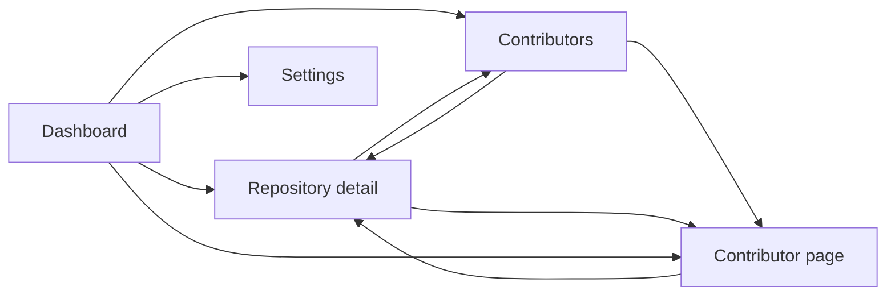

# 6. Web interface

[← Contents](README.md)

Five pages served by `watchoo serve`, refreshed by HTMX without a full page reload. The templates
(`html/template`) and the static assets are embedded in the binary (`embed`): no JavaScript build.
The styling relies on [DaisyUI](https://daisyui.com/): `card`, `badge`, `table`, `stat` components,
light/dark themes (see [Architecture](03-architecture.md#css-daisyui)).

`watchoo serve` displays **a single workspace**: the one in the directory where it is launched (or the
one given by `-C`). The workspace name (e.g. "licence-projet") is displayed in the title of every page.
To run several workspaces at the same time, launch one `serve` per workspace, each on its own port
(`web.addr`).

## Interface language

The pages' language comes from the **workspace's `lang` setting** (`config.yaml`): `en` by
default, `fr` for French. Everything displayed — titles, tables, labels, buttons,
error messages, relative dates (« il y a 2 h » → "2 h ago") — exists in both languages, served
by the `internal/i18n` package, with no dependency (see
[Architecture](03-architecture.md#languages-and-translations)). `lang` is a shared setting: it is
shared with the other supervisors like `timezone`. Entered data (display labels, commit
messages, logins) is not translated. The setting is changed in `config.yaml`.

## Pages

| Page | Address | HTMX fragments |
| --- | --- | --- |
| Dashboard | `/` | `/fragments/dashboard/repos`, `/fragments/dashboard/feed` |
| Repository detail | `/repos/{id}` (`?page=`, `?branch=`, `?author=`) | `/repos/{id}/commits` |
| Contributors | `/contributors` | `/fragments/contributors` |
| Contributor page (0.5.0) | `/contributors/{id}` (`?page=`) | `/contributors/{id}/commits` |
| Settings | `/settings` | `/fragments/quota` |

All pages share the same navigation bar (DaisyUI `navbar`): logo, workspace name, links, sync status
and the light/dark theme selector (the choice is kept in `localStorage`, key `watchoo-theme`; by
default, the system's, `prefers-color-scheme`). Below 1024 px wide, the links then the sync status each
move to their own line. Dates are relative ("il y a 2 h" ("2 h ago")), with the local time (display
timezone) as tooltip. Page not found (404) and errors (500…): pages in the workspace's language, with no internal detail
(the detail is in the `serve` log).

### Lines added and removed (0.5.0)

Everywhere a commit is listed (dashboard feed, history of a repository, commits of a contributor), it
shows **its** lines: "+12 −3", "+0 −0" for a commit genuinely without any line (merge without changes,
empty commit), "—" if they are still unknown (`commits.stats_known = 0`: local Git clone unavailable).
Shared `commit-lines` template.

The **totals** are given per contributor (ranking, contributor page, their repositories), per
repository (dashboard card, header and contributors of the repository page) and for the workspace (the
"Lignes" ("Lines") counter of the dashboard), computed by the store (`model.LineTotals`, aggregated
queries): they sum the known commits and add "(dont N commits non comptés)" ("including N uncounted
commits") when part of the commits does not have them yet; "—" if none has them. Shared `line-totals`
template.

### 1. Dashboard
- One **card per repository**: display label (`label`, e.g. "Alice Martin") or `owner/repo` (repeated
  under the label), first line of the last commit, author, age, number of commits and their lines
  added / removed (0.5.0, see [Lines added and removed](#lines-added-and-removed-050)), number of
  tracked branches, and the number of open pull requests if there are any (V2).
- **Status badge** (see [rules](02-features.md#functional-rules)): Actif (Active) in green
  (`badge-success`), Flemme (Slacking) in orange (`badge-warning`), Dead in red (`badge-error`); Never
  synced, Error, Archived, Stopped or Empty in gray (`badge-neutral`). Labels identical to the CLI
  ("Flemme · 9 j" ("Slacking · 9 d"), "Dead · 40 j" ("Dead · 40 d")). The left border of the card takes
  the color.
- **Sorting**: Dead first, then Flemme, then Actif, the oldest last commit first within each group;
  then the repositories in error (so that they get seen), then the other gray states; ties broken by
  display label.
- **Counters** per state (DaisyUI `stat`), with the workspace thresholds repeated under Flemme and
  Dead, and a **"Lignes"** ("Lines") counter (0.5.0): lines added / removed of all the commits of the
  workspace.
- **Feed of the 20 latest commits**, across all repositories (author initial, message, repository,
  date, `+/-` lines of the commit; short SHA linked to the commit on GitHub).
- **Workspace activity chart over 90 days**: commits per day, across all repositories (see
  [Activity charts](#activity-charts)), with its summary (total, busiest day). Absent as long as no
  repository is tracked.
- Button **"Synchroniser maintenant"** ("Sync now"). With no repository: an empty state points to the
  settings.

### 2. Repository detail
- Header: state, applied thresholds (each marked "propre à ce dépôt" ("specific to this repository")
  or "de l'espace" ("from the workspace"), a "Modifier" ("Edit") link to the thresholds form), last
  commit, last sync and its result, number of commits and their lines added / removed (0.5.0),
  default branch, tracked branches and patterns, stars and issues.
- **Activity thresholds of this repository** (collapsible block under the header, outside the HTMX
  fragments: an input in progress is not cleared by the post-sync refresh): two fields, "Flemme
  après" ("Slacking after") and "Dead après" ("Dead after"), in days without a commit, pre-filled with
  the repository's own thresholds; empty (or `0`) = workspace threshold, recalled in the text and in
  the placeholders of the fields. `POST /repos/{id}/thresholds` (CSRF): same rules as
  `repo add --flemme / --dead` (1 to 3,650 days, Dead strictly greater than Flemme when both are
  given), saved by the engine (`Engine.SetThresholds`), then a `303` redirect to
  `/repos/{id}?msg=thresholds#repo-thresholds` (block open, confirmation message, state recomputed).
  Rejected input: `400`, page displayed again with the message and the input; unknown repository:
  `404`.
- Commit history **paginated** (50 per page, previous / next links, HTMX), each commit with its
  `+/-` lines. A page number out of bounds is brought back to the first or the last page.
- Filters by **branch** (tracked branches first) and by **author** (GitHub login, otherwise Git name;
  never an email), applied by HTMX on change and kept from one page to the next; the address of the
  page (`?branch=`, `?author=`, `?page=`) is put in the address bar and reloads as is. **Choice**: an
  author filter that contains "@" (an email) is ignored, with a message, so that no address ends up in
  a URL or the browser history.
- **Activity chart over 90 days** (Chart.js): commits per calendar day of the display timezone,
  computed in Go (`activity.DailyCounts`), passed as JSON in a
  `<script type="application/json" id="activity-data">` and drawn by `static/app.js` (no data inside
  JavaScript code; theme colors, redrawn on theme change, no animation if the system asks for less
  motion). HTMX removes every `<script>` from a fragment (`allowScriptTags: false`): the chart is
  therefore outside the fragments; at the end of a sync, `app.js` re-reads the page (same origin),
  extracts the data with `DOMParser` (which executes nothing) and redraws.
- List of the repository's contributors (avatar or initial, name linked to the contributor page,
  secondary link to their GitHub profile, last commit, their lines added / removed in this
  repository).
- **Per-contributor activity over 12 weeks** (V2): the chart of the contributors page (stacked bars of
  commits per week, the 8 most active contributors of the period, the others grouped, collapsible
  "Données du graphique" ("Chart data") table), restricted to the commits of the repository: all the
  tracked branches, a commit present on several branches counted once (`store.AuthorCommitTimes` with
  the repository). Always displayed: without a commit from a known author over the period, the summary
  says so ("Aucun commit d'auteur connu depuis le …" ("No commit from a known author since …")) and so
  does the table; the chart fills in at the end of a sync, without reloading the page. See
  [Activity charts](#activity-charts).
- **Pull requests, releases and tags** (V2, `repo-pulls` fragment): two cards side by side (one below
  the other on a narrow screen).
  - **Pull requests**: all the open PRs (drafts marked), then the 10 last merged; for each, number and
    title (first line, linked to the PR on GitHub), author (login), branches (`tête → base`
    ("head → base")) and relative date (opening for an open PR, merge otherwise). Counters at the top
    (open, merged, closed without merge).
  - **Releases and tags**: the 10 latest releases (tag, title, `pré-release` ("pre-release") or
    `brouillon` ("draft") badge, publication date, linked to the release on GitHub), then the 15
    latest tags (name, short SHA linked to the commit on GitHub if it is in the database, date of that
    commit).
  - Without data: "Aucune pull request en base" ("No pull request in the database") / "Aucune release
    ni aucun tag en base" ("No release and no tag in the database") (a repository that has none, or
    not yet synced).
  - **Repository never read by the API** (V2: tracked by [local Git
    clones](03-architecture.md#local-git-repositories-v2), without `gh`, unknown `provider_id`): the
    "Pull requests" card says that they are not available and reminds `gh auth login`, without
    counters; the "Releases et tags" ("Releases and tags") card shows the tags (read by `git`) and
    specifies that the releases are not; in the header, "Sur GitHub" ("On GitHub") replaces the stars
    and the issues with "non disponibles" ("not available"). A repository already read by the API
    keeps its latest values.
- Button **"Synchroniser ce dépôt"** ("Sync this repository") (absent if tracking is stopped).
- Fragments: `/repos/{id}/commits` (history); `/repos/{id}` with the `HX-Target` header
  `repo-overview`, `repo-contributors` or `repo-pulls` returns the header, the contributors or the
  pull requests and releases alone. All of them reload at the end of a sync.

### 3. Contributors
- Global ranking (commits, share of the total, lines added / removed; "—" if none of their commits has
  known statistics yet, see `commits.stats_known`), with three counters (contributors, commits,
  repositories). The name of each contributor leads to their page (0.5.0).
- Number of commits per repository (links to the detail page).
- Last activity.
- **Per-contributor activity chart over 12 weeks**: stacked bars of commits per week (Monday to
  Sunday), one series per contributor among the **8 most active of the period** (ties broken by the
  global ranking), the others grouped under "Autres contributeurs" ("Other contributors") (gray);
  legend, per-week tooltip (detail and total) and a collapsible "Données du graphique" ("Chart data")
  table (view without chart). Absent as long as no author is known. See
  [Activity charts](#activity-charts).
- GitHub avatar. **Choice**: the image is loaded from `avatars.githubusercontent.com`, the only allowed
  external host (CSP `img-src`): it is a request to a third party, made by the browser, which reveals
  to GitHub that an avatar is displayed, but without a `Referer` header (`referrerpolicy="no-referrer"`),
  with lazy loading (`loading="lazy"`) and with no Watchoo cookie. An avatar URL from another host is
  never displayed; without an avatar, the initial of the name is shown. No email is displayed.

### 4. Contributor page (0.5.0)

`GET /contributors/{id}` (internal identifier of the contributor, 1 to 18 digits; unknown: `404`).
Breadcrumb "Contributeurs › nom" ("Contributors › name"). Nothing is GitHub-specific in the handler
nor the templates: the profile link is the address stored in the database (see
[Links to profiles](#links-to-profiles-050)).

- **Header** (`contributor-overview` fragment): avatar (same rule as the contributors page), display
  label, login with the "GitHub" link to their profile if known, number of attached Git identities
  ("2 identités Git connues" ("2 known Git identities"): the **number** of email addresses, **never
  the addresses**). Totals: commits, lines added / removed ("—" if unknown, like the ranking; the
  lines are read from the local Git clone of each repository, for all the commits, which a note
  recalls: "—" remains only if the clone is unavailable), repositories, first and last commit
  (relative dates). **Choice**: no Actif / Flemme / Dead state for a person: these states are
  repository rules (per-repository thresholds); the page gives the age of the last commit, and the
  state of each of their repositories in the list below.
- **Activity over 90 days**: commits per day of the contributor, across all repositories (`daily`
  chart, like the dashboard and the repository page).
- **Per-repository activity over 12 weeks**: the stacked `contributors-chart` chart (same template,
  same palette), one series per repository among the 8 where they have the most commits over the
  period, the others grouped under "Autres dépôts" ("Other repositories"), with the collapsible
  "Données du graphique" ("Chart data") table (repository name linked to its page).
- **Their repositories** (`contributor-repos` fragment): for each repository where they are the author
  of at least one commit, name linked to the repository page, status badge of the repository (rules
  and thresholds of the repository), their commits, their `+/-` lines ("—" if unknown), their last
  commit in that repository; sorted by decreasing number of commits, then most recent last commit.
- **Their commits** (`contributor-commits` fragment): paginated history (50 per page, like that of a
  repository; previous / next HTMX links, `?page=` pushed into the address), each commit with the
  first line of the message (cleaned), the repository (link), the date, the `+/-` lines ("—" if they
  are unknown) and the short SHA linked to the commit on the forge. Same list as the history of a
  repository (shared `commit-item` template).
- **Their pull requests** (`contributor-pulls` fragment, V2): the 20 most recently updated, across all
  repositories (number, title linked to the PR, repository, state: open, draft, merged, closed).
  Matching by the **forge account**: `pull_requests.author_provider_id` =
  `contributors.provider_user_id` (the author of a PR is not a contributor in the database). A
  contributor without a known account (local Git clones, unattached email) does not have this card:
  the page says so in one line. The **releases** are not matched: only the login of their author is
  kept, and a login can change owner.
- Contributor without any author commit (they are only a committer): the page displays, totals at
  zero, empty charts and "Aucun commit…" ("No commit…") messages.
- Fragments reloaded at the end of a sync (`sync-finished`): `contributor-overview`,
  `contributor-repos` and `contributor-pulls` (`GET /contributors/{id}` with the `HX-Target` header),
  `contributor-commits` (`GET /contributors/{id}/commits`, which serves the full page outside HTMX);
  the two charts re-read the page, as elsewhere.
- **Links to this page**: name of each row of the contributors ranking and of the data table of the
  per-contributor charts (contributors page, repository page), contributors of the repository page,
  author of each commit of the histories (repository, contributor) and of the dashboard feed, author
  of the last commit of the dashboard cards. A commit without a known author has no link.
- Personal data: name, login, avatar and commit messages, like the rest of the interface; **no email
  address** is read for this page (only their number); the access log writes only the route pattern
  (`/contributors/{id}`), never the identifier, a name nor a message.

### 5. Settings
- List of tracked repositories (state, branches, commits, last sync).
- Add a repository (`owner/repo` or URL, label, branches: same checks as `watchoo repo add`, access
  verified against GitHub, or through `git ls-remote` without `gh` (V2), no sync started). An empty
  branches field means "not specified": a new repository tracks all branches, an already tracked
  repository keeps its patterns. Responses: redirect to `/settings?msg=<code>&repo=<id>` (the message
  is built by the server from a fixed list of codes: nothing from the request is echoed back as is),
  `400` with the form refilled on invalid input, `422` if the repository is unreachable, `502` with a
  generic message if GitHub answers badly. Rejected input that contains "@" (a URL with credentials)
  is not displayed again.
- Edit the display label and the branches (empty field: all branches).
- Remove a repository: confirmation page (`GET`, changes nothing), then stopping tracking with history
  kept (like `repo remove --keep-history`, the local Git clone kept too), or deletion with the history
  and the local Git clone (V2) if it exists. **Choice**: deletion is refused (`409`) during a sync, so
  that the engine does not write to a repository being deleted; stopping tracking remains possible. A
  stopped repository can resume tracking.
- Bulk import from a CSV file (same format and same summary as `watchoo repo import`): V2.
- Sync interval: value in effect, next sync and value from `config.yaml`, re-read from disk on every
  display (if an import changed it since startup, the page says it will apply at the next launch). It
  can be changed **for the lifetime of the process only** (a Go duration like `45m` or `1h30m`, a whole
  number of minutes, or 0; 0 or at least 15 min): this setting never rewrites `config.yaml`; for a
  lasting change, edit `sync.interval` in the file (or import a shared configuration, below).
- Button **"Synchroniser maintenant"** ("Sync now").
- **Share the configuration** (same JSON file and same rules as `watchoo config export` and
  `watchoo config import`, see [Configuration sharing](05-cli.md#configuration-sharing-watchoo-config)):
  - **"Exporter"** ("Export") link: `GET /settings/export`, no side effect, returns the document as an
    attachment (`Content-Type: application/json`, `Content-Disposition: attachment`, safe file name
    derived from the workspace name: `watchoo-config-<nom>.json`, ASCII letters, digits, `-` and `_`
    only; `Cache-Control: no-store`);
  - **"Importer"** ("Import") form: `POST /settings/import` (`multipart/form-data`, `file` field, CSRF,
    1 MiB at most) **validates and displays the preview without applying anything**: repositories to
    add, to update (before → after: display label, branches, own thresholds), to resume, unchanged;
    settings changed; warnings (`WATCHOO_*` variable masking a setting, `config.yaml` comments lost).
    The preview does not check repository access. Invalid file: `400` with the validation message; too
    large: `413`;
  - **"Appliquer"** ("Apply") button: `POST /settings/import/apply` (CSRF) sends the file content back
    in a hidden field (`document`, `multipart/form-data` form); the server **revalidates it entirely**
    (the preview is never taken for granted: a document modified in the meantime is treated as a new
    one), applies it like the CLI (settings, then repositories with access verification), then
    redirects to `/settings?msg=imported` with a summary built by the server (numbers of repositories
    added, updated, unreachable; settings written). A document that has become invalid: `400`, nothing
    is modified;
  - **choice**: the rewritten settings are taken into account by the running `watchoo serve` only **at
    its next launch** (the summary says so): the configuration of the process is never changed on the
    fly, the interval included (it remains editable for the lifetime of the process, above). The added
    repositories, on the other hand, are visible and synced right away. The import remains possible
    during a sync, like adding a repository;
  - export, preview and apply re-read `config.yaml` from disk on every request (without touching the
    configuration of the process): an export made after an import reflects the new file, and
    re-importing the same file displays "Rien à appliquer" ("Nothing to apply");
  - **one apply at a time** per process: a second, simultaneous one receives `409` and changes nothing;
  - the summary gives the number of unreachable or failed repositories (red banner); their names are
    written to the log of the `serve` (`WARN`, `owner/repo` and the error, never an email), and
    `watchoo config import fichier --dry-run` lists them. A file with several hundred repositories can
    exceed the request timeout (30 s): unprocessed repositories are counted as errors and the import is
    safely run again (or done through the CLI).
- State of the GitHub **API quota** (remaining, limit, reset in local time, "quota bas" ("low quota")
  below 10%), read with a free request (`GET /rate_limit`) in a fragment loaded after the page and
  reloaded at the end of a sync; "quota inconnu" ("unknown quota") if `gh` is down or the read fails.
  Without `gh` installed and signed in (V2), "sans objet" ("not applicable"): the repositories are
  tracked by local Git clones, without a quota, and the fragment says so (with what is then not read
  and the reminder of `gh auth login`).
- The settings forms are plain `POST`s (a `303` redirect, or the page displayed again with the error),
  because HTMX does not replace the content on a 4xx response. The repository list is not reloaded at
  the end of a sync (only the quota is).

## Links to profiles (0.5.0)

Everywhere the interface shows a contributor (ranking and chart data table of the contributors page,
contributors and chart table of the repository page, author of the commits of the histories, of the
feed and of the dashboard cards, contributor page), their name leads to **their page** (main link);
if their forge account is known, a **secondary link** "GitHub" opens their profile in a new tab
(`target="_blank"`, `rel="noopener noreferrer"`, like the links to the commits and the repositories),
with the accessible label "Profil GitHub de <login>" ("GitHub profile of <login>").

- The address comes from the provider (`html_url` of the account, stored in `contributors.profile_url`,
  see [Data model](04-data-model.md#contributors--identified-people)); `internal/web` builds no forge
  address. Only an `https://` address is displayed (`profileURL` template function), otherwise no
  link.
- No link for a contributor known only by their name and their Git email (local Git clones). A
  contributor registered before 0.5.0 (known login, empty address) gets their link as early as the
  next sync (the one that `watchoo serve` launches in the background is enough): the provider builds
  the address from the login (0.6.1, see
  [Data model](04-data-model.md#contributors--identified-people)).

## Activity charts

Two chart shapes (Chart.js 4, embedded, loaded only on the pages that have one): commits per day over
90 days (`activity.DailyCounts`) for the dashboard and the repository detail; commits per week and per
contributor over 12 weeks (`activity.CountContributorWeeks`, series built by `buildContributorChart`
in `internal/web/charts.go`, shared `contributors-chart` template from `partials.html`) for the
contributors page (all the repositories) and the repository detail (its only commits). The contributor
page (0.5.0) reuses both shapes: per day for its commits (`store.ContributorCommitTimes`), and stacked
per week with **one series per repository** (`buildRepoChart`; same counts by
`activity.CountRepoWeeks`).

- **Computed in Go**, by tested pure functions: days and weeks (Monday to Sunday) in the workspace's
  **display timezone** ([Dates](04-data-model.md#dates)); dates read by `store.CommitTimes` (all
  repositories or a single one) and `store.AuthorCommitTimes` (author and date); no email. The names of
  the legend are cleaned (`textclean`) and truncated to 40 characters.
- **Transmission**: JSON in a `<script type="application/json">` (escaped by `html/template`), read by
  `static/app.js` with `JSON.parse` and validated; no data inside JavaScript code (strict CSP). Each
  `<canvas>` declares its shape (`data-chart`: `daily` or `weekly-stacked`), its data (`data-source`),
  its summary (`data-summary`), its optional table (`data-table`) and the page to re-read
  (`data-refresh-url`).
- **Refresh**: the charts are outside the fragments (HTMX removes their `<script>`s); at the end of a
  sync (`sync-finished`), `app.js` re-reads the page (same origin), extracts the data, the summary and
  the table from it with `DOMParser` (which executes nothing; the table is copied with `importNode`,
  never with `innerHTML`) and redraws.
  A chart card is rendered only if the workspace has data when the page loads (at least one tracked
  repository for the dashboard, one known author for the contributors): on a still empty workspace, it
  only appears on the page reload that follows the first sync (known limitation of 0.1.0). The two
  charts of the repository detail are always rendered (empty, with their summary, until the first
  commit); they re-read the same page, only once.
- **Colors**: plain bars in the primary color of the theme; contributor series in a categorical palette
  of 8 hues in a fixed order, with a light variant and a dark variant (checked for the common color
  blindnesses and for the contrast against the background of each theme; in the light theme, three
  hues are below 3:1, hence the legend and the data table); "Autres contributeurs" ("Other
  contributors") in gray; never a generated color. Axes and grid take the text color of the theme.
  Redrawn on theme change; no animation if the system asks for less motion.
- **Accessibility**: each `<canvas>` has `role="img"` and an `aria-label` that summarizes the series; a
  textual summary is displayed next to the title.

## New-version banner (0.6.0)

`watchoo serve` checks at startup, then every 30 min, whether a newer version of Watchoo has been
released (see [CLI](05-cli.md#self-update-watchoo-update)). When it is one, **all the pages** (except
the public error pages, shown before authentication) display under the navigation bar a discreet
banner (DaisyUI `alert-info alert-soft` alert, `role="status"`): "Nouvelle version de Watchoo
disponible : v0.5.0 → v0.6.0" ("New version of Watchoo available: v0.5.0 → v0.6.0"), a "Notes de
version" ("Release notes") link to the page of the release (new tab) and what to do: `watchoo update`
then restart `watchoo serve`; in the Docker image, change the tag of the image. No banner when the
check is disabled (`WATCHOO_NO_UPDATE_CHECK`, set in the Docker image), fails, or the version is up to
date. The banner makes no request: the known version is kept in memory by the process
(`selfupdate.Monitor`).

## Navigation



## Logo and icons

The logo is a pixelated owl ("watch-hoo"), drawn like the text versions: a solid head with pointed
ears, two square magenta eyes with green pupils and a beak cut out of the shape. The name "WATCHOO" is
in geometric letters (no font required), the two "OO" in green, like the pupils. The files are in
[`assets/logo/`](../../assets/logo/); the three `watchoo-logo-final*.svg` are the reference, all the
others are derived from them:

| File | Usage |
| --- | --- |
| `watchoo-logo-final.svg` | Owl alone, for light background (reference) |
| `watchoo-logo-final-nom.svg` | Owl and name, for light background (README, header of the pages in light theme) (reference) |
| `watchoo-logo-final-light-nom.svg` | Name alone, for light background (reference) |
| `watchoo-logo-final-dark.svg` | Owl alone, for dark background |
| `watchoo-logo-final-nom-dark.svg` | Owl and name, for dark background (README, header of the pages in dark theme) |
| `watchoo-logo-final-light-nom-dark.svg` | Name alone, for dark background |
| `watchoo-icone.svg` | Owl on a rounded white square: SVG favicon, web manifest, source of the PNG and ICO icons |
| `favicon.ico` | Favicon: 16, 32 and 48 px |
| `apple-touch-icon.png` | Home screen shortcut on iOS (180 px, opaque white background) |
| `icon-192.png`, `icon-512.png` | Web manifest |

Colors: head and letters `#000000` (variants for dark background: `#f8fafc`), eyes `#d500f9`, pupils
and "OO" `#00e676` (outline of the pupils `#19a53e`); background of the icons `#ffffff`. The header of
the pages displays the version that follows the effective DaisyUI theme (`dark:` Tailwind variant
defined in `input.css`, on the `data-theme` attribute or `prefers-color-scheme`). The files used by
the interface are copied into `internal/web/static/` (`make logo`) and embedded with `embed`; a test
checks that the copies are identical. A minimal web manifest (`/manifest.webmanifest`) references the
icons.

### Text versions (CLI and TUI)

The same owl exists in several text versions, chosen according to the situation and the terminal:

| File | Size | Usage |
| --- | --- | --- |
| `ascii-mini.txt` | 8 × 3, Unicode blocks | [Header card](05-cli.md#header-card) of the CLI, header of the configuration files (`config.yaml`), header of the TUI |
| `ascii-mini-pur.txt` | 8 × 3, pure ASCII | Header card of the CLI if the terminal does not handle Unicode |
| `ascii-mini-nom.txt` | 44 × 4, Unicode blocks | Header of the TUI, with the name |
| `ascii-blocs.txt` | 16 × 8, Unicode blocks | Welcome screen of the TUI |
| `ascii-blocs-nom.txt` | 53 × 8, Unicode blocks | Same, with the name |
| `ascii.txt` | 16 × 8, pure ASCII | Welcome screen of the TUI if the terminal does not handle Unicode |
| `ascii-nom.txt` | 53 × 8, pure ASCII | Same, with the name |

The mini version, in pure ASCII:

```
|\    /|
| o##o |
\##\/##/
```

The versions with the name fit in 80 columns; if the terminal is narrower than the version with the
name, the version without the name is displayed.

The owl takes the text color of the terminal and its eyes that of the background: it adapts on its own
to light and dark terminals. In the header card of the CLI, the pupils are colored green (ANSI
sequences); in the TUI, with lipgloss; without color (`NO_COLOR`, redirected output), the drawing stays
readable in monochrome.

These files are embedded in the binary by the `internal/logo` package. As `go:embed` cannot climb out
of the package, `internal/logo/art/` keeps a copy of them: after a change to `assets/logo/*.txt`,
`make logo` redoes the copy, and a test checks that it is identical, byte for byte.

## Background synchronization

`watchoo serve` also runs the periodic sync (`--interval`, **30 min** by default, **15 min** minimum,
can be disabled with `--interval 0`). Manual sync remains possible at any time (settings for all
repositories, detail page for a single one). During a sync, HTMX displays its progress. The pages
reflect the state of the database; HTMX refreshes the relevant fragments.

How it works (`wsync.Coordinator`, a single one per process, which reuses the engine):

- **a single sync at a time** in the process: a manual request during a sync is refused with the
  message "Synchro déjà en cours" ("Sync already in progress"); an automatic sync that falls during a
  sync is skipped. A manual sync does not shift the next automatic sync. The lock in the database
  (`sync_runs`) and the quota guard remain those of the engine: a `tui` or a `watchoo sync` launched at
  the same time does not sync the same repository twice;
- **at startup**, a sync is launched right away only if the last completed sync (`sync_runs`) dates
  back more than one interval; otherwise, the first one takes place one interval after it;
- **progress**: the sync status (navbar) is a fragment that refreshes every 2 s during a sync
  (finished repositories / total, repository in progress), and every 30 s otherwise, to see an
  automatic sync start (or one launched from another tab). **Choice**: this 30 s polling continues once
  the sync is over; it costs only an in-memory read of the state of the coordinator (no GitHub call, no
  database query) and a fragment of a few hundred bytes. When it notices the end of a sync, its
  response carries the `HX-Trigger: sync-finished` header, and the fragments of the pages (cards, feed,
  history…) as well as the charts reload. Outside a sync, it gives the summary of the last one:
  repositories in error, postponed, and the number of **warnings** (pull requests, releases or tags
  not read, local Git clone unavailable; the detail is in the tooltip); a sync launched from the
  interface and already finished when the response is rendered (immediate failure of the engine,
  repository synced quickly) carries this header as early as the response to the `POST`. The sync
  buttons ("Synchroniser maintenant" ("Sync now"), "Synchroniser ce dépôt" ("Sync this repository"))
  and the one that deletes a repository are never disabled at render time: most are outside the
  reloaded fragments and would remain unusable after the end of the sync; it is the `POST` that refuses
  ("Synchro déjà en cours" ("Sync already in progress"), deletion refused during a sync);
- the token is asked again from `gh` at each sync by the engine; it is never sent to the browser;
- **shutdown** (Ctrl+C, SIGTERM): the server stops accepting requests and finishes those in progress
  (10 s at most), the running sync is canceled (its `sync_runs` are closed as "synchro annulée"
  ("sync canceled")) and awaited (10 s at most), then the database is closed.

## Security

- Listening on **`127.0.0.1:8080` by default** (`web.addr`, `--addr` option).
- Tracked repositories are mainly **private**: the interface displays their content (commit messages,
  authors); it displays **no email**.
- When listening anywhere else than on the loopback (`127.0.0.0/8`, `::1`, `localhost`; an empty host
  or `0.0.0.0` listens on all interfaces), **authentication is mandatory**: Watchoo refuses to start
  without basic authentication configured, unless one states explicitly that an authenticating reverse
  proxy is in place.
  - **Basic authentication**: username `web.auth.username` in the config, password **only** in the
    `WATCHOO_WEB_PASSWORD` environment variable (12 characters at least; never in a settings file,
    never logged). Constant-time comparison (SHA-256 checksums, `crypto/subtle`). It applies to all
    addresses, static files included, and can also be enabled when listening locally. Without HTTPS,
    the password travels in clear over the network: prefer an HTTPS reverse proxy.
  - **Reverse proxy**: `web.trusted_proxy: true` allows starting without basic authentication, with a
    warning at startup. The check of the `Host` header **remains active**: a proxy does not protect
    against a rebound page that reaches Watchoo directly (even with Watchoo on `127.0.0.1` and the
    proxy on the same machine). `web.allowed_hosts` lists the public names that the proxy passes in
    `Host` (e.g. `["watchoo.example.org"]`, without port); outside the loopback, it is **mandatory**
    with `web.trusted_proxy` without basic authentication (refusal to start otherwise). On the
    loopback, without this setting, only local names pass (the case of a proxy that passes
    `Host: 127.0.0.1:8080`, like nginx by default; Caddy passes the public name, to be listed).
- **DNS rebinding**: a request whose `Host` header is neither `localhost`, `127.0.0.1`, `[::1]` (or the
  listened host) followed by the listened port, nor a name from `web.allowed_hosts` (with any port) is
  refused (`421`), with a page that shows nothing of the workspace. The check applies when listening
  locally, behind a reverse proxy declared without basic authentication, and as soon as
  `web.allowed_hosts` is set. It is lifted only outside the loopback with basic authentication and
  without `web.allowed_hosts`: the browser does not send the credentials on behalf of another site.
- **CSRF**: no action in `GET`; every request that modifies something is a `POST`, checked twice:
  origin (`http.CrossOriginProtection`: `Sec-Fetch-Site`, otherwise `Origin` compared to `Host`) and
  random token (`HttpOnly`, `SameSite=Strict` cookie, named with the port, sent back in the
  `csrf_token` field or the `X-CSRF-Token` header that HTMX adds thanks to `hx-headers`). Failure:
  `403`, nothing is modified. The cookie is only set with an HTML page or fragment, never with a static
  file (`/static/…`, icons, manifest).
- **Methods**: `HEAD` is accepted everywhere `GET` is (same response, without a body); another method
  on a known route gives `405`.
- **Headers**: strict `Content-Security-Policy` (`default-src 'self'`; `img-src 'self' https://avatars.githubusercontent.com data:`;
  `script-src 'self'` and `style-src 'self'`, without `unsafe-inline` nor `unsafe-eval`;
  `frame-ancestors 'none'`…), `X-Content-Type-Options: nosniff`, `Referrer-Policy: no-referrer`,
  `X-Frame-Options: DENY`; pages and fragments in `Cache-Control: no-store`. Verified: HTMX 2 and
  Chart.js 4 work under this policy, HTMX being configured by the `<meta name="htmx-config">` tag (no
  injected `<style>`, no `eval` hence no `hx-on` nor event filters, no `<script>` executed in a
  fragment, no history kept in `localStorage`). No inline script nor style in the templates.
- **Escaping**: `html/template` everywhere; no `template.HTML` built from data; the texts coming from
  the database also go through `textclean` (control characters).
- **Access log** (`slog`, info level): method, route pattern (`/repos/{id}`), code, duration; never
  the query string, an IP address, a header nor personal data.
- **Log**: a quota read interrupted (page left, `serve` stopped: canceled context) is logged at
  `debug`; the other quota read failures, as a warning.
- **Limits**: server timeouts (`ReadHeaderTimeout` 5 s…), request body capped at 64 KiB (1 MiB plus
  64 KiB for `POST /settings/import` and `POST /settings/import/apply`, which carry a file; beyond
  that: `413`, nothing is applied), repository and contributor IDs validated by the route (1 to 18
  digits).
- The GitHub token is never displayed nor sent back to the browser.
