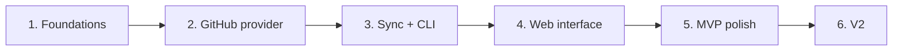

# 7. Roadmap

[← Contents](README.md)

Six short phases, each delivering something usable. **Move on to the next phase only when the
previous one works end to end.**

**Status**: phases 1 to 5 are done, the MVP was released as **v0.1.0** (see
[CHANGELOG.md](../../CHANGELOG.md)); the MVP exit criterion was validated on October 27, 2026;
phase 6 (V2) was completed and released as **v0.4.0**; the per-contributor page was released as
**v0.5.0**; Watchoo self-update (`watchoo update`) was released as **v0.6.0**; adding a repository
from the TUI and a fixed profile link in **v0.6.1**; the new-version notice fixed (`watchoo` only,
TUI) in **v0.6.2**; the bilingual interface was released as **v0.7.0** ([0.7.0](#070-bilingual-interface)); after one
more week of real usage, the public surface was stabilized and released as **v1.0.0**
([1.0.0](#100-stabilization)); languages and share of the contributors were released as **v1.1.0**
([1.1.0](#110-languages-and-share-of-the-contributors)); the AI signatures and the languages of the
contributors were released as **v1.2.0** ([1.2.0](#120-ai-signatures-and-languages-of-the-contributors)); the sync
warnings per repository were released as **v1.3.0** ([1.3.0](#130-sync-warnings-per-repository)); a dedicated
message for an unknown SSH host key (local Git clones) in **v1.3.1**; supervision and diagnosis (phases
7.1 to 7.5) were released as **v1.4.0** ([7](#after-100--7-supervision-and-diagnosis)); the absolute signals and
counter-indicators of the diagnosis (phase 7.7) as **v1.5.0**; the EN / FR language selector of the web
interface and the lines behind the signals on the review sheet of the diagnosis (phase 7.8) and the diagnosis score per
repository and per contributor as **v1.6.0**; the link to the documentation in the language of the web
interface as **v1.6.1**.

## Phases

### Phase 1 — Foundations
- Project skeleton, `cobra`, configuration (viper).
- SQLite + migrations (`goose`), `sqlc` configuration and first generated queries.
- Workspaces: `watchoo init` creates `.watchoo/` (config, database, `.gitignore`, `0700`/`0600`
  permissions) after checking `gh`; workspace discovery in the current directory then the parents;
  `-C` and `WATCHOO_DIR` (see [Workspaces](10-workspaces.md)).
- Token obtained only with `gh auth token`, never stored; cover the `GH_TOKEN` case (Docker, CI).
- Mock of `gh` (interface + fake binary) and CI without any external service (see [Testing](09-testing.md)).

**Deliverable**: `watchoo init` turns a directory into a workspace, with its config and a database
with the right schema; the other commands find the workspace.

### Phase 2 — GitHub provider
- `Provider` interface.
- `go-github` client.
- Commit fetching with pagination, ETag and rate limit handling.
- Tests against a simulated HTTP server (`httptest`).

**Deliverable**: tested provider, no real network call in tests.

### Phase 3 — Sync engine + CLI
- `repo add / list / remove`, `sync`, `log`, `contributors`, `status`.
- Bulk import `repo import` (CSV or list), access check and summary.
- Interactive mode `watchoo tui` (Bubble Tea): repositories, commits, contributors, filter, sync.

**Deliverable**: the tool is already useful in a terminal, in command mode as well as interactive
mode.

### Phase 4 — Web interface
- `serve`, embedded templates, DaisyUI CSS generated by the standalone Tailwind CLI (`make css`).
- Dashboard, repository detail (with the 90-day activity chart), contributors, settings.
- Periodic sync in the background.

**Deliverable**: working local web interface.

### Phase 5 — MVP polish
- Activity charts (beyond the repository-detail one delivered in phase 4).
- `--json` output.
- Makefile, cross-platform binaries via GoReleaser, Docker image, README.
- SemVer versions and `CHANGELOG.md` kept up with the `semver` and `semver-changelog` skills (see [Skills](11-skills.md)).

**Deliverable**: distributable MVP.

**Done (v0.1.0)**:
- Charts: 90-day workspace activity (dashboard) and weekly commits over 12 weeks of the 8 most
  active contributors (contributors page), computed in Go in the display timezone
  ([Activity charts](06-web-interface.md#activity-charts)).
- `--json` on every command that produces data, schema documented and verified by a test
  ([JSON output](05-cli.md#json-output)); `watchoo version` also gives the commit and its date.
- `make release-check`, `make release-snapshot`, `make docker`; GoReleaser (linux, darwin, windows
  in amd64 and arm64, archives and SHA-256 checksums, draft release); distroless non-root Docker
  image with `gh` verified by SHA-256, published on `ghcr.io/studoo-app/watchoo`; release workflow
  on tag ([Distribution](03-architecture.md#distribution)).
- Full README, `CHANGELOG.md`, version rules ([Skills](11-skills.md#versions-and-changelogmd)).
- Web touches: `HEAD` accepted anywhere `GET` is, CSRF cookie limited to HTML pages, interrupted
  quota read logged at debug level.

### Phase 6 — V2
- Pull requests and releases: **in place** (pull requests read incrementally, releases and tags,
  `watchoo prs` and `watchoo releases`, cards of a repository's page, open PRs on the dashboard
  and in the TUI; an isolated failure becomes a warning, `ErrUnsupported` for the local Git provider).
- **Local Git repositories**: **in place** (provider `internal/provider/git` on the `git` binary,
  clones with a working copy in `repos/` at the workspace root, updated by `git fetch` then reset to
  the default branch, source chosen at every sync based on `gh`,
  optional `provider_id` (migration `00004`), `watchoo init` without `gh`, source in `status`,
  `sync`, the Settings page, screens that hide what the clone does not provide, Docker image with
  `git`). A repository can be tracked from a local clone that provides commits, branches and tags
  without any GitHub API call, hence without consuming quota. Alternative to the GitHub API and to
  `gh`: if `gh` is installed and signed in, Watchoo uses it; otherwise it falls back to the local
  clone (see [Local Git repositories](03-architecture.md#local-git-repositories-v2)).
- Per-repository activity thresholds (option of `repo add`, import column, web setting): **in
  place** (`--flemme` / `--dead`, `flemme` / `dead` columns, configuration sharing, form of a
  repository's page).
- Per-contributor activity inside a repository: **in place** (chart of the contributors' commits per
  week on a repository's page, total and weekly curve in the TUI detail,
  `watchoo contributors --weeks N`).

Importing a whole organization and the alerts move to V3 (see
[Features](02-features.md#v3)).

### After phase 6 — 0.5.0: per-contributor page
- Per-contributor page (web `/contributors/{id}` and TUI detail): their repositories, their commits
  (`+/-` lines included) and their activity over time: **in place** (`store.ContributorProfile`,
  `store.ContributorRepos`, `store.ContributorCommitTimes` queries, `AuthorID` filters of commits
  and pull requests; reused charts; links from the contributor and commit lists).
- Link to the forge profile of every contributor whose account is known: **in place** (address
  given by the provider, `contributors.profile_url` column, migration `00005`).

### 0.6.0: Watchoo self-update
- New-version notice on every command (on the error output, without delaying the command by more
  than 1.5 s), at startup and every 30 min in `watchoo serve` (banner in the web interface):
  **in place** (`internal/selfupdate` package, see
  [Architecture](03-architecture.md#watchoo-self-update-060)).
- `watchoo update` command (`--check`, `--yes`): **in place** (release archive verified by
  SHA-256, atomic replacement of the binary; refusal explained in Docker, for a development
  version or a non-writable directory).

### 0.7.0: Bilingual interface
- Interface (CLI, TUI, web, install script) in **English by default**, also available in **French**: **in place**, the
  `internal/i18n` package (key catalog, no dependency), CLI/TUI language via `WATCHOO_LANG`
  or the system locale, web language via the workspace's shared `lang` setting, displayed
  texts and errors translated, `config.yaml` written in the chosen language. See
  [Languages and translations](03-architecture.md#languages-and-translations).

### 1.0.0: Stabilization
- Exit criterion: Watchoo used for **one week** on real repositories (GitHub API and local Git
  clones) with no blocking issue.
- Review of the public surface (commands, flags, exit codes, `--json` keys, `config.yaml` settings and
  `WATCHOO_*` variables, database schema, web routes) and of its documentation: **done**.
- From now on, SemVer applies fully: an incompatible change bumps MAJOR (see
  [Skills](11-skills.md#versions-and-changelogmd)). The V3 ([Features](02-features.md#v3)) comes in
  MINOR releases.

### 1.1.0: Languages and share of the contributors
- Languages of each repository with their percentage (`repository_languages` table, migration `00007`,
  `git ls-tree` in the local clone, `watchoo languages`, card of a repository's page, TUI detail): **in
  place**.
- Share of the commits of each contributor in `watchoo contributors`, on a repository's page and in the
  TUI detail: **in place**.

### 1.2.0: AI signatures and languages of the contributors
- Signatures of AI tools declared in the commits, per commit and per contributor (CLI, TUI, web, `--json`),
  analyzed without any request to the forge: **released in v1.2.0**. See
  [AI signatures](02-features.md#ai-signatures). Clues based on style or pace are deliberately left out of this feature; they belong to the diagnosis (phase 7, off by default).
- Languages of a contributor: lines added per language in their commits, read from the clone (contributor
  page, `watchoo contributors`, TUI, migration `00009`): **released in v1.2.0**. See
  [Languages of a contributor](03-architecture.md#languages-of-a-contributor-120).

### 1.3.0: sync warnings per repository
- Warnings of the last sync recorded per repository (`sync_runs.warnings`, migration `00010`): badge on the
  dashboard card, alert with the full message on the repository's page, menu of the repositories concerned
  in the sync indicator: **released in v1.3.0**. See [Web interface](06-web-interface.md#1-dashboard).
### After 1.0.0 — 7: supervision and diagnosis
- Watchoo becomes a **supervision and diagnosis** tool (maintainer decision). First component: detection of
  signals suggesting AI-assisted production, with its guardrails (a flag is never a verdict, explainability,
  human review, transparency, data minimisation).
- Sub-phases 7.1 to 7.6 (foundations, declarative, rhythm, review, form, calibration): see
  [Supervision and diagnosis](12-supervision-diagnostic.md#9-phase-plan-proposal).
- **Status**: **7.1 done** (foundations: `commit_signals` table, `diagnostic.*` settings, disabled by
  default) and **7.2 done** (declarative signals D1, D2, D3, D5, D4 context, `watchoo diagnostic` command for
  the trainer) and **7.3 done** (rhythm signals R1 to R6, "to review" level, `watchoo diagnostic backfill`);
  and **7.4 done** (human review on the web: "Diagnosis" page, review sheet, recorded decisions, history
  backfill button) and **7.5 done** (form signals F1 to F5 measured in memory, numbers only kept, "probable"
  level); **released in v1.4.0**. Phase 7.6 (calibration) will come in a
  **later release** (maintainer decision, November 4, 2026), once real reviews exist, then F6 (content
  classifier, postponed), each after its plan is approved. Phase **7.7** (absolute signals,
  work-in-progress markers, counter-indicators) is **released in v1.5.0**; phase **7.8** (lines behind the signals on
  the review sheet, extracted when shown) is **released in v1.6.0** (see
  [Supervision and diagnosis](12-supervision-diagnostic.md#96-phase-77-absolute-signals-work-in-progress-markers-and-counter-indicators-done)). Educational context
  settled (learners, results reserved to the trainer); learners are informed (existence of the diagnosis,
  purpose, criteria) before it is enabled.

## Definition of "done" for each phase

- Code written and reviewed.
- Passing tests, without any external service (`gh` mocked, GitHub API simulated with `httptest`).
- `go vet` without warning.
- Summary of what works.

## MVP exit criterion

> Track **10 real repositories for one week** with no sync error and no quota overrun.

**Validated** on October 27, 2026: the MVP is complete.
