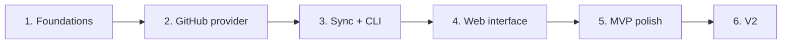

# 7. Roadmap

[← Contents](README.md)

Six short phases, each delivering something usable. **Move on to the next phase only when the
previous one works end to end.**

**Status**: phases 1 to 5 are done, the MVP was released as **v0.1.0** (see
[CHANGELOG.md](../../CHANGELOG.md)); the MVP exit criterion was validated on October 27, 2026;
phase 6 (V2) was completed and released as **v0.4.0**; the per-contributor page was released as
**v0.5.0**; Watchoo self-update (`watchoo update`) was released as **v0.6.0**; adding a repository
from the TUI and a fixed profile link in **v0.6.1**; the new-version notice fixed (`watchoo` only,
TUI) in **v0.6.2**; the next step, the bilingual interface ([0.7.0](#070-bilingual-interface)), is in
progress.

## Phases

### Phase 1 — Foundations
- Project skeleton, `cobra`, configuration (viper).
- SQLite + migrations (`goose`), `sqlc` configuration and first generated queries.
- Workspaces: `watchoo init` creates `.watchoo/` (config, database, `.gitignore`, `0700`/`0600`
  permissions) after checking `gh`; workspace discovery in the current directory then the parents;
  `-C` and `WATCHOO_DIR` (see [Workspaces](10-workspaces.md)).
- Token obtained only with `gh auth token`, never stored; cover the `GH_TOKEN` case (Docker, CI).
- Mock of `gh` (interface + fake binary) and CI without any external service (see [Testing](09-testing.md)).

**Deliverable**: `watchoo init` turns a directory into a workspace, with its config and a database
with the right schema; the other commands find the workspace.

### Phase 2 — GitHub provider
- `Provider` interface.
- `go-github` client.
- Commit fetching with pagination, ETag and rate limit handling.
- Tests against a simulated HTTP server (`httptest`).

**Deliverable**: tested provider, no real network call in tests.

### Phase 3 — Sync engine + CLI
- `repo add / list / remove`, `sync`, `log`, `contributors`, `status`.
- Bulk import `repo import` (CSV or list), access check and summary.
- Interactive mode `watchoo tui` (Bubble Tea): repositories, commits, contributors, filter, sync.

**Deliverable**: the tool is already useful in a terminal, in command mode as well as interactive
mode.

### Phase 4 — Web interface
- `serve`, embedded templates, DaisyUI CSS generated by the standalone Tailwind CLI (`make css`).
- Dashboard, repository detail (with the 90-day activity chart), contributors, settings.
- Periodic sync in the background.

**Deliverable**: working local web interface.

### Phase 5 — MVP polish
- Activity charts (beyond the repository-detail one delivered in phase 4).
- `--json` output.
- Makefile, cross-platform binaries via GoReleaser, Docker image, README.
- SemVer versions and `CHANGELOG.md` kept up with the `semver` and `semver-changelog` skills (see [Skills](11-skills.md)).

**Deliverable**: distributable MVP.

**Done (v0.1.0)**:
- Charts: 90-day workspace activity (dashboard) and weekly commits over 12 weeks of the 8 most
  active contributors (contributors page), computed in Go in the display timezone
  ([Activity charts](06-web-interface.md#activity-charts)).
- `--json` on every command that produces data, schema documented and verified by a test
  ([JSON output](05-cli.md#json-output)); `watchoo version` also gives the commit and its date.
- `make release-check`, `make release-snapshot`, `make docker`; GoReleaser (linux, darwin, windows
  in amd64 and arm64, archives and SHA-256 checksums, draft release); distroless non-root Docker
  image with `gh` verified by SHA-256, published on `ghcr.io/studoo-app/watchoo`; release workflow
  on tag ([Distribution](03-architecture.md#distribution)).
- Full README, `CHANGELOG.md`, version rules ([Skills](11-skills.md#versions-and-changelogmd)).
- Web touches: `HEAD` accepted anywhere `GET` is, CSRF cookie limited to HTML pages, interrupted
  quota read logged at debug level.

### Phase 6 — V2
- Pull requests and releases: **in place** (pull requests read incrementally, releases and tags,
  `watchoo prs` and `watchoo releases`, cards of a repository's page, open PRs on the dashboard
  and in the TUI; an isolated failure becomes a warning, `ErrUnsupported` for the local Git provider).
- **Local Git repositories**: **in place** (provider `internal/provider/git` on the `git` binary,
  clones with a working copy in `repos/` at the workspace root, updated by `git fetch` then reset to
  the default branch, source chosen at every sync based on `gh`,
  optional `provider_id` (migration `00004`), `watchoo init` without `gh`, source in `status`,
  `sync`, the Settings page, screens that hide what the clone does not provide, Docker image with
  `git`). A repository can be tracked from a local clone that provides commits, branches and tags
  without any GitHub API call, hence without consuming quota. Alternative to the GitHub API and to
  `gh`: if `gh` is installed and signed in, Watchoo uses it; otherwise it falls back to the local
  clone (see [Local Git repositories](03-architecture.md#local-git-repositories-v2)).
- Per-repository activity thresholds (option of `repo add`, import column, web setting): **in
  place** (`--flemme` / `--dead`, `flemme` / `dead` columns, configuration sharing, form of a
  repository's page).
- Per-contributor activity inside a repository: **in place** (chart of the contributors' commits per
  week on a repository's page, total and weekly curve in the TUI detail,
  `watchoo contributors --weeks N`).

Importing a whole organization and the alerts move to V3 (see
[Features](02-features.md#v3)).

### After phase 6 — 0.5.0: per-contributor page
- Per-contributor page (web `/contributors/{id}` and TUI detail): their repositories, their commits
  (`+/-` lines included) and their activity over time: **in place** (`store.ContributorProfile`,
  `store.ContributorRepos`, `store.ContributorCommitTimes` queries, `AuthorID` filters of commits
  and pull requests; reused charts; links from the contributor and commit lists).
- Link to the forge profile of every contributor whose account is known: **in place** (address
  given by the provider, `contributors.profile_url` column, migration `00005`).

### 0.6.0: Watchoo self-update
- New-version notice on every command (on the error output, without delaying the command by more
  than 1.5 s), at startup and every 30 min in `watchoo serve` (banner in the web interface):
  **in place** (`internal/selfupdate` package, see
  [Architecture](03-architecture.md#watchoo-self-update-060)).
- `watchoo update` command (`--check`, `--yes`): **in place** (release archive verified by
  SHA-256, atomic replacement of the binary; refusal explained in Docker, for a development
  version or a non-writable directory).

### 0.7.0: Bilingual interface
- Interface (CLI, TUI, web) in **English by default**, also available in **French**: the
  `internal/i18n` package (key catalog, no dependency), CLI/TUI language via `WATCHOO_LANG`
  or the system locale, web language via the workspace's shared `lang` setting, displayed
  texts and errors translated, `config.yaml` written in the chosen language. See
  [Languages and translations](03-architecture.md#languages-and-translations).

## Definition of "done" for each phase

- Code written and reviewed.
- Passing tests, without any external service (`gh` mocked, GitHub API simulated with `httptest`).
- `go vet` without warning.
- Summary of what works.

## MVP exit criterion

> Track **10 real repositories for one week** with no sync error and no quota overrun.

**Validated** on October 27, 2026: the MVP is complete.
