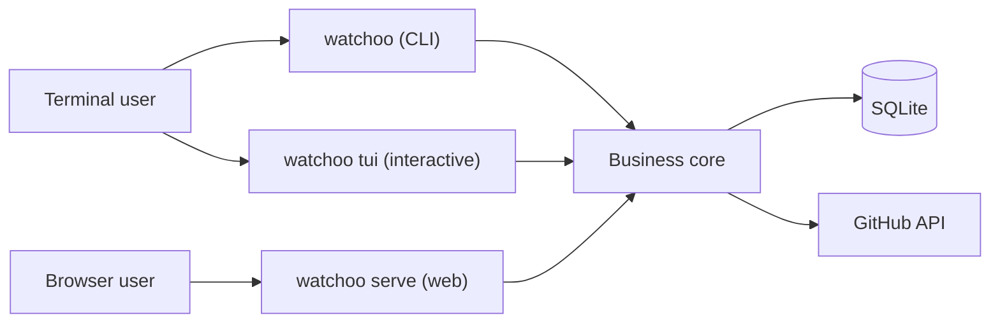

# Watchoo Documentation

> Project definition document — version of November 1, 2026 · Benoit
>
> Status: **v1.0.0, stable release**. Phases 1 to 5 (MVP) and 6 (V2) of the [roadmap](07-roadmap.md)
> are done, followed by the per-contributor page (0.5.0), Watchoo self-update (0.6.0), the bilingual
> interface, English by default and French (0.7.0), and the stabilization of the public surface
> (1.0.0). Release history: [CHANGELOG.md](../../CHANGELOG.md).

Watchoo is a single Go binary that watches a list of GitHub repositories and answers three questions:
**what moved, when, and who did it.** It is used on the command line (CLI), in interactive mode in
the terminal (`watchoo tui`) or through a local web interface served by the same binary.

## Contents

| # | Document | Content |
| --- | --- | --- |
| 1 | [Vision and goals](01-vision.md) | Why Watchoo, goals, scope, out of scope |
| 2 | [Features](02-features.md) | MVP scope, V2, V3 |
| 3 | [Technical architecture](03-architecture.md) | Overall schema, Go stack, code layout, watch points |
| 4 | [Data model](04-data-model.md) | SQLite tables, relations, indexes |
| 5 | [CLI](05-cli.md) | Commands, global options, output examples |
| 6 | [Web interface](06-web-interface.md) | Pages, HTMX behavior, security |
| 7 | [Roadmap](07-roadmap.md) | Phases, exit criteria, MVP exit criterion |
| 8 | [Ready-to-paste agent prompt](08-agent-prompt.md) | Prompt to paste to have the project built phase by phase |
| 9 | [Testing strategy](09-testing.md) | `gh` mock, simulated GitHub API, per-layer tests, CI without external service |
| 10 | [Workspaces](10-workspaces.md) | `watchoo init`, one directory per monitored group, "undergraduate students" scenario |
| 11 | [Coding agent skills](11-skills.md) | Skills installed via skills.sh, layout in the repository, rules |
| 12 | [Supervision and diagnosis](12-supervision-diagnostic.md) | Signals to review, guardrails, phase plan (proposal) |
| 13 | [Project conventions](13-conventions.md) | Compliance indicators against a charter (commits, branches, PRs, SemVer, CHANGELOG, README, INDEX), milestone review (proposal) |
| — | [Glossary](glossary.md) | Project vocabulary |

## At a glance

## Guiding principles

1. **One binary, one database per workspace**: CLI, TUI and web share the same business core; every
   monitored group has its own directory (`watchoo init`), with its config and its SQLite database.
2. **Zero installation**: embedded SQLite without CGO, embedded web assets (HTMX + DaisyUI), no framework and no JavaScript build.
3. **Frugal with the GitHub API**: incremental sync, ETags, rate limit respect.
4. **Extensible**: forge access goes through a `Provider` interface (GitHub first, GitLab/Gitea next).
5. **Ship in phases**: every phase produces something usable end to end.

## License

Code under the [Apache 2.0 license](../../LICENSE); the name and the logo remain reserved (see [NOTICE](../../NOTICE)).
The dependencies (cobra, viper, go-github, modernc SQLite, goose, chi, Bubble Tea, DaisyUI, HTMX, Chart.js)
are under compatible licenses (Apache 2.0, MIT, BSD).
