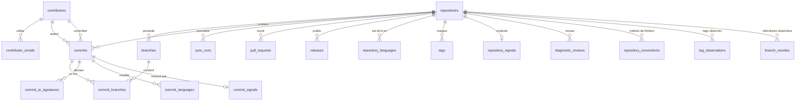

# 4. Modèle de données

[← Sommaire](README.md)

Sept tables suffisent pour le MVP ; `commits` est la table centrale, reliée aux dépôts, aux branches (via
`commit_branches`) et aux contributeurs. La V2 en ajoute trois (migration `00003`) : `pull_requests`,
`releases` et `tags`, soit **dix tables** ; la migration `00004` rend `repositories.provider_id`
facultatif (dépôts suivis par clones Git locaux) ; la migration `00005` (0.5.0) ajoute
`contributors.profile_url` et la migration `00006` (0.5.0) `commits.stats_known` ; la migration `00007` (1.1.0) ajoute `repository_languages` ; la migration `00008` (1.2.0)
ajoute `commits.ai_rules_version` et la table `commit_ai_signatures` ; la migration `00009` (1.2.0) ajoute
`commits.languages_version` et la table `commit_languages`, soit **treize tables** ; la migration `00010` (1.3.0)
ajoute `sync_runs.warnings`. La migration `00011` (phase 7.1) ajoute `commit_signals`, la migration `00012` (phase 7.2) `pull_requests.tool_ids` et `repository_signals`, la migration `00013` (phase 7.4) `diagnostic_reviews`, soit **seize tables**, la migration `00014` (phase 7.5) les colonnes de forme de `commit_signals`, et la migration `00015` (phase 7.7) ses mesures des signaux absolus et des contre-indicateurs (voir [Supervision et diagnostic](12-supervision-diagnostic.md)). La migration `00016` (phase 8.1) ajoute `commits.parent_count` et `repositories.conventions_since` (voir [Conventions de projet](13-conventions.md) et [Migration `00016`](#migration-00016--conventions-de-projet)), la migration `00017` (phase 8.3) le cache `repository_conventions` des critères de fichiers des conventions (voir [Migration `00017`](#migration-00017--cache-des-critères-de-fichiers)), puis les migrations `00018` et `00019` (phase 8.4) l'historique des tags `tag_observations` et les réécritures observées de la branche par défaut `branch_rewrites`, soit **dix-neuf tables** (voir [Migrations `00018` et `00019`](#migrations-00018-et-00019--historique-des-tags-et-de-la-branche-par-défaut)). Le stockage est un fichier SQLite versionné par des migrations
`goose`, avec **une base par espace de supervision** (`.watchoo/watchoo.db`, voir
[Espaces de supervision](10-espaces-de-supervision.md)). Les tables ne connaissent donc pas la notion
d'espace : deux espaces ne partagent jamais de données.

## Schéma relationnel

## Tables

### `repositories` — dépôts suivis

Unicité : **`(provider, provider_id)`** et **`(provider, owner, name)`**. `provider_id` peut être
`NULL` (V2) : SQLite accepte plusieurs `NULL` dans la contrainte `UNIQUE`, et `owner` / `name` restent
uniques.

| Colonne | Description |
| --- | --- |
| id | Identifiant interne |
| provider | Forge d'origine (`github` au MVP) |
| provider_id | Identifiant du dépôt sur la forge (identifiant numérique GitHub), qui ne change jamais. `NULL` = pas encore connu (V2) : dépôt ajouté et synchronisé seulement par [clones Git locaux](03-architecture.md#dépôts-git-locaux-v2), qui n'en ont pas ; la première synchro par l'API le résout par owner/name et l'écrit. Strictement positif (`CHECK`) ; `0` dans `model.Repository.ProviderID` |
| owner | Propriétaire (utilisateur ou organisation) |
| name | Nom du dépôt |
| label | Nom affiché (ex. « Alice Martin », « Groupe 3 »), facultatif ; vide = `owner/repo` |
| default_branch | Branche par défaut |
| url | URL du dépôt |
| stars | Nombre d'étoiles |
| open_issues | Nombre d'issues ouvertes |
| last_synced_at | Date de la dernière synchronisation |
| last_commit_at | Date du dernier commit connu, toutes branches suivies confondues |
| archived | Dépôt archivé sur GitHub |
| flemme_after_days | Seuil « Flemme » propre au dépôt, au moins 1 (vide = valeur globale, 5 j par défaut) ; réglé par `repo add --flemme`, la colonne `flemme` de l'import, le partage de la configuration ou la page du dépôt dans le web |
| dead_after_days | Seuil « Dead » propre au dépôt, au moins 1 (vide = valeur globale, 15 j par défaut) ; réglé de même (`--dead`, colonne `dead`) |
| enabled | Suivi actif, ou arrêté (`repo remove --keep-history` : historique gardé, plus de synchro ; `repo add` le réactive) |
| branch_patterns | Branches à suivre (`--branch`, colonne `branches` de l'import) : noms et motifs `path.Match` séparés par des virgules (`main,dev,release/*`) ; vide = toutes les branches. Ajoutée par la migration `00002` |
| conventions_since | Date de début des conventions propre au dépôt (`repo add --conventions-since AAAA-MM-JJ`, partage de la configuration), stockée au format fixe à **minuit UTC** de la date du calendrier (`2026-09-01T00:00:00Z`, `CHECK`) ; vide = date de l'espace (`conventions.since`). Interprétée comme la date du calendrier, à minuit dans le fuseau de l'espace. Ajoutée par la migration `00016` (phase 8.1) |

### `branches` — branches surveillées

Unicité : **`(repo_id, name)`**.

| Colonne | Description |
| --- | --- |
| id | Identifiant interne |
| repo_id | Dépôt parent |
| name | Nom de la branche |
| head_sha | SHA du dernier commit connu sur la branche |
| tracked | Branche suivie ou non |

### `contributors` — personnes identifiées

Unicité : **`(provider, provider_user_id)`**. Ces colonnes sont vides pour une personne connue seulement
par son e-mail Git ; SQLite accepte plusieurs valeurs vides dans une colonne unique.

| Colonne | Description |
| --- | --- |
| id | Identifiant interne |
| provider | Forge du compte (`github` au MVP), vide si aucun compte n'est connu |
| provider_user_id | Identifiant du compte sur la forge (identifiant numérique GitHub), qui ne change jamais |
| provider_login | Login GitHub (si connu), mis à jour si la personne en change |
| name | Nom affiché |
| avatar_url | URL de l'avatar |
| profile_url | Page de profil du compte sur la forge (`html_url` du compte GitHub), donnée par le provider ; vide si aucun login n'est connu. Ajoutée par la migration `00005` (0.5.0) ; complétée à partir du login pour les contributeurs déjà en base (0.6.1) |

`profile_url` vient du provider, jamais d'une adresse construite hors de `internal/provider/` :
l'interface web n'y ajoute rien de propre à GitHub. D'ordinaire, c'est le `html_url` du compte lié à un
**nouveau** commit (`provider.Person.ProfileURL`). Un contributeur déjà en base avant la migration
`00005` (les commits déjà en base ne sont pas relus, et la migration ne devine aucune adresse) a son
adresse complétée par la **synchro suivante**, par l'API comme par les clones Git locaux : pour chaque
contributeur de la forge avec un `provider_login` et un `profile_url` vide, le moteur écrit
`Provider.ProfileURL(login)` (`https://github.com/<login>`, sans requête ; rien pour un login qui n'a
pas la forme d'un login de compte, comme `dependabot[bot]`). Comme le login et l'avatar, une adresse
vide n'efface pas la valeur connue, et une adresse connue n'est jamais remplacée par ce complément. Un
contributeur sans login (connu seulement par les clones Git locaux) n'a pas d'adresse.

### `contributor_emails` — rattachement des e-mails Git

Clé primaire : **`email`**. Une adresse désigne une seule personne ; une personne peut avoir plusieurs
adresses. Les adresses sont enregistrées **en minuscules** (`Bob@Mail.com` et `bob@mail.com` sont la même
adresse).

| Colonne | Description |
| --- | --- |
| email | Adresse e-mail Git, en minuscules |
| contributor_id | Contributeur |

### `commits` — historique (table centrale)

Clé primaire : **`(repo_id, sha)`**. Chaque commit est enregistré une seule fois par dépôt, quel que
soit le nombre de branches qui le contiennent.

| Colonne | Description |
| --- | --- |
| repo_id | Dépôt |
| sha | Identifiant du commit |
| author_id | Auteur (contributeur) |
| committer_id | Committer (contributeur) |
| message | Message de commit |
| authored_at | Date d'écriture |
| committed_at | Date de commit |
| additions | Lignes ajoutées (0 si inconnu, voir ci-dessous) |
| deletions | Lignes supprimées (0 si inconnu) |
| stats_known | `1` si `additions` et `deletions` ont été calculées (même à 0), `0` si elles sont encore inconnues. Ajoutée par la migration `00006` (0.5.0) |
| url | Lien vers le commit sur la forge |
| ai_rules_version | Version des règles de signatures d'IA avec laquelle le commit a été analysé ; `0` = pas encore analysé. Ajoutée par la migration `00008` (1.2.0) |
| languages_version | Version des règles de langages avec laquelle les langages du commit ont été lus dans le clone ; `0` = pas encore. Ajoutée par la migration `00009` (1.2.0) |
| parent_count | Nombre de parents du commit : `0` = racine, `1` = ordinaire, `2` ou plus = fusion ; vide = inconnu (`CHECK >= 0`). Écrit à l'insertion depuis le commit lu (API ou clone) ; les commits enregistrés avant la migration sont rattrapés par le clone Git local à la synchro. Ajoutée par la migration `00016` (phase 8.1) |

- **Statistiques** (`additions`, `deletions`) : calculées dans le **clone Git local** du dépôt
  (`git diff-tree --numstat`, sans quota), avec ou sans `gh`, pour **tous** les commits, premier import
  compris ; chaque synchro reprend les commits dont `stats_known` vaut encore 0. Si le clone est
  indisponible, la synchro par l'API se replie sur une requête par commit, seulement pour les commits
  découverts après le premier import du dépôt, au plus 100 par dépôt et par synchro et jamais sous 10 %
  de quota restant (voir [Synchronisation incrémentale](03-architecture.md#synchronisation-incrémentale)).
- **Inconnu ou nul** : `stats_known` distingue un commit jamais calculé (`0`, affiché « — ») d'un commit
  réellement à `+0 −0` (`1` : merge sans changement, commit vide), qui n'est jamais recalculé. Un total
  (contributeur, dépôt) est affiché « — » seulement si **aucun** de ses commits n'a de statistiques
  connues ; sinon il additionne les commits connus. La migration `00006` marque connus les commits déjà
  en base dont `additions` ou `deletions` n'est pas nul (ils ont été lus par l'API) ; les autres
  (`0`/`0`, impossibles à distinguer avant la migration) sont recalculés par le clone à la synchro
  suivante, ce qui est sans coût. Un index partiel (`commits_stats_unknown`, sur `(repo_id, sha)` des
  commits inconnus) sert à les retrouver. Retour arrière (`Down`) : index et colonne supprimés ; les
  valeurs d'`additions` et `deletions` restent.
- **Auteur et committer** : un commit dont l'e-mail Git est vide et qui n'est lié à aucun compte GitHub
  n'a pas de contributeur (`author_id` / `committer_id` vides) ; son nom Git est ignoré, faute
  d'identité fiable pour regrouper ces commits.

### `commit_branches` — appartenance des commits aux branches

Un même commit appartient souvent à plusieurs branches (par exemple après un merge de `dev` dans `main`).
Cette table de liaison indique sur quelles branches suivies chaque commit a été vu.

Clé primaire : **`(repo_id, sha, branch_id)`**. Clé étrangère `(repo_id, sha)` vers `commits`.

| Colonne | Description |
| --- | --- |
| repo_id | Dépôt |
| sha | Commit |
| branch_id | Branche sur laquelle le commit a été vu |

- Comptages et statistiques (contributeurs, graphiques) : sur `commits` seule, donc sans doublon.
- Filtre par branche : jointure avec `commit_branches`.

### `commit_ai_signatures` — signatures d'IA des commits (1.2.0)

Une ligne par outil et par type de signature trouvés dans un commit (voir
[Signatures d'IA](02-fonctionnalites.md#signatures-dia)). **L'absence de ligne n'est pas la preuve d'un
travail sans IA.**

Clé primaire : **`(repo_id, sha, tool, kind)`**. Clé étrangère `(repo_id, sha)` vers `commits`, en cascade : les
signatures disparaissent avec le commit.

| Colonne | Description |
| --- | --- |
| repo_id | Dépôt |
| sha | Commit |
| tool | Identifiant de l'outil (`aider`, `claude`, `codex`, `copilot`, `cursor`) |
| kind | Type de signature (`agent_account`, `coauthor_trailer`, `footer`) |

Les signatures sont des données dérivées : elles sont réécrites à chaque analyse du commit, à partir du
message et de l'auteur déjà en base. Ni la ligne du message ni une adresse n'y sont copiées. Retour arrière
(`Down`) : table, index et colonne supprimés ; les commits restent.

### `sync_runs` — journal des synchronisations

| Colonne | Description |
| --- | --- |
| id | Identifiant interne |
| repo_id | Dépôt synchronisé |
| started_at | Début |
| finished_at | Fin |
| new_commits | Nombre de nouveaux commits récupérés |
| status | `running`, `success` ou `error` |
| error | Message d'erreur éventuel, dans la langue active lors de la synchro (anglais ou français), sans donnée personnelle |
| warnings | Avertissements d'une synchro réussie (1.3.0, migration `00010`) : tableau JSON de `{"kind": …, "message": …}`, `[]` si aucun. `kind` est un code stable (`stats_not_computed`, `clone_unavailable`, `languages_not_computed`, `lists_not_synced`, `ai_not_scanned`, `diagnostic_not_recorded` depuis la phase 7.1), traduit à l'affichage ; `message` est le texte complet, dans la langue active lors de la synchro, sans donnée personnelle |

Le dernier `sync_run` d'un dépôt donne l'état « en erreur », et ses avertissements sont ceux affichés
sur la carte et la page du dépôt (voir [Interface web](06-interface-web.md#1-tableau-de-bord)) : ils
survivent à un redémarrage de `watchoo serve` et disparaissent à la synchro suivante sans avertissement. Un `sync_run` `running` sert aussi de
**verrou** : voir [Architecture](03-architecture.md#fréquence-de-synchronisation).

### `pull_requests` — pull requests (V2)

Clé primaire : **`(repo_id, number)`**. Une PR est enregistrée une fois par dépôt, puis mise à jour à
chaque synchro qui la voit modifiée (voir
[Synchronisation incrémentale](03-architecture.md#synchronisation-incrémentale)) ; elle n'est jamais
supprimée, sauf avec son dépôt.

| Colonne | Description |
| --- | --- |
| repo_id | Dépôt |
| number | Numéro de la PR dans le dépôt (au moins 1) |
| title | Titre (texte venu du dépôt : nettoyé à l'affichage, jamais dans les logs) |
| state | `open` ou `closed`, comme sur la forge |
| merged | Mergée (une PR mergée est aussi `closed`, avec `merged_at`) |
| draft | Brouillon |
| author_login | Login de l'auteur sur la forge ; vide si inconnu |
| author_provider_id | Identifiant numérique du compte de l'auteur ; 0 si inconnu |
| url | Lien vers la PR sur la forge |
| base_branch | Branche visée |
| head_branch | Branche proposée |
| created_at | Date d'ouverture |
| updated_at | Dernière modification (sert de point de reprise de la synchro suivante) |
| closed_at | Date de fermeture ; vide si ouverte |
| merged_at | Date de merge ; vide si non mergée. Une PR mergée a `state = closed` et `merged_at` renseigné |
| tool_ids | Diagnostic (phase 7.2, migration `00012`) : outils déclarés dans la description, encodés `D2:claude`, triés, séparés par des virgules ; vide si aucun ou non mesuré. La description n'est jamais gardée ; valeur effacée par la purge (`diagnostic.retention_days`, date d'ouverture) |

- **Auteur** : gardé tel quel (login et identifiant de compte), **sans lien** vers `contributors` : un
  contributeur est l'auteur d'au moins un commit, et un auteur de PR sans commit ne doit pas apparaître
  dans le classement. Le rapprochement reste possible par `author_provider_id` =
  `contributors.provider_user_id`.
- **État affiché** : « ouverte » (ou « brouillon »), « mergée » (`merged`) ou « fermée » (fermée sans
  merge).

### `releases` — releases (V2)

Clé primaire : **`(repo_id, provider_id)`**. La liste d'un dépôt est **remplacée** à chaque synchro
réussie de cette liste : une release supprimée sur la forge disparaît.

| Colonne | Description |
| --- | --- |
| repo_id | Dépôt |
| provider_id | Identifiant de la release sur la forge |
| tag_name | Tag de la release |
| name | Titre (peut être vide) |
| draft | Brouillon (visible seulement d'un compte avec droit d'écriture sur le dépôt) |
| prerelease | Pré-release |
| author_login | Login de l'auteur ; vide si inconnu |
| url | Lien vers la release sur la forge |
| created_at | Date de création |
| published_at | Date de publication ; vide pour un brouillon |

### `tags` — tags (V2)

Clé primaire : **`(repo_id, name)`**. Comme `releases`, la liste d'un dépôt est remplacée à chaque
synchro réussie de cette liste.

| Colonne | Description |
| --- | --- |
| repo_id | Dépôt |
| name | Nom du tag |
| sha | SHA du commit visé |

La forge ne donne pas de date pour un tag : l'affichage reprend la date du commit visé quand il est en
base (jointure sur `commits (repo_id, sha)`, sans clé étrangère : le commit peut être sur une branche
non suivie).

### `repository_languages` — langages d'un dépôt (1.1.0)

Clé primaire : **`(repo_id, language)`**. La liste d'un dépôt est **remplacée** à chaque synchro qui a pu
lire son clone Git local ; sinon, ce qui est en base est gardé.

| Colonne | Description |
| --- | --- |
| repo_id | Dépôt |
| language | Nom du langage (`Go`, `TypeScript`…), le même dans toutes les langues de l'interface |
| bytes | Taille de ses fichiers sur la branche par défaut, en octets (au moins 1) |

Les pourcentages ne sont pas stockés : ils sont calculés à l'affichage, à partir du total du dépôt. Voir
[Langages d'un dépôt](03-architecture.md#langages-dun-dépôt-110).

### `commit_languages` — lignes ajoutées par langage dans un commit (1.2.0)

Une ligne par langage dans lequel le commit ajoute au moins une ligne, lue dans le clone Git local (voir
[Langages d'un contributeur](03-architecture.md#langages-dun-contributeur-120)). Un commit analysé
(`languages_version` > 0) sans ligne ici n'ajoute rien dans un langage reconnu (commit de fusion, Markdown
seul…).

Clé primaire : **`(repo_id, sha, language)`**. Clé étrangère `(repo_id, sha)` vers `commits`, en cascade.

| Colonne | Description |
| --- | --- |
| repo_id | Dépôt |
| sha | Commit |
| language | Nom du langage, comme dans `repository_languages` |
| additions | Lignes ajoutées dans ce langage (au moins 1) |

Donnée dérivée : réécrite à chaque analyse du commit. Les totaux d'un contributeur passent par
`commits.author_id` : une fusion de contributeurs les suit sans rien réécrire. Retour arrière (`Down`) :
table, index et colonne supprimés ; les commits restent.

### `commit_signals` — signaux de diagnostic (phase 7.1)

Clé primaire : **`(repo_id, sha)`**, clé étrangère vers `commits (repo_id, sha)` avec `ON DELETE CASCADE`
(supprimer un commit ou un dépôt supprime ses signaux). Une ligne par commit mesuré quand le réglage
`diagnostic.enabled` est actif : nouveaux commits synchronisés après l'activation, hors commits de
fusion, dont le clone Git local donne le détail des fichiers. Une ligne n'est jamais réécrite, sauf pour
compléter une forme non mesurée (`form_known = 0`) par une forme mesurée (phase 7.5).
**Minimisation** : ni message, ni e-mail, ni chemin de fichier, ni ligne de code.

| Colonne | Description |
| --- | --- |
| repo_id, sha | Commit mesuré |
| author_id | Auteur, recopié de `commits` (`NULL` si le contributeur est supprimé) |
| authored_at | Date d'écriture, recopiée de `commits` : fenêtres par auteur (phase 7.3) et purge |
| files_kept | Fichiers retenus (ni binaires ni exclus par `diagnostic.exclude`) |
| files_excluded | Fichiers binaires ou exclus par un motif |
| additions_kept, deletions_kept | Lignes ajoutées et supprimées dans les fichiers retenus |
| tool_ids | Outils déclarés, chacun avec son signal (phase 7.2) : `D1:<outil>` pour un trailer, `D2:<outil>` pour une signature ; outils : `claude`, `copilot`, `codex`, `cursor`, `unnamed`. Triés, séparés par des virgules ; vide si aucun |
| agent_config | Signal D4 : le commit modifie un fichier de configuration d'agent (`AGENTS.md`, `CLAUDE.md`…) |
| bot_author | Signal D3 : l'auteur est un compte bot connu (`*[bot]`, `copilot-swe-agent`) |
| computed_at | Date du calcul |
| form_known | Forme mesurée (phase 7.5) ; 0 pour une ligne d'avant la phase 7.5 ou une lecture en échec (toutes les colonnes suivantes valent alors 0) |
| source_lines, comment_lines | Lignes ajoutées non vides des fichiers source reconnus (tests compris), et parmi elles les lignes de commentaire ou de docstring (F1) |
| functions, documented_functions | Définitions de fonctions ajoutées, et parmi elles les documentées (F2) |
| identifiers, lexical_diversity | Identifiants du code ajouté (hors mots-clés et chaînes) et leur diversité lexicale MATTR, fenêtre de 50 ; `NULL` avec moins de 50 identifiants (F3) |
| test_lines | Lignes ajoutées non vides des fichiers de test (F5) |
| message_length, message_bullets, message_conventional | Longueur du message hors trailers et signatures, lignes en liste, sujet Conventional Commits (F4) ; le message n'est pas recopié |
| decorative_lines | Lignes de commentaire décoratives (phase 7.7, migration `00015`, signal A5) |
| fr_words, fr_words_unaccented | Mots français accentués courants repérés dans les commentaires, et parmi eux ceux écrits sans accents (A6) ; les mots ne sont pas gardés |
| wip_markers | Marqueurs de travail en cours : `TODO`, `FIXME`, `XXX`, `HACK`, appels de debug (A7, H1) |
| short_identifiers | Identifiants d'une lettre (A7, H2) |
| private_defs | Définitions privées parmi `functions` |
| message_revert, message_fix | Message de `git revert` (A4) ; sujet de correction (H4) |

Purge : en fin de chaque synchro, les lignes dont `authored_at` dépasse `diagnostic.retention_days`
(365 jours par défaut) sont supprimées.

### `repository_signals` — contexte de diagnostic d'un dépôt (phase 7.2)

Clé primaire : **`repo_id`**, supprimée avec le dépôt. Mise à jour à chaque synchro par le clone Git local,
diagnostic activé.

| Colonne | Description |
| --- | --- |
| repo_id | Dépôt |
| agent_config_since | Signal D4 (contexte) : date d'écriture du premier commit qui ajoute un fichier de configuration d'agent sur la branche par défaut ; `NULL` si aucun |
| computed_at | Date du calcul |

### `diagnostic_reviews` — revues humaines des pistes (phase 7.4)

Clé primaire : **`(repo_id, lead_key)`** ; une revue par piste, remplacée si elle est refaite ; supprimée
avec le dépôt. La note est une donnée personnelle : la revue suit `diagnostic.retention_days` à partir de
`lead_date`.

| Colonne | Description |
| --- | --- |
| repo_id | Dépôt |
| lead_key | Clé stable de la piste : `commit/<sha>`, `pull_request/<numéro>` ou `day/<auteur>/<début du jour UTC>` |
| kind | `commit`, `pull_request` ou `day` |
| lead_date | Date de la piste (conservation) |
| signals | Identifiants des signaux présents lors de la revue (`D1,R2`…), pour la calibration (phase 7.6) |
| decision | `assisted`, `not_assisted` ou `undetermined` |
| cause | Si non assisté : `internal_copy`, `tool_generated`, `existing_import`, `refactoring` ou `other` ; vide sinon |
| confidence | `low`, `medium` ou `high` |
| note | Note libre du relecteur (2 000 caractères au plus) |
| reviewer | Relecteur : compte de l'interface web, sinon nom de l'espace |
| reviewed_at | Date de la revue |

### `repository_conventions` — cache des critères de fichiers des conventions (phase 8.3)

Clé primaire : **`(repo_id, rev_kind, tag_name)`** ; une ligne par révision mesurée, remplacée quand elle
est recalculée ; supprimée avec le dépôt. Écrite par la synchro seulement quand les conventions sont
activées, après la mise à jour du clone Git local, pour la tête de la branche par défaut et pour chaque tag
qui désigne un jalon configuré (voir [Conventions de projet](13-conventions.md), sections 5.5 à 5.8 et 9).

| Colonne | Description |
| --- | --- |
| repo_id | Dépôt |
| rev_kind | `head` (tête de la branche par défaut) ou `tag` (tag d'un jalon) |
| tag_name | Nom du tag pour `tag` ; vide pour `head` (`CHECK`) |
| rev_sha | Commit mesuré (SHA complet, 40 ou 64 caractères hexadécimaux en minuscules) |
| rules_version | Version des règles des critères de fichiers (`conventions.FileRulesVersion`) |
| config_hash | Empreinte stable (SHA-256) des réglages `conventions.changelog.*`, `conventions.readme.*`, `conventions.docs.*`, du dépôt (`owner/name`, sans casse : RD3, DOC3 et DOC4 reconnaissent ses URL) et des noms des tags qui désignent une version (CL8) |
| results | Objet JSON (`CHECK json_type = 'object'`) : identifiants de critères, états, raisons, codes et **compteurs** seulement ; jamais un chemin, un contenu de fichier, une cellule d'INDEX ni un nom de personne |
| computed_at | Date du calcul |

Une ligne dont `rev_sha`, `rules_version` ou `config_hash` ne correspond plus est recalculée à la synchro
suivante ; les lignes des tags qui ne désignent plus de jalon configuré (tag disparu, jalon retiré) sont
supprimées, et la ligne de la tête quand la source n'a plus de branche par défaut. Les listes de chemins (DOC3, DOC4, DOC5, DOC8) ne sont pas stockées : elles sont recalculées
depuis le clone pour la vue détaillée d'un dépôt.

### `tag_observations` — historique des tags observés (phase 8.4)

Clé primaire : **`id`** ; une ligne par **période d'observation** d'un couple (nom du tag, SHA du commit
visé), ouverte (`ended_at` NULL) tant que le couple est vu par la synchro ; au plus une période ouverte par
nom et par dépôt (index unique partiel) ; supprimée avec le dépôt. Écrite par la synchro **seulement quand
les conventions sont activées** et seulement après une lecture des tags **réussie et non tronquée**
(au plus 1 000 tags) : une lecture en échec, ignorée ou tronquée ne ferme rien. Sert à SV3 (tag réécrit ou
supprimé) et aux échéances de SV2 (voir [Conventions de projet](13-conventions.md), sections 5.4 et 9).
Aucune attribution à une personne.

| Colonne | Description |
| --- | --- |
| repo_id | Dépôt |
| name | Nom du tag (non vide) |
| sha | SHA du commit visé (complet, 40 ou 64 caractères hexadécimaux en minuscules) ; pour un tag annoté, le commit, jamais l'objet tag |
| first_seen_at | Première lecture qui a vu le couple |
| last_seen_at | Dernière lecture qui l'a vu (`>= first_seen_at`) |
| ended_at | Lecture qui a constaté la fin (`>= last_seen_at`) ; NULL tant que la période est ouverte |
| end_reason | `rewritten` (le nom désigne un autre commit) ou `deleted` (le nom a disparu) ; NULL si et seulement si `ended_at` l'est |

À chaque lecture complète : un couple revu reporte `last_seen_at` ; un nom revu avec un autre SHA ferme sa
période (`rewritten`) et en ouvre une nouvelle ; un nom absent ferme sa période (`deleted`) ; un couple sans
période ouverte en ouvre une, y compris un couple déjà vu puis supprimé (l'historique des périodes reste).

### `branch_rewrites` — réécritures observées de la branche par défaut (phase 8.4)

Clé primaire : **`id`** ; une ligne par événement observé ; supprimée avec le dépôt. Écrite par la synchro
**seulement quand les conventions sont activées**, quand l'ancienne tête connue de la branche par défaut
n'est plus ancêtre de la nouvelle (BR4, voir [Conventions de projet](13-conventions.md), sections 5.2 et 9) ;
un résultat inconnu (ancien commit absent du clone) n'est jamais enregistré. Aucune attribution à une
personne.

| Colonne | Description |
| --- | --- |
| repo_id | Dépôt |
| branch | Branche par défaut au moment de l'observation (non vide) |
| old_sha | Ancienne tête (SHA complet en minuscules) |
| new_sha | Nouvelle tête (SHA complet en minuscules, différent de `old_sha`) |
| observed_at | Fin de la synchro qui a observé la réécriture |

## Index

| Index | Usage |
| --- | --- |
| `commits(repo_id, committed_at DESC)` | Vue « derniers commits » d'un dépôt |
| `commits(author_id, committed_at DESC)` | Vue « activité d'un contributeur » |
| `commit_branches(branch_id)` | Filtre « commits d'une branche » |
| `pull_requests(repo_id, updated_at DESC)` | Point de reprise de la synchro des PR, liste des PR d'un dépôt |
| `contributor_emails(contributor_id)` | Technique : clé étrangère souvent parcourue (e-mails d'un contributeur) |
| `sync_runs(repo_id, started_at DESC)` | Technique : dernière synchro d'un dépôt |
| `commits(repo_id, sha) WHERE stats_known = 0` | Index partiel : commits dont les lignes `+/-` restent à lire (migration `00006`) |
| `commits(repo_id, ai_rules_version)` | Commits restant à analyser pour les signatures d'IA (migration `00008`) |
| `commits(repo_id, languages_version)` | Commits dont les langages restent à lire dans le clone (migration `00009`) |
| `commits(repo_id, sha) WHERE parent_count IS NULL` | Index partiel : commits dont le nombre de parents reste à lire dans le clone (migration `00016`) |
| `commit_signals(repo_id, author_id, authored_at)` | Fenêtres glissantes par auteur des signaux de rythme (phase 7.3) |
| `commit_signals(authored_at)` | Purge par durée de conservation |
| `tag_observations(repo_id, name) WHERE ended_at IS NULL` | Index unique partiel : au plus une période ouverte par tag (migration `00018`) |
| `tag_observations(repo_id, name, first_seen_at)` | Historique des tags d'un dépôt (migration `00018`) |
| `branch_rewrites(repo_id, observed_at)` | Réécritures d'un dépôt par date (migration `00019`) |
| `diagnostic_reviews(lead_date)` | Purge des revues par durée de conservation |

## Fusion des identités

À chaque commit synchronisé, l'auteur et le committer sont rattachés à un contributeur :

- **commit lié à un compte GitHub** : contributeur trouvé (ou créé) par `(provider, provider_user_id)`,
  login, nom et avatar mis à jour ; l'e-mail Git (en minuscules) lui est rattaché. Si cet e-mail
  appartenait à un contributeur **sans compte**, celui-ci est fusionné dans le contributeur avec compte
  (ses commits et ses autres e-mails lui sont réattribués, puis il est supprimé) ;
- **commit sans compte** : contributeur trouvé par e-mail, sinon créé sans compte (nom = nom Git) ;
- **ni compte ni e-mail** : pas de contributeur.

Précisions :

- seuls les commits **nouveaux** passent par ces règles : un commit déjà en base ne met pas à jour son
  contributeur ;
- le nom Git d'un commit sans compte met à jour le nom d'un contributeur **sans compte** trouvé par
  e-mail (le plus récent l'emporte), jamais celui d'un contributeur avec compte ; un login, un avatar ou
  une adresse de profil vide n'efface pas la valeur connue ; lors d'une fusion, le contributeur avec compte reprend le nom du
  contributeur absorbé s'il n'en a pas.

Sans `gh` (clones Git locaux, V2), aucun commit n'est lié à un compte : seule la règle « commit sans
compte » s'applique (rattachement par e-mail). Un contributeur créé ainsi est fusionné plus tard, comme
ci-dessus, quand une synchro par l'API rattache un de ses e-mails à un compte.

## Migration `00004` : `provider_id` facultatif

SQLite ne sait pas retirer un `NOT NULL` d'une colonne : la migration reconstruit `repositories` selon la
procédure documentée par SQLite (nouvelle table, copie, `DROP`, renommage). Points d'attention :

- **hors transaction goose** (`-- +goose NO TRANSACTION`) pour pouvoir couper les clés étrangères
  (`PRAGMA foreign_keys = OFF`, sans effet dans une transaction) : sinon `DROP TABLE repositories`
  supprimerait en cascade branches, commits, `commit_branches`, `sync_runs`, pull requests, releases et
  tags. goose exécute une migration `NO TRANSACTION` sur une seule connexion, si bien que le pragma
  s'applique bien aux instructions suivantes ; la reconstruction elle-même est dans une transaction
  explicite (`BEGIN` … `COMMIT`), puis les clés étrangères sont réactivées ;
- les tables filles gardent leur clause `REFERENCES repositories`, qui désigne la nouvelle table après le
  renommage ; `id`, colonnes et contraintes (`COLLATE NOCASE`, `CHECK`) sont repris tels quels, et
  `provider_id` gagne `CHECK (provider_id IS NULL OR provider_id > 0)` ;
- un test (`internal/store/migration_provider_id_test.go`) remplit une base au schéma `00003` (deux dépôts
  avec branches, commits, `commit_branches`, synchros, PR, releases, tags, contributeurs), applique
  `00004` et vérifie qu'aucune ligne n'est perdue, que `foreign_key_check` et `integrity_check` sont
  propres, que les clés étrangères sont réactivées et que la cascade marche toujours ;
- retour arrière (`Down`) : même reconstruction vers `NOT NULL`, un `provider_id` inconnu recevant
  l'opposé de l'identifiant interne (négatif, unique, remplacé à la synchro par l'API suivante).

Écriture par le moteur (`store.RepositoryMetadata`) : `ProviderID` > 0 est écrit (résolution après le
retour de `gh`), 0 garde la valeur en base ; `Partial` (synchro par clones Git locaux) n'écrit que la
branche par défaut (si elle est connue) et la date de synchro, jamais des zéros à la place de l'URL, des
étoiles, des issues, de l'état archivé ou de `provider_id`.

## Migration `00016` : conventions de projet

La phase 8.1 ([Conventions de projet](13-conventions.md)) ajoute deux colonnes par `ALTER TABLE … ADD
COLUMN`, sans reconstruire de table :

- **`commits.parent_count`** (`NULL` pour les commits déjà en base) et l'index partiel
  `commits_parent_count_unknown` sur `(repo_id, sha) WHERE parent_count IS NULL`. Les nouveaux commits
  reçoivent leur nombre de parents à l'insertion (`len(Parents)` du commit lu). Les commits déjà en base
  sont rattrapés à chaque synchro par le clone Git local (`git rev-list --no-walk=unsorted --parents`, par
  paquets, clone lu sans mise à jour supplémentaire), **que les conventions soient activées ou non** ; un
  nombre connu n'est jamais réécrit. Sans clone, ou pour un SHA absent du clone (historique réécrit), la
  valeur reste `NULL` (inconnue, jamais traitée comme `1`) et est redemandée à la synchro suivante.
- **`repositories.conventions_since`** : `NULL` = date de l'espace. Le `CHECK` n'accepte que minuit UTC
  (`AAAA-MM-JJT00:00:00Z`) : seule la date du calendrier compte, interprétée à minuit dans le fuseau de
  l'espace (`timezone`).

Retour arrière (`Down`) : l'index puis les deux colonnes sont supprimés ; les autres valeurs restent. Un test
(`internal/store/migration_conventions_test.go`) applique la migration sur une base au schéma `00015`,
vérifie les valeurs inconnues, l'index et les contraintes, puis le retour arrière.

## Migration `00017` : cache des critères de fichiers

La phase 8.3 ([Conventions de projet](13-conventions.md)) crée la table `repository_conventions` (voir
plus haut), sans toucher aux autres tables. Ses contraintes : `rev_kind IN ('head', 'tag')`, `tag_name`
vide si et seulement si `rev_kind = 'head'`, `rev_sha` de 40 ou 64 caractères hexadécimaux en minuscules,
`rules_version >= 1`, `config_hash` non vide, `results` objet JSON valide, `computed_at` au format de date
fixe, clé étrangère sur `repositories` avec `ON DELETE CASCADE`. La table part vide : la première synchro
avec les conventions activées la remplit.

Retour arrière (`Down`) : la table est supprimée. Un test (`internal/store/migration_conventions_files_test.go`)
applique la migration à une base au schéma `00016`, vérifie les contraintes, puis le retour arrière.

## Migrations `00018` et `00019` : historique des tags et de la branche par défaut

La phase 8.4 ([Conventions de projet](13-conventions.md)) crée les tables `tag_observations` (migration
`00018`) et `branch_rewrites` (migration `00019`), voir plus haut, sans toucher aux autres tables.
Contraintes de `tag_observations` : `name` non vide, `sha` de 40 ou 64 caractères hexadécimaux en minuscules,
dates au format fixe, `last_seen_at >= first_seen_at`, `ended_at >= last_seen_at`, `end_reason IN
('rewritten', 'deleted')`, `ended_at` et `end_reason` nuls ensemble, une seule période ouverte par nom
(index unique partiel). Contraintes de `branch_rewrites` : `branch` non vide, `old_sha` et `new_sha` de 40 ou
64 caractères hexadécimaux en minuscules et différents, `observed_at` au format fixe. Clés étrangères sur
`repositories` avec `ON DELETE CASCADE`. Les tables partent vides : l'historique commence à la première
synchro avec les conventions activées, d'où le libellé « aucune réécriture observée depuis le … ».

Retour arrière (`Down`) : chaque table est supprimée. Un test (`internal/store/tag_history_test.go`)
applique les migrations à une base au schéma `00017`, vérifie les contraintes, puis le retour arrière.

## Renommages et changements de login

Sur GitHub, un dépôt peut être renommé ou transféré, et un utilisateur peut changer de login. Les
identifiants numériques (`provider_id`, `provider_user_id`) ne changent jamais : c'est sur eux que repose
l'unicité. À chaque synchro, Watchoo met à jour `owner`, `name` et `provider_login` si besoin, sans créer de
doublon et sans séparer l'historique. Sans `gh` (clones Git locaux), un dépôt est désigné par owner/name :
un renommage n'est suivi qu'à la synchro suivante par l'API.

## Dates

- Stockées en **texte ISO 8601, en UTC**, avec un format strictement fixe à la seconde près :
  `2006-01-02T15:04:05Z` (ex. `2026-10-26T14:03:00Z`). Un format fixe se trie correctement comme du texte,
  donc les index sur `committed_at` fonctionnent.
- C'est le format renvoyé par l'API GitHub. Les colonnes de date sont déclarées `TEXT` (sqlc génère donc
  des `string` ou `sql.NullString`) : la conversion `string` ↔ `time.Time` est faite explicitement dans
  `internal/store` (`FormatTime` / `ParseTime`), car le driver `modernc` n'écrit pas ce format tout seul.
  Le format est aussi vérifié en base par une contrainte `CHECK`.
- **Conversion en heure locale à l'affichage seulement** (CLI, TUI, web) : dates relatives (« il y a 2 h »)
  ou date et heure locales.
- **Regroupements « par jour / semaine »** (graphiques, statistiques) : selon le **fuseau de
  l'utilisateur**, celui du système par défaut ou celui réglé dans la config. Sinon, un commit fait à
  23 h à Paris tomberait le lendemain.
- Le fuseau horaire de l'auteur n'est pas conservé, car l'API GitHub renvoie les dates déjà converties en
  UTC.
