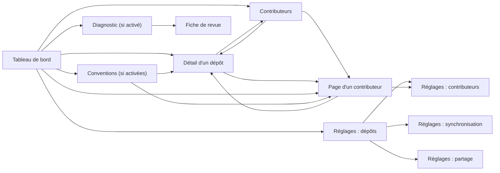

# 6. Interface web

[← Sommaire](README.md)

Cinq pages servies par `watchoo serve`, rafraîchies par HTMX sans rechargement complet. Les templates
(`html/template`) et les assets statiques sont embarqués dans le binaire (`embed`) : aucun build JavaScript.
Le style repose sur [DaisyUI](https://daisyui.com/) : composants `card`, `badge`, `table`, `stat`,
thèmes clair / sombre (voir [Architecture](03-architecture.md#css--daisyui)).

`watchoo serve` affiche **un seul espace de supervision** : celui du répertoire où on le lance (ou celui
donné par `-C`). Le nom de l'espace (ex. « licence-projet ») est affiché dans le titre de chaque page. Pour
plusieurs espaces en même temps, on lance un `serve` par espace, chacun sur son port (`web.addr`).

## Langue de l'interface

La langue des pages vient du **réglage `lang` de l'espace de supervision** (`config.yaml`) : `en` par
défaut, `fr` pour le français. Le **sélecteur EN / FR** de l'en-tête (1.6.0) la change pour le seul
navigateur en cours : le choix est gardé dans un cookie (`watchoo_lang`, suffixé par le port comme le
cookie CSRF, `HttpOnly`, un an), l'emporte sur `lang` et `WATCHOO_LANG`, et n'écrit jamais dans
`config.yaml`. Sans choix, ou avec une valeur inconnue, la langue de l'espace s'applique. Tout ce qui est affiché — titres, tableaux, libellés, boutons,
messages d'erreur, dates relatives (« il y a 2 h » → "2 h ago") — existe dans les deux langues, servis
par le paquet `internal/i18n`, sans dépendance (voir
[Architecture](03-architecture.md#langues-et-traductions)). `lang` est un réglage commun : il est
partagé avec les autres superviseurs comme `timezone`. Les données saisies (noms affichés, messages
de commit, logins) ne sont pas traduites. Le réglage se change dans `config.yaml` (ou par l'import d'une
configuration partagée) ; il est relu à chaque requête : un changement s'applique sans redémarrer
`watchoo serve`. Sa variable d'environnement est `WATCHOO_LANG`, la même que celle de la CLI : la
définir impose la langue partout, sauf dans un navigateur qui a choisi une langue avec le sélecteur.

## Pages

| Page | Adresse | Fragments HTMX |
| --- | --- | --- |
| Tableau de bord | `/` (`?sort=`, `?state=`, `?q=`, `?warnings=`, `?prs=`) | `/fragments/dashboard/repos`, `/fragments/dashboard/feed` |
| Détail d'un dépôt | `/repos/{id}` (`?page=`, `?branch=`, `?author=`) | `/repos/{id}/commits` |
| Contributeurs | `/contributors` | `/fragments/contributors` |
| Page d'un contributeur (0.5.0) | `/contributors/{id}` (`?page=`) | `/contributors/{id}/commits` |
| Réglages (1.8.0 : quatre pages) | `/settings/repos`, `/settings/contributors` (`?q=`), `/settings/sync`, `/settings/share` ; `/settings` redirige | `/fragments/quota` (sur `/settings/sync`) |
| Diagnostic (7.4, diagnostic activé) | `/diagnostic` (`?repo=`), `/diagnostic/lead` (`?repo=`, `?key=`) | — |
| Conventions (1.8.0, conventions activées) | `/conventions` (`?milestone=`) | — |

### Routes

Liste complète des routes (partie de la surface publique depuis la 1.0.0, voir
[Skills](11-skills.md#versions-et-changelogmd)). Toute route `GET` accepte aussi `HEAD` ; aucun `GET`
ne modifie quoi que ce soit ; tout `POST` passe par le contrôle CSRF.

| Méthode | Adresse | Rôle |
| --- | --- | --- |
| `GET` | `/` | Tableau de bord |
| `GET` | `/fragments/dashboard/repos`, `/fragments/dashboard/feed` | Fragments du tableau de bord (cartes, fil) |
| `GET` | `/repos/{id}` | Détail d'un dépôt |
| `GET` | `/repos/{id}/commits` | Fragment de l'historique des commits d'un dépôt |
| `POST` | `/repos/{id}/thresholds` | Seuils d'activité d'un dépôt |
| `POST` | `/repos/{id}/sync` | Synchro d'un seul dépôt |
| `GET` | `/contributors` | Contributeurs |
| `GET` | `/fragments/contributors` | Fragment du tableau des contributeurs |
| `GET` | `/contributors/{id}` | Page d'un contributeur |
| `GET` | `/contributors/{id}/commits` | Fragment des commits d'un contributeur |
| `GET` | `/settings` | Redirection (`302`) vers la page de réglages du sujet (1.8.0, voir [Réglages](#5-réglages)) |
| `GET` | `/settings/repos`, `/settings/contributors`, `/settings/sync`, `/settings/share` | Pages de réglages (1.8.0) : dépôts, contributeurs, synchronisation, partage |
| `POST` | `/settings/contributors/{id}` | Nom donné à un contributeur (1.8.0 ; vide : retiré) |
| `POST` | `/settings/contributors/{id}/attach`, `/settings/contributors/{id}/detach` | Rattacher un compte à un contributeur principal, ou le détacher (1.9.0) |
| `POST` | `/settings/repos` | Ajout d'un dépôt |
| `POST` | `/settings/repos/{id}` | Modification d'un dépôt (libellé, branches) |
| `GET`, `POST` | `/settings/repos/{id}/remove` | Retrait d'un dépôt : page de confirmation, puis retrait |
| `POST` | `/settings/interval` | Intervalle de synchro (durée de vie du processus) |
| `GET` | `/fragments/quota` | Fragment du quota GitHub |
| `GET` | `/settings/export` | Export de la configuration (JSON) |
| `POST` | `/settings/import`, `/settings/import/apply` | Import de la configuration : aperçu, puis application |
| `POST` | `/sync` | Synchro de tous les dépôts |
| `GET` | `/fragments/sync` | État de la synchro (barre de navigation) |
| `GET` | `/diagnostic` | Pistes de réflexion du diagnostic (7.4 ; contenu seulement si le diagnostic est activé) |
| `GET` | `/diagnostic/lead` | Fiche de revue d'une piste (404 si le diagnostic est désactivé ou la piste inconnue) |
| `POST` | `/diagnostic/review` | Enregistre la revue d'une piste |
| `POST` | `/diagnostic/backfill` | Lance la reprise de l'historique en arrière-plan (une à la fois) |
| `GET` | `/conventions` | Vue d'ensemble des conventions et revue de jalon (1.8.0 ; contenu seulement si les conventions sont activées ; 400 pour un jalon non configuré) |
| `POST` | `/lang` | Langue du navigateur (`lang` : `en` ou `fr` ; retour au chemin local `return`, sans query, sinon `/` ; 400 si inconnue) |
| `GET` | `/static/*`, `/favicon.ico`, `/apple-touch-icon.png`, `/manifest.webmanifest` | Fichiers statiques embarqués |

`{id}` est un nombre de 1 à 18 chiffres (sinon 404).

Toutes les pages ont la même barre de navigation (DaisyUI `navbar`) : logo, nom de l'espace, liens,
état des synchros et sélecteur de thème clair / sombre (choix gardé dans `localStorage`, clé
`watchoo-theme` ; par défaut, celui du système, `prefers-color-scheme`). Sous 1024 px de large, les
liens puis l'état des synchros passent chacun sur leur propre ligne. Depuis 1.7.1, la barre reste collée en
haut de l'écran pendant le défilement (sa hauteur, variable, est mesurée par `static/app.js` pour coller
les sommaires juste dessous et arrêter les ancres sous elle). Les dates sont relatives
(« il y a 2 h »), avec l'heure locale (fuseau d'affichage) en infobulle. Page introuvable (404) et
erreurs (500…) : pages dans la langue de l'espace, sans détail interne (le détail est dans le journal de `serve`).

### Lignes ajoutées et supprimées (0.5.0)

Partout où un commit est listé (fil du tableau de bord, historique d'un dépôt, commits d'un
contributeur), il montre **ses** lignes : « +12 −3 », « +0 −0 » pour un commit réellement sans ligne
(merge sans changement, commit vide), « — » si elles sont encore inconnues (`commits.stats_known = 0` :
clone Git local indisponible). Template partagé `commit-lines`.

Les **totaux** sont donnés par contributeur (classement, page d'un contributeur, ses dépôts), par
dépôt (carte du tableau de bord, en-tête et contributeurs de la page d'un dépôt) et pour l'espace
(compteur « Lignes » du tableau de bord), calculés par le store (`model.LineTotals`, requêtes
agrégées) : ils additionnent les commits connus et ajoutent « (dont N commits non comptés) » quand une
partie des commits n'en a pas encore ; « — » si aucun n'en a. Template partagé `line-totals`.

### Signatures d'IA (1.2.0)

Partout où un commit est listé (fil du tableau de bord, historique d'un dépôt, commits d'un contributeur), un
badge « IA : Claude » nomme chaque outil déclaré dessus ; **rien** sans signature (template partagé
`commit-ai`). Jusqu'à 1.6.0 (classement des contributeurs) et 1.6.1 (page d'un contributeur), un total « signés / analysés »
(« 1 / 2 ») était aussi affiché ; il est remplacé par le [score IA](#3-contributeurs). Pas de pourcentage, pas de
classement sur les signatures, aucune adresse affichée. Règles :
[Signatures d'IA](02-fonctionnalites.md#signatures-dia).

### 1. Tableau de bord
- Une **carte par dépôt** : nom affiché (`label`, ex. « Alice Martin ») ou `owner/repo` (rappelé sous le
  label), première ligne du dernier commit, auteur, ancienneté, nombre de commits et leurs lignes
  ajoutées / supprimées (0.5.0, voir [Lignes ajoutées et supprimées](#lignes-ajoutées-et-supprimées-050)),
  nombre de branches suivies, et nombre de pull requests ouvertes s'il y en a (V2).
- **Pastille d'état** (voir [règles](02-fonctionnalites.md#règles-fonctionnelles)) : Actif en vert
  (`badge-success`), Flemme en orange (`badge-warning`), Dead en rouge (`badge-error`) ; jamais
  synchronisé, en erreur, archivé, arrêté ou vide en gris (`badge-neutral`). Libellés identiques à la
  CLI (« Flemme · 9 j », « Dead · 40 j »). La bordure gauche de la carte reprend la couleur.
- **Pastilles de synchro** (1.3.0), à côté de la pastille d'état, d'après la dernière synchro du dépôt
  (`sync_runs`, elles survivent donc à un redémarrage) : une pastille orange en contour avec le nombre
  d'**avertissements** (clone Git local indisponible, statistiques de lignes ou langages non calculés,
  pull requests, releases ou tags non lus, signatures d'IA non analysées), leurs libellés courts en
  infobulle et, sous le dernier commit, la conséquence du premier (« Statistiques de lignes lues par
  l'API (limitées) »). La pastille mène à la page du dépôt. Un dépôt dont la dernière synchro a échoué
  (état gris « en erreur ») affiche au même endroit, en rouge, la première ligne du message d'erreur.
- **Tri** (1.7.0), choisi dans une liste au-dessus des cartes :
  - **À surveiller** (par défaut) : Dead, puis Flemme, puis Actif, le dernier commit le plus ancien
    d'abord dans chaque groupe ; ensuite les dépôts en erreur (pour qu'ils se voient), puis les autres
    états gris ; égalités départagées par nom affiché.
  - **Nom** : nom affiché de A à Z, sans tenir compte de la casse, les nombres comparés comme des
    nombres (« GR2 » avant « GR10 »).
  - **Dernier commit** : le plus récent d'abord ; les dépôts sans commit à la fin.
  - **Commits** : le plus de commits d'abord.
  - **Lignes ajoutées** : le plus de lignes ajoutées d'abord (dépôts sans statistiques connues à la fin).
  - Les égalités sont toujours départagées par nom affiché. Pas de tri par score IA : le score ne classe
    jamais les dépôts (voir [Supervision et diagnostic](12-supervision-diagnostic.md)).
- **Filtres** (1.7.0), à côté du tri, cumulables :
  - **État** : Actif, Flemme, Dead ou Autres (tous les états gris) ; tous par défaut.
  - **Recherche** : texte contenu dans le nom affiché ou dans `owner/repo`, sans tenir compte de la
    casse (ex. « java », « GR6 »).
  - **Avec avertissements** : seulement les dépôts dont la dernière synchro a laissé des avertissements
    ou a échoué.
  - **PR ouvertes** : seulement les dépôts qui ont au moins une pull request ouverte.
  - Une ligne indique « 3 sur 18 dépôts affichés » et un lien **Effacer les filtres** quand un filtre
    est actif ; « Aucun dépôt ne correspond à ces filtres. » quand il n'en reste aucun.
  - Les choix sont dans l'adresse de la page (`/?sort=name&state=flemme&q=java`, valeurs `attention`,
    `name`, `recent`, `commits`, `lines` ; `active`, `flemme`, `dead`, `other` ; `warnings=1`, `prs=1`) :
    la vue se met en favori, survit au rafraîchissement de fin de synchro et au bouton retour. Une
    valeur inconnue est ignorée. Changer un choix redessine les cartes (fragment HTMX) et met à jour
    l'adresse ; sans JavaScript, un bouton envoie le formulaire.
- **Compteurs** par état (DaisyUI `stat`), avec les seuils de l'espace rappelés sous Flemme et Dead,
  et un compteur **Lignes** (0.5.0) : lignes ajoutées / supprimées de tous les commits de l'espace. Les
  compteurs portent toujours sur tout l'espace, quels que soient les filtres ; un clic sur le compteur
  Actifs, Flemme, Dead ou Autres filtre sur cet état (1.7.0), un second clic retire le filtre.
- **Fil des 20 derniers commits**, tous dépôts confondus (initiale de l'auteur, message, dépôt, date,
  lignes `+/-` du commit ; SHA court lié au commit sur GitHub).
- **Graphique d'activité de l'espace sur 90 jours** : commits par jour, tous dépôts confondus (voir
  [Graphiques d'activité](#graphiques-dactivité)), avec son résumé (total, jour le plus chargé). Absent
  tant qu'aucun dépôt n'est suivi.
- Bouton **« Synchroniser maintenant »**. Sans aucun dépôt : un état vide renvoie vers les réglages.

### 2. Détail d'un dépôt
- En-tête : état, seuils appliqués (chacun marqué « propre à ce dépôt » ou « de l'espace », lien
  « Modifier » vers le formulaire des seuils), dernier commit, dernière synchro et son résultat, nombre
  de commits et leurs lignes ajoutées / supprimées (0.5.0), branche par défaut, branches suivies et
  motifs, étoiles et issues.
- **Alerte de la dernière synchro** (1.3.0), sous l'en-tête, quand la dernière synchro du dépôt a des
  avertissements : une alerte orange (`alert-warning`) avec la date de la synchro, le message complet de
  chaque avertissement (tel qu'enregistré, dans la langue active lors de la synchro) et, pour le clone
  Git local, le conseil « Corrigez la cause indiquée ci-dessus (accès SSH ou identifiants Git de cette
  machine), puis relancez une synchro ». Une alerte rouge (`alert-error`) donne au même endroit le message d'une synchro échouée.
- **Seuils d'activité de ce dépôt** (bloc repliable sous l'en-tête, hors des fragments HTMX : une saisie
  en cours n'est pas effacée par le rafraîchissement d'après synchro) : deux champs, « Flemme après » et
  « Dead après », en jours sans commit, préremplis avec les seuils propres du dépôt ; vide (ou `0`) =
  seuil de l'espace, rappelé dans le texte et en indication des champs. `POST /repos/{id}/thresholds`
  (CSRF) : mêmes règles que `repo add --flemme / --dead` (1 à 3 650 jours, Dead strictement supérieur
  à Flemme quand les deux sont donnés), enregistrement par le moteur (`Engine.SetThresholds`), puis
  redirection `303` vers `/repos/{id}?msg=thresholds#repo-thresholds` (bloc ouvert, message de
  confirmation, état recalculé). Saisie refusée : `400`, page réaffichée avec le message et la saisie ;
  dépôt inconnu : `404`.
- Historique des commits **paginé** (50 par page, liens précédent / suivant, HTMX), chaque commit avec
  ses lignes `+/-`. Le numéro de page
  hors bornes est ramené à la première ou à la dernière page.
- Filtres par **branche** (branches suivies d'abord) et par **auteur** (login GitHub, sinon nom Git ;
  jamais un e-mail), appliqués par HTMX au changement et gardés d'une page à l'autre ; l'adresse de la
  page (`?branch=`, `?author=`, `?page=`) est mise dans la barre d'adresse et se recharge telle quelle.
  **Choix** : un filtre auteur qui contient « @ » (un e-mail) est ignoré, avec un message, pour qu'aucune
  adresse ne finisse dans une URL ou l'historique du navigateur.
- **Graphique d'activité sur 90 jours** (Chart.js) : commits par jour calendaire du fuseau d'affichage,
  calculés en Go (`activity.DailyCounts`), transmis en JSON dans un
  `<script type="application/json" id="activity-data">` et dessinés par `static/app.js` (aucune donnée
  dans du code JavaScript ; couleurs du thème, redessiné au changement de thème, sans animation si le
  système demande moins de mouvement). HTMX supprime tout `<script>` d'un fragment
  (`allowScriptTags: false`) : le graphique est donc hors des fragments ; à la fin d'une synchro,
  `app.js` relit la page (même origine), extrait les données avec `DOMParser` (qui n'exécute rien) et
  redessine.
- Liste des contributeurs du dépôt (avatar ou initiale, nom lié à la page du contributeur, lien
  secondaire vers son profil GitHub, dernier commit, ses lignes ajoutées / supprimées dans ce dépôt, sa part des commits du dépôt en
  pourcentage, 1.1.0).
- **Activité par contributeur sur 12 semaines** (V2) : le graphique de la page des contributeurs
  (barres empilées des commits par semaine, 8 contributeurs les plus actifs de la période, les autres
  regroupés, table « Données du graphique » repliable), restreint aux commits du dépôt : toutes les
  branches suivies, un commit présent sur plusieurs branches compté une fois (`store.AuthorCommitTimes`
  avec le dépôt). Toujours affiché : sans commit d'auteur connu sur la période, le résumé le dit
  (« Aucun commit d'auteur connu depuis le … ») et la table aussi ; le graphique se remplit à la fin
  d'une synchro, sans recharger la page. Voir [Graphiques d'activité](#graphiques-dactivité).
- **Langages** (1.1.0, fragment `repo-languages`) : langages de la branche par défaut, du plus gros au plus
  petit, chacun avec une barre de progression et sa part des octets (une décimale). Calculés depuis le clone
  Git local, donc les mêmes avec ou sans `gh` ; une note rappelle que les chiffres peuvent différer un peu de
  ceux de GitHub. Sans donnée : la carte indique qu'ils apparaissent après la prochaine synchro. Voir
  [Architecture](03-architecture.md#langages-dun-dépôt-110).
- **Pull requests, releases et tags** (V2, fragment `repo-pulls`) : deux cartes côte à côte (l'une sous
  l'autre sur un écran étroit).
  - **Pull requests** : toutes les PR ouvertes (brouillons marqués), puis les 10 dernières mergées ;
    pour chacune, numéro et titre (première ligne, liés à la PR sur GitHub), auteur (login), branches
    (`tête → base`) et date relative (ouverture pour une PR ouverte, merge sinon). Compteurs en tête
    (ouvertes, mergées, fermées sans merge).
  - **Releases et tags** : les 10 dernières releases (tag, titre, pastille `pré-release` ou
    `brouillon`, date de publication, liées à la release sur GitHub), puis les 15 derniers tags (nom,
    SHA court lié au commit sur GitHub s'il est en base, date de ce commit).
  - Sans donnée : « Aucune pull request en base » / « Aucune release ni aucun tag en base » (dépôt qui
    n'en a pas, ou pas encore synchronisé).
  - **Dépôt jamais lu par l'API** (V2 : suivi par [clones Git locaux](03-architecture.md#dépôts-git-locaux-v2),
    sans `gh`, `provider_id` inconnu) : la carte « Pull requests » dit qu'elles ne sont pas disponibles
    et rappelle `gh auth login`, sans compteurs ; la carte « Releases et tags » montre les tags (lus par
    `git`) et précise que les releases ne le sont pas ; dans l'en-tête, « Sur GitHub » remplace les
    étoiles et les issues par « non disponibles ». Un dépôt déjà lu par l'API garde ses dernières
    valeurs.
- **Diagnostic** (1.6.0, fragment `repo-diagnostic`, seulement si le diagnostic est activé) : rappel « une
  piste n'est jamais un verdict » ; le [score du dépôt](12-supervision-diagnostic.md#6-niveaux-score-et-sortie)
  à côté du nombre de pistes par niveau (déclaré, probable, à regarder) ; le tableau des signaux déclenchés
  (identifiant, description, nombre de pistes qui le portent, points) ; les 10 dernières pistes (date, auteur,
  élément lié à sa fiche de revue, niveau, signaux, état de la revue) et un lien vers toutes les pistes du
  dépôt (`/diagnostic?repo=`). Sans piste : « Aucune piste de réflexion. » Aucun message de commit.
- **Conventions** (1.7.0, fragment `repo-conventions`, seulement si les [conventions](13-conventions.md)
  sont activées, section distincte du diagnostic) : rappel « des taux, pas une note » ; **Commits
  conformes** `n/m` et pourcentage, toutes branches suivies (CC1) ; la vue informative de la seule branche
  par défaut ; les commits exclus et comptés à part, par motif (fusions, bots, commit initial de GitHub,
  comptes exclus : CC4) ; les commits écrits avant la date de début, non évalués ; la date de début
  effective et son origine (espace ou propre au dépôt) ; le tableau des écarts par code (code, libellé,
  gravité « bloquant » ou « avertissement », nombre de commits : CC2) ; les 10 derniers commits non
  conformes (date, auteur, SHA court, codes). Une note donne le périmètre : clone local (toutes les
  branches suivies, chaque commit une fois) ou, sans clone lisible, commits rattachés aux branches
  suivies en base, avec la mention « peut inclure des commits réécrits » ; et le nombre de commits au
  nombre de parents inconnu (fusions reconnues à leur message). Dépôt jamais synchronisé : « Inconnu »
  (pas 0 %) ; aucun commit évalué : un texte dédié (pas « 0/0 »). Calcul à la lecture, rien n'est
  stocké. **Aucun message de commit**, aucun classement.
  Depuis 1.8.0 (phase 8.2), la section ajoute : les avertissements de **formulation** (CC5 : passé, forme
  en « -ing », première personne), les commits avec un pied de message valide et ceux qui citent une issue
  (CC6) et la **langue des sujets** (CC7 : français, anglais, inconnue ; badge « mélange » ; commits hors de
  la langue réglée par `conventions.commit.language`), le tout pour information ; les **noms de branche**
  (BR1 : `n/m` conformes, nombre « à revoir », tableau des branches non conformes et à revoir avec leurs
  codes et les pull requests dont elles sont la branche de tête, 20 au plus ; une note donne la source :
  branches du distant du clone local, ou seulement les branches suivies de la base, liste partielle) ; les
  **titres de pull request** (PR1 et PR2 : ouvertes et fusionnées comptées à part, les pull requests non
  évaluées par motif, et un tableau des titres non conformes ou par défaut qui donne le **numéro**, l'auteur,
  la branche de tête et les codes, **jamais le titre** ; « Inconnu » quand l'espace se synchronise par les
  clones seuls ou que le dépôt n'a jamais été vu par l'API) ; les **tags** (SV1 : une pastille par tag,
  « conforme », « conforme, avertissement » ou « non conforme », avec ses codes), les **jalons** configurés
  (SV2 : « présent », « nom non conforme » avec le tag, ou « absent » ; présence seulement) et les
  **releases** pour information (SV6 : jalon sans release, release sans tag, drapeau de pré-version
  incohérent ; « inconnu » sans données de l'API) ; les **commits entre tags** (CC1 par intervalle entre
  tags finals, du plus récent au plus ancien, et depuis le dernier tag final ; « Inconnu » sans clone local
  ou sans tag final conforme). Chaque pastille porte un texte à côté de son icône.
  Depuis 1.9.0 (phase 8.3), la section se termine par les **fichiers** (`repo-conventions-files`) : la
  révision mesurée par la synchro sur la branche par défaut (SHA court, date du calcul), puis une grille par
  famille, **CHANGELOG** (CL1 à CL8), **README** (RD1 à RD4), **documentation** (DOC1 à DOC5, DOC8) et
  **outillage** (TL1 à TL3), chacune « k/n critères conformes, u inconnus » avec, par critère, une pastille
  et son texte, la raison d'un critère inconnu et les codes avec leur libellé (bloquant ou avertissement,
  nombre d'éléments ; sections trouvées pour RD2, mots pour RD4). Lu dans le cache de la synchro :
  « inconnus : pas encore calculé, lancez watchoo sync », « à recalculer » quand les réglages, les règles
  ou la révision ont changé, « pas de clone local ». En dessous, repliés (`details`), les **chemins à
  examiner**, recalculés depuis le clone local pour cette page seulement et jamais stockés : documents non
  référencés par l'INDEX (DOC3), liens morts `source → cible` (DOC4), chemins mal nommés (DOC5), archives et
  documents bureautiques (DOC8) ; sans clone lisible, « Listes de chemins indisponibles ». Jamais une
  cellule de l'INDEX ni un contenu de fichier.
  Depuis 1.10.0 (phase 8.4), chaque jalon reçoit aussi une pastille d'**échéance** (SV2 : « à l'heure »,
  « en retard », « indéterminé ») avec la première observation de son tag, ou « posé entre le X et le Y » ;
  et la section ajoute **Historique des tags et de la branche par défaut, versions**
  (`repo-conventions-history`), observé par les synchros quand les conventions sont activées et attribué à
  personne : les **réécritures de la branche par défaut** (BR4 : nombre, date de la dernière, chaque
  événement avec sa date et les SHA courts ancien et nouveau ; sinon « aucune réécriture de la branche par
  défaut observée »), l'**historique des tags** (SV3 : « n sans réécriture observée depuis le <date>, r
  réécrit(s), d supprimé(s), p supprimé(s) puis reposé(s) sur le même commit », ces
  derniers non conformes, une pastille par tag, ceux qui ont changé d'abord ; jamais « jamais réécrit »), les **pré-versions** (SV4 : avertissements seulement), la **précédence** des versions finales
  (SV7 ; incrément sauté en information), les **sauts de version** (SV5 : décomptes, puis chaque paire qui
  n'est pas cohérente avec le saut attendu ou la raison) et la **fraîcheur du CHANGELOG** (CL10 : `feat` et
  `fix` depuis le dernier commit qui a touché le CHANGELOG, grisée quand le CHANGELOG du dernier jalon est à
  jour). SV5 et CL10 sont lus dans le clone local (« inconnu (pas de clone local) » sans clone) ; sans
  clone, SV4 juge la pose d'une pré-version par la première observation des tags et SV7 ne garde que
  l'incrément sauté (information).
  Depuis 1.11.0 (phase 8.5), le tableau des pull requests liste celles dont le titre, la **description** ou
  la **fusion** est à regarder, avec deux pastilles : la description (PR5 : « complète », « manque : … » avec
  les sections attendues et « Closes #n », ou « inconnue ») et, pour une pull request fusionnée, la fusion
  (PR6 : « squash », « squash, message non conforme », « merge commit », « rebase », « fusion inconnue ») ;
  les pull requests issues d'un fork sont écartées (« issues d'un fork »). Un bloc **Fusions**
  (`repo-conventions-merges`) donne les commits arrivés sur la branche par défaut hors pull request (PR3 :
  « n sur m (par pull request p, indéterminés u) », puis chaque commit par SHA court, **auteur du commit**
  (lien vers sa page) et raison, jamais « poussé par » ; clone seul, ou liste des pull requests pas encore
  relue en entier : une note), les descriptions des pull requests (conformes sur celles lues), les fusions
  en squash au message conforme par méthode, les branches de tête fusionnées plus d'une fois (BR2) et les
  méthodes de fusion autorisées (BR5 : pastille « squash seul » ou « pas seulement le squash », « inconnu »
  avec sa raison sans droit push). Ni description, ni titre, ni message de commit n'est jamais affiché.
  Depuis 1.12.0 (phase 8.6, mode API), le tableau des pull requests liste aussi les pull requests
  **fusionnées sans relecture**, avec une troisième pastille, la relecture d'une pull request fusionnée
  (PR4 : « relue », « fusionnée sans relecture », « relectures pas encore lues »), et le bloc **Fusions**
  donne, dans `repo-conventions-reviews`, « Pull requests fusionnées relues par un autre compte : r/k (u pas
  encore lues). » puis « Fusionnées sans relecture (n) : » avec le numéro et l'auteur (lien vers sa page) de
  chacune, au plus 20. Des compteurs seulement : aucun relecteur, aucun corps de relecture, aucun titre.
  Depuis 1.13.0 (phase 8.7), la section se termine par un **bloc replié de pistes**
  (`repo-conventions-leads`, titre « Pistes : k à relire »), avec une note qui rappelle qu'elles invitent à
  relire et ne jugent pas : elles n'entrent dans aucune grille, aucun taux ni aucune revue de jalon. Chaque
  piste (CL11, CL12, RD5, DOC6, DOC7, DOC9, DOC10, TL4, TL5, voir [Conventions de
  projet](13-conventions.md#55-changelog-cl)) a une pastille neutre (« rien à relire », « sans objet »,
  « inconnue » avec sa raison) ou d'information (« à relire »), jamais une pastille conforme ou non
  conforme, puis ses codes avec le nombre d'éléments, ses compteurs et, pour DOC9 et TL5, ses dates. DOC9,
  DOC10 et TL5 et la liste des **images cassées** (DOC7, `source → cible`) sont recalculées depuis le clone
  local pour cette page seulement, jamais stockées. Ni valeur d'en-tête, ni cellule de l'INDEX, ni sujet de
  commit n'est affiché. `/conventions` n'affiche aucune piste.
  **Mise en page (1.7.1)** : sous le taux de commits conformes et les exclusions, chaque famille est un
  **bloc repliable** dont le titre porte le chiffre clé, lisible bloc fermé (« Noms de branche — 10/44
  branches conformes · 3 à revoir », titres de PR, fusions « n hors PR / m », tags, commits entre tags,
  historique, fichiers « CHANGELOG 8/8 · README 2/4 … », pistes) ; seul le bloc **Écarts et commits non
  conformes** est ouvert (écarts par code et derniers commits non conformes côte à côte sur un grand
  écran). Le tableau des pull requests n'a plus que quatre colonnes : les pastilles de description, de
  fusion et de relecture rejoignent les codes, chacune nommée. Un lien **Tous les dépôts** mène à
  `/conventions`. Une synchro recharge la section et referme les blocs. Un **sommaire des familles**
  (Commits, Branches, Pull requests, Fusions, Tags, Entre tags, Historique, Fichiers, Pistes) reste collé
  sous la barre de navigation tant que la section est à l'écran ; un lien ouvre son bloc et y descend.
- Bouton **« Synchroniser ce dépôt »** (absent si le suivi est arrêté).
- Fragments : `/repos/{id}/commits` (historique) ; `/repos/{id}` avec l'en-tête `HX-Target`
  `repo-overview`, `repo-contributors`, `repo-languages`, `repo-pulls`, `repo-diagnostic` ou
  `repo-conventions` (1.7.0) renvoie l'en-tête, les contributeurs, les langages, les pull requests et
  releases, le diagnostic ou les conventions seuls. Tous se rechargent à la fin d'une synchro.

### 3. Contributeurs
- Classement global (commits, part du total, lignes ajoutées / retirées ; « — » si aucun de ses commits
  n'a encore de statistiques connues, voir `commits.stats_known`), avec trois compteurs (contributeurs, commits, dépôts). Le nom de chaque
  contributeur mène à sa page (0.5.0). Depuis la 1.8.0, c'est le nom affiché : le nom donné dans
  [les réglages](#52-contributeurs-settingscontributors) s'il y en a un, le pseudo des commits alors en
  petit en dessous. Depuis la 1.9.0, une ligne par personne : les comptes rattachés à un principal
  ([groupes de contributeurs](04-modele-donnees.md#groupes-de-contributeurs-190)) sont comptés avec lui,
  et « +n comptes » suit son login.
- **Score IA** (1.6.0, à la place de la colonne « Signatures d'IA ») : le [score IA du
  contributeur](12-supervision-diagnostic.md#6-niveaux-score-et-sortie) : l'icône de son palier
  (`static/score-not-ia.svg` à 0, `score-ia.svg` de 1 à 29, `score-ia-max.svg` dès 30, copiées de
  `assets/icon/` par `make logo`). À 0, l'icône seule ; sinon le score est posé au centre de l'icône (même case
  de grille, couleur du thème) ; le texte de remplacement donne le score et le palier ; le nombre de pistes par niveau (déclaré, probable, à
  regarder) est dans l'infobulle ; « — » si le diagnostic est désactivé. Pas de tri sur cette
  colonne. Note sous le tableau : comment le score est calculé, et qu'une piste n'est jamais un verdict.
- Nombre de commits par dépôt (liens vers le détail).
- Dernière activité.
- **Graphique d'activité par contributeur sur 12 semaines** : barres empilées des commits par semaine
  (du lundi au dimanche), une série par contributeur parmi les **8 plus actifs de la période** (égalités
  départagées par le classement global), les autres regroupés dans « Autres contributeurs » (gris) ;
  légende, infobulle par semaine (détail et total) et table « Données du graphique » repliable (vue
  sans graphique). Absent tant qu'aucun auteur n'est connu. Voir
  [Graphiques d'activité](#graphiques-dactivité).
- Avatar GitHub. **Choix** : l'image est chargée depuis `avatars.githubusercontent.com`, seul hôte
  externe permis (CSP `img-src`) : c'est une requête vers un tiers, faite par le navigateur, qui révèle à
  GitHub qu'un avatar est affiché, mais sans en-tête `Referer` (`referrerpolicy="no-referrer"`), en
  chargement différé (`loading="lazy"`) et sans aucun cookie de Watchoo. Une URL d'avatar d'un autre
  hôte n'est jamais affichée ; sans avatar, on montre l'initiale du nom. Aucun e-mail n'est affiché.

### 4. Page d'un contributeur (0.5.0)

`GET /contributors/{id}` (identifiant interne du contributeur, 1 à 18 chiffres ; inconnu : `404` ; un
compte rattaché à un principal (1.9.0) : `302` vers la page de son principal, la query gardée).
Fil d'Ariane « Contributeurs › nom ». Rien n'est propre à GitHub dans le handler ni les templates : le
lien de profil est l'adresse enregistrée en base (voir [Liens vers les profils](#liens-vers-les-profils-050)).

- **En-tête** (fragment `contributor-overview`) : avatar (même règle que la page des contributeurs),
  nom affiché (depuis la 1.8.0, le nom donné dans les réglages s'il y en a un, puis le nom connu par les
  commits en petit, et un lien « Renommer » vers [`/settings/contributors`](#52-contributeurs-settingscontributors)), login avec le lien « GitHub » vers son profil s'il est connu, nombre d'identités Git
  rattachées (« 2 identités Git connues » : le **nombre** d'adresses e-mail, **jamais les adresses**).
  Totaux : commits, lignes ajoutées / retirées (« — » si inconnues, comme le classement ; les lignes
  sont lues dans le clone Git local de chaque dépôt, pour tous les commits, ce que rappelle une note :
  « — » ne reste que si le clone est indisponible), dépôts, **score IA** (le même que dans la [liste des contributeurs](#3-contributeurs), template partagé
  `ai-score` : icône du palier, score au centre, pistes par niveau en dessous ; « — » si le diagnostic est
  désactivé ; il remplace la carte « Signatures d'IA »), premier et dernier commit (dates relatives). **Choix** : aucun état Actif / Flemme /
  Dead pour une personne : ces états sont des règles de dépôt (seuils par dépôt) ; la page donne
  l'ancienneté du dernier commit, et l'état de chacun de ses dépôts dans la liste ci-dessous.
  **Conventions** (1.7.0, seulement si elles sont activées ; absente sinon) : sous les totaux, la ligne
  « Commits conformes 18/25 (72 %) » (CC3 : ses commits, tous dépôts et toutes branches suivies
  confondus, hors exclusions CC4 ; « aucun commit évalué » sinon), suivie des codes d'écart reçus et de
  leur nombre, et d'une note (nombre de commits exclus ; « un taux, pas une note »). Elle n'est calculée
  que pour la page complète et le fragment `contributor-overview`, jamais pour l'historique paginé. Depuis
  1.8.0 : la ligne « Titres de pull request conformes » (ouvertes et fusionnées à part, pull requests dont
  l'auteur est le compte de forge de la personne, rapprochées par le compte ; « aucune pull request évaluée »
  sinon) et la **tendance** de CC3 : deux taux, avant et depuis le dernier tag final de chaque dépôt, sans
  flèche (« inconnue » sans clone local ni tag final). Depuis 1.11.0 (`contributor-conventions-outside-pr`) :
  les commits de la branche par défaut dont la personne est l'auteur arrivés hors pull request (« n sur
  m », puis chacun par dépôt, SHA court et raison, au plus 20 ; « inconnu » sans clone local lisible).
  Depuis 1.12.0 (`contributor-conventions-reviews`) : ses pull requests fusionnées relues par un autre compte
  et les relectures reçues sur ses pull requests (« r/k ; … : n » ; les relectures reçues seules, sans « 0/0 », tant qu'aucune pull request fusionnée n'a ses relectures lues ; « aucune lue » sans aucune pull request lue) ; les relectures
  qu'il a données ne sont pas comptées, faute de garder les relecteurs.
- **Activité sur 90 jours** : commits par jour du contributeur, tous dépôts confondus (graphique
  `daily`, comme le tableau de bord et la page d'un dépôt).
- **Activité par dépôt sur 12 semaines** : le graphique empilé `contributors-chart` (même template, même
  palette), une série par dépôt parmi les 8 où il a le plus de commits sur la période, les autres
  regroupés dans « Autres dépôts », avec la table « Données du graphique » repliable (nom du dépôt lié
  à sa page).
- **Langages** (1.2.0, fragment `contributor-languages`) : lignes ajoutées dans chaque langage par ses
  commits, tous dépôts confondus, du langage qui en a le plus au moins : nom, lignes, pourcentage et barre
  (`<progress>`, comme la carte d'un dépôt) ; au-delà de 8, le reste est regroupé dans « Autres langages ».
  « Aucun langage connu » si aucun de ses commits n'est encore analysé ; une note signale les commits pas
  encore analysés et rappelle que ce sont des lignes ajoutées. Règles :
  [Architecture](03-architecture.md#langages-dun-contributeur-120).
- **Ses dépôts** (fragment `contributor-repos`) : pour chaque dépôt où il est auteur d'au moins un
  commit, nom lié à la page du dépôt, pastille d'état du dépôt (règles et seuils du dépôt), ses commits,
  ses lignes `+/-` (« — » si inconnues), son langage principal dans ce dépôt (1.2.0, « — » si inconnu),
  son dernier commit dans ce dépôt ; tri par commits
  décroissants, puis dernier commit le plus récent.
- **Ses commits** (fragment `contributor-commits`) : historique paginé (50 par page, comme celui d'un
  dépôt ; liens précédent / suivant HTMX, `?page=` poussé dans l'adresse), chaque commit avec la
  première ligne du message (nettoyée), le dépôt (lien), la date, les lignes `+/-` (« — » si elles
  sont inconnues) et le SHA
  court lié au commit sur la forge. Même liste que l'historique d'un dépôt (template partagé
  `commit-item`). Diagnostic activé : un commit qui porte une [piste de
  réflexion](12-supervision-diagnostic.md#6-niveaux-score-et-sortie) a un badge « Piste : déclaré »
  (« probable », « à regarder » : couleur du niveau, petite icône du score IA) qui mène à sa fiche de revue
  (`/diagnostic/lead`) ; rien sur les autres commits, rien si le diagnostic est désactivé.
- **Ses pull requests** (fragment `contributor-pulls`, V2) : les 20 plus récemment modifiées, tous
  dépôts confondus (numéro, titre lié à la PR, dépôt, état : ouverte, brouillon, mergée, fermée).
  Rapprochement par le **compte de forge** : `pull_requests.author_provider_id` =
  `contributors.provider_user_id` (l'auteur d'une PR n'est pas un contributeur en base). Un
  contributeur sans compte connu (clones Git locaux, e-mail non rattaché) n'a pas cette carte : la page
  le dit en une ligne. Les **releases** ne sont pas rapprochées : seul le login de leur auteur est
  gardé, et un login peut changer de titulaire.
- Contributeur sans aucun commit d'auteur (il n'est que committer) : la page s'affiche, totaux à zéro,
  graphiques vides et messages « Aucun commit… ».
- Fragments rechargés à la fin d'une synchro (`sync-finished`) : `contributor-overview`, `contributor-languages`,
  `contributor-repos` et `contributor-pulls` (`GET /contributors/{id}` avec l'en-tête `HX-Target`),
  `contributor-commits` (`GET /contributors/{id}/commits`, qui sert la page complète hors HTMX) ; les
  deux graphiques relisent la page, comme ailleurs.
- **Liens vers cette page** : nom de chaque ligne du classement des contributeurs et de la table de
  données des graphiques par contributeur (page des contributeurs, page d'un dépôt), contributeurs de la
  page d'un dépôt, auteur de chaque commit des historiques (dépôt, contributeur) et du fil du tableau de
  bord, auteur du dernier commit des cartes du tableau de bord. Un commit sans auteur connu n'a pas de
  lien.
- Données personnelles : nom, login, avatar et messages de commit, comme le reste de l'interface ;
  **aucune adresse e-mail** n'est lue pour cette page (seul leur nombre) ; le journal d'accès n'écrit que
  le motif de route (`/contributors/{id}`), jamais l'identifiant, un nom ni un message.

### 5. Réglages

Depuis la 1.8.0, les réglages sont répartis sur **quatre pages**, une par sujet, au lieu d'une seule.
Elles partagent un menu des réglages : un `menu` DaisyUI vertical à gauche à partir de 1024 px de
large, une rangée d'onglets au-dessus du contenu en dessous ; la page courante est marquée
(`aria-current="page"`). Le lien « Réglages » de la barre de navigation mène à `/settings/repos`.

| Page | Adresse | Contenu |
| --- | --- | --- |
| Dépôts | `/settings/repos` | Dépôts suivis : liste, ajout, modification, retrait |
| Contributeurs | `/settings/contributors` (`?q=`) | Noms donnés aux contributeurs |
| Synchronisation | `/settings/sync` | Intervalle, « Synchroniser maintenant », quota de l'API GitHub |
| Partage | `/settings/share` | Export et import de la configuration |

`GET /settings` reste valide (favoris, anciens liens) : il redirige (`302`) vers la page du sujet, la
query gardée : `msg=imported` (et les autres codes de l'import) vers `/settings/share`, les codes de
l'intervalle vers `/settings/sync`, toute autre requête vers `/settings/repos`. Les routes `POST` ne
changent pas (mêmes adresses, mêmes champs, mêmes réponses) ; seules leurs redirections mènent à la
page de leur sujet, et une erreur réaffiche cette page.

#### 5.1 Dépôts (`/settings/repos`)

- Liste des dépôts suivis (état, branches, commits, dernière synchro).
- Ajouter un dépôt (`owner/repo` ou URL, label, branches : mêmes vérifications que `watchoo repo add`,
  accès vérifié auprès de GitHub, ou par `git ls-remote` sans `gh` (V2), aucune synchro lancée). Un champ branches vide veut dire « non
  précisé » : un nouveau dépôt suit toutes les branches, un dépôt déjà suivi garde ses motifs. Réponses :
  redirection vers `/settings/repos?msg=<code>&repo=<id>` (le message est construit par le serveur à partir
  d'une liste fixe de codes : rien de la requête n'est renvoyé tel quel), `400` avec le formulaire
  rempli en cas de saisie invalide, `422` si le dépôt est inaccessible, `502` avec un message générique
  si GitHub répond mal. Une saisie refusée qui contient « @ » (une URL avec identifiants) n'est pas
  réaffichée.
- Modifier le nom affiché et les branches (champ vide : toutes les branches).
- Retirer un dépôt : page de confirmation (`GET`, ne modifie rien), puis arrêt du suivi avec historique
  gardé (comme `repo remove --keep-history`, clone Git local gardé aussi), ou suppression avec
  l'historique et le clone Git local (V2) s'il existe. **Choix** : la
  suppression est refusée (`409`) pendant une synchro, pour que le moteur n'écrive pas dans un dépôt en
  cours de suppression ; l'arrêt du suivi reste possible. Un dépôt arrêté peut reprendre son suivi.
- Import groupé depuis un fichier CSV : pas dans l'interface web ; utiliser `watchoo repo import`, ou
  l'import de la configuration (`/settings/share`).

#### 5.2 Contributeurs (`/settings/contributors`)

Les commits ne donnent qu'un pseudo (login GitHub, nom Git), qui souvent ne dit rien de la personne.
Cette page donne à un contributeur un **nom de son choix** (`contributors.label`, voir
[Modèle de données](04-modele-donnees.md#contributors--personnes-identifiées)), affiché partout à la
place du pseudo : web, CLI, TUI et clé `display_name` de `--json`.

- Liste des contributeurs auteurs d'au moins un commit en base (les mêmes que la page
  [Contributeurs](#3-contributeurs)), triés par nom affiché : avatar (même règle que la page des
  contributeurs), nom affiché, nom connu par les commits, login avec le lien « GitHub » s'il est connu,
  nombre d'identités Git rattachées (jamais les adresses), nombre de commits, et un **champ de nom**
  (« Nom pour … »)
  avec un bouton **« Enregistrer »** sur chaque ligne. Chaque ligne a l'ancre `#contributor-{id}`.
- Champ de recherche `?q=` (formulaire `GET` classique) : garde les lignes dont le nom donné, le nom ou
  le login contient le texte, sans tenir compte de la casse ; liste vide : « Aucun contributeur ne
  correspond. » Pas de pagination.
- `POST /settings/contributors/{id}` (CSRF, champ `label`) : la valeur est débarrassée de ses espaces
  de bord ; de 1 à 100 caractères sans caractère de contrôle, ou vide pour retirer le nom donné (retour
  au pseudo). Réponses : redirection (`303`) vers
  `/settings/contributors?msg=<code>&contributor=<id>#contributor-<id>` (`label_saved` ou
  `label_removed`, message construit par le serveur, qui nomme le contributeur par son nouveau nom
  affiché), `400` avec la page réaffichée et le champ de la ligne rempli (trop long, caractères de
  contrôle), `404` pour un contributeur inconnu. Possible pendant une synchro : la synchro n'écrit
  jamais le nom donné.
- Une note sous le titre : le nom donné n'est visible que dans cet espace, n'est jamais exporté par le
  partage de la configuration, et le login et le nom des commits restent visibles à côté.
- La page d'un contributeur a un lien **« Renommer »** à côté du nom, vers
  `/settings/contributors#contributor-{id}`.
- **Comptes d'une personne** (1.9.0, [groupes de contributeurs](04-modele-donnees.md#groupes-de-contributeurs-190)) :
  la même page regroupe les identités d'une personne sous un **principal**.
  - La ligne d'un contributeur qui n'a pas de compte rattaché et n'est pas rattaché a un formulaire
    **« Rattacher à… »** : une liste des principaux possibles (tout autre contributeur non rattaché),
    triée par nom affiché, et un bouton. `POST /settings/contributors/{id}/attach` (CSRF, champ
    `primary`).
  - La ligne d'un principal liste ses comptes rattachés (avatar, login, nom Git, nombre de commits),
    chacun avec un bouton **« Détacher »** : `POST /settings/contributors/{id}/detach` (CSRF). La liste
    montre les comptes sous leur principal ; la recherche trouve un groupe par n'importe lequel de ses
    comptes.
  - Refusé (`400`, la page réaffichée avec l'erreur sur la ligne) : se rattacher à soi-même, à un compte
    rattaché, ou rattacher un principal qui a des comptes (« détachez d'abord ses comptes ») ; détacher
    un compte qui n'est pas rattaché. Contributeur inconnu : `404`. Réponses : redirection (`303`) vers
    `/settings/contributors?msg=<code>&contributor=<id>#contributor-<id>` (`attached` ou `detached`, sur
    la ligne du principal). Possible pendant une synchro (une transaction SQLite).
  - Une note : le regroupement change tous les comptages par contributeur (classement, score IA,
    historiques du diagnostic, conventions) ; le détachement les rétablit exactement. Rien n'est exporté.
- La page d'un principal montre une carte **« Comptes »** : ses comptes rattachés (login avec le lien
  « GitHub » s'il est connu, nom Git, nombre de commits, jamais une adresse) et un lien vers cette page de
  réglages.

#### 5.3 Synchronisation (`/settings/sync`)

- Intervalle de synchronisation : valeur en vigueur, prochaine synchro et valeur de `config.yaml`,
  relue sur le disque à chaque affichage (si un import l'a changée depuis le lancement, la page dit
  qu'elle vaudra au prochain lancement). Il peut être changé **pour la durée du processus seulement** (durée Go comme `45m` ou `1h30m`, nombre
  entier de minutes, ou 0 ; 0 ou au moins 15 min) : ce réglage ne réécrit jamais `config.yaml` ;
  pour un changement durable, modifier `sync.interval` dans le fichier (ou importer une configuration
  partagée, [Partage](#54-partage-settingsshare)).
- Bouton **« Synchroniser maintenant »** (`POST /sync`).
- État du **quota API** GitHub (restant, limite, remise à zéro en heure locale, « quota bas » sous
  10 %), lu par une requête gratuite (`GET /rate_limit`) dans un fragment chargé après la page et
  rechargé à la fin d'une synchro ; « quota inconnu » si `gh` est en panne ou que la lecture échoue.
  Sans `gh` installé et connecté (V2), « sans objet » : les dépôts sont suivis par clones Git locaux,
  sans quota, et le fragment le dit (avec ce qui n'est alors pas lu et le rappel de `gh auth login`).

#### 5.4 Partage (`/settings/share`)

**Partager la configuration** : même fichier JSON et mêmes règles que `watchoo config export` et
`watchoo config import`, voir [Partage de la configuration](05-cli.md#partage-de-la-configuration--watchoo-config).

- lien **« Exporter »** : `GET /settings/export`, sans effet de bord, renvoie le document en pièce
  jointe (`Content-Type: application/json`, `Content-Disposition: attachment`, nom de fichier sûr
  tiré du nom de l'espace : `watchoo-config-<nom>.json`, lettres ASCII, chiffres, `-` et `_`
  seulement ; `Cache-Control: no-store`) ;
- formulaire **« Importer »** : `POST /settings/import` (`multipart/form-data`, champ `file`, CSRF,
  1 Mio au plus) **valide et affiche l'aperçu sans rien appliquer** : dépôts à ajouter, à mettre à
  jour (avant → après : nom affiché, branches, seuils propres), à reprendre, inchangés ; réglages modifiés ; avertissements (variable
  `WATCHOO_*` qui masque un réglage, commentaires de `config.yaml` perdus). L'aperçu ne vérifie pas
  l'accès aux dépôts. Fichier invalide : `400` avec le message de validation ; trop gros : `413` ;
- bouton **« Appliquer »** : `POST /settings/import/apply` (CSRF) renvoie le contenu du fichier dans un
  champ caché (`document`, formulaire `multipart/form-data`) ; le serveur le **revalide entièrement**
  (l'aperçu n'est jamais pris pour acquis : un document modifié entre-temps est traité comme un
  nouveau), l'applique comme la CLI (réglages, puis dépôts avec vérification d'accès), puis redirige
  vers `/settings/share?msg=imported` avec un bilan construit par le serveur (nombres de dépôts ajoutés, mis
  à jour, inaccessibles ; réglages écrits). Un document devenu invalide : `400`, rien n'est modifié ;
- **choix** : les réglages réécrits ne sont pris en compte par le `watchoo serve` en cours qu'**à son
  prochain lancement** (le bilan le dit) : la configuration du processus n'est jamais changée à
  chaud, l'intervalle compris (il reste modifiable pour la durée du processus, [Synchronisation](#53-synchronisation-settingssync)). Les
  dépôts ajoutés sont, eux, visibles et synchronisés tout de suite. L'import reste possible pendant
  une synchro, comme l'ajout d'un dépôt ;
- export, aperçu et application relisent `config.yaml` sur le disque à chaque requête (sans toucher
  à la configuration du processus) : un export fait après un import reflète le nouveau fichier, et
  réimporter le même fichier affiche « Rien à appliquer » ;
- **une seule application à la fois** par processus : une seconde, simultanée, reçoit `409` et ne
  change rien ;
- le bilan donne le nombre de dépôts inaccessibles ou en erreur (bandeau rouge) ; leurs noms sont
  écrits dans le journal du `serve` (`WARN`, `owner/repo` et l'erreur, jamais d'e-mail), et
  `watchoo config import fichier --dry-run` les liste. Un fichier de plusieurs centaines de dépôts
  peut dépasser le délai d'une requête (30 s) : les dépôts non traités sont comptés en erreur et
  l'import se relance sans risque (ou se fait par la CLI).

#### Règles communes

- Les formulaires des réglages sont des `POST` classiques (redirection `303`, ou page réaffichée avec
  l'erreur), car HTMX ne remplace pas le contenu sur une réponse 4xx. La liste des dépôts n'est pas
  rechargée à la fin d'une synchro (seul le quota l'est).

## Liens vers les profils (0.5.0)

Partout où l'interface montre un contributeur (classement et table des données du graphique de la page
des contributeurs, contributeurs et table du graphique de la page d'un dépôt, auteur des commits des
historiques, du fil et des cartes du tableau de bord, page d'un contributeur), son nom mène à **sa page**
(lien principal) ; si son compte de forge est connu, un **lien secondaire** « GitHub » ouvre son profil
dans un nouvel onglet (`target="_blank"`, `rel="noopener noreferrer"`, comme les liens vers les commits
et les dépôts), avec le libellé accessible « Profil GitHub de <login> ».

- L'adresse vient du provider (`html_url` du compte, enregistrée dans `contributors.profile_url`, voir
  [Modèle de données](04-modele-donnees.md#contributors--personnes-identifiées)) ; `internal/web` ne
  construit aucune adresse de forge. Seule une adresse `https://` est affichée (fonction de template
  `profileURL`), sinon pas de lien.
- Pas de lien pour un contributeur connu seulement par son nom et son e-mail Git (clones Git locaux).
  Un contributeur enregistré avant la 0.5.0 (login connu, adresse vide) a son lien dès la synchro
  suivante (celle que `watchoo serve` lance en arrière-plan suffit) : le provider construit l'adresse à
  partir du login (0.6.1, voir
  [Modèle de données](04-modele-donnees.md#contributors--personnes-identifiées)).

## Graphiques d'activité

Deux formes de graphique (Chart.js 4, embarqué, chargé seulement sur les pages qui en ont un) :
commits par jour sur 90 jours (`activity.DailyCounts`) pour le tableau de bord et le détail d'un
dépôt ; commits par semaine et par contributeur sur 12 semaines (`activity.CountContributorWeeks`,
séries construites par `buildContributorChart` dans `internal/web/charts.go`, template partagé
`contributors-chart` de `partials.html`) pour la page des contributeurs (tous les dépôts) et le détail
d'un dépôt (ses seuls commits). La page d'un contributeur (0.5.0) reprend les deux formes : par jour
pour ses commits (`store.ContributorCommitTimes`), et empilé par semaine avec **une série par dépôt**
(`buildRepoChart` ; mêmes comptages par `activity.CountRepoWeeks`).

- **Calcul en Go**, par des fonctions pures testées : jours et semaines (du lundi au dimanche) dans le
  **fuseau d'affichage** de l'espace ([Dates](04-modele-donnees.md#dates)) ; dates lues par
  `store.CommitTimes` (tous dépôts ou un seul) et `store.AuthorCommitTimes` (auteur et date) ; aucun
  e-mail. Les noms de la légende sont nettoyés (`textclean`) et tronqués à 40 caractères.
- **Transmission** : JSON dans un `<script type="application/json">` (échappé par `html/template`),
  lu par `static/app.js` avec `JSON.parse` et validé ; aucune donnée dans du code JavaScript (CSP
  stricte). Chaque `<canvas>` déclare sa forme (`data-chart` : `daily` ou `weekly-stacked`), ses
  données (`data-source`), son résumé (`data-summary`), sa table éventuelle (`data-table`) et la page
  à relire (`data-refresh-url`).
- **Rafraîchissement** : les graphiques sont hors des fragments (HTMX retire leurs `<script>`) ; à la fin
  d'une synchro (`sync-finished`), `app.js` relit la page (même origine), en extrait les données, le
  résumé et la table avec `DOMParser` (qui n'exécute rien ; la table est recopiée par `importNode`,
  jamais par `innerHTML`) et redessine.
  Une carte de graphique n'est rendue que si l'espace a des données au chargement de la page (au
  moins un dépôt suivi pour le tableau de bord, un auteur connu pour les contributeurs) : sur un espace
  encore vide, elle n'apparaît qu'au rechargement de la page qui suit la première synchro (limite
  connue). Les deux graphiques du détail d'un dépôt sont toujours rendus (vides, avec leur résumé,
  jusqu'au premier commit) ; ils relisent la même page, une seule fois.
- **Couleurs** : barres simples de la couleur primaire du thème ; séries des contributeurs dans une
  palette catégorielle de 8 teintes en ordre fixe, avec une variante claire et une variante sombre
  (vérifiées pour les daltonismes courants et le contraste sur le fond de chaque thème ; en thème clair,
  trois teintes sont sous 3:1, d'où la légende et la table des données) ; « Autres contributeurs » en
  gris ; jamais de couleur générée. Axes et grille reprennent le texte du thème. Redessiné au changement
  de thème ; sans animation si le système demande moins de mouvement.
- **Accessibilité** : chaque `<canvas>` a `role="img"` et un `aria-label` qui résume la série ; un résumé
  textuel est affiché à côté du titre.

## Bandeau de nouvelle version (0.6.0)

`watchoo serve` vérifie au démarrage, puis toutes les 30 min, si une version plus récente de Watchoo est
publiée (voir [CLI](05-cli.md#mise-à-jour--watchoo-update)). Quand c'en est une, **toutes les pages**
(sauf les pages d'erreur publiques, montrées avant authentification) affichent sous la barre de
navigation un bandeau discret (alerte DaisyUI `alert-info alert-soft`, `role="status"`) :
« Nouvelle version de Watchoo disponible : v0.5.0 → v0.6.0 », un lien « Notes de version » vers la page
de la release (nouvel onglet) et la marche à suivre : `watchoo update` puis redémarrer `watchoo serve` ;
dans l'image Docker, changer le tag de l'image. Pas de bandeau quand la vérification est coupée
(`WATCHOO_NO_UPDATE_CHECK`, posée dans l'image Docker), échoue, ou que la version est à jour. Le bandeau
ne fait aucune requête : la version connue est gardée en mémoire par le processus (`selfupdate.Monitor`).

### 6. Diagnostic (phase 7.4)

Réservé au formateur qui supervise l'espace ; entrée « Diagnostic » de la navigation seulement quand le
diagnostic est activé (`diagnostic.enabled`). Détail : [Supervision et diagnostic](12-supervision-diagnostic.md#94-phase-74--revue-humaine-sur-le-web).

- **Liste** (`/diagnostic`) : rappel « une piste n'est jamais un verdict », pistes de la plus récente à la
  plus ancienne (date, dépôt, auteur, élément, niveau, signaux, état de la revue), filtre par dépôt, nombre
  de pistes revues, historiques insuffisants, contexte D4, bouton « Mesurer l'historique » (reprise lancée
  en arrière-plan, une à la fois ; le résultat s'affiche au rechargement). Aucun message de commit.
- **Niveaux** : badge « déclaré » (bleu), « probable » (rouge, phase 7.5), « à regarder » (orange).
- **Revue** : une fois la piste revue, son niveau reste affiché en texte gris, sans badge, et la
  colonne « Revue » porte un badge coloré avec la décision : « assisté » (violet), « non assisté » (vert),
  « indéterminé » (gris). Sans revue : « non revue ». Même affichage dans les pistes de la page d'un dépôt.
- **Fiche de revue** (`/diagnostic/lead`) : niveau ; signaux (D, R et, depuis la phase 7.5, F) avec leur description, valeur brute, médiane
  personnelle et score z ; graphique du débit de l'auteur sur 90 jours (lignes ajoutées par jour, jour de
  la piste en évidence) ; pour un commit, les commits mesurés voisins (± 3), les **lignes en cause** de chaque
  signal (fichier, numéro de ligne, 20 par signal au plus ; phase 7.8) et le diff, lus sur le clone local
  à l'affichage (jamais gardés ; diff coupé au-delà de 200 Ko ; « indisponible » sans clone) ; contexte D4 ; lien
  vers la forge ; formulaire de revue (décision, cause si non assisté, confiance, note de 2 000 caractères
  au plus). Une saisie refusée est réaffichée avec l'erreur (400) ; une revue enregistrée renvoie sur la
  fiche (303) avec « Revue enregistrée » et le relecteur (compte de l'interface web, sinon nom de l'espace).

### 7. Conventions (1.8.0, phase 8.2)

Réservé au formateur ; entrée « Conventions » de la navigation seulement quand les conventions sont
activées (`conventions.enabled`). Désactivées : la page explique comment les activer
(`conventions.enabled`, `conventions.since`, relance) et n'affiche aucune donnée. Détail :
[Conventions de projet](13-conventions.md#72-interfaces).

**Mise en page (1.7.1)** : la page se lit sans défilement horizontal. Chaque dépôt est une **carte** (deux
par ligne sur un grand écran) : le taux de commits conformes en tête, avec une barre, puis une liste
« indicateur : valeur » (branches, titres de PR, tags, jalons, fichiers, hors PR et méthodes de fusion,
relectures, historique, langue) et un lien **Détail** vers la section Conventions du dépôt. Le tableau des
contributeurs n'a plus que cinq colonnes : la tendance s'écrit sous le taux de commits, les branches sous
les titres de PR. La **revue de jalon** est une carte par dépôt : les critères à regarder (non conformes,
puis inconnus, avec leur raison) en liste, les critères conformes regroupés sur une ligne (« Conformes :
✓ BR1 ✓ SV1… », libellé au survol et pour les lecteurs d'écran), puis l'intervalle, l'échéance,
l'historique du tag, PR3 et PR4. Les notes explicatives longues sont repliées sous « À propos de ces
chiffres ». Un **sommaire** (« Par dépôt », « Par contributeur », « Revue de jalon ») reste collé sous la
barre de navigation pendant le défilement.

- **Par dépôt** : dans l'ordre de l'espace, jamais triés par conformité : commits conformes (CC1), branches
  conformes (BR1) et nombre à revoir, titres de pull request conformes (ouvertes et fusionnées à part,
  titres par défaut ; « inconnu » sans données de l'API), tags conformes (SV1), une pastille par jalon
  configuré (SV2) et la langue des sujets (CC7) ; depuis 1.9.0, une colonne **Fichiers**, une pastille
  par famille (« CHANGELOG 6/8 · 1 inconnus »), ou « inconnu » avec sa raison (phase 8.3) ; depuis 1.10.0,
  la pastille d'un jalon avec échéance est suivie de sa pastille d'échéance (à l'heure, en retard,
  indéterminé), et une colonne **Historique et versions** donne les réécritures de la branche par défaut,
  les tags réécrits ou supprimés, les sauts sous-versionnés, les avertissements de pré-version et de
  précédence et les commits `feat`/`fix` depuis le CHANGELOG (phase 8.4) ; depuis 1.11.0, une colonne
  **Hors PR, méthodes de fusion** : commits hors pull request sur ceux du premier parent de la branche par
  défaut (PR3) et la pastille des méthodes de fusion autorisées (BR5) ; depuis 1.12.0, une colonne **PR
  fusionnées relues** : « r/k relues · u pas encore lues » (PR4).
- **Par contributeur** : par nom, jamais triés par conformité : commits conformes (CC3), tendance (avant /
  depuis le dernier tag final), titres de pull request et branches conformes (seulement les branches de tête
  de ses pull requests), et depuis 1.11.0 les commits dont la personne est l'auteur arrivés hors pull
  request (PR3) ; depuis 1.12.0, **Relectures reçues** : « r/k relues · n reçues » (PR4 de ses pull requests
  fusionnées et relectures reçues sur ses pull requests ; « n reçues » seul sans pull request fusionnée lue, « — » sans aucune pull request lue ; les relectures données ne sont pas comptées). Tags, jalons et branches sans pull request ne sont attribués à personne.
- **Revue de jalon** (`?milestone=vX.Y.Z`, premier jalon configuré par défaut ; jalon absent de
  `conventions.tags.milestones` : 400) : un tableau dépôt × critère (CC1 sur l'intervalle du jalon, BR1,
  SV1, SV2 ; depuis 1.9.0 CL9, CL8, RD1, RD2 section installation, RD3, DOC1 et DOC3, lus sur l'arbre du tag
  du jalon ; tag absent : « inconnu » avec la raison de SV1 ; depuis 1.10.0 SV3 après SV2, et SV2 juge
  l'échéance ; depuis 1.11.0 PR3 après BR1, avec « PR3 : n hors pull request sur m commits (u indéterminés) » sous le
  résultat ; depuis 1.12.0 PR4 après PR3, avec « PR4 : r/m pull requests fusionnées relues (u pas encore
  lues) (#n, …) » sous le résultat), chaque case « conforme », « non conforme » ou « inconnu » avec sa raison, puis « k/n critères
  conformes, u inconnus », l'échéance et l'historique du tag (1.10.0) et l'intervalle lu ; aucune note
  globale. Sans date de début : « Non évaluable :
  date de début manquante ». Aucun jalon configuré : un texte dédié.
- L'espace se synchronise par les clones seuls : une note indique que pull requests et releases sont
  inconnues.
- Aucun message de commit, aucun titre ni description de pull request ; calcul à la lecture, rien n'est stocké, sauf les
  critères de fichiers, calculés par la synchro et gardés en cache (codes, états et compteurs seulement).

## Navigation



Le pied de chaque page porte un lien **Documentation** (1.6.1) vers le sommaire de la documentation en
ligne dans la langue de la page : `documentation/fr/README.md` en français, `documentation/en/README.md`
en anglais (la langue choisie avec le sélecteur EN / FR, sinon celle de l'espace), suivi d'un lien
**GitHub**, avec l'icône de GitHub (SVG en ligne), vers le dépôt de Watchoo. Les deux s'ouvrent dans un
nouvel onglet, sans en-tête `Referer`. Depuis la 1.8.0, le pied se termine par la mention « Créé par
Studoo Labs » (texte simple, sans lien).

## Logo et icônes

Le logo est un hibou (« watch-hoo ») pixelisé, dessiné comme les versions texte : une tête pleine aux
oreilles pointues, deux yeux carrés magenta aux pupilles vertes et un bec découpé dans la forme. Le nom
« WATCHOO » est en lettres géométriques (aucune police requise), les deux « OO » en vert, comme les
pupilles. Les fichiers sont dans [`assets/logo/`](../../assets/logo/) ; les trois `watchoo-logo-final*.svg`
sont la référence, tous les autres en sont tirés :

| Fichier | Usage |
| --- | --- |
| `watchoo-logo-final.svg` | Hibou seul, pour fond clair (référence) |
| `watchoo-logo-final-nom.svg` | Hibou et nom, pour fond clair (README, en-tête des pages en thème clair) (référence) |
| `watchoo-logo-final-light-nom.svg` | Nom seul, pour fond clair (référence) |
| `watchoo-logo-final-dark.svg` | Hibou seul, pour fond sombre |
| `watchoo-logo-final-nom-dark.svg` | Hibou et nom, pour fond sombre (README, en-tête des pages en thème sombre) |
| `watchoo-logo-final-light-nom-dark.svg` | Nom seul, pour fond sombre |
| `watchoo-icone.svg` | Hibou sur un carré blanc arrondi : favicon SVG, manifeste web, source des icônes PNG et ICO |
| `favicon.ico` | Favicon : 16, 32 et 48 px |
| `apple-touch-icon.png` | Raccourci sur l'écran d'accueil iOS (180 px, fond blanc opaque) |
| `icon-192.png`, `icon-512.png` | Manifeste web |

Couleurs : tête et lettres `#000000` (variantes pour fond sombre : `#f8fafc`), yeux `#d500f9`, pupilles et
« OO » `#00e676` (contour des pupilles `#19a53e`) ; fond des icônes `#ffffff`. L'en-tête des pages affiche
la version qui suit le thème DaisyUI effectif (variante Tailwind `dark:` définie dans `input.css`, sur
l'attribut `data-theme` ou `prefers-color-scheme`). Les fichiers utilisés par l'interface sont copiés
dans `internal/web/static/` (`make logo`) et embarqués avec `embed` ; un test vérifie que les copies sont
identiques. Un manifeste web minimal (`/manifest.webmanifest`) cite les icônes.

### Versions texte (CLI et TUI)

Le même hibou existe en plusieurs versions texte, choisies selon la situation et le terminal :

| Fichier | Taille | Usage |
| --- | --- | --- |
| `ascii-mini.txt` | 8 × 3, blocs Unicode | [Carte d'en-tête](05-cli.md#carte-den-tête) de la CLI, en-tête des fichiers de configuration (`config.yaml`), en-tête du TUI |
| `ascii-mini-pur.txt` | 8 × 3, ASCII pur | Carte d'en-tête de la CLI si le terminal ne gère pas l'Unicode |
| `ascii-mini-nom.txt` | 44 × 4, blocs Unicode | En-tête du TUI, avec le nom |
| `ascii-blocs.txt` | 16 × 8, blocs Unicode | Écran d'accueil du TUI |
| `ascii-blocs-nom.txt` | 53 × 8, blocs Unicode | Idem, avec le nom |
| `ascii.txt` | 16 × 8, ASCII pur | Écran d'accueil du TUI si le terminal ne gère pas l'Unicode |
| `ascii-nom.txt` | 53 × 8, ASCII pur | Idem, avec le nom |

La version mini, en ASCII pur :

```
|\    /|
| o##o |
\##\/##/
```

Les versions avec le nom tiennent dans 80 colonnes ; si le terminal est plus étroit que la version avec le
nom, on affiche la version sans nom.

Le hibou prend la couleur du texte du terminal et ses yeux celle du fond : il s'adapte seul aux terminaux
clairs et sombres. Dans la carte d'en-tête de la CLI, les pupilles sont colorées en vert (séquences ANSI) ;
dans le TUI, avec lipgloss ; sans couleur (`NO_COLOR`, sortie redirigée), le dessin reste lisible en
monochrome.

Ces fichiers sont embarqués dans le binaire par le package `internal/logo`. `go:embed` ne pouvant pas
remonter hors du package, `internal/logo/art/` en garde une copie : après une modification de
`assets/logo/*.txt`, `make logo` refait la copie, et un test vérifie qu'elle est identique, octet pour
octet.

## Synchronisation en arrière-plan

`watchoo serve` lance aussi la synchro périodique (`--interval`, **30 min** par défaut, **15 min** minimum,
désactivable avec `--interval 0`). La synchro manuelle reste possible à tout moment (tableau de bord et
réglages pour tous les dépôts, page de détail pour un seul). Pendant une synchro, HTMX affiche sa progression. Les pages
reflètent l'état de la base ; HTMX rafraîchit les fragments concernés.

Fonctionnement (`wsync.Coordinator`, un seul par processus, qui réutilise le moteur) :

- **une seule synchro à la fois** dans le processus : une demande manuelle pendant une synchro est
  refusée avec le message « Synchro déjà en cours » ; une synchro automatique qui tombe pendant une
  synchro est sautée. Une synchro manuelle ne décale pas la prochaine synchro automatique. Le verrou en
  base (`sync_runs`) et le garde-fou de quota restent ceux du moteur : un `tui` ou un `watchoo sync`
  lancé en même temps ne synchronise pas deux fois le même dépôt ;
- **au démarrage**, une synchro n'est lancée tout de suite que si la dernière synchro terminée
  (`sync_runs`) date de plus d'un intervalle ; sinon, la première a lieu un intervalle après elle ;
- **progression** : l'état des synchros (navbar) est un fragment qui se rafraîchit toutes les 2 s
  pendant une synchro (dépôts terminés / total, dépôt en cours), et toutes les 30 s sinon, pour voir
  démarrer une synchro automatique (ou lancée depuis un autre onglet). **Choix** : ce sondage à 30 s
  continue une fois la synchro finie ; il ne coûte qu'une lecture en mémoire de l'état du coordinateur
  (aucun appel GitHub, aucune requête en base) et un fragment de quelques centaines d'octets. Quand il
  constate la fin d'une synchro, sa réponse porte l'en-tête `HX-Trigger: sync-finished`, et les
  fragments des pages (cartes, fil, historique…) ainsi que les graphiques se rechargent. Hors synchro,
  il donne le bilan de la dernière : dépôts en erreur, reportés, et nombre d'**avertissements** (pull
  requests, releases ou tags non lus, clone Git local indisponible…). Depuis la 1.3.0, cette pastille
  ouvre un menu (`<details>`) qui liste les dépôts concernés, chacun lié à sa page avec le libellé court
  de son avertissement (ou leur nombre) ; le sondage s'interrompt tant que le menu est ouvert. Une synchro lancée depuis l'interface et déjà terminée quand la réponse est rendue (échec immédiat
  du moteur, dépôt vite synchronisé) porte cet en-tête dès la réponse au `POST`. Les boutons de synchro
  (« Synchroniser maintenant », « Synchroniser ce dépôt ») et celui de la suppression d'un dépôt ne
  sont jamais désactivés au rendu : la plupart sont hors des fragments rechargés et resteraient
  inutilisables après la fin de la synchro ; c'est le `POST` qui refuse (« Synchro déjà en cours »,
  suppression refusée pendant une synchro) ;
- le token est redemandé à `gh` à chaque synchro par le moteur ; il n'est jamais envoyé au navigateur ;
- **arrêt** (Ctrl+C, SIGTERM) : le serveur cesse d'accepter des requêtes et termine celles en cours
  (10 s au plus), la synchro en cours est annulée (ses `sync_runs` sont clos « synchro annulée ») et
  attendue (10 s au plus), puis la base est fermée.

## Sécurité

- Écoute sur **`127.0.0.1:8080` par défaut** (`web.addr`, option `--addr`).
- Les dépôts suivis sont principalement **privés** : l'interface affiche leur contenu (messages de commit,
  auteurs) ; elle n'affiche **aucun e-mail**.
- Si on écoute ailleurs que sur la boucle locale (`127.0.0.0/8`, `::1`, `localhost` ; un hôte vide ou
  `0.0.0.0` écoute sur toutes les interfaces), l'**authentification est obligatoire** : Watchoo refuse
  de démarrer sans authentification basique configurée, sauf si on indique explicitement qu'un reverse
  proxy authentifiant est en place.
  - **Authentification basique** : identifiant `web.auth.username` dans la config, mot de passe
    **uniquement** dans la variable d'environnement `WATCHOO_WEB_PASSWORD` (12 caractères au moins ;
    jamais dans un fichier de réglages, jamais journalisé). Comparaison en temps constant (empreintes
    SHA-256, `crypto/subtle`). Elle s'applique à toutes les adresses, fichiers statiques compris, et
    peut aussi être activée en écoute locale. Sans HTTPS, le mot de passe circule en clair sur le réseau :
    préférer un reverse proxy HTTPS.
  - **Reverse proxy** : `web.trusted_proxy: true` permet de démarrer sans authentification basique,
    avec un avertissement au démarrage. Le contrôle de l'en-tête `Host` **reste actif** : un proxy ne
    protège pas d'une page rebindée qui joint Watchoo directement (même avec Watchoo sur `127.0.0.1`
    et le proxy sur la même machine). `web.allowed_hosts` liste les noms publics que le proxy transmet
    dans `Host` (ex. `["watchoo.example.org"]`, sans port) ; hors boucle locale, il est **obligatoire**
    avec `web.trusted_proxy` sans authentification basique (refus de démarrer sinon). En boucle
    locale, sans ce réglage, seuls les noms locaux passent (cas d'un proxy qui transmet
    `Host: 127.0.0.1:8080`, comme nginx par défaut ; Caddy transmet le nom public, à lister).
- **DNS rebinding** : une requête dont l'en-tête `Host` n'est ni `localhost`, `127.0.0.1`, `[::1]` (ou
  l'hôte écouté) suivi du port écouté, ni un nom de `web.allowed_hosts` (avec n'importe quel port) est
  refusée (`421`), avec une page qui ne montre rien de l'espace. Le contrôle s'applique en écoute
  locale, derrière un reverse proxy déclaré sans authentification basique, et dès que
  `web.allowed_hosts` est réglé. Il n'est levé qu'hors boucle locale avec l'authentification basique
  et sans `web.allowed_hosts` : le navigateur n'envoie pas les identifiants au nom d'un autre site.
- **CSRF** : aucune action en `GET` ; toute requête qui modifie quelque chose est un `POST`, vérifié deux
  fois : origine (`http.CrossOriginProtection` : `Sec-Fetch-Site`, sinon `Origin` comparé à `Host`) et
  jeton aléatoire (cookie `HttpOnly`, `SameSite=Strict`, nommé avec le port, renvoyé dans le champ
  `csrf_token` ou l'en-tête `X-CSRF-Token` que HTMX ajoute grâce à `hx-headers`). Échec : `403`, rien
  n'est modifié. Le cookie n'est posé qu'avec une page ou un fragment HTML, jamais avec un fichier
  statique (`/static/…`, icônes, manifeste).
- **Méthodes** : `HEAD` est accepté partout où `GET` l'est (même réponse, sans corps) ; une autre méthode
  sur une route connue donne `405`.
- **En-têtes** : `Content-Security-Policy` stricte (`default-src 'self'` ; `img-src 'self'
  https://avatars.githubusercontent.com data:` ; `script-src 'self'` et `style-src 'self'`, sans
  `unsafe-inline` ni `unsafe-eval` ; `frame-ancestors 'none'`…), `X-Content-Type-Options: nosniff`,
  `Referrer-Policy: no-referrer`, `X-Frame-Options: DENY` ; pages et fragments en `Cache-Control:
  no-store`. Vérifié : HTMX 2 et Chart.js 4 fonctionnent sous cette politique, HTMX étant réglé par la
  balise `<meta name="htmx-config">` (pas de `<style>` injecté, pas d'`eval` donc pas de `hx-on` ni de
  filtres d'événements, pas de `<script>` exécuté dans un fragment, pas d'historique gardé dans
  `localStorage`). Aucun script ni style en ligne dans les templates.
- **Échappement** : `html/template` partout ; aucun `template.HTML` construit à partir de données ; les
  textes venus de la base passent en plus par `textclean` (caractères de contrôle).
- **Journal d'accès** (`slog`, niveau info) : méthode, motif de route (`/repos/{id}`), code, durée ;
  jamais la query string, une adresse IP, un en-tête ni une donnée personnelle.
- **Journal** : une lecture du quota interrompue (page quittée, arrêt de `serve` : contexte annulé) est
  journalisée en `debug` ; les autres échecs de lecture du quota, en avertissement.
- **Limites** : délais du serveur (`ReadHeaderTimeout` 5 s…), corps de requête borné à 64 Kio (1 Mio
  plus 64 Kio pour `POST /settings/import` et `POST /settings/import/apply`, qui portent un fichier ;
  au-delà : `413`, rien n'est appliqué), identifiants de dépôt et de contributeur validés par la route
  (1 à 18 chiffres).
- Le token GitHub n'est jamais affiché ni renvoyé au navigateur.
