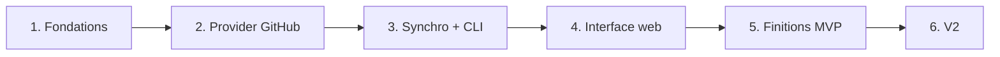

# 7. Roadmap

[← Sommaire](README.md)

Six phases courtes, chacune livrant quelque chose d'utilisable. **On ne passe à la suivante que lorsque
la précédente marche de bout en bout.**

**État** : phases 1 à 5 réalisées, MVP publié en **v0.1.0** (voir [CHANGELOG.md](../../CHANGELOG.md)) ;
critère de fin du MVP validé le 27 octobre 2026 ; phase 6 (V2) réalisée et publiée en **v0.4.0** ;
page par contributeur publiée en **v0.5.0** ; mise à jour de Watchoo (`watchoo update`) publiée en
**v0.6.0** ; ajout d'un dépôt depuis le TUI et lien de profil corrigé en **v0.6.1** ; avis de nouvelle version
corrigé (`watchoo` seul, TUI) en **v0.6.2** ; l'interface bilingue est publiée en **v0.7.0** ([0.7.0](#070--interface-bilingue)) ; après une
semaine de plus d'usage réel, la surface publique est stabilisée et publiée en **v1.0.0**
([1.0.0](#100--stabilisation)) ; les langages et la part des contributeurs sont publiés en **v1.1.0**
([1.1.0](#110--langages-et-part-des-contributeurs)) ; les signatures d'IA et les langages des contributeurs
sont publiés en **v1.2.0** ([1.2.0](#120--signatures-dia-et-langages-des-contributeurs)) ; les avertissements de
synchro par dépôt sont publiés en **v1.3.0** ([1.3.0](#130--avertissements-de-synchro-par-dépôt)) ; un message
dédié pour une empreinte de serveur SSH inconnue (clones Git locaux) en **v1.3.1** ; la supervision et le
diagnostic (phases 7.1 à 7.5) sont publiés en **v1.4.0** ([7](#après-100--7--supervision-et-diagnostic)) ; les signaux
absolus et les contre-indicateurs du diagnostic (phase 7.7) en **v1.5.0** ; le sélecteur de langue EN / FR de
l'interface web et les lignes en cause sur la fiche de revue du diagnostic (phase 7.8) et le score du diagnostic par dépôt et
par contributeur en **v1.6.0** ; le lien vers la documentation dans la langue de l'interface web, les icônes du score IA et le score IA et les
pistes des commits sur la page d'un contributeur en **v1.6.1**.

## Phases

### Phase 1 — Fondations
- Squelette du projet, `cobra`, configuration (viper).
- SQLite + migrations (`goose`), configuration `sqlc` et premières requêtes générées.
- Espaces de supervision : `watchoo init` crée `.watchoo/` (config, base, `.gitignore`, droits `0700`/`0600`)
  après avoir vérifié `gh` ; recherche de l'espace dans le répertoire courant puis les parents ; `-C` et
  `WATCHOO_DIR` (voir [Espaces de supervision](10-espaces-de-supervision.md)).
- Token obtenu uniquement avec `gh auth token`, jamais stocké ; vérifier le cas `GH_TOKEN` (Docker, CI).
- Mock de `gh` (interface + faux binaire) et CI sans service extérieur (voir [Tests](09-tests.md)).

**Livrable** : `watchoo init` transforme un répertoire en espace de supervision, avec sa config et une base au
bon schéma ; les autres commandes retrouvent l'espace.

### Phase 2 — Provider GitHub
- Interface `Provider`.
- Client `go-github`.
- Récupération des commits avec pagination, ETag et gestion du rate limit.
- Tests avec un serveur HTTP simulé (`httptest`).

**Livrable** : provider testé, sans appel réseau réel dans les tests.

### Phase 3 — Moteur de synchro + CLI
- `repo add / list / remove`, `sync`, `log`, `contributors`, `status`.
- Import groupé `repo import` (CSV ou liste), vérification d'accès et bilan.
- Mode interactif `watchoo tui` (Bubble Tea) : dépôts, commits, contributeurs, filtre, synchro.

**Livrable** : l'outil est déjà utile en terminal, en mode commande comme en mode interactif.

### Phase 4 — Interface web
- `serve`, templates embarqués, CSS DaisyUI généré par la CLI autonome Tailwind (`make css`).
- Tableau de bord, détail dépôt (avec le graphique d'activité sur 90 jours), contributeurs, réglages.
- Synchro périodique en arrière-plan.

**Livrable** : interface web locale fonctionnelle.

### Phase 5 — Finitions MVP
- Graphiques d'activité (au-delà de celui du détail d'un dépôt, livré en phase 4).
- Sortie `--json`.
- Makefile, binaires multi-plateformes via GoReleaser, image Docker, README.
- Versions SemVer et `CHANGELOG.md` tenus avec les skills `semver` et `semver-changelog` (voir [Skills](11-skills.md)).

**Livrable** : MVP distribuable.

**Réalisé (v0.1.0)** :
- Graphiques : activité de l'espace sur 90 jours (tableau de bord) et commits par semaine sur 12
  semaines des 8 contributeurs les plus actifs (page contributeurs), calculés en Go dans le fuseau
  d'affichage ([Graphiques d'activité](06-interface-web.md#graphiques-dactivité)).
- `--json` sur toutes les commandes qui produisent des données, schéma documenté et vérifié par un test
  ([Sortie JSON](05-cli.md#sortie-json)) ; `watchoo version` donne aussi le commit et sa date.
- `make release-check`, `make release-snapshot`, `make docker` ; GoReleaser (linux, darwin, windows en
  amd64 et arm64, archives et sommes SHA-256, release en brouillon) ; image Docker distroless non root
  avec `gh` vérifié par SHA-256, publiée sur `ghcr.io/studoo-app/watchoo` ; workflow de release sur tag
  ([Distribution](03-architecture.md#distribution)).
- README complet, `CHANGELOG.md`, règles de version ([Skills](11-skills.md#versions-et-changelogmd)).
- Retouches web : `HEAD` accepté partout où `GET` l'est, cookie CSRF limité aux pages HTML, lecture du
  quota interrompue journalisée en debug.

### Phase 6 — V2
- Pull requests et releases : **en place** (pull requests lues de façon incrémentale, releases et tags,
  `watchoo prs` et `watchoo releases`, cartes de la page d'un dépôt, PR ouvertes sur le tableau de bord
  et dans le TUI ; échec isolé en avertissement, `ErrUnsupported` pour le provider Git local).
- **Dépôts Git locaux** : **en place** (provider `internal/provider/git` sur le binaire `git`, clones
  avec copie de travail dans `repos/` à la racine de l'espace, mis à jour par `git fetch` puis remis sur
  la branche par défaut, choix de la source à chaque synchro selon `gh`,
  `provider_id` facultatif (migration `00004`), `watchoo init` sans `gh`, source dans `status`, `sync`,
  la page Réglages, écrans qui masquent ce que le clone ne fournit pas, image Docker avec `git`). Un
  dépôt peut être suivi depuis un clone local qui fournit commits, branches et tags sans appel à l'API
  GitHub, donc sans consommer de quota. Alternative à l'API GitHub et à `gh` : si `gh` est installé et
  connecté, Watchoo l'utilise ; sinon il passe par le clone local (voir
  [Dépôts Git locaux](03-architecture.md#dépôts-git-locaux-v2)).
- Seuils d'activité par dépôt (option de `repo add`, colonne de l'import, réglage web) : **en place**
  (`--flemme` / `--dead`, colonnes `flemme` / `dead`, partage de la configuration, formulaire de la page
  d'un dépôt).
- Activité par contributeur à l'intérieur d'un dépôt : **en place** (graphique des commits par semaine
  des contributeurs sur la page d'un dépôt, total et courbe par semaine dans le détail du TUI,
  `watchoo contributors --weeks N`).

L'import d'une organisation entière et les alertes passent en V3 (voir
[Fonctionnalités](02-fonctionnalites.md#v3)).

### Après la phase 6 — 0.5.0 : page par contributeur
- Page par contributeur (web `/contributors/{id}` et détail du TUI) : ses dépôts, ses commits (lignes
  `+/-` comprises) et son activité dans le temps : **en place** (requêtes `store.ContributorProfile`,
  `store.ContributorRepos`, `store.ContributorCommitTimes`, filtres `AuthorID` des commits et des pull
  requests ; graphiques réutilisés ; liens depuis les listes de contributeurs et de commits).
- Lien vers le profil de forge de chaque contributeur dont le compte est connu : **en place** (adresse
  donnée par le provider, colonne `contributors.profile_url`, migration `00005`).

### 0.6.0 : mise à jour de Watchoo
- Avis de nouvelle version à chaque commande (sur la sortie d'erreur, sans retarder la commande de plus
  de 1,5 s), au démarrage et toutes les 30 min dans `watchoo serve` (bandeau dans l'interface web) :
  **en place** (package `internal/selfupdate`, voir
  [Architecture](03-architecture.md#mise-à-jour-de-watchoo-060)).
- Commande `watchoo update` (`--check`, `--yes`) : **en place** (archive de la release vérifiée par
  SHA-256, remplacement atomique du binaire ; refus expliqué dans Docker, pour une version de
  développement ou un répertoire non accessible en écriture).

### 0.7.0 : interface bilingue
- Interface (CLI, TUI, web, script d'installation) en **anglais par défaut**, disponible aussi en **français** : **en place**, paquet
  `internal/i18n` (catalogue de clés, sans dépendance), langue de la CLI et du TUI par `WATCHOO_LANG`
  ou la locale du système, langue du web par le réglage `lang` de l'espace (partagé), textes
  affichés et erreurs traduits, `config.yaml` écrit dans la langue choisie. Voir
  [Langues et traductions](03-architecture.md#langues-et-traductions).

### 1.0.0 : stabilisation
- Critère : Watchoo utilisé **une semaine** sur des dépôts réels (API GitHub et clones Git locaux)
  sans problème bloquant.
- Relecture de la surface publique (commandes, options, codes de sortie, clés `--json`, réglages de
  `config.yaml` et variables `WATCHOO_*`, schéma de la base, routes web) et de sa documentation :
  **faite**.
- Désormais, SemVer s'applique pleinement : un changement incompatible fait monter MAJOR (voir
  [Skills](11-skills.md#versions-et-changelogmd)). La V3 ([Fonctionnalités](02-fonctionnalites.md#v3))
  arrive en versions MINOR.

### 1.1.0 : langages et part des contributeurs
- Langages de chaque dépôt avec leur pourcentage (table `repository_languages`, migration `00007`,
  `git ls-tree` dans le clone local, `watchoo languages`, carte de la page d'un dépôt, détail du TUI) :
  **en place**.
- Part des commits de chaque contributeur dans `watchoo contributors`, sur la page d'un dépôt et dans le
  détail du TUI : **en place**.

### 1.2.0 : signatures d'IA et langages des contributeurs
- Signatures d'outils d'IA déclarées dans les commits, par commit et par contributeur (CLI, TUI, web,
  `--json`), analysées sans aucune requête à la forge : **publié en v1.2.0**. Voir
  [Signatures d'IA](02-fonctionnalites.md#signatures-dia). Les indices de style ou de rythme sont
  volontairement écartés de cette fonction ; ils relèvent du diagnostic (phase 7, désactivé par défaut).
- Langages d'un contributeur : lignes ajoutées par langage dans ses commits, lues dans le clone (page d'un
  contributeur, `watchoo contributors`, TUI, migration `00009`) : **publié en v1.2.0**. Voir
  [Langages d'un contributeur](03-architecture.md#langages-dun-contributeur-120).

### 1.3.0 : avertissements de synchro par dépôt
- Avertissements de la dernière synchro enregistrés par dépôt (`sync_runs.warnings`, migration `00010`) :
  pastille sur la carte du tableau de bord, alerte avec le message complet sur la page du dépôt, menu des
  dépôts concernés dans l'indicateur de synchro : **publié en v1.3.0**. Voir
  [Interface web](06-interface-web.md#1-tableau-de-bord).
### Après 1.0.0 — 7 : supervision et diagnostic
- Watchoo devient un outil de **supervision et de diagnostic** (décision du mainteneur). Première brique : la
  détection de signaux suggérant une production assistée par IA, avec ses garde-fous (flag jamais verdict,
  explicabilité, revue humaine, transparence, minimisation des données).
- Sous-phases 7.1 à 7.6 (fondations, déclaratif, rythme, revue, forme, calibration) : voir
  [Supervision et diagnostic](12-supervision-diagnostic.md#9-plan-par-phases-proposition).
- **Statut** : **7.1 réalisée** (fondations : table `commit_signals`, réglages `diagnostic.*`, désactivé par
  défaut) et **7.2 réalisée** (signaux déclaratifs D1, D2, D3, D5, contexte D4, commande
  `watchoo diagnostic` réservée au formateur) et **7.3 réalisée** (signaux de rythme R1 à R6, niveau
  « à regarder », `watchoo diagnostic backfill`) et **7.4 réalisée** (revue humaine sur le web : page
  « Diagnostic », fiche de revue, décisions enregistrées, bouton de reprise de l'historique) et **7.5
  réalisée** (signaux de forme F1 à F5 mesurés en mémoire, seuls des nombres gardés, niveau « probable ») ;
  **publiées en v1.4.0**. La phase 7.6 (calibration) viendra dans une
  **version ultérieure** (décision du mainteneur, 4 novembre 2026), quand des revues réelles existeront,
  puis F6 (classifieur de contenu, reporté), chacune après validation de son plan. La phase
  **7.7** (signaux absolus, marqueurs de travail, contre-indicateurs) est **publiée en v1.5.0** ; la phase **7.8** (lignes en cause
  sur la fiche de revue, extraites à l'affichage) est **publiée en v1.6.0** (voir
  [Supervision et diagnostic](12-supervision-diagnostic.md#96-phase-77--signaux-absolus-marqueurs-de-travail-et-contre-indicateurs-réalisée)). Contexte pédagogique tranché (apprenants, résultats réservés au formateur) ;
  l'information des apprenants (existence du diagnostic, finalité, critères) se fait avant de l'activer.

## Définition de « terminé » pour chaque phase

- Code écrit et relu.
- Tests passants, sans service extérieur (`gh` mocké, API GitHub simulée avec `httptest`).
- `go vet` sans avertissement.
- Résumé de ce qui marche.

## Critère de fin du MVP

> Suivre **10 dépôts réels pendant une semaine** sans erreur de synchro ni dépassement de quota.

**Validé** le 27 octobre 2026 : le MVP est terminé.
